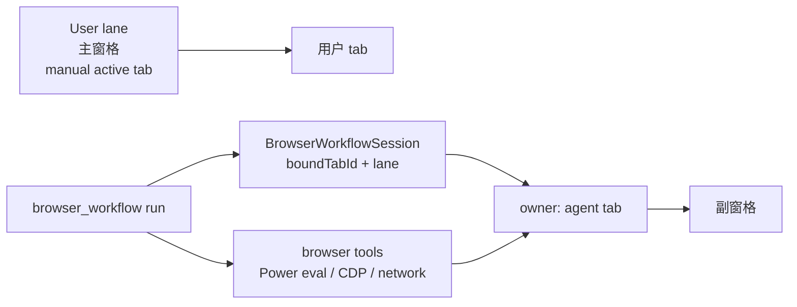

# Browser Agent Lane Decoupling Plan

## 目标

让长时间、可视化、需要点击输入的浏览器 agent 任务不再占住用户当前正在看的网页。用户应当能一边让 agent 在自己的浏览器窗格里发帖、填表、调试页面，一边继续在另一个浏览器窗格里正常工作。

完成后的体验应当是：

1. 发帖、表单、上传、登录态网页操作等前台交互任务，会自动打开或复用 agent 专属浏览器窗格。
2. `browser_click`、`browser_type`、页面地图、截图、Power eval、CDP、network trace 都默认作用在 agent 专属 tab 上。
3. 用户主浏览器 tab 保持用户所有；用户在主窗格切网页、滚动、输入，不应暂停 agent。
4. 只有用户直接操作 agent 窗格，或点击明确的停止/接管按钮，才进入 agent 暂停或接管流程。
5. 纯后台采集、下载、资源嗅探默认继续隐藏运行，不强行打开分屏；用户可以手动查看 agent 浏览器。

## 完成标准

本计划完成时必须同时满足：

1. `browser_workflow` / `browser_upload_workflow` 前台任务会创建或复用 `owner:'agent'` 的专属 tab。
2. 主进程把这个 agent tab 作为本次 run 的 `boundTabId` 持久记录。
3. renderer 能拿到这个 agent tab，并用现有副窗格显示它。
4. 用户当前 active tab 不会被标记为 `owner:'agent'`。
5. agent run 内所有浏览器工具都默认继承 `boundTabId`，包括 Power eval、CDP、network trace、页面地图、截图、点击、输入和导航。
6. 绑定了 agent tab 的前台 workflow 不允许静默回落到 `controller.getActiveTab()`。
7. 用户在主窗格正常操作不会触发 agent 暂停。
8. 用户在 agent 窗格操作会冻结 agent，并走二次确认。
9. agent 触发的新 tab / popup 仍归属 agent lane；用户触发的新 tab / popup 仍归属 user lane。
10. 运行中的 agent tab 不会因为折叠、离屏或后台隐藏变成被节流/冻结的页面。
11. 前台 workflow 和后台采集不会共用同一个 agent tab；并发冲突必须排队、拒绝或显式暂停其中一个任务。
12. 任务结束、接管、取消仍走既有 run-finalizer / TaskEventBridge / no-progress 守卫，不新增旁路终态。
13. 任务结束后释放 agent 写入锁，用户当前 tab 不变，agent 窗格自动收起或回到空闲状态。
14. 有机器测试或 gate 防止新的前台 workflow 写操作重新使用未绑定 active tab。

## 前因后果

这轮问题的起点不是“Ready 没有浏览器能力”，而是“agent 的浏览器工作和用户自己的浏览器工作没有真正解耦”。

之前小红书发布、表单、长时间页面操作类任务中，用户看到的现象是：

- agent 经常直接驱动用户当前可见 tab。
- 用户想继续用浏览器时，会和 agent 抢同一个页面。
- Power eval 这类工具如果没有显式 `tab_id`，可能读到或改到用户 active tab。
- 用户切 tab 或输入可能被系统理解成“用户接管了 agent 正在操作的页面”。
- 后台采集任务已经有 agent tab，但前台交互任务并没有稳定使用这条 lane。

最初直觉上像是要“实现浏览器分屏”。但只读核查后发现：Ready 不是缺分屏 surface，而是前台 workflow 的控制面还绑在用户 active tab 上。

## 关键现状

### 已经有的地基

Ready 已经有原生双 surface 能力，不需要用 CSS 假分屏，也不需要外接浏览器：

- `src/main/modules/browser-engine/host-layout-service.ts`：每个 tab 都有独立 `BrowserView` / `WebContentsView`，不是所有 tab 共享一块网页画面。
- `src/main/modules/browser-engine/tab-shell-service.ts`：`applyIntent()` 已经能处理主窗格 `set-bounds` 和副窗格 `secondary-set-bounds`。
- `src/renderer/modules/browser/useBrowserViewBounds.ts`：split 存在时一次同步主副两个原生 bounds。
- `src/renderer/pages/modes/BrowserMode.tsx`：已有 split layout，并且优先把 `agentSupervision.agentTabId` 渲染为副窗格。

Ready 也已经有 agent tab 原语：

- `src/main/modules/browser-engine/ipc-handler.ts` 的 `ensureAgentTab()` 会创建后台 tab，标记 `owner:'agent'`，并恢复用户原 active tab。
- `src/main/modules/browser-engine/tab-lifecycle-service.ts` 创建 tab 时使用 `persist:browser`，所以从代码看用户 tab 和 agent tab 应共享登录态。
- `src/main/modules/browser-engine/scoped-browser-facade.ts` 已经证明后台采集可以做到“所有工具都强制带固定 `tab_id`，绝不落到 active tab”。

Ready 也已经有 lane 级写入锁：

- `src/main/modules/browser-engine/browser-write-lease.ts` 同时支持 `user-view` 和 `agent-view` 两个 surface。
- `src/main/modules/browser-engine/agent-tab-control-gate.ts` 已经有 agent tab 的冻结、确认、接管状态机。

### 还没有接上的地方

真正缺的是“前台浏览器 workflow 的 agent lane 绑定”。

当前 `src/main/modules/tools/browser-agent-runner.ts` 的前台 deterministic workflow 仍然是：

1. 读取 `controller.getActiveTab()?.id`。
2. 把这个用户当前 tab 标记为 `owner:'agent'`。
3. 用 `runUnderUserViewLease()` 持有 user-view 写入锁。
4. 任务结束后再把同一个 tab 改回 `owner:'manual'`。

这套逻辑的语义是“agent 协助操作用户当前页”，不是“agent 在自己的浏览器窗格里工作”。

监督面板也只接了后台采集任务：

- `src/main/modules/browser-engine/ipc-supervision.ts` 只从 `listAgentCollectionTasks()` 找 active task。
- `agentTabId` 只有在 `visible_collect` / `note_collect` / `card_loop` 这类采集任务 active 时才返回。
- 前台 `browser_workflow` 即使将来创建了 agent tab，如果没有把 workflow session 纳入 supervision，renderer 仍然不会自动打开 agent 副窗格。

工具派发还有 active-tab 兜底：

- `src/main/modules/browser-engine/ipc-handler.ts` 的 `resolveTabView(tabId)` 是 `tabId || activeTabId`。
- `browser_power_eval`、`browser_power_cdp`、`browser_power_network_trace`、`browser_power_resource_forensics`、`browser_power_script_run` 都先读 `args.tab_id || null`。
- 没有 `tab_id` 时，这些工具最终会走到 active tab。
- `resolveHighControlAgentTab()` 只对高风控目标 URL 强制 agent tab，普通前台 workflow 仍可能使用用户 tab。

popup / 新 tab 归属也还没建模：

- `BrowserWindowOpenService.openInTab()` 只打开普通 tab，没有传 source tab / source owner / source lane。
- agent 点击后弹出的页面可能变成普通用户 tab，导致 agent 后续又丢目标。

运行态隐藏和节流也还没建模：

- `src/main/modules/browser-engine/host-layout-service.ts` 的 `hideHost()` 当前是把 view 移到 1x1 离屏 bounds，而不是 detach。
- `createHost()` 的 webPreferences 当前没有显式 `backgroundThrottling: false`。
- 这意味着隐藏或折叠的 agent 页面可能进入 `document.hidden=true` / `visibilityState='hidden'`，定时器、rAF、IntersectionObserver、懒加载、视频播放和编辑器渲染都可能变慢或停止。
- 对小红书这类依赖可见态、滚动加载和富编辑器的页面，这可能直接导致“页面地图读不到”“采集懒加载不触发”“发布编辑器状态不稳”。

agent tab 和控制 gate 也仍是单例：

- `ipc-handler.ts` 只有一个 `agentTabId` 字段。
- `ensureAgentTab()` 命中时会复用同一个物理 tab。
- `AgentTabControlGate` 当前也是 controller 级单例。
- `BrowserWriteLeaseService` 的 `agent-view` 也是 surface 级单写入锁。
- 因此前台发帖 workflow 和后台采集如果同时使用 agent lane，不能让它们抢同一个 tab、同一个 gate、同一个 lease。

## 第一性原理定位

一个浏览器任务至少有五个身份，不能混在一起：

1. **用户当前 tab**：用户正在浏览和控制的页面。
2. **agent 目标 tab**：agent 被允许读写的页面。
3. **可见 surface**：这个 tab 显示在主窗格还是副窗格。
4. **写入 lease surface**：写操作由 user-view 规则还是 agent-view 规则约束。
5. **任务身份**：哪个 run / task 应该出现在监督 UI 和任务卡里。

当前前台 workflow 把这些身份压成了一个：

- 用户当前 tab = agent 目标 tab。
- user-view surface = 写入 lease surface。
- 采集 task = agent pane 可见性的唯一来源。

所以用户感觉浏览器被 agent 占用，本质上不是 UI 问题，而是身份模型没有闭合。

正确修法是：把 agent 目标 tab 变成 run 级结构化事实，然后所有工具、截图、页面地图、Power eval、popup 跟随都读这个事实，而不是读 active tab。

## 架构决策

采用“双 lane 原生 BrowserView”方案，但不重造浏览器。

### User Lane

- 对应用户主浏览器窗格。
- 维护用户 `activeTabId`。
- 用户可以正常浏览、输入、切 tab。
- 只有明确声明为 user-view 协作模式的任务，才允许 agent 在这里写入。

### Agent Lane

- 对应 `owner:'agent'` 的专属 tab。
- 前台发帖、表单、上传、登录态操作默认使用它。
- renderer 用现有副窗格显示它。
- 纯后台采集/下载/嗅探可以保持隐藏。
- 所有 agent 工具默认使用 run 绑定的 `boundTabId`。



## 解决方法

### 1. 新增前台 BrowserWorkflowSession

新增一个主进程内的 run 级 session，不做复杂抽象，只记录前台浏览器 workflow 的目标身份。

字段：

- `runId`
- `taskId`
- `lane: 'agent-view' | 'user-view'`
- `boundTabId`
- `sourceUserTabId`
- `targetFrameId`
- `frameUrl`
- `startedAt`
- `status: running | completed | failed | interrupted`
- `reason`

默认规则：

- `browser_workflow`：默认 `agent-view`。
- `browser_upload_workflow`：默认 `agent-view`。
- 明确用户协作/调试模式：才用 `user-view`。
- 后台采集、下载、资源嗅探：继续走现有隐藏 agent-view 路径。

这里复用已经存在的 `BrowserWorkflowIntent` / `browser_transaction` 信号，不新增第四套分类器。

### 2. 前台 workflow 绑定 agent tab

替换当前“把用户 active tab 临时改成 agent”的流程。

新流程：

1. 记录用户当前 tab 为 `sourceUserTabId`。
2. 调用 `ensureAgentTab()`。
3. 根据任务目标决定是否把 agent tab 导航到用户当前 URL 或用户指定 URL。
4. 写入 `boundTabId = agentTabId`。
5. 用 `agent-view` lease 运行 workflow。
6. 不切走用户 active tab。
7. 不把用户 tab 标成 `owner:'agent'`。

导航规则：

- 用户说“当前页面/这个页面”时，把 agent tab 导航到当前用户 tab 的 URL。
- 用户给了明确 URL 时，把 agent tab 导航到这个 URL。
- agent tab 已经在正确目标时复用。
- 如果用户的真实意图是操作“当前可见页面状态”，例如已滚到某处、展开了某个弹层、选中了内容、编辑器里已有草稿、页面里有临时未保存状态，则不能假装 URL 克隆等于状态克隆。这类任务应明确走 `user-view` 协作，或先询问用户是否允许 agent 接管当前页面。
- 无法确定目标时，不静默使用用户 tab，应进入澄清或可恢复状态。

### 3. agent tab 分配与并发策略

不能继续把 `ensureAgentTab()` 当成唯一 agent tab 单例来扩展前台 workflow。最小正确决策是：agent lane 需要明确 slot 分配，且同一物理 tab 不得被两个 run 共用。

V1 建议采用保守策略：

- 同时只允许一个可见前台 workflow 占用 foreground agent slot。
- 后台采集使用独立 background slot，或者在无法独立分配时排队/暂停，不得复用 foreground tab。
- 如果 `agent-view` 写入锁已被后台任务持有，新的前台 workflow 必须排队、提示用户暂停后台任务，或返回可恢复 busy 状态。
- 如果产品要支持前台 workflow 与后台采集真正并行，则必须把 `BrowserWriteLeaseService` 从 surface 级单锁升级为 slot/run 级锁，并给每个 slot 独立 `AgentTabControlGate`。

这一步的关键不是马上做无限 tab 池，而是消除“所有 agent 任务抢一个 `agentTabId`”这个隐患。

监督优先级：

- 前台交互 workflow 优先占用可见副窗格。
- 后台采集默认保持隐藏或小状态条。
- 如果用户手动查看后台采集，再临时切换可见 agent slot，但不改变各自的 `boundTabId`。

### 4. 把前台 workflow 接入 supervision

renderer 已经会根据 `agentSupervision.agentTabId` 打开 agent 副窗格。主进程需要把前台 workflow session 也纳入 supervision。

改动方向：

- `browser:getAgentSupervisionState` 同时读取 active agent-view collection task 和 active foreground workflow session。
- 只要存在 active agent-view workflow，就返回 `agentTabId`。
- tasks 列表里给前台 workflow 一个轻量监督项，供 `AgentBrowserSupervisionPanel` 展示。
- completed / failed / cancelled 的历史 session 不打开 agent pane。

这样可以复用现有 UI，而不是重做分屏。

### 5. 运行态 agent tab 的 live-host policy

运行中的 agent 页面不能因为“用户收起副窗格”就变成浏览器意义上的 hidden frozen 页面。

策略：

- `agent tab 折叠` 只代表 UI 变窄或收起状态面板，不代表暂停页面执行。
- 对正在执行的可见交互 workflow，优先保持 agent host 有真实可见 bounds；不能把它移到 1x1 离屏 bounds。
- 对必须隐藏但仍需继续加载/滚动/播放/执行脚本的 agent tab，host 创建层需要关闭后台节流，并验证 `document.visibilityState`、timer、rAF、IntersectionObserver、懒加载行为是否满足任务需要。
- 如果站点依赖真实可见态，隐藏运行必须降级为“保持可见小窗格”或明确暂停，而不是静默 hidden。
- 纯资源下载、已冻结 URL 队列下载等不依赖页面可见态的任务，才可以使用真正隐藏的后台 tab。

验收时必须把“折叠不等于暂停”作为合同来测。

### 6. 所有 workflow 工具继承 `boundTabId`

`BrowserAgentRunner.invokeTool()` 应在派发工具前补齐 tab：

```text
如果 args.tab_id 明确存在，使用 args.tab_id
否则如果当前 run 有 boundTabId，使用 boundTabId
否则如果当前 run 是显式 user-view，允许使用 user-view active tab
否则返回结构化错误
```

必须覆盖：

- `browser_navigate`
- `browser_read_page_map`
- `browser_capture_viewport`
- `browser_click` / `browser_click_at` / `browser_click_text`
- `browser_type` / `browser_type_at` / `browser_send_keys`
- `browser_power_eval`
- `browser_power_cdp`
- `browser_power_network_trace`
- `browser_power_resource_forensics`
- `browser_power_script_run`
- resource / media 下载链路
- workflow step 内部执行

重点是 Power 工具不能例外。小红书这类动态页面正是大量依赖 Power eval / CDP，一旦 Power 工具仍然落到 active tab，整个解耦就是假的。

### 7. 禁止 bound workflow 静默回落 active tab

新增一个统一 target resolver，把 tab 解析规则收口：

```text
explicit tab_id
  -> bound workflow tab
  -> explicit user-view mode
  -> error
```

对 agent-view bound workflow 来说，`tab_id = null` 不是“使用当前 tab”，而是“调用方忘了传目标”。这必须是 loud failure，不能自动纠错到 active tab。

### 8. surface binding 从固定 user-view 改为显式 lane

当前 `resolveBrowserToolSurfaceBinding()` 对 `dispatch:'browser-agent-runner'` 的写操作默认返回 `user-view-assisted`。这正是前台 workflow 被绑定在用户页面上的合同根源。

目标合同：

- runner 派发时必须传 `boundSurface`。
- `boundSurface === 'agent-view'` 时，写操作要求 agent tab 和 agent-view lease。
- `boundSurface === 'user-view'` 时，保留现有 user-view 协作行为。
- 现有“runner writes always user-view”的测试要改成 lane-aware 测试。

### 9. 用户操作与 agent 操作解耦

user-view takeover 逻辑只适用于 agent 真正在用户主窗格协作的场景。

目标行为：

- 用户在主窗格输入、点击、切 tab，不影响 agent-view workflow。
- 用户在 agent 副窗格输入、点击、导航、关闭，触发 `AgentTabControlGate.requestInterruption()`。
- agent 写入被冻结，等待用户确认继续、取消或接管。
- 用户确认接管后，agent tab 改为 `owner:'manual'`，并清掉当前 workflow 绑定。

### 10. popup / 新 tab 跟随 lane

把 source tab 和 source owner 传进 window-open 处理。

规则：

- agent tab 触发的新 tab，默认 `owner:'agent'`。
- user tab 触发的新 tab，默认 `owner:'manual'`。
- OAuth 等必须开独立 popup 的情况保留现有策略，但 fallback 到 tab 时要继承来源 lane。
- 如果 agent 新 tab 成为下一步目标，更新 `BrowserWorkflowSession.boundTabId`。

### 11. 结束收口与终态通道

lane 切换、用户接管、取消和结束都不能新增旁路终态。

agent-lane workflow 结束时：

- session 标记 terminal。
- 释放 agent-view lease。
- agent tab `activity` 改成 idle。
- 用户 active tab 不变。
- agent pane 按 UI 策略自动折叠或隐藏。
- agent tab 保留给下次复用，除非用户确认接管或关闭。
- 前台 run 的终态仍经 `finalizeRunOutcome()`。
- 后台 browser task 终态仍经 `TaskEventBridge` 回灌。
- main 侧 no-progress 守卫仍然有效，并且要能区分“agent lane 暂停/用户确认中”和真正无进展。

## 实施顺序

### Phase 0：验证前提

先只验证，不改行为：

1. agent tab 和 user tab 是否真的共享 `persist:browser` 登录态。
2. 非 active agent tab 上能否稳定执行 `executeJS`、CDP、截图、点击、输入。
3. 主副两个原生 pane 的 bounds 是否能同时稳定同步。
4. `AgentTabControlGate` 是否足够复用到前台 workflow。
5. agent tab 在可见、副窗格折叠、离屏隐藏三种状态下的 `document.hidden`、`visibilityState`、timer、rAF、IntersectionObserver、懒加载行为。
6. 用户在主窗格同时输入时，agent 对自己 tab 的 `sendInputEvent` / `executeJS` 是否会被 OS 焦点或 active tab 抢走。
7. 前台 workflow 与后台采集并发时，当前单例 `agentTabId` / 单例 `AgentTabControlGate` / surface 级 `agent-view` lease 会怎样冲突。

验收：

- 实施 PR 里记录验证结论。
- 如果任一项失败，先修底层，不进入 Phase 1。

### Phase 1：建立前台 workflow session 与 agent tab 绑定

交付：

1. 新增轻量 `BrowserWorkflowSession` store。
2. 新增 agent lane slot 分配层；不要直接把所有前台 workflow 指向单例 `agentTabId`。
3. `browser_workflow` / `browser_upload_workflow` 启动时分配 foreground agent slot。
4. 如果后台采集正在占用唯一可用 agent-view 写入资源，前台 workflow 排队、提示暂停后台任务，或返回可恢复 busy 状态。
5. 写入 `boundTabId` / `sourceUserTabId`。
6. 不再把用户 active tab 标为 `owner:'agent'`。
7. 用 agent-view lease 或 slot 级 agent-view lease 运行 workflow。
8. 对“当前可见页面状态”类任务保留 user-view 协作路径，不做 URL 克隆。

验收：

- 发帖任务启动后，用户 active tab 不变。
- agent tab 是 `owner:'agent'` 且 `activity:'running'`。
- session 可读到 `boundTabId`。
- 后台采集和前台 workflow 不会共享同一个 physical tab。
- 第二个前台 workflow 不会抢第一个 workflow 的 agent tab。

### Phase 2：接入 supervision 和现有副窗格

交付：

1. supervision 返回 active foreground workflow。
2. active agent-view workflow 存在时返回 `agentTabId`。
3. 复用现有 `AgentBrowserSupervisionPanel` 和副窗格 UI。
4. 保留折叠/展开/关闭行为。
5. 明确可见优先级：前台 workflow 优先显示，后台采集保持隐藏或状态条。
6. 折叠 agent pane 不得让运行态页面进入会破坏任务的 hidden/throttled 状态。

验收：

- 前台发帖/表单任务自动打开 agent 副窗格。
- 用户主窗格仍可用。
- 后台采集默认不强行打开副窗格。
- 折叠 agent pane 后，运行态页面仍能继续加载、滚动和执行必要脚本，或明确显示“已暂停”等待用户。

### Phase 3：工具目标绑定

交付：

1. 新增统一 target resolver。
2. `BrowserAgentRunner.invokeTool()` 给工具补 `boundTabId`。
3. Power eval、CDP、network trace、页面地图、截图、点击、输入、导航全部使用 resolver。
4. bound workflow 无目标时返回结构化错误。

验收：

- 模型不传 `tab_id` 时，`browser_power_eval` 仍执行在 agent tab。
- 页面地图和截图看到的是 agent 正在操作的页面。
- 前台 workflow 写操作不能隐式命中用户 active tab。

### Phase 4：lane-aware surface binding 与接管语义

交付：

1. `resolveBrowserToolSurfaceBinding()` 支持 `boundSurface`。
2. runner agent-lane 写操作映射为 `agent-view`。
3. 显式 user-view 协作保留旧逻辑。
4. agent pane 用户操作触发 agent interruption，主 pane 用户操作不触发。
5. 结束、接管、取消状态仍走既有 finalizer / event bridge 收口。

验收：

- 用户主窗格输入不暂停 agent。
- 用户 agent 窗格输入会冻结 agent 并请求确认。
- 原有 user-view 协作测试仍通过。
- lane 切换和接管不会绕过 run 终态收口。

### Phase 5：popup / 新 tab 归属

交付：

1. window-open 处理带上 source tab / source owner。
2. agent 来源的新 tab 继承 agent owner。
3. agent popup 成为目标时更新 `boundTabId`。
4. user 来源的新 tab 保持 user owner。

验收：

- agent 点击后打开的新页面仍在 agent lane。
- 用户点击后打开的新页面不进入 agent pane。

### Phase 6：测试、gate 与回归

交付：

1. 新增 focused 入口，例如 `npm run verify:browser-lane`。
2. 新增 gate：前台 bound workflow 不得新增无声明 active-tab fallback。
3. 更新现有“runner 写操作必然 user-view”的测试。
4. 加小红书发帖、通用表单、Power eval 绑定、popup 跟随、用户主窗格并行操作回归。
5. 加 visibility/throttling、agent slot 并发、finalizer funnel 回归。

验收：

- `npm run typecheck`
- focused browser lane tests
- `npm run verify:native`
- `npm run verify:stability`

## 测试计划

### 单元与合同测试

1. `browser-agent-runner` 启动前台 workflow 时创建 `boundTabId=agentTabId`。
2. runner 不再把用户 active tab 改成 `owner:'agent'`。
3. `resolveBrowserToolSurfaceBinding()` 能把 agent-lane runner 写操作映射到 `agent-view`。
4. runner 无 `boundTabId` 时拒绝写操作，除非显式 user-view。
5. Power eval / CDP / network trace 自动继承 `boundTabId`。
6. supervision 能为 active foreground workflow 返回 `agentTabId`。
7. 主窗格 tab switch 不触发 agent-lane takeover。
8. agent 窗格 input 触发 pending interruption。
9. agent 来源 popup 是 agent-owned 或更新 bound target。
10. 结束清理释放 agent-view lease，且不改变 `activeTabId`。
11. 折叠/隐藏运行态 agent pane 不会把任务页推进 hidden-throttled 失败态，或会明确暂停并给出原因。
12. 前台 workflow 和后台采集并发时不会复用同一 agent tab。
13. 第二个前台 workflow 会排队、拒绝或提示用户处理当前 foreground slot。
14. “当前可见页面状态”任务会路由到 user-view 协作或澄清，不做 URL 克隆。
15. 接管、取消、结束不绕过 `finalizeRunOutcome()` / `TaskEventBridge`。

### 集成回归

1. 从小红书创作平台发帖：agent 打开副窗格，用户主窗格保持可用。
2. 通用网页表单提交：点击和输入发生在 agent 窗格。
3. 前台 workflow 中调用 `browser_power_eval` 且模型不传 `tab_id`：仍命中 agent tab。
4. agent 页面触发新 tab：新 tab 归属 agent lane。
5. agent 工作时用户在主窗格切网页和输入：agent 继续运行。
6. 用户点击 agent 窗格：agent 冻结并等待确认。
7. 任务完成：agent 窗格收起，用户当前 tab 不变。
8. agent pane 折叠后，小红书编辑器或懒加载页面仍继续工作，或明确暂停而不是假装继续。
9. 后台采集运行时启动前台发布任务：不会串 tab，系统给出排队/暂停后台/忙碌可恢复状态。
10. 用户已在当前页展开弹层或输入草稿时要求“操作这个页面”：系统不新开 agent tab URL 克隆，而走 user-view 或澄清。
11. 运行过程中无进展时，main 侧守卫能把“等待用户确认/agent lane 暂停”和真正卡死分开。

## 非目标

1. 不外接 Chrome/Edge 或 web-access 黑盒兜底。
2. 不用 CSS 假分屏替代原生 BrowserView bounds。
3. 不重写 `BrowserMode` 分屏 UI。
4. 不新增浏览器意图分类器。
5. 不削弱 Power Browser 授权。
6. 不把所有后台采集任务默认改成可见分屏。

## 风险与缓解

### 风险 1：active-tab 兜底漏网

这是最大风险。当前很多代码把 `tab_id=null` 解释为 active tab。只要有一个前台 workflow 写操作漏掉 `boundTabId`，agent 就可能重新打到用户页面。

缓解：

- 新增统一 target resolver。
- Power 工具、页面地图、截图、点击输入都加 focused 测试。
- 加 source gate，禁止前台 bound workflow 重新出现未声明 active-tab fallback。

### 风险 2：agent tab 登录态不一致

代码显示同用 `persist:browser`，但仍需实测登录态、same-site cookie、OAuth popup、用户代理等细节。

缓解：

- Phase 0 先用小红书登录态验证 agent tab。
- 如果不共享，先修 session/partition，再做 lane。

### 风险 3：监督面板只认识采集任务

当前 renderer 要 `agentTabId` 才能打开 agent pane，而 main 只在采集任务 active 时返回它。

缓解：

- 把 foreground workflow session 纳入 supervision。
- 保持采集任务逻辑不变。

### 风险 4：popup 归属丢失

发帖、登录、创作后台经常开新页。若 popup 不继承 lane，agent 会跟丢目标。

缓解：

- window-open 传 source tab 和 source owner。
- agent popup 更新 `boundTabId`。

### 风险 5：隐藏/折叠导致页面被节流

离屏 1x1 隐藏会让页面进入 hidden 或被 Chromium 节流。对依赖可见态的站点，这会让 agent 看到的页面不是用户以为正在运行的页面。

缓解：

- Phase 0 先测 visibility 和节流行为。
- 运行态 agent tab 不走离屏 1x1。
- 必要时设置 `backgroundThrottling:false`，但仍要实测页面是否依赖真实 visible 状态。
- 对 visible-state 依赖站点，折叠改为小窗格或暂停，不做假后台。

### 风险 6：agent tab / gate / lease 单例导致串台

单例 `agentTabId`、单例 `AgentTabControlGate` 和 surface 级 `agent-view` lease 都不能支撑多个 agent 任务同时写页面。

缓解：

- 引入 slot 分配。
- V1 至少保证前台 workflow 和后台采集不共用 tab。
- 如果需要真正并行，升级到 slot/run 级 control gate 与 write lease。
- 如果暂不升级并行能力，明确排队或返回 busy，不共享页面。

### 风险 7：URL 克隆丢失当前页面状态

“当前页面”可能包含滚动位置、弹层、草稿、选区、未保存表单等 URL 无法表达的状态。把 agent tab 导航到相同 URL 并不能复制这些状态。

缓解：

- URL 可表达的任务走 agent-view。
- 页面临时状态任务走 user-view 协作或先澄清。
- 测试覆盖“已有草稿/弹层/滚动位置”的误路由。

### 风险 8：lane 收口绕过终态合同

如果 lane 切换、接管、取消或结束直接改 UI 状态，会绕过 Ready 现有 run 收口合同。

缓解：

- 前台 run 终态仍走 `finalizeRunOutcome()`。
- 后台任务仍走 `TaskEventBridge`。
- no-progress 守卫保持 main 侧可见。
- gate 覆盖新终态路径。

## 结论

Claude 的关键补充值得吸收：Ready 已经有双原生 surface、分屏 UI、专属 agent tab、agent-view lease 和后台采集固定 tab 的成功范例。因此这不是一次重造双浏览器架构的工程，而是把前台浏览器 workflow 接到已经存在的 agent lane 上。

下一轮最小正确修复是：

1. 前台浏览器 workflow 绑定 `ensureAgentTab()`。
2. 通过 supervision 让现有 agent 副窗格出现。
3. 所有工具继承 `boundTabId`。
4. runner 写操作从固定 user-view 改成 lane-aware。
5. 补 live-host policy、slot 并发、popup 跟随、agent 窗格接管、结束收口和 gate。

这样才能真正做到：agent 占用自己的浏览器，用户继续使用自己的浏览器。
