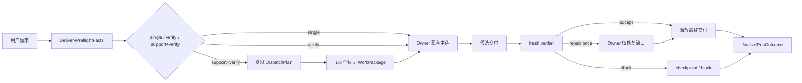

# Dynamic Delivery v3：Agent 原生的单轮协作交付

## 0. 结论

原方案的产品目标成立：复杂任务不应只让同一个模型在一个上下文里从头做到尾，而应允许独立视角、专项 Agent 和最终复核在同一用户轮次内协作。

但原落地形态被整体否决：

- 不让模型写 JavaScript；
- 不引入 QuickJS；
- 不新建匿名 Agent 注册表、workflow 状态机或独立计费台账；
- 不用四套 pattern 再叠一套全局 verifier；
- 不在首版给 worker 复制主回合工具面；
- 不在根基未修好前接 live 编排。

v3 只保留一条主链：

> **代码预判 → 必要时调用现有专项 Agent/独立视角 → Owner 统一综合或独占执行 → fresh verifier 复核 → Owner 最多修一次 → 唯一 finalizer 交付。**

“动态”的是本轮需要哪些工作包、哪个现有 Agent 最适合、是否需要独立复核；控制流、预算、权限、重试、证据和终态仍由代码掌握。

## 1. 为什么必须先修 Agent 根基

当前 Ready 已经有真实的主 Agent、文案、美术、智识和用户派生 Agent，也已经有人格、RULES、FOUNDATION、作用域知识、routing 卡和分阶段学习。这些就是 Dynamic Delivery 应该利用的真正资产。

但当前身份事实仍是分裂的：

- `scope.agent` 选人格；
- 最近 task owner 又被借来推测“当前会话转给了谁”；
- owner 选 RULES/knowledge；
- 大部分专项会话 task owner 仍为空；
- 学习只认 owner，不认本次真正执行的 Agent；
- 同一 run 多次模型调用的 usage 会被后一次覆盖。

因此 live 协作的硬前置是：

1. 会话的 `activeAgentId` 单独持久化，不再扫“最近 task owner”。
2. 每个 task 有 owner，每个 run 有冻结 `executionBinding`，每个子执行有 lifecycle id。
3. 人格、RULES、knowledge 和显示身份来自同一 `AgentExecutionProfile`。
4. same-session handoff 在新 run 接管，旧模型不在原 run 内“当场扮演”新 Agent。
5. active Agent 有可计算的 conversation/handoff/route/collaboration readiness。
6. usage 是加法累计，不是最后一次覆盖。

这些不在 Dynamic Delivery 里临时打补丁，必须由独立的 Agent Foundation 计划 AF-0..AF-7 先完成。

## 2. 当前底座的真实边界

| 能力 | 当前事实 | v3 处置 |
|---|---|---|
| Agent registry / 派生 | 真实 live | 直接绑定 collaborationReady 的现有 Agent，不建第二注册表 |
| task criteria/proof/check-in | 真实 live | 继续由 host/finalizer 判定，不让 planner/worker 写终值 |
| packet 字段/两层深度 | schema live | 复用 parent/child projection |
| packet compiler/dispatch/failure | 明确 dormant，gate 禁止 production import | 所有 dark 部件、安全和 verifier 齐备后才原子翻 live |
| `runSubAgent()` | 生命周期容器 live，不是长期 Agent 身份 | worker 复用它的 cancel/progress/close，profile 另由 Foundation 绑定 |
| `parallel-branch-orchestrator` | 并发硬顶 3，达上限会返回 null | scheduler 必须把 null 转成显式 capacity settlement |
| selected Skill floors | 可能包含状态变更 action | 首版 worker 不进工具循环；Skill 仍由 Owner 执行 |
| TaskEventBridge | 通用后台路由尚未证明 | 首版不暴露 background lane，不声称通用 detached 恢复 |

## 3. 唯一执行主链



代码只有三个决策结果：

- `single_path`：简单回答、status、continue、原子动作，零额外调用。
- `verify_only`：不分包，Owner 完成后只加一次 fresh 语义复核。
- `support_and_verify`：先让 1-3 个独立角色提供产出/证据/反方判断，Owner 再综合或执行，最后只经过一层 verifier。

不再定义 `parallel_synthesis / produce_review_revise / research_verify / plan_execute_verify` 四套重复状态机。内容创作、研究、文档修改和高风险动作都映射到同一主链，差别只是工作包内容和 Agent 绑定。

## 4. 代码预判，不让模型自由开启协作

`DeliveryPreflightFacts` 在 canonical task facts 和 live budget 已解析、Owner input assembly 之前由 host 生成。canonical task facts 结合 typed request envelope、intent classification、structured targets 和继续状态；不能只因暴露了 research/skill 工具就假定用户意图。

- typed `deliveryMode`；
- 代码推导的 task type / intent domains；
- 结构化目标、附件/文档/资源 ref id；
- selected Skill 身份（只作 Owner 能力事实）；
- 等待确认/独占动作/资源冲突；
- collaborationReady Agent roster；
- 剩余总预算和墙钟；
- 代码模板产生的 host criteria baseline。

任一关键事实为 unknown，就 fail closed 到 `single_path`。模型在这个边界前还没声明 criteria，所以计划编译器不得伪称“完整 criteria 已准备好”。

`DeliveryMode` 为：

- `standard`：完全不进入协作。
- `adaptive`：默认值，只在结构事实证明收益时进入 verify/support。
- `thorough`：本次发送的深度协作 override；仅放宽收益门槛，不越过安全、预算和原子任务禁分包规则。

## 5. 结构化计划和工作包

planner 只在 `support_and_verify` 调用，输出受限 JSON；不输出源码，不生成任意 DAG。

```ts
interface DispatchPlan {
  version: 1
  packages: WorkPackage[] // adaptive 1..2, thorough 1..3
}

interface WorkPackage {
  packageId: string
  title: string
  objective: string
  deliverable: string
  expectedOutputs: string[]
  proposedCriteria: string[]
  contextRefIds: string[]
  executorHint:
    | { kind: 'registered_agent'; agentId: string }
    | { kind: 'ephemeral'; role: 'researcher' | 'producer' | 'critic' }
  criticality: 'required' | 'optional'
}
```

硬限制：

- 工作包只能一层，每个只有一个可验收交付物；
- 持久化的 context ref 仍是 canonical string id，运行时再解析为结构资源；
- host 额外附加逐字 `userRequestVerbatim`，planner 不得伪造用户原话；
- `proposedCriteria` 只是文本建议；最终 criterion kind/source/NA 由代码模板和 finalizer 决定；
- planner 只给 hint，host 才能将它解析成 Foundation 的 `TaskExecutionBinding`；
- 首版没有 `background` 和 worker tool lane。

## 6. 如何真正利用主 Agent 与派生 Agent

### 6.1 Owner

Owner 来自当前 task owner，它负责：

- 理解用户最终意图；
- 持有所有写入、发送、shell、BrowserView、权限和确认动作；
- 综合工作包，解决冲突；
- 生成唯一候选交付；
- 根据 verifier 结构化缺口最多修复一次；
- 向用户负责。

### 6.2 Registered participant

优先绑定 collaborationReady 的现有/派生 Agent，从 Foundation resolver 获得冻结人格、RULES、作用域知识 allowlist 和 execution material hash。

例如：

| 用户任务 | 前置协作 | Owner 职责 | 最终复核 |
|---|---|---|---|
| 内容策划/文案 | 智识给事实与结构，文案给稿件方向 | 选取、改写、交付 | fresh critic 检查逻辑、用户要求与风险声明 |
| 视觉/视频方案 | 美术判画面，文案判信息钩子 | 统一成可执行方案 | fresh verifier 检查缺镜头/缺交付物 |
| 研究/决策 | 智识与独立 researcher 按声明分工 | 持有真实联网/读取工具，统一证据 | 按 claim/evidence 检查未证声明 |
| 文档修改 | 对口 Agent 只读现有内容包并给修改清单 | Owner 独占写入与保存 | 对读回产物和 expected outputs 复核 |
| 高风险动作 | 协作者只审计计划 | Owner 独占确认与执行 | 仅用真实 receipt/proof 验证结果 |

### 6.3 Ephemeral participant

当需要真正独立的反方/审稿视角，或现有 roster 没有合适 Agent 时，才使用代码定义的临时角色。它没有 registry id、不读专项长期知识、不写学习资产、不能自动派生成新 Agent。

## 7. WorkerReport、证据和验收权

worker 不能直接声称 criterion 已通过，也不能自己铸造 `ProofRef`。它只返回：

- 最多 5 行摘要；
- 短 deliverable 或 artifact/resource ref id；
- 对 host criteria 的 observation；
- host 签发的 evidence handle / 未证声明；
- open questions；
- confidence；
- usage 与时长由 host provider wrapper 另行附加，不是模型可填的 WorkerReport 字段。

host 负责：

1. 校验 artifact/resource/evidence handle 确实存在且属于该 child。
2. 从 canonical 事实铸造 ProofRef。
3. 将 required/optional child 结算为 completed / redispatch-once / degraded-with-reason / blocked。
4. 在 Owner 最终产出后由 parent finalizer 唯一生成最终 Check-in/adjudication。

packet failure 层不再提前给 parent 造 Check-in。任一 required package 未结算，packet-aware finalizer guard 必须 fail closed，不得因 adjudicator 异常保留 `done`。

## 8. 工具、Skill 和安全

首个 live 版本的 model worker 不进工具循环。它的输入由 host 组成 `WorkerResourceBundle`：

- 用户原话与 WorkPackage；
- canonical context refs 的受限读取结果；
- registered Agent 的 active+allowlisted knowledge 快照；
- Owner 已产生的 artifact/proof 摘要；
- 与该工作包相关的 Skill 方法/产物摘要，不包含 action 授权。

因此：

- selected Skill 与 Dynamic Delivery 不互斥；
- Skill floors 和完整工具面仍只属于 Owner 现有回合；
- worker 无 write/send/shell/Power Browser/BrowserView/权限/支付/确认工具；
- Owner 现有 capability floors、授权、action confirmation 和文档保存守卫不变。

未来若要给 worker 真实只读工具，必须先建独立 WorkerAuthorization/WorkerFloors 合同；不能先减掉高危工具，又被现有 selected-skill floors 原样补回。

## 9. 候选交付、verifier 与一次 repair

协作路径的 Owner 回合在 forked `MemorySession` 中运行：

- Owner 候选文本不直接进 verifier/finalizer；先完成文档/产物检查、保存与读回、proof 收集，并合并 Owner 运行中新声明的 criteria，形成一份 sealed candidate bundle；
- candidate text 不立即写用户消息、不立即提交到后续会话 snapshot；
- verifier 使用 fresh SubAgent，只看原话、候选封口后 host criteria、candidate、open questions，以及 host 从真实 artifact/proof/action receipt 物化的限长内容包（摘录 + digest + provenance）；不能只给 ref 名字就声称已读回核验；
- verdict 是 closed `accept | repair | block`；
- repair 在同一 fork 上继续，仅收到结构化 gap，最多一个 cycle：文本缺口零 tools；文档/产物缺口只能在原 Owner 授权和同一已验目标内做 repair-safe 定向修复并重新读回；发送/shell/Power Browser/支付/权限/外部事务缺口直接 block；
- 已发生的 Owner action 通过现有 receipt/idempotency 事实保留，repair 不重放动作；
- accept 后只提交被接受的 transcript/snapshot；被拒 candidate 不得出现在下一轮或重启后 recall；
- block 时保存真实 action receipt/checkpoint，不保存被拒的结论性文本。
- 新请求抢占、budget/steering checkpoint 和 compaction 只能读 session transaction 生成的 sanitized snapshot，不能直接复制含 candidate 的 working session。

verifier 不可用时：

- 语义性研究/创作/结论任务必须 checkpoint/block，禁止 fail-open；
- 只有完全可机械验证的交付物，才可由 host adjudicator 降级放行，并明示 `verifier_unavailable`。

## 10. 预算与效率

预算是整个 parent run 的一个总盘，不是“协作 token”和“Owner 百分比”两套相互推算的数字。

| 项目 | adaptive | thorough | 硬顶 |
|---|---:|---:|---:|
| 前置 worker | 1-2 | 1-3 | 3 |
| 额外 bounded 调用（正常 / 含 1 次全局重派硬顶） | ≤6 / ≤7 | ≤7 / ≤8 | 含 verifier 与最多 2-call 产物 repair cycle |
| parent run 总 token | 72k | 120k | 120k |
| Owner 预留 | ≥36k | ≥48k | 不得被 worker 侵占 |
| 墙钟 | 120s | 240s | 300s |
| worker 并发 | 2 | 3 | 3 |
| redispatch | 单包≤1，全 plan≤1 | 单包≤1，全 plan≤1 | 只限瞬态错误且已预留调用/token |
| repair | 0-1 | 0-1 | 1 |

调用前从同一 `RunUsageAccumulator` 预留，调用后用 provider usage 核销；缺 usage 时使用保守 estimator。优先保留 Owner 最终交付、verifier 和一次 repair，再分配 required/optional workers。

简单任务的额外调用必须为 0。

## 11. 持久化、失败和重启

不建新 workflow 表，但也不能只靠内存：

- parent task projection 持有版本化 `deliveryState`，记录 decision、parentGeneration、package/attempt/child ids、settlement、verifier 状态和 usage snapshot；
- child 使用现有 packet parent/child 字段，context refs 仍为 string ids；
- `DynamicDeliveryTaskStore.createPacketTree()` 先等待 parent 真实落库，再在一个 SQLite transaction 中标记 parent 并创建所有 child；
- 稳定 attempt 身份为 `packageId + attempt(0|1) + parentGeneration`，旧 attempt 迟到直接弃用；
- child 有唯一 taskId/lifecycleId，close 事件经 finalizer-backed projection adapter 收口，不写 parent run_meta；
- 只有 parent finalizer 写整个协作 run 的聚合 usage，避免 child + parent 双计。

首版不承诺进程重启后自动续跑所有 worker。boot reconciliation 只能将未完成协作收成明确 checkpoint/degraded 状态，保留已验证 proof，由用户继续后再决定是否重跑。没有恢复 reducer 就不能宣称“可自动恢复”。

## 12. 产品表达

- 最终发布目标是设置页默认 `adaptive`、可全局关闭；A/B 发布门通过前代码默认仍是 `standard`。
- 输入框只有“本次深度协作”，发送后自动复位，不做粘性 Boost 开关。
- 任务卡显示 Owner、真实 registered contributors 或具名临时角色，不显示“Agent 1/2”。
- 负责任务和协作贡献分开，participant 不伪装 owner。
- failed/degraded/open questions 可见，renderer 不自行猜完成。

registered Agent 的被采用贡献可在稳定后进入既有 staged 学习建议。ephemeral role demand 到派生候选的自动信号生产不是首版必要条件，继续后置。

## 13. 路线与验收

| 阶段 | 目标 | 硬门 |
|---|---|---|
| P0 Agent Foundation | 会话 active Agent、task owner、run binding、profile、readiness、learning、usage 单源 | AF-0..AF-7 全绿，无 skip |
| P1 Dark contracts | preflight、bounded plan、host criteria/proof、worker、packet transaction、settlement | 零 production import，全行为测试绿 |
| P2 Dark quality loop | forked candidate session、fresh verifier、one repair、packet-aware fail-closed guard | 被拒 candidate 不泄漏、不重放 action |
| P3 Atomic live flip | typed mode wire、精确 pre/post owner seams、packet trio gate/doc/metric 原子翻面 | 不存在“无 verifier/无安全合同先 live”过渡态 |
| P4 Product + A/B | UI、真机、DB、重启、六类 fixture 与 standard 基线 | 每类都达最低线，零新 false completion/安全绕过 |

六类验收是研究、内容创作、视觉/视频方案、文档修改、显式 Skill、高风险动作。每类至少两个 fixture，每类都必须证明：

- 不低于 standard 的 criteria acceptance/proof coverage；
- 不增加 false completion 和无证声明；
- 不绕过确认、Skill floors、文档保存或 BrowserView 边界；
- 超时/超预算/分支失败都能明确降级或阻塞；
- 下一轮和重启后不出现被拒 candidate。

只有每类最低线都通过，且总体至少在三类任务上显著降低“用户追加一轮才补齐”的比例，才可默认打开 adaptive。

## 14. 不做清单

- 不执行模型/用户提供的 workflow 代码。
- 不建 `boost_workflows` / `workflow_runs` 新表，不复活 `skill_executions` coordinator。
- 不复制 Agent registry、memory、prompt assembly 或 provider runner。
- 不让 planner/worker 写 CriteriaItem kind/source、ProofRef 或最终 Check-in。
- 不让 worker 直接写入、发送、shell 或操作 BrowserView。
- 不在首版做 background worker、通用 detached 恢复、sessionful steer/race、递归 specialist。
- 不自动创建、启用、退休或合并派生 Agent。
- 不把多 Agent 投票当证据。

## 15. 复审边界

本 v3 来自当前 checkout 源码、测试、gate、本机 ready.db/Agent 资产只读核对，并经身份、任务包和反方三路独立复审。它是修订后的目标架构，不代表运行时已实现。实施顺序、文件、测试与 gate flip 见 companion implementation 文档。
