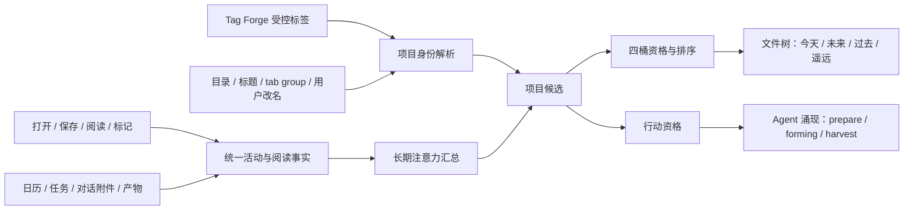

> 原位归档（2026-09-06）：固定历史证据仍引用此路径。保留此路径不代表全文仍是当前合同；其中的状态、源码位置和待办属于原记录。现行约束见 [当前运行时合同](../../architecture/current-runtime-contracts.md)，归档去向见 [文档清单](../../documentation-inventory.md)。

# 文件涌现持续工作预测与 Tag Forge 接入优化路线

> 本文是待确认的目标方案，不是可以直接开工的实施合同。
> 用户确认方向后，每一阶段都要单独转换为带机器验证合同的 implementation plan；
> 未通过前一阶段验收，不进入后一阶段。

## 0. 方案摘要

文件涌现不应该回答“最近有哪些文件”，而应该回答：

> **在不打扰用户的前提下，哪些文件最可能在接下来的工作、阅读或使用中再次有用？**

最优解不是给现有分数继续加权，而是建立三个清楚分开的基础能力：

1. **项目身份**：知道一组文件共同属于哪条持续工作线，并给它一个可信、可修正的名字；
2. **长期注意力**：保存用户对文件的投入、停顿、回访、完成和主动标记，而不只看最近 30 天原始事件；
3. **受控标签**：Tag Forge 在文件生成或用户明确要求时完成语义打标，涌现只读取已经验证的结果。

在这三层之上，四个分区只做确定性的资格判断和排序：

| 分区 | 产品含义 | 关键问题 |
|---|---|---|
| 今天 | 正在进行 | 用户现在最可能接着做什么？ |
| 未来 | 已形成后续意图 | 哪些内容已经有继续、准备、交付或阅读的证据？ |
| 过去 | 最近留下的工作痕迹 | 哪些内容刚做过，但目前没有继续证据？ |
| 遥远 | 值得重拾 | 哪些长期沉睡内容曾经很重要，现在可能值得重新出现？ |

空分区本身不是错误。验收目标是“有证据时一定能到达，没证据时不凑数”，而不是强制四格填满。

## 1. 本轮建议锁定的六项原则

### 1.1 先修信号，再调分数

阅读进度断路、活动双记、长期候选被查询窗口排除时，任何权重优化都是在放大错误输入。
第一阶段只修数据合同与可观测性，不同时重写排序。

### 1.2 项目归属和内容标签必须分开

“这份文档属于 Ready 项目”与“这份文档主要讨论 SQLite”是两件事。
`project` 是持续工作归属；Tag Forge 的 `entity/domain/use` 是内容与用途。
两者可以互相佐证，但不能互相替代。

### 1.3 模型只做语义判断，代码负责规则

模型适合：从最终文档中提议标签、在几个可信项目名之间消歧。

代码必须负责：候选资格、时间窗口、去重、词表配额、别名归一、pending 审批、权限、写回、缓存和失败恢复。

### 1.4 标签在写入时产生，涌现刷新只读

每次打开文件管理都调用模型，会带来延迟、成本、结果漂移和偷偷修改文件的风险。
Tag Forge 应在新文档完成保存、用户明确批量打标或导入流程中运行；涌现只消费已索引的结构化结果。

### 1.5 同一个项目身份同时服务两种涌现

文件树负责“给我文件”；Agent 涌现流负责“提醒我下一步”。两者应共用 `projectKey`、证据和注意力状态，
再分别投影成文件分区和 `prepare / forming / harvest` 卡，不能继续各自猜项目。

### 1.6 用户修正高于一切推断

用户改过的项目名、明确说“不相关”、选择“稍后提醒”或“不要再出现”，都应成为稳定事实，
不能在下次刷新时被算法覆盖。

## 2. 完成标准

全部阶段完成后，至少满足以下可观察结果：

1. Markdown/PDF 的真实阅读进度能从 renderer 写入阅读会话，并被下一次涌现读取；
2. 一次用户打开只计一次，陈旧的持久化 tab 不会永久占据“今天”；
3. 明确的未来日程、可续跑任务、交付产物、持续阅读或行为节奏，都可以各自让项目进入“未来”；
4. 31～365 天前的高价值项目可以从长期汇总进入“遥远”，不依赖伪造的新活动；
5. 有人工目录名或共同主题时，哈希、BV 号、图片名、超长书名不能抢走项目标题；
6. 新生成的用户可读 Markdown 在自动打标开启时，保存后得到 3～7 个受控标签；证据不足时可得到
   `completed_sparse`，执行失败时必须得到明确的可重试状态；
7. 自动打标失败不能让正文丢失，也不能静默假装成功；
8. 涌现刷新不调用模型、不写用户文件；
9. 文件树与 Agent 涌现卡不会把同一项目重复成两个身份；
10. 用户能看懂“为什么它会出现”，并能改名、稍后、隐藏或纠正归属；
11. 现有四桶在生产形状测试中全部可达，但没有可信候选时允许为空；
12. 在可合法回放的 activity/reading 事件子集，以及上线后不可变 prediction snapshot 中，新方案对
    “下一次实际打开/保存/阅读”的命中优于当前基线，且没有未来状态泄漏。

## 3. 目标用户体验

### 3.1 文件树中的呈现

每个项目卡保留当前项目名、文件和分区结构，补充一条短原因，例如：

- “今天连续编辑 3 次，当前仍打开”；
- “下周有交付，关联 2 个任务产物”；
- “读到 62%，停了 3 天”；
- “两个月未打开，但曾精读并标记为精选”。

原因必须来自代码已经验证的 evidence，不让模型自由生成解释。

### 3.2 四个分区的边界

- **今天**不再等于“所有还挂在 tab 里的文件”；只包含当前活跃、刚完成真实打开/保存、或今天确有工作证据的项目。
- **未来**表达已经存在的继续意图，不表达泛泛的相似性。
- **过去**是近期痕迹，不承担“可能继续”的兜底桶。
- **遥远**表达长期重拾。建议 UI 暂时保留原名，同时加副标题“值得重拾”；如后续用户测试仍误解，再单独讨论改名为“重拾”。

### 3.3 空状态

空状态要区分：

- 没有可信候选；
- 数据源暂时不可用；
- 尚未积累足够历史；
- 所有候选被用户隐藏或延后。

不能继续用一个完全空白的格子掩盖生产信号断路。

## 4. 一套内核，两种投影



核心边界：

- 数据源只提供事实，不直接决定分区；
- 项目身份只决定“这些证据属于谁”，不直接决定重要性；
- 长期注意力只汇总行为，不生成项目名；
- 四桶资格是代码合同；
- Agent 卡还要额外满足“有可执行下一步”，不能只因文件重要就出现。

## 5. 五个目标数据合同

字段名在 implementation plan 中再按现有风格落定，本节只固定语义。

### 5.1 FileIdentity：路径可变，文件身份稳定

长期注意力不能直接以 path 当永久主键。每个被 Ready 管理的文件需要：

- `fileKey`：稳定身份；
- `workspaceRoot` 与当前 `path`；
- `previousPaths` 或可审计的 move receipt；
- `createdAt / observedSince / lastVerifiedAt`；
- `status`：present、missing、deleted；
- 最近内容 hash，只用于移动关联、revision 校验和去重，不作为展示名。

Ready 内部 move/rename 必须产生带 `fileKey + oldPath + newPath` 的事实，并在同一收口中更新项目成员、rollup 和索引。
外部文件系统移动只能在短时间窗内用内容 hash/文件事实做保守关联；证据不足时宁可建立新身份并保留旧 tombstone，
不能把同内容的两个合法文件自动合并。用户后续可以显式合并。

### 5.2 ProjectIdentity：稳定项目身份

至少包含：

- `projectKey`：稳定机器身份，项目改名后不变；
- `displayName`：当前展示名；
- `aliases`：历史名称、缩写和可信别名；
- `workspaceRoot` 与目录/file anchors；
- `members`：文件成员及每条归属证据；
- `source`：用户改名、显式 project、tab group、目录共识、任务/附件共识、语义消歧、fallback；
- `confidence` 与可解释 evidence；
- `status`：active、snoozed、hidden、merged 等最小状态；
- `updatedAt`：身份事实更新时间，不是 snapshot 生成时间。

`projectKey` 不能由展示标题直接生成，否则改名会制造新项目。首版可由 workspace + 稳定目录锚点建立，
用户改名或目录迁移时保留映射；只有在证据证明是同一项目时才合并。

### 5.3 FileAttentionRollup：长期注意力汇总

每个安全 workspace 文件维护低敏聚合事实：

- 首次/最近打开、保存、阅读时间；
- 7/30/90 天和 observed lifetime 的打开、保存、活跃天数；
- 有效阅读分钟、最近/最大进度、最后阅读位置类型；
- document mark 数、链接入度/出度；
- 最近关联的 task、artifact、calendar 或 attachment；
- 最近一次被涌现、被点击、被延后、被隐藏的时间；
- 是否仍存在、是否已归档；
- `observedSince/historyCoverage`，明确 Ready 实际看到了多长历史。

原始事件仍可按现有周期清理；rollup 保留聚合值，使 30 天以外的项目不会随事件清理消失。
rollup 不保存正文、聊天内容或网页内容。首轮只能从现有保留数据回填，不能把“最近 90 天可见”写成真实 lifetime。

### 5.4 ControlledTagAssignment：受控标签事实

每个文件的 assignment 至少区分：

- 已生效标签：lexicon id、facet、label、词表版本；
- 依据与置信度；
- 来源：用户、Tag Forge 自动、Tag Forge 显式批处理、导入；
- pending 新词建议；
- 上次由自动流程管理的标签集合，与用户手工标签分开；
- 最近一次验证和写回结果；
- 文档 header 与索引 readback 是否一致。

文档头只保存用户真正需要携带的干净字段；证据、置信度、词表版本和审核状态保存在 Ready 数据层，
避免把内部账本塞满用户文档。对 Ready 新生成的 Markdown，建议统一为：

```yaml
---
ready_project: Ready
tags:
  - 参考资料
  - AI工作流
  - 待整理
---
```

其中 `ready_project` 与 `tags` 都是可选字段：没有可信项目归属时不猜，没有足够标签时宁缺毋滥。
最终字段名和向既有 frontmatter 的兼容规则，要在 Tag 阶段实施合同中用真实 parser fixture 锁定。

### 5.5 ProjectIntentFact：明确后续意图

为了让“明天继续这个项目”不再只是一段会被重新正则扫描的聊天文字，需要最小结构化意图事实：

- `intentId` 与 `projectKey/fileKeys`；
- `kind`：continue、prepare、deliver、read；
- `source`：calendar、task projection、用户明确表达、Agent 语义提案后确认；
- `notBefore/dueAt/expiresAt`；
- `status`：active、completed、cancelled、expired；
- 只含短 evidence code/引用，不复制整段聊天正文。

task/calendar 的既有结构事实可直接归一；自然语言只允许模型提出候选，代码必须验证项目/文件关联、时间与有效期后才持久化。
任务完成、用户取消、文件归档或到达 `expiresAt` 都会确定性失效。普通 browser history 不能单独生成 intent。

## 6. 项目识别与命名方案

### 6.1 先识别项目，再选择标题

当前逻辑把“选择一个字符串”当成项目识别。目标流程应拆为：

1. 先根据目录、tab group、任务产物、附件路径和显式 metadata 判断文件是否属于同一个项目；
2. 再从这组共同证据中选展示名；
3. 最后才在确有歧义时让模型从有限候选中消歧。

### 6.2 项目归属证据优先级

从强到弱：

1. 用户纠正或合并记录；
2. 文档显式 `ready_project`；
3. 用户命名的 document tab group；
4. 同一 task 的 expected output / recent artifact 与附件路径；
5. workspace 下稳定目录锚点，并被至少两个成员或两类行为支持；
6. 受控标签 + 文件链接 + 时间共现的组合证据；
7. 有边界的语义消歧；
8. 单文件/目录 fallback。

单独一个 entity tag、同一 CSS/正文 `#token`、一次浏览记录或一个相似文件名，都不能建立项目归属。

### 6.3 标题候选规则

标题得分应奖励：

- 用户直接给出的项目名；
- 多个成员共同支持；
- 目录、tab group、任务标题和 frontmatter 之间一致；
- 名称在一段时间内稳定复现；
- 可读且长度适中。

标题得分应惩罚或直接拒绝：

- UUID、MD5/哈希、纯数字或时间戳；
- `BV...`、导出序号、图片资源名、扩展名残片；
- 超长商品式书名、网页 title、整句任务描述；
- `src`、`assets`、`output`、`docs`、`资料`、`项目` 等通用目录；
- 只被一份文件支持、却试图命名多文件项目的候选。

“字符串越长越具体”的规则必须退役。具体性应来自共同支持和来源质量，不来自字符数。

### 6.4 模型的最小角色

只有在确定性规则留下 2～5 个可信候选且分差不足时，才允许模型做一次选择：

- 输入只含 root-relative 路径、结构化标题/标签、任务名和有限短摘要；
- 输出只能选择候选、给出短名称或声明无法判断；
- 不允许发明路径、文件成员或项目事实；
- 结果按项目 fingerprint 缓存，普通刷新不重新调用；
- 模型失败时回退到最可靠的人工/目录候选，不阻塞涌现。

首版可以完全不接模型，先把共同支持、机器名拒绝和用户改名做好；只有真实回放仍存在歧义时再启用。

## 7. 四个分区的资格与排序

资格决定“能不能进”，排序决定“进来后排第几”。两者必须分开测试。

### 7.1 今天：真实正在进行

任一强事实可取得资格：

- 当前 active tab；
- 今天刚成功打开或保存；
- 今天有有效阅读；
- 今天正在运行的 task 明确关联到该文件/项目；
- 今日 calendar 正在发生并已关联文件。

约束：

- 一次打开手势只写一条事实；
- open tab 必须有 `lastFocusedAt/lastOpenedAt`，过期 tab 不自动进入；
- dirty tab 可以保留较强权重，但不能永久存在；
- renderer 只补充当前现场，不伪造长期历史。

### 7.2 未来：已经形成继续意图

以下信号各自可以取得资格，不再要求先有未来 60 天日历：

1. **确定日程**：未来事件明确链接项目。查询可覆盖未来一年，分数随时间平滑衰减，避免 60 天硬断崖；
2. **结构化任务**：可续跑 task、未完成 expected output、明确的交付路径或播报续跑；
3. **明确意图**：本轮 Agent 产生的结构化 future intent，而不是刷新时重新对聊天文字跑正则；
4. **持续阅读**：未读完、有近期有效阅读、停顿处于合理窗口；进度是加分，不是唯一通行证；
5. **行为节奏**：项目在多个活跃日反复出现，当前停顿接近用户自己的回访间隔；
6. **高投入停顿**：近期连续编辑/阅读投入显著，虽无进度字段但没有完成/归档证据。

排除或降权：

- 当前仍 active 的项目优先放今天，不在未来重复；
- 已归档、明确完成、用户隐藏；
- 只有一次低投入打开；
- 只有相同 tag，没有后续意图；
- 纯文字“以后看看”但没有文件关联或持久化意图事实。

### 7.3 过去：近期痕迹

过去是近 30 天真实活动的回顾面：

- 有近期打开/保存/阅读，但没有今天或未来资格；
- 已完成或已读完的内容可在这里短期保留；
- 排序以最近事实为主，不用历史总量让老项目长期霸榜。

过去不能充当所有未分类候选的垃圾桶。低置信、无文件或只有噪声标题的候选应直接不展示。

### 7.4 遥远：高价值重拾

候选池来自长期 rollup，而不是最近 30 天 activity query：

- 31～365 天未使用；
- 历史上有多个活跃日、真实保存、较长阅读、document mark、backlink、task artifact 或用户“精选”；
- 文件仍存在，未归档、未隐藏；
- 最近未被涌现，避免每天重复同一项目。

“历史重要”应由多个可解释事实累计，不能仅靠文件多或一次长时间停留。建议首版每次最多显示 1～3 个，
并设置本地 cooldown；没有合格项目就诚实为空。

### 7.5 跨桶不变量

- 同一 `projectKey` 在一个 snapshot 中只进入一个桶；
- 优先级为 today > future > past > distant；
- 每次分配都保存资格原因和被排除原因；
- `updatedAt` 表示最近真实证据，`generatedAt` 单独表示 snapshot 时间；
- 每个桶有独立上限，避免今天的高频文件挤走未来/遥远；
- 置信度不足时不展示，绝不通过降低阈值填满。

## 8. Tag Forge 产品化方案

### 8.1 技能讲方法，机器策略负责执行真值

Tag Forge 的 facet、别名归一、三道闸门和 pending 审批继续作为模型判断方法；
真正要由代码执行的配额、facet 开放度、黑名单、默认状态和版本，必须进入同一份机器可读策略。

最小方案是在 `tag-lexicon.yaml` 的 `config` 中补齐这些策略，由 validator 和 SKILL 共同读取；
SKILL 负责解释，不再另外写一份可能漂移的数值真值。用户 overlay 只能改词条和别名，不能静默改系统策略。

但“方法来源”不等于“让 Agent 自己记得调用”。自动流程需要应用侧明确接线和结构化结果。
Ready 内的用户显式 Tag Forge 请求也走同一提案、校验、写回与 readback 服务；区别只在于显式请求中
“打标”是主交付，失败不能降级成正文已交付。

### 8.2 三层词表真值

1. **内置种子与机器策略**：随版本发布的 `tag-lexicon.yaml`，只读；
2. **用户 overlay**：保存在 app data / DB，记录新增、别名、废弃和审批，不写回内置资源；
3. **本轮提案**：pending 队列，未经用户批准不进入 active 词表。

这是对当前 SKILL 方法的一处有意收紧：交互式 tag 模式可以把 pending 候选展示给用户当场批复，
但无人值守的自动打标不能先写入用户文档再等待审批；它只写 active 标签，把新词留在审核队列。

首版只做一个用户级 overlay。除非真实需求证明不同 workspace 必须有冲突词义，不提前增加 workspace 多层继承。

升级时按 lexicon id 合并内置种子与用户 overlay，不能因为新包覆盖技能目录而丢掉用户词表。

### 8.3 自动打标触发边界

建议默认开启，但只覆盖：

- 当前 run 新创建；
- 已完成正文保存；
- 位于安全 workspace；
- 用户可读的 `.md` 文档；
- 来源明确为 Agent 交付物。

首版明确不自动处理：

- 既有用户文档的普通编辑；
- 源码、配置、日志、缓存、临时文件；
- 图片、PDF、Office 和视频；
- 每次打开或每次涌现刷新；
- 用户未授权的 workspace 外路径。

既有文件和批量目录继续走用户显式 Tag Forge 请求。二进制侧车标签可以以后独立设计，不混入首版。

“当前 run 新创建”不能从保存路径或 artifact 外形猜。创建动作必须持久化 typed receipt：

- `createdInThisRun=true`、`sourceRunId`、`path/fileKey`；
- `finalSaveReceipt`、最终内容 hash 与保存时间；
- enrichment 幂等 key 和当前状态。

receipt 必须在真正创建文件时铸造，并在正文最终保存后补齐，重启/重试仍可读取。没有 creation receipt 的既有文件，
即使本轮被 Agent 保存，也绝不进入默认自动流程。

### 8.4 自动打标流水线

```text
Agent 新文档正文保存成功
  -> 读取最终落盘内容
  -> 装载内置种子 + 用户 overlay
  -> 记录当前内容 revision / hash
  -> 模型只输出 form/domain/entity/use 候选、依据和置信度
  -> 代码执行别名归一、facet 配额、黑名单、新词与安全校验，并固定 state=待整理
  -> ready_project 只取用户显式值或已有 ProjectIdentity
  -> pending 新词只进审核队列，不静默扩词表
  -> realpath/lstat no-follow 再验证 workspace 边界，拒绝会越界的 symlink
  -> 写回前校验 revision；打开的文档走同一 tab 状态与保存通道，关闭文件走 CAS + 原子替换
  -> 只替换上次自动管理的标签，保留用户标签；统一写入 YAML，避免顶部 tag 行重复
  -> 复用并加固现有 frontmatter 合并与索引入口
  -> readback 验证 header、索引与 assignment 一致
  -> 更新 artifact proof / 打标状态
```

模型不能直接修改词表、状态、项目或文件。当前 `file_classify` 只作为已有合并逻辑的基础，不能原样当作
自动写回证明；P3 必须补 revision CAS、原子写入、打开 tab 同步、自动/用户标签归属和索引返回检查。
已有正文顶部 `#tag` 的文件不能再追加一份 YAML tag；显式批处理时应先给出可见迁移方案，自动新文件则一律只写 YAML。

### 8.5 失败语义

- `completed`：正常完成受控打标；
- `completed_sparse`：最终少于 3 个有证据的 active 标签，结果有效，不用宽泛词凑数；
- `failed_retryable`：模型、revision 冲突、写回或索引失败，可安全重试；
- 正文已经成功保存时，打标失败不能回滚或删除正文；
- 默认自动 enrichment 失败时，run 可以完成正文交付，但必须显示 `failed_retryable`；
- 用户明确要求“生成并打标”或显式批量打标时，打标属于主交付，失败后不能把整项任务判为完成；
- 不允许在报告中声称“已自动打标”，除非 header 与索引 readback 都成功；
- 重试必须幂等，不能重复 tag、重复 frontmatter 或重复 pending 提案；
- revision 冲突时不能覆盖用户新内容，应重新读取后判断或进入待重试。

### 8.6 修正当前技能包的基础缺口

在接入自动流程前先完成：

- 把 `SKILL.md` 的 `references/` 修为真实的 `reference/`，或统一目录名；
- 给 lint 增加 Markdown 相对链接存在性检查；
- 从 description 删除当前并不可靠的 `tf` 触发承诺；用户未要求为此扩展整个 skill runtime；
- `tag-forge` 当前没有 `scripts/`，任何激活路径都不得因此开放 `skill_run_shell`；不改变其它技能的既有 shell 同意规则；
- 给词表 schema、id、label/alias、facet 配额与状态枚举加验证；
- id 全局唯一；同 facet 的 label/alias 不得指向不同词条；跨 facet 重名允许，但 facet 缺失或歧义时拒绝而不是猜；
- 同一词条仅大小写不同的重复 alias 归一为 warning 或自动去重；
- 同步重写 `SKILL.md` 的 Ready 写回合同：自动模式输出结构化 proposal、内置 lexicon 只读、用户变更走 overlay、
  新文件统一 YAML；增加 skill 文本、机器策略和 validator 的漂移 gate；
- 保证新包升级后用户 overlay 不丢失。

### 8.7 Tag 如何帮助涌现

只消费已生效、来源明确的 Tag Forge assignment：

| facet/字段 | 对涌现的作用 |
|---|---|
| `ready_project` | 强项目归属，但仍受用户修正覆盖 |
| form | 区分教程、会议记录、案例、参考资料等使用方式 |
| domain | 帮助相关文件召回，不单独建立项目 |
| entity | 只说明主要对象；不能自动等同项目名 |
| use | 帮助判断“为什么留着”，如教学、竞品研究、KV参考 |
| state=待整理 | 与近期投入组合时支持 future，不单独取得资格 |
| state=已精读 | 降低继续阅读概率，提高已完成证据 |
| state=精选 | 提高长期价值，可支持 distant |
| state=已归档 | 排除 today/future/distant，除非用户显式恢复 |

任何 tag 都不能独自把一个从未使用的文件推入涌现；它只修正已有注意力与意图证据。

### 8.8 用户手改后的持续对账

Tag assignment 不能只在 Tag Forge 自己写回后更新。每次普通 document write、外部文件变更或重索引完成后，
都要无模型地重新解析 frontmatter，并按确定性规则对账：

- 用户新增且命中 active lexicon 的标签记为 `source=user`；
- 用户删除自动标签视为明确覆盖，写入 `user_removed`，自动重试不得偷偷加回；
- 未命中词表的用户标签原样保留，但标为 uncontrolled，不参与涌现强信号；
- 同 facet 出现多个互斥 state 时不猜，标记歧义并进入可见审核；
- 用户修改合法 `ready_project` 时，标脏 ProjectIdentity 并重新解析；
- 对账后检查 header、索引、assignment 一致，并精确标脏相关涌现缓存。

这条通道不调用 LLM，也不主动重写用户文件；只有用户显式运行 Tag Forge 时才重新提议或整理标签。

## 9. 与 Agent 涌现卡统一

目标不是把所有文件卡复制到 Agent 首页，而是复用同一候选事实：

- `future + 有明确下一步` -> `prepare`；
- `today + 多证据仍在形成` -> `forming`；
- `最近完成 + 有真实 artifact` -> `harvest`；
- 只有文件重要、没有行动出口 -> 只留在文件树；
- 同一 `projectKey` 在两个表面共享名称和成员，不重复建卡。

现有 `FileEmergenceSnapshot.intentCards` 和 `extractPrepare/Harvest/Forming` 是可复用接缝；
实施时应让生产 service 真正填充，而不是再加一套 renderer 猜测。

## 10. 缓存、刷新与解释性

### 10.1 失效规则

以下事实变化应精确标脏相关 root/project：

- 文件成功打开/保存/删除/移动；
- 阅读会话结束或进度跨过明显节点；
- task projection/产物发生变化；
- calendar 关联变化；
- Tag Forge assignment 或 project override 变化；
- 用户执行改名、延后、隐藏、恢复。

多 root snapshot 不能只靠 `[singleRoot]` key 失效。缓存索引需要知道一个 root 被哪些组合 key 包含。

面板重新可见或用户手动刷新时，renderer 要重新读取当前进度；滚动可以节流，不需要每一帧刷新。

### 10.2 诊断账本

每次生成记录隐私安全的聚合诊断：

- 各来源读取数量与时间范围；
- 候选数、各桶资格数、低置信拒绝数；
- future/distant 各资格入口命中数；
- 项目名来源分布和机器名拒绝数；
- Tag assignment 命中、pending、写回和 readback 状态；
- 缓存命中与 stale 原因。

日志不写正文、聊天原文或完整外部 URL。用户界面只展示简短的“为什么出现”，详细拒绝原因留给诊断。

## 11. 分阶段实施路线

### P0：修复生产信号与可观测性

范围：

- 修复原生 Storage 绑定，贯通 Markdown/PDF progress -> IPC -> DB -> snapshot；
- 用真实 Storage 对象补回归，不能再只用箭头 fake；
- 一次打开手势只落一条事实；
- 给持久化 tab 增加新鲜度；
- 修正 `updatedAt/generatedAt` 语义；
- 修 multi-root cache stale；
- 增加候选资格/拒绝聚合日志；
- 给 snapshot 增加可区分的空态/降级原因，文件树在 0 项时仍显示可理解状态，不再整区消失；
- 建独立 `verify:file-emergence`，接入当前相关阶段 gate。

验收门：

- 真 Storage 测试证明 Markdown/PDF/EPUB 都能读；
- 真实 save/open 流程不会双计；
- 至少一条真实阅读会话写入 progress kind/value；
- 陈旧 tab 不进入 today；
- “无可信候选 / 数据源异常 / 历史不足”至少三种空态可在真实文件管理中区分；
- 不改变项目命名和主要排序权重。

### P1：建立项目身份与可靠命名

范围：

- 建 `ProjectIdentity` 与 title resolver；
- 建 `FileIdentity`，让 Ready 内部 move/rename 产生持久 move receipt；
- 接入 tab group、task artifact/expected output、对话附件和显式 metadata；
- 加机器 id、视频 id、资源名、超长 title 拒绝；
- 标题按共同支持和来源质量排序；
- 保存用户改名与归属纠正；
- 用当前真实噪声样例建立 production-shaped fixture。

验收门：

- `宝矿力/多看书/pin/品牌广告/服装研究/2026 世界杯` 等回放不再被哈希、BV、webp 或单文件名抢占；
- 项目改名后 `projectKey` 不变；
- Ready 内部移动文件/目录后 `fileKey` 与项目成员不被切断，旧 activity/reading 仍可经 move receipt 追溯；
  外部模糊移动不会误合并两个文件；
- 单个文件名或语义短句不能跨目录误合并项目；
- 项目身份以共享合同输出，不再为文件树和意图流各建一套 id 逻辑。

### P2：长期注意力与 future/distant 可达

范围：

- 建 FileAttentionRollup 及数据库迁移；
- 从现有 90 天 activity/reading 数据幂等回填；
- 写入新事件时增量更新；
- 保存 `observedSince/historyCoverage`，不把有限回填冒充完整 lifetime；
- 建 ProjectIntentFact producer、TTL 和完成/取消/归档失效；
- 接入 task projection、calendar、用户明确后续意图、reading cadence、marks、links；
- 重写 future/distant 资格，保留 today/past 现有可用行为；
- 加 surfaced cooldown 和跨桶唯一性；
- 从本阶段起保存隐私安全、不可变的 prediction snapshot，供上线后的 1/7 天结果评估；

验收门：

- 31～90 天仅有旧活动的真实 fixture 可以进入 distant；
- 纯结构化任务意图可以进入 future；
- “明天继续”只有在 ProjectIntentFact 建立并关联项目后进入 future，完成/过期后会退出；
- 高投入、无 progress 的继续行为可以进入 future；
- 未来一年日历分数平滑衰减，不在第 60 天断崖消失；
- 没有可信项目时两个桶仍可为空；
- 原始事件清理后 rollup 仍保留必要聚合。
- P2 rollup 以 `fileKey` 为主键，P2 上线后再次移动文件不会切断累计注意力。

### P3：Tag Forge 基础设施与新文档自动打标

范围：

- 修技能相对链接，删除未兑现的 `tf` 显式触发承诺；
- 在本机同步 `/Users/user/实验田/skill-fac/tag-forge/` 作者源与 repo 内 embedded copy，并提供本地 parity 检查；
  CI 只依赖并验证 repo 内副本，repo 内副本仍是运行与打包真值；
- 补齐机器策略，建按 facet 消歧的词表 validator、内置 seed + 用户 overlay + pending 队列；
- 建结构化 tag proposal 与代码校验；
- 在 Agent 新 Markdown artifact 保存后接入自动 enrichment；
- 持久化 `createdInThisRun + sourceRunId + finalSaveReceipt`，只由真实创建动作铸造自动触发资格；
- 模型只判断 form/domain/entity/use；代码固定新文件 state，项目只来自用户或已有 ProjectIdentity；
- 加固现有 frontmatter 写回：realpath/lstat no-follow、revision CAS、原子替换、打开 tab 同步、
  自动标签归属、顶部 tag 行去重；
- 检查索引结果并重新查询；
- 在普通保存、外部编辑和重索引后，无模型地对账 frontmatter、索引与 assignment，并标脏涌现；
- readback 后才能标记打标完成；
- 设置页提供总开关与 pending 审核入口。

验收门：

- 新生成 Markdown 自动得到受控 active tags，重复执行不产生重复项；
- 最终不足 3 个可信标签时得到 `completed_sparse`，不判为执行失败；
- 未批准新词不静默进入 active 词表；
- 词表升级不覆盖用户 overlay；
- 默认自动失败保住正文并显示 `failed_retryable`；显式打标失败不能把主任务判为完成；
- 判断期间用户继续编辑时，陈旧写回被拒绝且不丢正文；
- 工作区内指向外部的 symlink 被拒绝，不发生边界外写入；
- 只有 creation receipt 的当前 run 新文件会自动触发，编辑既有文件不会误触发，重启后仍可安全重试；
- 重试只替换旧自动标签，保留用户手工标签；
- 用户手工新增/删除标签后 assignment 同步；删除的自动标签不会被重试恢复，未知标签不被当成受控真值；
- 多个互斥 state 不被静默任选，进入可见审核；
- 打开的 clean/dirty tab、磁盘和索引不会出现三份不同内容；
- 模型输出 `精选/已精读/已归档` 或新 project 时被拒绝；
- 现有用户文档不会被普通编辑自动重打；
- 涌现刷新路径没有 LLM 调用和文件写入。

### P4：受控标签与双涌现投影接入

范围：

- metadata port 读取结构化 project/tag assignment，不读取受污染的 raw body hashtag；
- 给 FileEmergenceProject、intent card 与 Agent EmergenceCard 增加共享 `projectKey` wire，并完成迁移；
- 标签按 facet 进入项目解析、相关文件召回和状态修正；
- 同一候选投影为文件桶与 prepare/forming/harvest；
- 同一 project resolver 同时供 `FileEmergenceService` 与 `EmergenceFeedGroup` 使用，把
  prepare/forming/harvest production signals 注入 feed deps；
- 按 `projectKey` 跨表面去重；
- 把 `open_project / open_artifact / open_project_group` 接到真实 renderer 行动，不能保留死按钮。

验收门：

- CSS 色值类 body tag 对涌现无影响；
- `entity` 与 `ready_project` 区分有合同测试；
- `精选/已归档/已精读/待整理` 的作用符合表 8.7；
- 生产 snapshot 能真实生成 intentCards，不靠测试手填；
- 生产 `emergence.feed()` 能真实返回 prepare/forming/harvest，不靠测试手填 entry；
- 用户点击每种行动都能打开对应项目、文件或分组，且失败有可见结果。

### P5：用户反馈与本地校准

范围：

- 最小反馈动作：改项目名、不相关、稍后提醒、不再出现；
- 反馈写入稳定 override/attention 事实；
- 空态补齐“全部被隐藏/延后”原因；
- 建本地历史回放与离线评估；
- 把上线前事件子集回放与上线后 prediction snapshot 评估分开；
- 只在证据表明有收益时微调排序权重，不修改资格合同。

验收门：

- 用户修正刷新后仍保持；
- “稍后”到期前不出现、到期后重新取得资格；
- 隐藏项目不会通过新名称复活；
- 全部候选被隐藏或延后时，文件树显示对应空态而不是数据异常；
- 新排序在同一无未来泄漏的评估窗口上优于当前基线。

## 12. 验证矩阵

### 12.1 行为测试

| 层级 | 必测行为 |
|---|---|
| renderer | 原生 Storage brand check、滚动进度、tab freshness、手动刷新 |
| IPC/repository | activity 幂等、reading progress 落库、multi-root stale |
| service | 四桶 production-shaped 可达、跨桶唯一、拒绝原因 |
| file/project identity | 多文件共同主题、机器名拒绝、用户改名、内部移动延续、外部移动误合并保护 |
| rollup/intent | 回填覆盖范围、增量、事件清理后保留、TTL、完成/取消/归档失效 |
| Tag Forge | 链接、词表 schema、按 facet alias 消歧、配额、pending、overlay 升级、无 scripts 时无 shell |
| 写回/对账 | revision 冲突、原子落盘、顶部 tag 去重、保留/删除用户标签、外部编辑、状态歧义、索引失败、稀疏结果、显式/默认失败语义 |
| 双投影 | shared wire 同 projectKey、生产 intentCards、无重复卡、三类 open action 真正可用 |

Tag fixture 必须覆盖当前真实跨 facet 重名，如“教学 / 收藏 / 胡迪尼”；先确定 facet，再做 alias 归一，
不能用全局字符串唯一规则误杀合法词条。

### 12.2 本地历史回放

上线前只能对 activity/reading 等不可变事件子集做只读时间切片：在时间 `t` 只给算法看 `t` 之前的事件，
再检查未来 1 天/7 天用户实际打开、保存或阅读了什么。当前 task projection、文件名、frontmatter 和 tags
会原地更新，不能拿它们的“今天状态”冒充历史 `t` 状态。

完整评估从 P2 开始：每次真实生成后保存不可变且低敏的 prediction snapshot（projectKey、桶、原因码、时间，
不含正文），再与之后的真实活动 outcome 关联。至少记录：

- Top-K 下一次使用命中率；
- future 在 7 天内的命中率与误报率；
- distant 被点击/继续使用的比例；
- 每桶候选覆盖和拒绝原因分布；
- 机器式项目名比例；
- 用户隐藏、改名和稍后行为。

这些指标只在本机计算，不上传文件名或行为历史。CI 使用去标识化 fixture，不能依赖用户数据库。
上线前的子集回放与上线后的完整 snapshot 评估必须分开报告，不能合成一个看似完整的准确率。

### 12.3 真机验收

每一阶段除了测试，还要在真实 Electron dev 中打开文件管理核对。Tag Forge 阶段另需用新打包应用验证：

- 新包确实包含 `tag-forge`；
- 自动生成 Markdown 的 header 可见且正文无损；
- 刷新涌现时没有模型请求和文件 mtime 变化；
- future/distant 的项目名、原因和点击文件与真实状态一致；
- 空桶能解释是“无可信候选”还是“数据源异常”。

## 13. 迁移、性能与隐私边界

### 13.1 迁移

- 新表先从现有可见活动、reading session、task artifacts 幂等回填，并记录每类信号的 `historyCoverage`；
- 没有 progress 的旧 reading 不伪造进度，只保留时长和时间；
- 旧 snapshot cache 直接失效，不做兼容双写；
- 项目标题从旧候选迁移时只当 alias/fallback，不直接当用户真值；
- raw tags 表不迁移为受控 assignment；只允许重新解析文件 frontmatter 后，把命中词表且来源明确的项导入。

### 13.2 性能

- 每次刷新读 rollup 与索引，不扫全量正文；
- 新文档 Tag Forge 只读本次最终 artifact；
- 项目语义消歧按 fingerprint 缓存；
- 长期统计增量更新，避免每次重算一年事件；
- 文件存在性与 metadata 并发受限，保持 UI 可快速得到首屏。

### 13.3 隐私

- 项目身份与 rollup 只处理用户已授权 workspace；
- 默认不把聊天全文、网页正文或完整路径发送给模型；
- 自动打标只使用用户刚要求 Agent 生成的最终文档；
- 用户可关闭自动打标；
- 诊断日志不写正文和外部敏感内容；
- existing files 的批量打标必须由用户显式发起。

## 14. 明确不采用的方案

1. **只降低 future/distant 阈值**：候选入口本身断裂，会制造噪声而不是智能；
2. **强制每桶至少一项**：把算法故障伪装成内容丰富；
3. **把 raw `tags` 表直接做项目聚类**：当前 CSS 色值污染会造成大规模误合并；
4. **把 entity tag 当项目名**：内容对象和工作归属不同；
5. **每次涌现刷新运行 Tag Forge**：慢、贵、不稳定，还可能暗改文件；
6. **只提醒模型“记得用 tag-forge”**：技能选择不是可靠的保存后合同；
7. **让模型直接改词表和 frontmatter**：无法保证配额、幂等、审批和恢复；
8. **先重做整个文件树 UI**：当前根因在数据与身份，视觉改造不能让空桶可达；
9. **一开始建设 workspace/团队/云端多层词表**：当前没有证据需要这层复杂度；
10. **扫描所有历史文件全文来猜项目**：成本、隐私和稳定性都不如现有结构信号。

## 15. 建议后续确认的默认选择

如果用户认可总体方向，建议按以下默认值写第一份实施合同：

1. 保留“今天 / 未来 / 过去 / 遥远”四个主标题，给“遥远”加“值得重拾”副标题；
2. 新 Agent 生成 Markdown 的自动打标默认开启，可在设置关闭；
3. 既有文件默认不自动重打，只响应用户显式 Tag Forge 请求；
4. 首版只做用户级 lexicon overlay；
5. `ready_project` 独立于 Tag Forge 五类标签；
6. pending 新词先入审核队列，批准后再成为 active；
7. 涌现刷新永不调用模型；项目标题模型消歧首版可暂缓；
8. 第一阶段只修信号、测试和必要空态，不趁机重写排序或主要卡片/交互 UI。

## 16. 推荐开工顺序

用户确认后，只先写并执行 P0 implementation plan。P0 真机验收通过，再根据新诊断数据复核 P1/P2 的阈值和字段；
不要一次性把五个阶段合并成大改。

这样做的原因是：当前“未来/遥远为空”有明确生产断路。先恢复真实信号，后续项目识别、长期注意力和
Tag Forge 才有可信输入；否则任何“智能化”都会建立在错误数据上。
