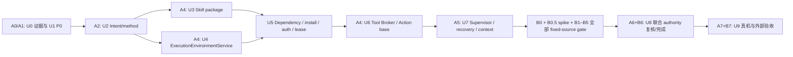

# Ready Agent 统一执行环境与任务内核收口实施计划

## 0. 计划定位

本文是待 owner 确认的实施提案。确认前不修改产品代码；确认后只在独立
`/Users/user/实验田/ready-cowork-agent-renew` 推进，不在当前 newtab 工作区开启第二条实现。

本文不是另起 Agent 重构，U0–U9 也不是第二套总阶段。它们是已批准 A0–A7/B0–B7 内的工作包：

```text
U0/U1 -> A0/A1
U2 -> A2
U3–U6 -> A4
U7 -> A5
U8 -> A6+B6
U9 -> A7+B7
```

## 1. 开工假设与前置条件

### 1.1 假设

1. 07-24 Durable Agent / Browser 目标架构继续有效。
2. `agent-renew` 中 Task/Turn/Item、ExecutionPlan、Action Journal、Artifact/Evidence、Browser Runtime 和
   finalizer 是唯一未来权威。
3. 首批只交付本机桌面环境、Ready-managed runtime 和 MCP connector；容器/SSH/remote executor 后置。
4. Lark CLI 是第一个真实 vertical slice，但所有合同和测试使用通用 program/dependency 名称。
5. 用户未授权自动安装、修改设置或改变当前本机认证；计划阶段不做这些操作。

### 1.2 开工前必须满足

1. owner 确认本计划和目标架构补充提案。
2. `agent-renew` 的 327 个 modified/staged 项与 91 个 untracked 项完成来源和所有权盘点。
3. 当前 A7+B7 固定 nonce 要么生成要求的最终通过报告，要么经 owner 明确裁决废弃并建立新 source digest；
   不能把新工作叠到漂移中的验收身份上。
4. 用户现有 newtab 两处 Renderer 改动保持原样，不带入本计划提交。
5. 每一阶段先写失败测试和机器合同，再写实现。
6. `agent-renew` HEAD 已包含 joint kernel production-binding 候选代码，但尚未完成 fixed-source 验收。
   默认将它定性为“已绑定、未验收的切换候选”，后续是 forward-fix 和一次切换完成，不做第二次切换。

### 1.3 不等待大重构也必须保留的 P0 gate

即使 owner 决定分批实施，下列合同也不能被后续阶段推迟或重新放宽：

- `requires.bins` 只是依赖声明，永不自动签发 shell 权限；
- Skill package symlink/逃逸关闭失败；
- 同一 Task 只能有一个 active Turn，第二 ingress 不能清掉旧 owner；
- Provider request retry 只能有一个 owner，不能两层相乘；
- required method 失败时禁止无政策 fallback。

## 2. 完成标准

全部条件同时满足才可标记 implemented：

### 2.1 当前问题闭环

1. 从 Finder/LaunchServices 启动安装版 Ready，能解析并执行 U0 当次签名 baseline manifest 记录的
   `lark-cli` identity/path/version，且版本满足产品支持约束。
2. `lark-im` 可通过类型化 resource 读取 `lark-shared`，不调用 `cat`。
3. “必须用飞书 CLI”时，Browser 和 Feishu sidecar 都不能满足任务或进入业务 dispatch。
4. CLI 真缺失时只询问一次；用户同意后安装、readback、认证并自动续回同一 Task；拒绝后不降级。
5. “查找上周编辑过的文档”能从 TaskContract 形成正确操作和时间条件，不依赖飞书专用关键词分支。

### 2.2 通用架构闭环

1. Skill shell、typed action、setup、MCP stdio 按同一解析政策得到同一 `ExecutableIdentity`；
   每个 profile/attempt 仍生成自己的 snapshot-bound launch handle。
2. 多 guidance Skill 可同时加载；执行权限不做 manifest 全集并集。
3. 每个外部 action 有且只有一个 terminal ToolResultEnvelope；崩溃缝隙进入 `effect_unknown`。
4. 所有 ingress 共用 Supervisor admission；同一 Task 永远最多一个 active Turn。
5. timeout retry policy 规定 1 次重试时，总 wire calls 恰好 2，不再是 4。
6. Task、Turn、Item、plan、action、environment/skill snapshot ref 和 canonical answer 可在删除 projection 后重建。
7. IPC admission accepted 不再冒充 Task completed。
8. provider/context/restart/install/auth 都使用同 taskId 的 successor Turn。
9. `os.tmpdir()` 被清空后仍能恢复 canonical Task；临时文件只损失缓存和诊断。
10. 联合切换后旧 terminal writer、旧 Skill 权限路径、旧 PATH builder 和生产双写调用为零。

### 2.3 安全与发布闭环

1. 外来 Skill 声明 `cat/curl/ssh/bash/osascript/security` 不产生执行权限。
2. Skill 子进程默认拿不到 Provider secret、Browser cookies、完整 HOME 或未声明 credential。
3. PATH 空项、相对项、cwd 和工作区可写目录不参与 executable resolution。
4. resolve 后 wrapper/payload/interpreter/launcher 任一身份被替换时，旧 lease 关闭失败，不执行新链。
5. 安装配方固定来源、版本/范围、digest 和 readback；Skill 不能自行提供自动安装命令。
6. mounted DMG、安装后 app、Windows 安装包、native DB、真实外部任务全部通过。
7. 08-03 审计定义的零值指标持续为零。

## 3. 已批准总顺序与工作包依赖



U3 与 U4 可以在不同提交序列并行，但 U5 前必须同时完成。唯一顺序仍是：

```text
A0–A5（含 U0–U7）
-> B0 + B0.5 background-pointer spike + B1–B5
-> A6+B6+U8 同一 authority 切换候选的复核与完成
-> A7+B7+U9
```

U2–U7 不能被单独验收为 production authority。由于当前分支已有未验收 binding，它们只能作为同一 cutover
candidate 的 forward-fix；U8 不再绑定第二套入口。任一 B0–B5 gate 未绿，U8 均不得退出。

## 4. 目标模块边界

建议在 `agent-renew` 上按职责落位：

| 职责 | 归属 | 禁止承担 |
| --- | --- | --- |
| IntentFrame v2、method/fallback 验证 | `src/main/modules/agent-kernel/` | OS PATH、安装命令、产品名分支 |
| Skill package revision / set snapshot | `src/main/modules/skills-runtime/` + kernel snapshot binding | shell 权限、Task 终态 |
| 桌面环境发现、launch graph、process adapter | 新 `src/main/modules/desktop-execution/` | Task 状态、fallback 决策、Browser 操作 |
| dependency resolution / trusted recipe | kernel contract + desktop implementation | Skill 自签权限、直接发布最终回答 |
| CapabilityLease / action receipt | 现有 authorization receipt + 目标通用 action base | 环境发现、模型语义判断 |
| waiting/wake/successor | 现有 Supervisor / interaction / recovery | 执行具体程序 |
| package/task/user/credential resource | 现有 Artifact/Resource layer | 路径猜测和多 root fallback |
| Context Builder | 现有 agent-kernel Context Builder | 修改 canonical stores |
| Browser | 现有 BrowserRuntimeService | 充当 CLI fallback 或通用 process executor |

新模块必须有依赖方向 gate。`runtime.ts`、`AgentSdkRuntime`、turn orchestrator 和 domain adapter 只调度，不
拼 PATH、不解析产品名、不安装依赖、不直接写 action terminal。

## 5. U0：证据冻结与实施现场收口

### 目标

把当前故障、独立 Agent 缺陷和 `agent-renew` 当前 stopping point 固定成可重复基线，避免修复过程中换了
源码、数据库、包体或问题定义。

### 实施

1. 为 8 月 3 日 run 生成脱敏 fixture，保存：
   - run/task/scope identity；
   - app version、可执行文件与 `app.asar` digest；
   - Ready 进程 PATH digest；
   - Skill package digest；
   - CLI absolute path/version/auth 状态的脱敏 readback；
   - 84/89 tool schema、两次 shell error、Browser dispatch、最终状态；
   - DB 表行数与 projection/run terminal 对照。
2. 固定四个最小失败探针：
   - Finder PATH 下 setup 能找到、skill shell 找不到同一个 fixture CLI；
   - raw Orchestrator 第二 ingress 让旧 owner liveness 变成 null/false；
   - timeout `maxAttempts=1` 产生 4 次 wire call；
   - `requires.bins` 自动开放无确认 shell。
3. 固定 Skill package 失败：第二 Skill 激活失败、source run 中漂移、兄弟依赖未导入、symlink 穿透、resource/artifact
   路径混用。
4. 盘点 `agent-renew` 每个 dirty 文件的阶段、作者、测试和是否属于固定 nonce；拆成可审阅提交，禁止一个
   “current working tree”同时承担代码、证据和最终结论。
5. 每个探针 fixture 必须写明 `worktree + branch + HEAD + dirty digest + expected result`：
   - current newtab timeout 预期 4 次 wire call；
   - `agent-renew@91f7e9e9` HEAD 仍无 exhausted guard；
   - `agent-renew` 未提交 guard 探针预期 2 次，U1 是整理并提交它，不是从零实现。
6. 将当前 `RunCoordinator -> joint kernel host` 定性为已绑定但未验收的 cutover candidate。若 owner
   不接受此定性，必须先裁决并建立真正 pre-cutover 基线；在此之前 U1 以后停止。
7. 对 fixed nonce A7+B7 报告完成或明确 rebaseline；不存在最终 report 时保持 blocked，不改写为通过。
8. 收口正式验证链：修正 `check-browser-surface-binding.cjs` 与
   `check-provider-checkpoint-module-boundaries.cjs` 的 8 个 stale path，或为仍有历史合同价值的路径增加具名、
   有 owner 和 expiry 的 allowlist；`npm run verify:meta-paths` 必须恢复通过。
9. 在写产品实现前提交 canonical-store registry/schema decision，对 Skill package/set、dependency、environment base/attempt、
   launch handle、CapabilityLease、generic action base 和 Browser extension 逐项写明 classification、sole writer、owner、
   immutable/head、CAS、唯一性、FK 与 rebuild rule。目标是零重复生命周期，不是零新表。
10. 先在 `package.json`/CI 注册本文所有新 gate，复用现有 `verify:agent-kernel`、
    `verify:agent-browser-joint-cutover` 和 native runner。`.red` 必须是可执行且在旧实现上真失败的测试；
    对每类核心 gate 做一次故意破坏，证明非零退出。

### Gate

下列是 U0 需要注册的可执行 gate，不是当前已存在的 npm scripts：

```text
verify:agent-unified-runtime-baseline
verify:agent-admission-single-owner.red
verify:provider-retry-budget.red
verify:skill-dependency-permission.red
verify:desktop-environment-parity.red
```

### 退出条件

- 每个失败均有真实入口行为测试或无敏感 fixture；
- current/new target/agent-renew 三种事实不会混写；
- canonical-store registry/schema decision 通过结构 gate；不再以“原则上 0 新表”逃避 owner/CAS/FK；
- 所有新 gate 已注册，red 在旧实现上失败，故意破坏能触发非零退出；
- `npm run verify:meta-paths` 通过，正式 gate 不再引用已删除入口；
- 新代码尚未开始，工作区基线可复核。

## 6. U1：P0 主链与安全合同先收口

### 目标

先消除会破坏所有后续执行环境测试的 owner、retry 和自动提权问题。

### 实施

1. 把 canonical admission 下沉到所有 ingress 共用的 Supervisor 边界：
   - 本地 `sendScoped`；
   - raw Orchestrator/internal send；
   - remote channel inbound；
   - narration continuation；
   - scheduled task；
   - recovery/wake。
2. admission 成功前禁止：
   - 清旧 active owner；
   - 写新 `run_meta(running)` 或 Task active Turn；
   - 发 started projection；
   - 建第二个 provider session。
3. 有活动 Turn 时统一产生 steering/queue/refusal receipt。拒绝时不得再写“已保留给当前任务”。
4. 整理并提交当前 dirty worktree 已有的 `provider_request_retry_exhausted` guard；rebase 后用真实探针确认
   request 层耗尽后，模型循环不能再次重试同一 provider call。
5. 将 retry budget 计入唯一 parent budget；accepted delta/tool/effect 后走 successor/reconciliation，不进行盲重试。
6. 先以现有权限路径 fail closed，不提前伪造 U5 才实现的 CapabilityLease：
   - `requires.bins` 只是中性 dependency declaration，删除它到 shell consent/allowlist 的所有边；
   - 没有现有 host-signed action authorization 的 `skill_run_shell` 直接 `authorization_denied`；
   - unlisted/`unknown_effect` 不再 default M4；
   - 导入扫描拒绝 symlink、路径逃逸和未扫描执行载荷。
7. 维护 sub-agent 必须传真实 cleanup handle；删除用 `as never` 绕过 `drain` 的伪实现，并让接口/测试在缺方法时
   编译或构造失败，不再每六小时容忍错误。

### Gate

`verify:agent-admission-single-owner` 至少覆盖：

- 本地 follow-up；
- raw Orchestrator 第二 ingress；
- 同一渠道线程再次入站；
- narration 与活动用户任务碰撞；
- ownerRunId、Task active Turn、外层 liveness 始终一致；
- admission rejection 无遗留 running row。

`verify:provider-retry-budget` 至少断言：

- timeout `maxAttempts=1` 总 wire calls = 2；
- transient `maxAttempts=6` 总 wire calls <= 7；
- rate-limit 使用同一唯一预算；
- accepted effect 后不重新提交未知副作用。

`verify:skill-import-safety` 至少断言：

- declared `cat/curl/bash/ssh/osascript/security` 即使 dependency probe ready 也不产生授权；
- symlink/逃逸/隐藏可执行载荷导入失败；
- 无 host-signed action authorization 时不进入 spawn；
- dependency record 永远不能生成 authorization receipt；
- Skill 文案不能修改 effect 分类。

### 退出条件

- owner/retry/声明自提权/symlink 五类 P0 red tests 变绿；
- 修复进入清晰提交而非只存在 dirty working tree；
- 不需要飞书特例。

## 7. U2：IntentFrame v2 与方法/fallback 合同

### 目标

让“必须用某方法”成为机器可验证 TaskContract，而不是 prompt 建议。

### 实施

1. 按目标架构补充 `methodConstraints`、`methodFallbackPolicy`、`allowedFallbackMethodIds`、
   `dependencyResolutionPolicy`、`outputContract`、`environmentRequirements`；方法替换和依赖安装是两个合同。
2. admission 第一次提交 IntentFrame 时同时校验：
   - required 与 forbidden 不冲突；
   - implementationRef 可映射到 capability/dependency selector；
   - fallback 来源是用户原话、资源合同或系统 policy；
   - acceptance source 能由 required method 理论满足。
3. 资源充分性先遵守 method constraints，再推 capability floor；不能因“动态事实”无条件加入 Browser。
4. fallback 只通过 `PolicyDecisionReceipt` 发生，回执冻结原 method、替代 method、原因、作用域与到期时间：
   - `none` -> fail/blocked；
   - `ask_user` -> durable interaction；
   - `allowed` -> 仍记录原因和替代方法。
5. planned Task 修订 plan 并新建 attempt；direct Task 保持原 `execution_admissions` 不变，追加
   `PolicyDecisionReceipt` 并创建新 direct call-scope generation。Effective TaskContract delta 作为 control receipt/ref，
   不更新或复制 admission。只有满足 07-22 promotion 条件时才建 plan。
6. `ExecutionNode.methodConstraintRefs`、NodeAttempt 的 skill/dependency/environment/backend refs 与
   `ExecutionCallScope.inputDigest` 一起冻结；direct scope 同样绑定。
7. Completion Verifier 核对 required/forbidden/fallback receipts。
8. 删除 `hasExplicitLocalFeishuCliIntent` 这类产品专用权威；可以保留为迁移测试输入，不能再决定生产能力。

### 行为矩阵

| 输入 | 期望 |
| --- | --- |
| “用飞书 CLI 查” | required local program + methodFallback none + ask_install，Browser 业务工具 0 |
| “优先 CLI，不行问我” | preferred + ask_user |
| “优先 CLI，不行网页” | preferred + allowed Browser fallback |
| “不要打开网页” | Browser forbidden |
| “查最新信息”未指定方法 | 资源充分性可推 Browser |
| required CLI 缺失 | dependency waiting/询问安装，不完成、不 Browser |
| direct task 批准替代方法 | immutable admission + control receipt + 新 direct call-scope generation，不伪造 plan |

### Gate

```text
verify:agent-method-contracts
verify:method-capability-floor-order
verify:method-completion-proof
check-no-product-method-routing.cjs
```

### 退出条件

- Lark、Git、ffmpeg 和虚构 CLI 走同一合同；
- required/forbidden/fallback 可从 ledger 重放；
- 依赖安装批准不会生成方法 fallback receipt；direct scope 不因方法变更自动建 plan；
- Provider prompt 不能推翻代码决策。

## 8. U3：Skill package revision、多 guidance 与资源类型

### 目标

把 Skill 从“live 文件夹 + 单选权限包”改为不可变、可组合、只提供 guidance/dependency 的 package snapshot。

### 实施

1. 导入事务：扫描全部文件 -> 验证 manifest -> 解析 read-only dependency closure -> 内容寻址复制/登记 -> 原子发布 revision。
2. 每个 revision 保存 content、resource manifest、dependency closure 和 version digest；source 更新生成新 revision。
   Dependency closure edge 冻结 `fromRevision + alias + toRevision + allowedResourceIds + edgeDigest`，循环、冲突、缺失关闭失败。
3. Skill package revision 写入全局不可变 registry，不写进 task artifact。Task admission/clean boundary 创建
   `SkillSetSnapshot`，并通过 canonical snapshot binding 绑定 task/turn/attempt 或 direct call scope。
4. 将单 `SkillToolAuthorization.skillId` 重构为：
   - `SkillContextSet`：多个 guidance/reference；
   - `ActionOwnerRef`：单个 action owner；
   - `CapabilityLease`：最小执行权限。
5. `use_skill` 演化为 guidance loader；第一个 Skill 后仍可加载第二个，但只能在 clean boundary 生成新
   SkillSetSnapshot + control receipt + successor attempt，不原地改活动 attempt，也不自动开放两者全部工具。
6. 提供 `read_skill_resource`：输入必须绑定
   `skillSetId + packageRevisionDigest + resourceId + expectedDigest`，支持大小/片段/digest/循环限制。
   Action owner 绑定 `packageRevisionDigest + actionId + actionDescriptorDigest`。
7. `read_task_artifact` 只读当前 Task action 产物；删除 `skill_read_artifact` 的多 root 猜测语义。
8. 保持 writable artifact cwd；修正所有文案，不再声称 cwd=managedPath。脚本通过 resource digest + interpreter launch handle 调用。
9. UI 对 external source 显示 installed revision、source digest 和 update available；更新不影响活动 Task。
10. legacy `../sibling/SKILL.md` 必须在导入时迁移成明确 dependency edge；两包同资源路径、同 action id、
    不同版本的情形必须要么按 alias/revision 唯一解析，要么关闭失败。

### Gate

```text
verify:skill-package-revision
verify:skill-dependency-closure
verify:multi-guidance-skill
verify:skill-resource-types
verify:prepared-skill-resume-revalidation
```

关键反例：

- source 在 run 中更新，当前 run 继续旧 digest；
- dependency 缺失时原子拒绝，不留下半导入；
- 两个 guidance Skill 均可读，只有当前 node action 获 lease；
- 两包同路径/同 action id/不同 revision 不会选错 owner，循环和未声明兄弟链接关闭失败；
- 两个 session 的 last-reference hint 不能互相改变 allowlist；最终删除该 hint 权限来源。

### 退出条件

- package 内容与权限不再从 live path 漂移；
- `lark-im -> lark-shared` 无需 shell/cat；
- 单 Skill 权限全集 floor 退役。

## 9. U4：ExecutionEnvironmentService 与 immutable launch handle

### 目标

建立一个环境权威，让发现、探测、执行和恢复使用同一不可变快照。

### 实施

1. 新建 `src/main/modules/desktop-execution/`，最少包含：
   - contracts；
   - platform discovery adapter；
   - environment snapshot builder；
   - executable/launch-chain resolver；
   - process adapter；
   - credential overlay；
   - diagnostics/redaction。
2. 实现 `internal_sealed / desktop_tool / managed_runtime / connector` 四种 profile；首批不实现 remote backend。
3. macOS discovery 覆盖 Finder/LaunchServices 最小 PATH、Apple Silicon Homebrew、Intel Homebrew、`~/.local/bin`
   和 Ready 显式配置；删除空/相对/cwd 项。
4. Windows discovery 覆盖用户/系统 PATH、应用安装目录、PATHEXT 和实际 identity；`.cmd` 必须绑定
   绝对 `cmd.exe` handle 与唯一 quoting 合同，在该 gate 通过前 Windows 只支持 `.exe`。不借用 macOS 快照。
5. Linux 使用确定性系统/用户路径和同一清洗合同。
6. 首批只使用 deterministic platform discovery + Ready 显式配置；不启动 login shell，不执行用户 rc。
7. Resolver 展开 symlink、shebang、`/usr/bin/env`、npm shim 和 Windows launcher，返回 `ExecutableIdentity` +
   snapshot-bound `ResolvedLaunchHandle`，包含 payload/wrapper/interpreter/launcher 的绝对路径、identity、digest 与 resolver receipt。
8. Process adapter 只接受 launch handle + argv；直接启动绝对 interpreter/launcher，不让 PATH/PATHEXT/COMSPEC 二次解析。
9. spawn 前核对完整 identity chain、owner 与可写父目录。高风险/可写链进入 Ready 管理的只读 store；
   记录残余 TOCTOU 威胁边界，不用 pre-spawn stat 宣称完全消除 race。
10. 全局 base snapshot 与 Task/attempt snapshot 分开，按 canonical-store registry 落位 owner/head/CAS；不把全局 base
    强行塞入 task-scoped `artifact_objects`。不持久 secret value。
11. 建立 program-data/config access grant，绑定 program identity、允许 config root、读写模式和 HOME/XDG mapping。
    CLI 保留自己的原生凭据；Ready 只持 handle。Probe 与 execute 使用同一 overlay。
12. 安装、用户配置或启动链身份变化使 base cache 失效；既有 attempt snapshot 不变，后续创建新 attempt。

### Shadow 对账

开发期允许只读 shadow resolver 比较旧路径实际选择与新 identity/launch handle，不执行第二次命令、不写第二份 Task 状态。任何
差异记录环境来源、候选和拒绝原因，值脱敏。

### Gate

```text
verify:desktop-execution-environment
verify:executable-handle-integrity
verify:execution-environment-secrets
verify:execution-environment-platforms
check-no-user-process-spawn-bypass.cjs
check-desktop-execution-module-boundaries.cjs
```

必须覆盖：

- Finder 最小 PATH；
- Homebrew/local/managed runtime；
- PATH hijack、空项、相对项、cwd；
- `lark-cli -> #!/usr/bin/env node` 启动链，PATH 中放恶意 `node` 仍执行冻结 interpreter；
- `.cmd`/npm shim、解释器替换、父目录可写与真实 race；
- resolve 后 PATH 改变仍执行原 launch chain；
- secret 不进入 DB/log/artifact；
- 对已授权 CLI，原生配置可读，但其他 HOME/SSH/Provider/Browser 秘密不可读；
- 多 Task 并发共享 base，但 snapshot/lease/cwd/credential 不串。

### 退出条件

- 同一 fixture CLI 在所有迁移目标上得到同一 ExecutableIdentity；各 profile/attempt 持自己的 handle；
- 新 Service 不写 Task 状态、不决定 fallback；
- Browser 不依赖该模块。

## 10. U5：Dependency、安装、认证与 CapabilityLease

### 目标

把“程序缺失怎么办”变成所有本地工具共享的 durable 流程，并确保 ready 不等于 authorized。

### 实施

1. 由 Skill/Intent/Tool descriptor 产生 typed `DependencyRequirement`，冻结 stable requirement id、owner scope、
   selector/version digest、generation 和当前裁决 receipt；不在 UI 读取时临时猜状态。
2. Resolver 分辨：
   - resolved ready；
   - installed but unresolved in current snapshot；
   - missing installable；
   - missing un-installable；
   - version mismatch；
   - config/auth/health missing。
   Permission/authorization 不属于 DependencyState；dependency ready 可与 action `authorization_denied` 同时成立。
3. 建 trusted recipe catalog；每个 recipe 固定平台、来源、版本、argv、effect、确认文案和 readback。
4. 安装请求使用现有 interaction lifecycle 和 wake authorizer；用户后续只回复“可以”仍能恢复冻结 recipe。
5. 定义可由 U6 action adapter 执行的安装 descriptor/result/readback 合同；成功后必须刷新环境、新建 attempt、
   重新 resolve，不能沿用旧 snapshot。U5 不在 generic action base 前直接 dispatch installer。
6. 认证 challenge 持久化 identity/expiry/credential handle；auth 完成通过 readback receipt 唤醒同一 Task。
   Provider 禁止缓存的 device code/verification URL 不落盘；restart 后重新签发挑战。
7. Tool Broker 在依赖 ready 后仍必须签发 CapabilityLease；lease 绑定 task/turn/node/action/skillSet/env/launch-handle/effect/
   target/args/confirmation/expiry。
   Lease 是现有 authorization receipt 的强类型扩展，不新建授权账本。
8. raw shell 默认 `unknown_effect`，需要独立 lease；外来 Skill 不得声明 read-only 来降级。
9. 跨 Task 安装单飞使用现有 `execution_resource_claims`，键为
   `dependency-install:<profile>:<selector>:<version>`。获胜 Task 拥有安装 action，其他 Task 只等待；完成后各自重新
   probe 并取得自己的 observation/lease，不跨 Task 复用授权。
10. Browser-assisted auth 绑定 `purpose=dependency_auth`、requirement/challenge、精确 origin/target、动作集与
    expiry，继续经 Browser claim/journal/observation；不得满足业务 node。

### Gate

```text
verify:dependency-resolution
verify:capability-lease
verify:dependency-state-authorization-separation
verify:trusted-recipe-freeze
verify:dependency-install-singleflight-claim
```

下列端到端故障注入在 U6 adapter 完成、U7 Supervisor 接入后运行，不作为 U5 单阶段退出条件：

- approval 落库前后重启；
- 安装进程启动前后重启；
- exit 0 后环境刷新前重启；
- resolve 成功后 auth 前重启；
- auth 回执重复提交；
- restart 后旧 device code/URL 不被重放，新 challenge 仍唯一续回原 Task；
- 用户拒绝后说“继续”；
- 两 Task 同时要求同一安装，只有一个安装 action，两个任务各自重新 resolve。

### 退出条件

- 安装授权、安装成功、resolve、认证、healthy、业务完成是独立事实；
- 恶意 `requires.bins` 可达 dependency ready，但无 lease 时仍为 `authorization_denied`，dependency 记录不产生 lease；
- recipe、interaction、singleflight claim、auth challenge 和 lease 在组件层可重放；尚不声称安装/认证已端到端续回。

## 11. U6：Tool Broker 与 Action Journal 全面接入

### 目标

把统一环境作为既有 Tool Broker 的执行后端，并让所有外部 action 拥有与 Browser 同等级的通用持久闭环。

### 实施

1. 不把当前 Browser-only `agent_action_journal` 的专用字段改成 nullable。按 U0 schema decision 迁移为：
   - generic action base：task/turn/call scope、可空 plan/node/attempt、action identity、统一 effect、args digest、state、result/idempotency；
   - Browser 1:1 extension：browser task/domain item/target/session/claim/generation/sequence/observation policy；
   - Browser action 必须有 extension + valid claim，非 Browser action 禁止写 Browser binding。
   复用 `ToolResultEnvelope`，不建第二张通用 action 账本。Schema 只在 U8/A6+B6 联合迁移时成为产品 authority。
2. desktop program action 依次提交：prepared -> authorized/lease -> started -> terminal -> observation/readback。
3. 每个 provider tool call 恰好映射一个 action/result identity；provider retry/context rollover 不重复结果或丢半边。
4. 统一 effect 枚举只使用 `read / reversible_write / external_effect / unknown_effect`。外部 effect 已发生但结果未写回时标
   `effect_unknown`，由 adapter observation 解决；只读 action 可按明确 receipt 安全重试，其他不得盲重试。
5. 迁移以下消费者到同一环境与 action 合同：
   - `skill_run_shell`；
   - typed skill direct action；
   - `run_setup_command` / installer；
   - MCP stdio；
   - 需要调用本地 CLI 的内置工具。
6. 内部 worker/sidecar 若保留 direct spawn，必须列入 `internal_sealed` allowlist，并由边界 gate 证明不接受
   用户/Skill executable selector。
7. 禁止 MCP 连接时隐式安装，包括 versioned `npx -y`。Trusted recipe 先下载，校验 registry integrity/
   签名 + digest，原子发布到 Ready 只读 store，再用 launch handle 离线启动。MCP 配置只有 artifact digest、
   连接 health 和授权 readback 全部成功后才提交；失败事务不留伪安装成功。
8. stdout/stderr 截断前脱敏并存 artifact；structured result 与 artifact digest 进入 ToolResultEnvelope。

### Gate

```text
verify:tool-action-journal
verify:tool-call-result-pairing
verify:desktop-program-adapter
verify:mcp-stdio-execution-environment
verify:setup-command-execution-environment
verify:generic-effect-unknown-recovery
verify:dependency-install-action-adapter
verify:dependency-auth-action-adapter
```

本阶段只跑 adapter/repository 组件级崩溃点：

1. action prepared 前；
2. prepared 后、spawn 前；
3. spawn 后、外部 effect 前；
4. effect 后、result 前；
5. result/observation 原子提交前后。

本阶段证明：不重复未知副作用，调用/结果不缺半边，base/Browser extension 约束不被削弱。
Task 恢复、projection 重建、provider 回灌与 finalizer 的完整七点 kill matrix 在 U7 集成后运行。

### 退出条件

- 四套旧 PATH builder 不再是生产权威；
- 所有 user/Skill/MCP local process 均有 launch handle、lease、action 和 result；
- generic base 不要求 Browser id；Browser action 又必须有 1:1 extension/claim，原有约束不被削弱。

## 12. U7：Supervisor、Retry、Frame、Context 与 Finalizer 收口

### 目标

让统一执行环境真正处于单一 Task 内核之下，而不是接到旧 run/projection 旁路。

### 实施

1. 完成所有 ingress 的 canonical Supervisor admission；删除 Orchestrator 自行替换 owner 的路径。
2. Provider exhausted、dependency waiting、effect_unknown、context rollover、process restart 都创建同 Task successor
   或 durable waiting，不直接结束为无可恢复错误。
3. TurnFrame 裁决：保留一个真实 production frame builder/patcher；删除测试专用 parity 实现，所有行为测试走真实
   `sendScoped`/joint kernel 入口。
4. Context Builder 按 TaskContract + current node + SkillSet + dependency status + action descriptors 生成最小模型工作集。
5. 显式 required CLI 的 wire 工具面：Browser/sidecar 业务工具 0，未选择 Skill actions 0。
6. provider schema/reminder 大对象进入版本化 budget；大 stdout/page/package resource 只发摘要 + artifact ref。
7. 在唯一 Supervisor 下分开四类具名 UoW：admission、waiting/recovering transition、successor、terminal finalizer。
   Finalizer 只负责原子终态；dependency waiting/startup recovery 不复制 Action Journal/recovery facts。
8. `sendScoped` 返回 admission receipt + task snapshot；Renderer 不从 boolean 猜完成。
9. `os.tmpdir()` 中 session/checkpoint 降为 cache；删除后从 durable ledger 重建，不能改变 Task 结论。
10. 收窄 DomainAdapter：只提供 domain facts、typed action descriptor 和 evidence verifier。Scheduler/orchestrator
    不比较 adapter id；Adapter 不写 Task、不决定 fallback、不自建 plan。删除或降级未使用的端到端调度接口。

### Gate

```text
verify:agent-frame-live-source
verify:agent-context-surface
verify:agent-terminal-atomicity
verify:agent-restart-recovery
verify:agent-admission-response
verify:projection-rebuild
verify:provider-retry-budget
verify:dependency-install-approval
verify:dependency-auth-recovery
verify:dependency-restart-recovery
node scripts/check-domain-adapter-boundaries.cjs
verify:domain-adapter-facts-and-evidence
```

DomainAdapter 结构 gate 至少断言：

- scheduler/orchestrator 不比较具体 adapter id；
- DomainAdapter 无 Task/Plan/fallback 写入入口；
- 所有 action 经 Tool Broker；
- 旧端到端调度接口无 production caller。

`verify:domain-adapter-facts-and-evidence` 使用真实 adapter 入口证明 domain facts 与 evidence verifier 仍正常，
不得只用 source grep 冒充行为验证。

Context gate 不只比较 token 数，还断言 exact capability set。08-03 同类 CLI fixture 必须从 84/89 个工具收敛到
当前 node 实际需要的集合；预算阈值由 U0 基线和 U2 action descriptor 大小形成代码常量，变更需显式审阅。

U6 集成后在本阶段运行完整 kill matrix：

1. action prepared 前；
2. prepared 后、spawn 前；
3. spawn 后、外部 effect 前；
4. effect 后、result 前；
5. result 后、provider 回灌前；
6. provider 回灌后、terminal finalizer 前；
7. app restart + duplicate wake。

每个点都必须证明：不重复未知副作用、调用/结果不缺半边、Task 可恢复、projection 可重建。

### 退出条件

- 一个 Task、一个 active Turn、一个 action truth、一个 finalizer；
- 用户拒绝不产生 Browser/sidecar dispatch；安装/认证续回原 taskId，恰好一个 successor Turn；
- 删除 temp snapshot/projection 后可重建同样结果；
- IPC、UI 与 canonical terminal 语义一致。

## 13. U8：联合 authority 复核、迁移与旧路径删除

### 目标

完成已进入 `agent-renew` 的同一 Agent + Browser cutover candidate，不再绑定第二套生产入口，不保留生产双轨。

### 硬前置

U8 只有在同一 fixed source digest 上满足以下条件后才能开始退出验收：

- Agent A0–A5（含 U0–U7）全绿；
- Browser B0 fixtures 全绿；
- B0.5 真实 Electron background-pointer spike 报告明确可行；
- B1 runtime/session、B2 work surface、B3 target claim/takeover、B4 tool surface、B5 evidence/checkpoint 全绿；
- `verify:agent-browser-joint-cutover` 能拒绝 A6-only 或 B6-only binding。

任一报告缺失、source digest 漂移或 Browser gate 只有 source-grep 时，U8 保持 blocked。

### 数据落位

严格执行目标架构 §16 canonical-store registry：

| 新事实 | 现有落位 |
| --- | --- |
| IntentFrame v2 / method/output/env requirements | `execution_admissions` + TaskItem ref |
| SkillPackageRevision | 全局不可变 registry，content digest 唯一；非 task artifact |
| SkillSetSnapshot | task/turn/attempt 或 direct-scope canonical binding，generation + expected digest CAS |
| Environment base / attempt snapshot | 全局 base 与 task attempt binding 分开，各有 owner/head/CAS |
| ExecutableIdentity / launch handle | identity-chain immutable object + snapshot-bound handle/ref |
| Dependency requirement/status | stable requirement id/generation/current decision，不包含权限 |
| CapabilityLease | 现有 authorization receipt 强类型扩展，不建第二授权账本 |
| Action Journal | generic base + Browser 1:1 extension，联合迁移 |
| stdout/stderr/readback | artifact/evidence + ToolResultEnvelope |

物理 schema 必须是 U0 已通过的 registry decision；现有 store 无法机械保证时允许一个具名 domain-fact store。
禁止的是 `cli_runs`、`environment_runs`、`skill_executions_v2` 等重复 Task/Plan/Action 生命周期，不是为了追求“0 新表”
而把 owner/CAS/FK 散落到 JSON ref。

### 迁移

1. 对旧 Skill：扫描、生成 package revision；不安全包标 disabled/review_required，不自动放行。
2. 对旧 imported source：记录 source digest/update available；活动旧 run 不伪造 snapshot。
3. 对旧 pending setup/auth：能形成完整 receipt 的迁移；只有自然语言“继续”的标 recovery_required。
4. 对旧 run/projection：沿 07-24 migration receipt 规则归一，completed 无 canonical message 的标 integrity_failed。
5. 对旧 MCP：未固定版本或连接未验证的标 needs_revalidation，不伪装 installed。
6. 对旧 environment：不迁移 process.env/PATH 值；首次运行重新 discovery，生成新 snapshot。
7. 对现有 Browser-only action rows：在同一 migration receipt 中拆成 generic base + Browser 1:1 extension，保留原
   action revision/idempotency/target/claim/sequence。任一 Browser row 缺 extension 或 claim 时 migration 整体失败，不用 nullable 降级。

### 删除

- `requires.bins => shell consent/allowlist`；
- single selected skill 权限模型；
- session-global last-reference hint 参与 allowlist；
- `skill_read_artifact` 多 root 语义；
- setup、skill、typed action、MCP 各自 PATH builder；
- product-specific CLI routing authority；
- Orchestrator admission 前 active-owner 替换；
- model-loop 对 request-layer exhausted 的第二层 retry；
- `run_meta`/projection/Skill coarse status 的 terminal 写 authority；
- temp checkpoint 作为 durable truth。

### Gate

```text
verify:legacy-writer-zero
verify:execution-environment-single-authority
verify:skill-permission-legacy-zero
verify:agent-browser-joint-cutover
verify:legacy-migration-native
verify:browser-live-grounded -- --scenario=background-pointer-spike
verify:browser-runtime-baseline
verify:browser-runtime-service
verify:browser-session-recovery
verify:browser-background-actions
verify:browser-live-background-actions
verify:browser-takeover
verify:browser-live-takeover
verify:browser-tool-surface
verify:agent-tool-broker
verify:continuation-wake-authorization
verify:browser-research-ledger
verify:xhs-research-fixture
```

结构 gate 可检查生产 import/call graph；行为 gate 必须同时证明旧入口调用失败或零调用。source grep 不能单独算验收。

### 回退策略

- 切换前：新 stores/validators 可离线读取比较，不能生产双写。
- 切换发布：先备份 DB 与 package identity，再原子切入口和 migration version。
- 只有在切换后尚无任何新 canonical write 和外部 action 的验证窗口，才可回复配对 DB 备份。
- 一旦已有新写入或外部 action，只允许 forward-fix 或兼容新 schema/data 的二进制回退；禁止倒回旧 DB 快照，
  也禁止临时重新启用旧 writer。
- 已发生外部 action 的 Task 按 journal reconciliation，不因版本回退盲重试。

### 退出条件

- legacy writer 和旧 env/permission path 生产调用为 0；
- A0–A5/U0–U7、B0/B0.5/B1–B5 在同一 source digest 全绿，没有第二次 production binding；
- projection 只读重建；
- 新旧 schema 迁移、重启和回退演练通过。

## 14. U9：真实安装包与外部验收

### 14.1 本地确定性矩阵

| 场景 | 验收 |
| --- | --- |
| macOS Finder 最小 PATH + Homebrew fixture CLI | resolve/execute 同 immutable launch chain |
| Apple Silicon 与 Intel Homebrew 路径 | 平台 adapter 选择正确，无硬编码单一路径 |
| `~/.local/bin` fixture | Ready 能发现，PATH 无 cwd/空项 |
| Windows user/system PATH + PATHEXT | `.exe` 必过；`.cmd` 只在绝对 `cmd.exe` + quoting gate 通过后支持；不使用 macOS 快照 |
| managed Python/Node runtime | 只使用包体 manifest/readback，不被用户 PATH 替换 |
| MCP stdio | 审批 artifact 在只读 store 中离线重启；registry/cache 漂移、恶意 lifecycle 与连接失败不留配置 |
| launch component 运行中替换 | 旧 handle 拒绝、新 attempt 重解析；真实 race gate 通过 |
| app restart / temp 清空 | 同 taskId 恢复，不重复 effect |

### 14.2 Skill 与安全矩阵

- malicious requires.bins；
- symlink、目录逃逸、未扫描扩展；
- HOME、Provider key、Browser cookie、SSH agent 读取；
- program-scoped config root 可用，但不能因 HOME mapping 扩大到任意用户文件；
- raw shell、管道、重定向、解释器脚本；
- 两 Skill guidance、action owner、依赖闭包、源更新；
- 两 session 并发和 snapshot 隔离；
- output exit 0 但 readback 缺失；
- stdout/stderr 脱敏和 artifact 大小上限。

### 14.3 Task 与恢复矩阵

- 第二条本地消息、渠道入站、自动播报、定时任务碰撞；
- Provider timeout/transient/rate limit 的总 wire call 预算；
- install approval 前后重启；
- auth challenge 过期、重复提交、跨重启；
- Browser auth action 有 `purpose=dependency_auth` 时只能完成 challenge，不能满足业务 node；
- effect_unknown 的 observation/reconciliation；
- natural language、按钮、自动 health wake、startup reconciler 定位同一 candidate；
- required/preferred/forbidden/fallback 的完整矩阵；
- 删除 projection/temp cache 后重建。

### 14.4 Lark CLI 真实 vertical slice

使用隔离 conversation 和真实安装包，从零执行。U0 先产生带签名/digest 的 baseline manifest，记录
本次机器、平台、CLI identity/path/version 与支持版本约束；U9 对账该 manifest，不把当天绝对路径和版本
永久写成产品合同：

1. 明确要求 `lark-cli` 查询上周编辑文档；
2. 读取 `lark-im/lark-drive/lark-shared` package resources；
3. 回读 ExecutableIdentity/launch chain 与当次 baseline manifest 及支持版本约束一致；
4. 回读 auth verified；
5. 冻结用户时区下“上周”的绝对起止时间、当前认证 principal、`modified_by=principal` 的编辑语义，
   查询真实结果，处理到 cursor 终止并按稳定 key 去重；若 CLI 无法证明编辑者，该 slice 按 acceptance gap 失败；
6. 根据文档内容汇总新增视频条数、支付时长、预算；
7. Completion Verifier 核对 required method receipt、来源和输出；
8. Browser 业务 dispatch 数为 0；
9. 最终只有一个 canonical answer；
10. DB、action journal、artifact 和 projection readback 一致。

另用可删除的 fixture dependency 走“真缺失 -> 询问 -> 同意安装 -> auth -> restart -> resume”和“拒绝 -> no
fallback”两条路径，不能为测试卸载用户现有 `lark-cli`。

### 14.5 Agent/Browser 既有验收不回退

统一执行环境最终变更 source digest 后，必须重跑 A7+B7 当前要求的 fixed report，而不是复用旧 foundation：

- current-source 总报告存在且 `ok:true`；
- validator 退出 0；
- controlled page / Wikipedia / XHS R1-R3；
- Provider transfer、sleep/wake、target takeover、dialog、popup、download、effect_unknown recovery；
- 三份页面回读与独立 reviewer PASS；
- 零 integrity metrics。

零值报告不能只是指标名列表。每项输出
`metricId / collectorVersion / sourceDigest / taskScope / runScope / windowStart / windowEnd / quiescenceAt /
observed / allowed / evidenceRefs`，并将 SQL/日志 collector 与非零退出码接入 gate。Projection gap 只要求在 quiescence +
canonical readback 后为 0，不以传播中的短暂差值制造假失败。

### 14.6 最终命令组

至少包括：

```text
npm run typecheck
npm run verify:native
npm run verify:stability
npm run verify:streaming
npm run verify:dynamic-delivery
npm run verify:browser-orchestration
npm run verify:browser-surface
npm run verify:browser-reliability
npm run verify:agent-unified-runtime
npm run verify:meta-paths
npm run build
npm run verify:version
```

`verify:agent-unified-runtime` 是 U1–U8 新 gate 的聚合入口。普通 Node ABI skip、source grep、缺报告、外部审查无
输出、只启动 app 或只看到网页都不算通过。

## 15. 提交与审阅边界

建议提交序列：

1. `test(agent): freeze unified runtime failures`
2. `fix(agent): enforce single owner and single retry budget`
3. `fix(skills): separate dependency declarations from permission`
4. `feat(agent): add method and fallback task contracts`
5. `feat(skills): add immutable package and guidance set`
6. `feat(runtime): add desktop execution environment handles`
7. `feat(agent): add dependency recovery and capability leases`
8. `feat(agent): journal all external tool actions`
9. `refactor(agent): forward-fix supervisor context and lifecycle units`
10. `refactor(agent): complete joint authority migration and remove legacy writers`
11. `test(release): prove installed unified agent runtime`

每个提交只包含对应阶段代码、测试和唯一权威文档更新。U8 联合切换可以是一个 PR 内的多个可审阅提交，但
生产入口切换与旧 writer 删除必须同批，不拆成两个可发布状态。

## 16. Stop conditions

出现任一条件立即停止扩展，回到证据和合同：

1. `agent-renew` source/DB/runtime/report digest 不一致。
2. 环境快照把 secret value 写进 DB、日志、artifact 或 prompt。
3. 新 resolver 与 executor 选择不同 executable identity。
4. 任一 required method 任务产生无 policy receipt 的替代工具 dispatch。
5. 任一外部 action 缺 terminal result，或 effect_unknown 被原样重试。
6. 同一 Task 出现两个 active Turn，或第二 ingress 清掉旧 liveness。
7. wire call 超过唯一 retry budget。
8. 新方案需要 `cli_runs`、`skill_executions_v2` 或生产双写才能继续。
   反过来，若为追求 0 新表而把新事实散落到无 owner/CAS/FK 的 JSON ref，也立即停止。
9. 普通 Node skip 被当成 native 通过。
10. fixed live report 缺失、`ok:false`、validator 失败或 reviewer 无明确 PASS。

## 17. owner 确认后的文档动作

1. 把目标架构补充内容合并进 07-24 owner-approved target architecture。
2. 把 U0–U9 对应阶段并入 07-24 Agent implementation plan 的 A0–A7，并裁决与 Browser B0–B7 的联合顺序。
3. 把 07-23 Lark CLI 文档标为 historical/superseded-by-unified-runtime；保留当时证据，不继续追加规范。
4. 更新 `current-runtime-contracts.md`，删除“declared bin 直接可用/无需专属同意”的旧合同。
5. 为新 gate 增加 package scripts 与 testing conventions 归属。
6. 实现完成后将本计划标 `implemented`，目标补充提案标 `merged-and-implemented / enforce:false`，保持单一真值。
