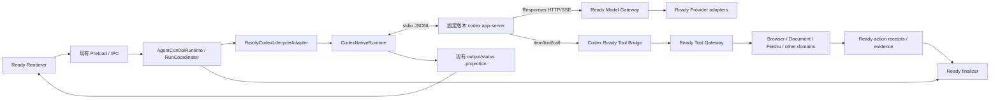
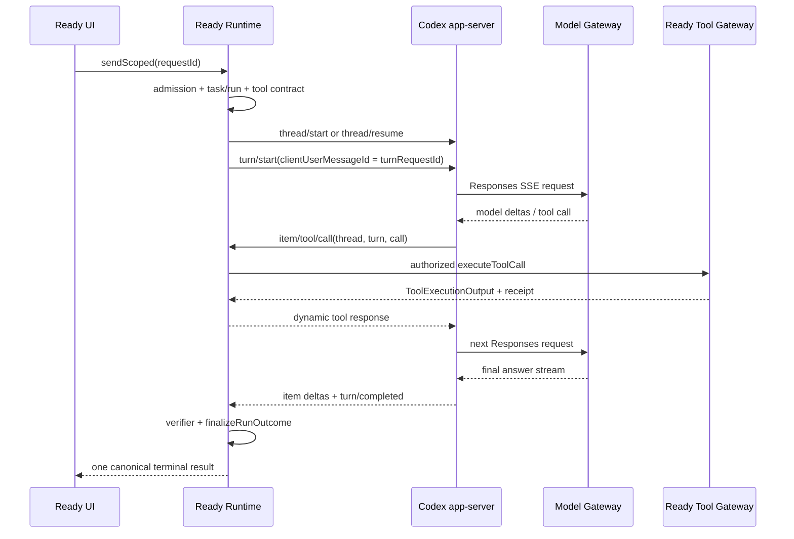

# cod-ready Codex Runtime 最小替换试验实施计划

## 0. 文档定位

本文只定义一个隔离、可撤销、可判输赢的最小替换试验。计划获 owner 确认前，不修改产品代码；实施在后续新会话进行。

试验目标不是把 ChatGPT/Codex 桌面应用搬进 Ready，也不是继续扩建当前 Ready Agent 模块，而是回答一个更窄的问题：

> 用官方开源 Codex app-server 替换 Ready 当前的模型循环、工具循环和会话内压缩后，Ready 原有界面、任务、工具、权限、Browser、Document、Provider 与最终收口能否稳定工作，并且是否比当前内核更容易证明正确？

本计划只有三种合法结论：

1. **PASS**：固定源码、固定二进制、固定协议、固定模型与固定工具面下，全部机器门禁和真实竖切连续通过，形成后续正式迁移提案。
2. **FAIL**：证据已经证明方案不满足硬边界或验收门槛，关闭试验，不把半成品接入 Ready 生产主链。
3. **BLOCKED**：缺少真实外部条件或无法观测关键指标，保持未通过，不把本地替代门禁写成成功。

计划不允许“基本可用”“多数通过”“本机偶尔成功”成为结论。

## 0.1 Worktree 开工回执

本轮已完成的唯一落盘动作是创建独立 worktree：

```text
worktree=/Users/user/实验田/cod-ready
branch=codex/cod-ready
base=ba145c9e8208d0e1f0840af8eeb274f602dfea86
initial_status=clean
created_from=ready-cowork-newtab committed HEAD
```

边界如下：

- 不带入 `ready-cowork-newtab` 当时未提交的阅读模式改动。
- 不复制 `ready-cowork-agent-renew` 的未提交实现。
- `agent-renew` 只作为缺口、测试和反例证据源，不是本试验的代码来源。
- 当前文档完成后，`cod-ready` 只应有本文一处计划改动；没有替换代码。

## 0.2 计划完成标准

本文只有同时满足以下条件才算计划完成：

1. 三条硬边界都转成机器可验证合同，而不是口头约定。
2. 指定唯一替换缝、保留模块、唯一写者和禁止双写位置。
3. 解释模型转换层、工具桥、状态映射、崩溃恢复与打包来源。
4. 每个阶段都有前置条件、实施内容、验证命令和退出条件。
5. 定义固定真实竖切、故障注入、PASS/FAIL 门槛和回滚方法。
6. 给后续新会话提供不依赖本轮上下文的开工清单。
7. 通过独立、具名、无实现权限的对抗复审。

## 0.3 E0 施工结论（2026-08-06）

本试验已按 owner 指令进入 E0，并在写入任何产品实现前证明“资源正文直接放进 `additionalContext`”这条旧路线
为合法终态：**FAIL**。该结论保持不可改写，但不再外推为整个 `cod-ready` 方向失败。

- 固定官方公开版本 `rust-v0.146.1` 及其源码提交、二进制、许可和协议快照。
- 固定 schema 的 `AdditionalContextKind` 只有 `application` 与 `untrusted` 两种。
- 两种都用真实 `app-server` 在同一 thread 连续两轮更换资源值；第二轮的 Provider 输入都同时保留旧值与新值。
- 该行为直接违反当时 §7.4 的旧值不残留硬边界，并命中当时 §18 的停止条件。不得把这份失败报告改写成通过。
- E1–E9 均未开始；`src/main` / `src/preload` / `src/renderer` / `src/shared` 均无改动。
- 独立复审者 `/root/e0_adversarial_reviewer` 同意“E0 判 FAIL 并停工”。该复审 PASS 不是实验 PASS。

细节、命令退出码、证据哈希和未完成项见
`docs/superpowers/audits/2026-08-06-codex-runtime-e0-failure-report.json` 与同名 Markdown。

## 0.4 E0-R 路线修订与完成标准（2026-08-06）

Owner 已批准在 E1 前增加窄阶段 **E0-R：版本化资源权威实验**。E0-R 只允许修改计划、实验脚本、合同、fixture 与审计
材料；仍禁止修改四个产品源码根目录，也不授权 E1。

E0-R 接受 Codex 的原生历史设计，不再要求旧资源引用或既有工具结果从同一 thread 中消失。它把三个层级写成互不替代的
合同：

1. **可见性**：旧引用、旧回答和已经返回给 Codex 的旧工具正文可能继续存在于原生历史；压缩、恢复或 MCP 不得被描述成
   确定删除。
2. **权威性**：Ready host 只允许读取当前授权版本；旧版本读取返回 typed `resource_version_superseded` 且正文为 0 字节；
   旧版本 mutation 在创建 effect identity 前失败，外部副作用严格为 0；发布前必须存在绑定当前 thread/turn/call/resource/
   version/digest/policy epoch 的读取回执。检查器必须把回执与对应 case 的原始 Provider 调用、原生完成项和
   thread readback 逐项连接，不得用全局“存在于合法集合”或 fixture 预算布尔值代替。
3. **硬隔离与删除**：敏感撤销要求后续模型不可再看旧上下文时，用户可见地创建新原生 thread 并退役旧 alias；若要求磁盘
   删除，还必须另走显式删除、rollout 清理和 readback，单纯新建 thread 不算删除。

`additionalContext` 从本阶段起只允许非语义引用：`logicalResourceId + currentVersion + currentDigest + supersedesVersion? +
policyEpoch`。资源正文、事实摘录、可变化摘要、凭据和 Ready 历史均禁止进入。正文只通过当前版本授权的只读 Ready tool
按需取得；模型参数不得携带可复用 secret capability token。每个 dispatch 的引用必须与对应 Provider 请求中实际可见的
引用及当轮 authority snapshot 逐字段匹配；保留在原生历史里的 V1 引用可并存，但不能冒充当轮 V2。

当前版本读取回执只是发布的必要条件，不单独证明模型忽略了旧正文。E0-R 必须让第一轮真实工具输出包含与 V2 矛盾的
V1 正文，再在同一 thread 第二轮读取 V2；只有第二轮候选正文包含 V2 sentinel、完全不含 V1 sentinel，且发布门读到当前
V2 回执才可通过。若未来把该行为升级为生产安全保证，fresh verifier 只能基于当前版本接受或拒绝，不能改写 Codex 正文。

E0-R 还必须分别实测 root、`fork_turns=none` 子 Agent 与带历史子 Agent 的资源工具可用性。dynamicTools 不可用时，允许在
隔离 fixture 中验证 Ready 只读 MCP 资源桥；MCP 只解决工具分发，不改变旧结果留在历史的事实。三类 Agent 均必须受同一
版本授权、回执和 stale-write 零副作用合同约束。

E0-R 完成要求同时满足：

- 固定 `rust-v0.146.1`、真实 `app-server`、本地 Responses fixture 与机器可读合同/报告；
- V1/V2 冲突、stale read、stale mutation、缺失当前回执四个正反门禁；
- 同 thread、多轮、`thread/read -> thread/resume`、manual compaction、受控 automatic compaction 与 sidecar restart；压缩均需原始
  Provider 请求、完成通知、终态、回读与后续轮次顺序一一对应；
- root、无历史子 Agent、带历史子 Agent；必要时再跑只读 MCP bridge；
- Ready history 注入为 0、Ready compaction 为 0、协议转换恰好一层；
- 原 E0 报告和证据 digest 仍可独立验证，E0-R 报告不得覆盖它；
- 具名独立 reviewer 对 E0-R 报告给出明确 PASS。

任一项失败或不可观测，E0-R 为 FAIL/BLOCKED，`nextPhaseAllowed=false`，不得进入 E1。

## 0.5 E1 施工结论（2026-08-07）

E1 已完成并通过独立复审：**PASS，允许进入 E2**。

- Agent 生产发送主链已收窄为唯一 Codex 组装路径；旧 SDK 循环、PromptAssembly、Dynamic Delivery、
  child-run/workflow continuation、全局 session cap 和 Renderer coalescing 不再进入该路径。
- shared send/lifecycle wire 改为唯一严格合同；Renderer 只在 durable ingress admission 后提交用户气泡、
  标题与输入清理，失败生命周期操作保留原 UI。
- `CodexNativeRuntime` typed seam、product preparer、turn input builder、collector 与薄 lifecycle adapter 已建立；
  本固定版本只接受 `source=vscode` 的 app-server root；合法但不属于该 root 的 custom/subagent source
  在 binding、resume marker 和 `turn/start` 前关闭失败。
- 预留与准备结果都在产品持久化前做 exact runtime validation；终态只发布 Ready 已提交的回读。
  损坏、外来或空 digest 回读保持同一 active operation，不产生第五种 wire 返回，不提前结算。
- E1 专项 14 文件 108/108 通过，`typecheck`、build、native ABI、source pin、source-contract 交叉门禁、
  phase-status、exit-authority、meta-path 和 diff gate 通过。
  全库 parallel 回归仍是施工前同一组 18 个已知失败，E1 新增失败为 0；两组 serial 回归通过。
- 具名 reviewer `/root/e0_adversarial_reviewer` 在首轮指出完整 `SessionSource` 结构缺口；根因修复后
  重跑给出 `PASS / nextPhaseAllowed=true`。

阶段报告见 `docs/superpowers/audits/2026-08-07-codex-runtime-e1-report.md` 与同名 JSON；原 E0 FAIL 和
E0-R PASS 报告保持不变。E2 从此边界开始，不将 E1 fake native port 冒充为已实现 sidecar。

## 1. 开工假设与不确定项

### 1.1 已锁定假设

1. `cod-ready` 是试验分支本身，不再增加运行时 feature flag。
2. 试验构建中，Agent 请求只走 Codex 内核；失败时明确失败，不自动回退旧内核。
3. Ready 继续拥有产品级 Task/Run、投影、权限、外部动作回执和幂等发布记录；Codex final `agentMessage` 是语义回答正文。
4. Codex 只拥有其内部 thread/turn/item 模型循环；这些身份通过只含映射信息的绑定表接入 Ready。
5. 首轮只验证 macOS arm64 本地桌面包；Intel Mac 与 Windows 必须在 PASS 后另立平台阶段。
6. 首轮每个 Codex thread 最多一个活动 operation；不同 Ready conversation 映射到不同 Codex thread，并保留固定
   app-server 原生跨 thread 并发。Ready 多 Agent、分支和远端 executor 不进入本试验，也不得用一个 Ready 全局锁把
   独立 Codex thread 人为串行化。
7. 模型只通过 Ready 保留的一层 Responses-compatible 转换网关访问；Codex 不读取 Ready Provider 密钥。
8. Codex 的内建 shell、文件修改、网页、Browser、Computer Use、MCP、插件、技能、多 Agent 和图片工具全部视为未授权能力。
9. 首批 Ready 工具由 `dynamicTools` 接入。它是实验协议，因此试验 PASS 不等于生产获准。

### 1.2 Codex-first 适配裁决

本计划不把 Ready 当前 Agent 架构当成必须保住的上位框架。优先级写死为：

1. Codex 原生 thread/turn/history/context compaction/model loop 是新的 Agent 内部权威。
2. Ready conversation 只保留产品展示、用户消息审计和资源入口，不再向每轮模型重复拼历史，也不决定 Codex 如何
   保存、裁剪或总结上下文。
3. Ready Task/Run 只记录一次产品请求、工具行动、证据、等待和最终收口；它是 Codex turn 的外部产品投影，不是
   Codex session 状态机的父级。
4. Ready 为多 Agent、Dynamic Delivery、child-run 和旧 SDK compaction 建造的 session/workflow 机制，不作为本次
   最小替换的兼容目标；它们从 `cod-ready` live path 移除或明确 unsupported。未来若需要多 Agent，优先评估 Codex
   原生设计，不先复活 Ready 旧编排。
5. Ready 只在四类跨边界真值上约束 Codex：Provider/模型路由、可见工具与授权、外部动作回执、用户可见发布/终态。
   这些是产品安全边界，不得扩张成第二套推理、会话或压缩系统。
6. 发生冲突时，默认裁决是收缩/退役 Ready 旧机制并让适配层变薄；只有会破坏上述产品安全边界时才限制 Codex。

因此本文后续的 binding、lease、receipt 都只做跨进程身份与安全证明；不得保存第二份对话历史、压缩摘要、Agent 计划或
Codex 内部状态。

| Ready 旧机制 | 本试验裁决 | 新权威/适配方式 |
| --- | --- | --- |
| Ready session history / PromptAssembly | 从 Codex live path 完全移除 | Codex thread/rollout 保存 Agent history；Ready 只投递本轮新输入 |
| Ready context compression / SDK compactor | 移除 | automatic/manual 都使用 Codex native compaction；Ready 只观察 auto、薄绑定 manual |
| Ready conversation/session lineage | 降为 UI/audit alias | 绑定到 Codex `threadId/sessionId`，不成为上位 session 状态机 |
| Ready multi-agent identity / roster | 本 POC 不支持 | PASS 后只评估 Codex native subagent/thread tree |
| Dynamic Delivery / child-run / workflow continuation | 从 live graph 退役 | 不做兼容层；未来投影 Codex native items，而非重建旧 workflow |
| Ready global session cap / scheduler | 移除 | 同 thread 遵守 native 单 operation；不同 thread 保留 app-server 原生并行 |
| Ready finalizer | 收缩为产品证据 gate + 幂等发布 | Codex final agentMessage 是语义正文，Ready 不改写 |

### 1.3 必须用证据消除的不确定项

1. 选定的开源 Codex release/tag 是否能与需要的 app-server schema 和行为对应。
2. 固定版本能否彻底压掉所有 Codex 内建工具；目前没有可信的“一键全部关闭”开关。
3. Codex 发给自定义 Provider 的真实 Responses 请求包含哪些字段、事件和重试行为。
4. 动态工具合同能否在恢复时保持一致。当前官方手册与本机生成 schema 已出现差异。
5. app-server 与 Main 一起崩溃后，旧的 in-flight turn 会被怎样记录；不能预设它会原地续跑。
6. 现有 Ready Provider 适配器能否被抽成单一转换层，而不保留第二个 Agent/重试循环。
7. 当前外部动作回执对“动作已发生、结果尚未回给 Codex”这一崩溃缝隙是否足够。

任一不确定项若改变目标结构，必须先更新本文并重新复审；不得在实现中偷偷选择兼容分支。

## 2. 事实基线

### 2.1 Ready 当前真实调用链

基线 `ba145c9e` 的本地 Agent 请求链是：

```text
Renderer useAgent
  -> Preload agent.sendScoped
  -> IPC agent:sendScoped
  -> AgentControlRuntime.sendScoped
  -> RunCoordinator.runScoped
  -> ReadyAgentOrchestrator.executeAndCollect
  -> AgentSdkRuntime
  -> AgentSdkTurnOrchestrator
  -> Provider / Ready tools
```

关键入口：

| 层 | 基线文件 | 本试验裁决 |
| --- | --- | --- |
| Renderer ingress | `src/renderer/stores/useAgent.ts` | 保留 |
| Preload/IPC | `src/preload/index.ts`、`agent-lifecycle-group.ts` | 保留跨进程边界；生命周期 channel/result 按 §5.1 明确重定义，不保留旧 wire shape |
| Scope/admission | `runtime-core/runtime.ts:2002` 附近 | 只保留 ingress、duplicate fence、产品资源/动作安全；旧 session scheduler、全局 session cap 退役 |
| Run preparation | `task-projection/run-coordinator.ts` | 只保留 Task/Run 与显式资源 preparation；Codex ingress 独立走 `CodexTurnInputBuilder`，PromptAssembly 调用为 0 |
| Core seam | `runtime-core/orchestrator.ts` | 唯一替换缝 |
| Current model/tool loop | `agent-sdk-runtime.ts`、`agent-sdk-turn-orchestrator.ts` | 从 live path 移除 |
| Ready tool policy | `tools-runtime/tool-registry.ts`、`tools/tool-executor.ts` | 保留并成为唯一执行入口 |
| Product domains | Browser/Document/RSS/Calendar/File 等模块 | 保留 |
| Canonical terminal commit | `runtime-core/run-finalizer.ts` | 保留并继续唯一写入 |
| Exit classification/closeout | SDK closeout/orchestrator/guards/completion、`runtime.ts`、Browser continuation | E0 逐条建矩阵后迁移 |

计划冻结时的只读基线命令 `npm run verify:meta-paths` 退出码为 1，准确报告 8 个 stale reference；本轮不修，但 E0 写任何
产品实现前必须恢复该 gate，且要区分“更新到现行路径”和“具名、有到期日的合法存在性例外”：

```text
scripts/check-browser-surface-binding.cjs
  -> src/main/modules/browser-engine/browser-write-lease.ts
  -> src/main/modules/browser-engine/scoped-browser-facade.ts
  -> src/main/modules/browser-engine/agent-browser-lane.ts
  -> src/main/modules/browser-engine/agent-browser-lease-singleton.ts
  -> src/main/modules/browser-engine/user-view-takeover-bridge.ts
scripts/check-provider-checkpoint-module-boundaries.cjs
  -> src/__tests__/agent-session-checkpoint-native.test.ts
  -> src/__tests__/run-finalizer-checkin.test.ts
  -> src/__tests__/runtime-driver-terminal-unlock.test.ts
```

这 8 项是已知基线红灯，不得隐藏为 skip，也不得在最终报告中归因成 cod-ready PASS 证据。

### 2.2 Codex 可用事实

本轮只把下列信息当作版本绑定证据：

| 事实 | 观察 |
| --- | --- |
| 官方集成面 | `codex app-server`，默认 `stdio://` JSONL |
| 官方推荐用途 | 深度嵌入自有产品、会话、审批和流式事件 |
| 开源边界 | CLI、SDK、app-server 开源；IDE 扩展与 cloud 不开源 |
| 本机公开 CLI | `codex-cli 0.145.0`，公开包标注 Apache-2.0 |
| 本机桌面参考体 | Matrix Runtime 内 `0.147.0-alpha.1.2`，只用于观察，不可分发 |
| app-server 生命周期 | initialize、thread、turn、item、审批、反问、interrupt、resume |
| Ready 工具接点 | 实验性 `dynamicTools` 与 `item/tool/call` 回调 |
| 自定义模型协议 | 当前官方配置合同只支持 `wire_api = "responses"` |
| schema | 可由固定二进制生成 TS 与 JSON Schema，且明确版本专属 |

官方入口：

- [Codex App Server](https://learn.chatgpt.com/docs/app-server.md)
- [Codex Open Source](https://learn.chatgpt.com/docs/open-source.md)

### 2.3 已确认的协议漂移样本

当前官方手册描述 dynamic tools 会随 thread 持久化并在 resume 时恢复；本机 `0.147.0-alpha.1.2` 生成的
`ThreadResumeParams` 却没有 `dynamicTools` 字段，只有 `ThreadStartParams` 有。

裁决：

1. 不含 run identity/授权快照的工具 schema surface 与 thread 创建时的 `toolSurfaceDigest` 绑定。
2. 试验不支持同一 thread 中途扩张或替换工具面。
3. 需要不同工具合同的任务必须在 admission 前确定；运行中发现缺口时以
   `unsupported_capability_change` 失败，不能暗中开新 thread 或回退旧内核。
4. 若未来固定版本明确支持安全更新，必须作为协议升级单独实施，不能靠手册描述放宽当前 gate。

## 3. 试验要回答什么

### 3.1 核心问题

1. Codex 内核能否持续完成同一 turn 内的多次 Ready 工具调用？
2. 工具调用是否始终经过 Ready 的注册、授权、确认、执行与回执？
3. Ready 的 Provider 能否通过唯一转换层为 Codex 提供真实 SSE？
4. Renderer、Main、sidecar 分别故障时，是否不会出现重复动作、重复最终回答或假完成？
5. 固定来源的 sidecar 能否随 Ready 包发布、读回版本并独立于本机 Codex 安装？
6. 这条路径的正确性是否比当前 AgentSdkRuntime 更容易由少量合同和真实行为证明？

### 3.2 非目标

- 不复制 ChatGPT/Codex 桌面 App、`app.asar`、私有提示、认证、Cookie 或用户历史。
- 不把 Codex 的 shell、apply patch、web search、Browser、Computer Use 或插件接进 Ready。
- 不完成 Windows、Intel Mac、远端 host、容器或云调度。
- 不迁移当前所有历史对话。
- 不在本试验中实现多 Agent、分支、自动技能发现或动态工具热更新。
- 不开放 active-turn steering；同一 Codex thread 有 active turn 时的新输入返回 busy 并保留草稿。PASS 后若启用，必须
  另立 exactly-once steering 合同，不能复用普通 send identity 或当前试验的通过结论。
- 不为兼容 Ready 旧 multi-agent identity、Dynamic Delivery、child-run/workflow coordinator 而改造 Codex thread/history；
  这些能力不计入本次 PASS，后续优先走 Codex native 方案重新立项。
- 不重做 Ready 的 Browser、Document、RSS、Calendar、文件涌现、Tag Forge、Provider 设置或 Renderer。
- 不宣称 app-server 或 dynamicTools 已达到生产稳定级别。
- 不把 `agent-renew` 当前未验收实现合并进来。

## 4. 三条不可破硬边界

### H1. 只使用可复核、可分发的官方开源来源

允许：

- 从官方 `openai/codex` 固定公开 release tag 与 git commit 构建。
- 或使用同一公开 release 的官方平台包，但必须能对应源码、许可和哈希。

禁止：

- 复制 `/Applications/ChatGPT Matrix Runtime.app` 中的 alpha 二进制。
- 复制 ChatGPT/Codex 桌面 App、IDE 扩展、cloud 组件或其登录态。
- 从 `PATH` 找本机 `codex` 作为产品依赖。
- 启动时下载、自动升级或追踪 latest。

机器合同：

```text
runtime-manifest.json
  sourceRepo
  releaseTag
  gitCommit
  codexVersion
  platform
  architecture
  binarySha256
  stableSchemaSha256
  experimentalSchemaSha256
  agentMessageFinalSelectionContractDigest
  historyPublicationParityContractDigest
  turnInputUnionContractDigest
  turnClientIdentityExtractionContractDigest
  nonUserSuccessorIdentityContractDigest
  startIdentityRegistryCapacity
  startDeliveryResolutionContractDigest
  hostFailureCloseoutContractDigest
  processLeaseContractDigest
  childEnvAllowlistDigest
  licenseDigest
  thirdPartyNoticeDigest
```

manifest 任一字段缺失、包内读回不一致或来源无法证明，构建失败。
`startIdentityRegistryCapacity` 必须是固定正整数，开发、测试与包体启动均只从 manifest 读取；不得用环境变量、默认值或
运行时 setting覆盖。它参与 manifest digest、boot registry rebuild、overflow gate、包内 readback 与最终报告。
`startDeliveryResolutionContractDigest` 与 `hostFailureCloseoutContractDigest` 固定 §6.2 的三分 predicate、member/guard转换、
failure kind、两步 transaction字段和 crash gate；实现不得按 write-confirmed与否选择不同表。
`processLeaseContractDigest` 与 `childEnvAllowlistDigest` 固定 §7.4 的 lease字段/顺序、pre/post-CAS matcher、stable-zero sample
count/interval/quiescence window、ownership marker变量名和全部 child-env键集合；运行时值可变，但合同或允许键集合漂移必须在
spawn前阻断。

### H2. 保留且只保留一层模型转换

固定路径：

```text
Codex app-server
  -> localhost Responses API
  -> Ready Model Gateway
  -> Ready 当前选定 Provider wire
```

约束：

1. Codex 上游永远只看 Responses-compatible API。
2. Ready Gateway 是唯一协议转换点。
3. 原生 Responses Provider 可做受控透传；Anthropic Messages 与 Chat Completions 在 Gateway 转换。
4. Gateway 不做 Agent 循环、不选工具、不写 Task、不执行工具。
5. Provider request retry 只有一个 owner；不得由 Codex 与 Ready 两层相乘。
6. 语义性 4xx 不切换协议、不伪装为 stream fallback。
7. Provider 密钥不进入 Codex argv、配置、日志、数据库或子进程通用环境。
8. Gateway 同时验证发给 Provider 的工具面与 Provider 返回的 action item；未知动作不能到达 app-server。

### H3. Codex 只替换 Agent 内核，Ready 产品能力不被替换

Codex 负责：

- thread/turn/item、模型上下文历史和 native automatic/manual compaction；
- native base instructions、reasoning/model loop 与跨 thread 调度能力；
- 模型发言、计划、推理摘要与 dynamic tool call 的顺序；
- turn interrupt/completed/failed 的 engine outcome。

Ready 只继续负责：

- 用户入口、消息展示/audit、scope 与外部 Task/Run projection；
- capability floor、工具 schema、Skill authorization；
- Browser/Document/RSS/Calendar/File/Feishu 等实现；
- 行动确认、权限、目标绑定、动作回执和 `effect_unknown`；
- Task projection、幂等发布记录和 `finalizeRunOutcome()`；
- 外部动作证据未闭合时的发布阻断；
- Provider 配置、凭据和协议转换；
- sidecar 版本、进程与打包。

Codex 不得直接写 Ready SQLite、文档、Browser、文件或外部服务。
Ready 不得重组 Codex history、生成 compaction summary、覆盖 native base instructions，或要求 Codex 模拟 Ready 旧
multi-agent/Dynamic Workflow 状态机。

Codex 最终 `agentMessage` 是语义回答权威。Ready finalizer 只允许原文发布、因动作证据不足而拒绝发布，或发布独立的
typed product failure；不得润色、摘要、补写或改写一条已经接受的 Codex 正文。成功发布时 Codex 正文 digest 与 Ready
canonical message body digest 必须相等，Ready 只能在正文之外附加产品元数据。

## 5. 目标结构



### 5.1 唯一替换缝：原生协议，不复刻旧引擎接口

`ReadyAgentOrchestrator` 当前直接构造 `AgentSdkRuntime`。实施时不能再设计一个同形的
`sendMessage/newSession/compactSession` core 让 Codex 适配旧 SDK；唯一内核接口必须忠实暴露固定 app-server schema 的
原生能力：

```text
CodexNativeRuntime
  initialize
  threadStart / threadRead / threadResume / threadArchive
  turnStart / turnInterrupt
  threadCompactStart
  subscribe(thread | turn | item typed notifications)
```

每个方法返回可等待的 typed Promise；输入不是任意 JSON，而是 §7.4 逐方法安全构造器的输出。`threadArchive` 只供
supervisor 的受限 cleanup 使用，不暴露给 Renderer、模型或通用产品调用。

Ready 侧另有一个薄的 `ReadyCodexLifecycleAdapter`，它不是 Agent 内核：

- send：解析 Ready 产品请求，lazy start/resume 已绑定的 Codex thread，再发原生 `turn/start`；
- collect：`CodexTurnCollector` 订阅原生 typed item/turn 通知，在真实 product `turn/completed` 后形成
  `CoreTurnCandidate`，交给 Ready closeout；candidate 不是 `CodexNativeRuntime.sendMessage()` 的返回模型；
- reset：只异步 retire 当前 Ready conversation alias generation 并建立空 alias，下一条真实用户输入才 lazy
  `thread/start`；普通 reset 不杀共享 sidecar，也不改写/复用旧 Codex thread；
- stop：发 `turn/interrupt`，等待 ACK 与同一 turn 的明确 terminal；ACK 只代表请求被接受。terminal 超时返回
  `interrupt_state_unknown`，不表示停止、不 closeout、不释放 fence；
- close：若有 active turn，先完成上述 interrupt 与 closeout，再 retire alias；只有满足精确 cleanup 合同的已退役
  thread 才可调用 `thread/archive`；
- manual compact：只在 thread idle 时调用原生 `thread/compact/start` 并等待 §10.6 的完成证据；automatic
  compaction 不经过这个适配方法。

这些产品 lifecycle Promise 必须由 Orchestrator、Main IPC、Preload 和 Renderer 逐层 `await`。reset pending 时 Renderer
阻止该 conversation 新 send，保留旧消息与当前选中项；transaction 成功后才切到空界面，失败则原样保留并展示 typed
错误。stop/close 不得在明确 native terminal/readback 前显示完成；`interrupt_state_unknown` 时 UI 保持该 alias blocked
并显示“停止状态待确认”，不得 fire-and-forget 后台收尾。

`cod-ready` 只组装 `CodexNativeRuntime + ReadyCodexLifecycleAdapter + CodexTurnCollector`。不在 `sendScoped`、Provider、
Renderer 或工具实现里增加 `if codex ... else legacy ...`，也不保留 `setSystemPrompt` 一类覆盖 Codex 原生设计的入口。

#### Renderer 到 native terminal 的真实 lifecycle 闭环

基线不是可等待合同：`useAgent.stopStreaming()` 先把 UI 写成 cancelled 再 fire-and-forget `agent:kill`；`newSession()` 先
清消息/造 welcome 再后台持久化；`closeSession()` 只删 Renderer tab，没有 Main channel；`compactSession` 虽有 Preload/IPC，
但没有 Renderer caller。实施必须同时改真实入口，不能只改 Orchestrator 类型：

| 产品动作 | 目标 Promise 与 UI 语义 | Main/native 完成点 |
| --- | --- | --- |
| 新建 tab/conversation | `createNewSession(): Promise<CreateSessionResult>`；移除 Renderer/Orchestrator session cap；持久 alias/binding 成功后才显示新 tab | 只创建空 Ready alias/binding；0 `thread/start`，首条真实输入才建 Codex root thread |
| 重置当前 conversation | `resetCurrentConversation(): Promise<LifecycleResult>`；旧消息和选中 tab 保留到成功，失败原样恢复 | 已绑定 active product turn 先走 interrupt 明确 terminal + closeout；start/manual-compact pending 返回 typed failure；idle 才原子 retire/insert generation；普通 reset 0 sidecar kill |
| 停止 | `stopStreaming(): Promise<LifecycleResult>`；只先显示 pending，不先写 cancelled/清流 | interrupt ACK 不算完成；明确 terminal + closeout + fence release 才 success；timeout 返回 `interrupt_state_unknown` |
| 关闭 tab | `closeSession(id): Promise<LifecycleResult>`；成功前不删 tab/消息 | 新增 `agent:closeSession` IPC；只有已绑定的 active product turn 可先安全 stop/closeout 再 retire；start pending 或 manual compact pending 返回 typed failure 并保留 UI；archive 只是有 native thread 时的受限异步 cleanup |
| 手动压缩 | `compactCurrentSession(): Promise<LifecycleResult>`；提供现有 Agent tab/header 的最小“压缩上下文”动作，显示 pending 但不改消息 | `thread/compact/start` 返回 queued/`{}` 不算成功；必须等 item + turn terminal + thread/read + manual binding consume |
| undo/delete | POC 隐藏旧 `undoLastMessage`（它会改 Ready history 后 fire-and-forget reset）；delete 必须先 await close/retire，失败保留 UI | 不开放 rollback/raw inject/history replay |

Renderer/Preload/Main 共用以下 exact discriminated union，不继续返回 `{}`、自由字符串或只含 `success` 的弱结果：

```text
CreateSessionResult =
  | { ok: true, action: "create", aliasId, aliasGeneration, persistedAt }
  | { ok: false, action: "create", code: "binding_conflict" | "persistence_failed", preserveUi: true, evidenceDigest }

LifecycleResult =
  | { ok: true, action: "reset", aliasId, retiredGeneration, newGeneration, transactionDigest }
  | { ok: true, action: "stop", aliasId, codexThreadId, codexTurnId, terminal, closeoutDigest, fenceReleaseRevision }
  | { ok: true, action: "close", closeoutDisposition: "never_started", aliasId, retiredGeneration,
      retirementTransactionDigest, archiveDisposition: "not_required" }
  | { ok: true, action: "close", closeoutDisposition: "ready_terminal_no_native_thread", aliasId, retiredGeneration,
      lastCommittedReadyTerminalTransactionDigest, retirementTransactionDigest,
      archiveDisposition: "not_required" }
  | { ok: true, action: "close", closeoutDisposition: "native_thread_idle", aliasId, retiredGeneration,
      idleThreadReadDigest, lastCommittedProductTerminalDigest, retirementTransactionDigest,
      archiveDisposition: "not_required" | "queued_cleanup" }
  | { ok: true, action: "close", closeoutDisposition: "completed_active_product_turn", aliasId, retiredGeneration,
      codexThreadId, codexTurnId, terminal, closeoutDigest, retirementTransactionDigest,
      archiveDisposition: "not_required" | "queued_cleanup" }
  | { ok: true, action: "manual_compact", aliasId, manualCompactionId, contextCompactionItemId, codexTurnId, threadReadDigest }
  | { ok: false, action: "reset" | "stop" | "close" | "manual_compact",
      code: "no_active_operation" | "thread_busy" | "binding_conflict" | "interrupt_state_unknown" | "compaction_state_unknown" |
            "native_protocol_error" | "persistence_failed" | "unsupported",
      preserveUi: true, aliasId, aliasGeneration, evidenceDigest }
```

生命周期不新增持久 `operationKind` 状态机。每次动作先在一个一致性 read transaction 中读取 active alias generation、
thread/turn reservation 与 dispatch-intent、Codex ids、dispatch fence、manual binding、interrupt timestamps、native terminal
readback、Ready closeout transaction 和 fence-release revision，纯函数派生以下 exact snapshot；dispatch fence 原字段仍只有
`product_turn | manual_compaction`：

```text
LifecycleOperationSnapshot =
  | idle_never_started
  | idle_ready_terminal_no_native
  | idle_native_thread
  | thread_start_pending
  | turn_start_pending
  | product_turn_interruptible
  | product_turn_interrupt_unknown
  | product_turn_engine_terminal_closeout_pending
  | host_failure_closeout_pending
  | manual_compaction_pending
  | manual_compaction_unknown
  | invariant_violation
```

判定互斥条件写入 shared pure classifier + table-driven gate：无 active fence、无**尚未完成 native identity reconciliation**
的 reservation、无 nonterminal run 才能是三种 idle；已经有 `*_start_reconciled_at + immutable native id` 的 late-response
guard既不占 reservation capacity，也不代表 lifecycle operation pending。三种 idle又按 durable facts穷尽细分：从未创建 Ready run/native
thread 是 `idle_never_started`；没有 native thread、但 start/host failure 的 Ready terminal transaction 已提交是
`idle_ready_terminal_no_native`；已有 native thread，且每个 admitted product attempt 要么已有 engine terminal + Ready closeout，
要么在 native turn 创建前已有 typed host failure + Ready terminal transaction，则是 `idle_native_thread`。无 thread id、thread
member/intent identity 尚未 reconciled、且没有 typed start/host failure evidence 才是
`thread_start_pending`；有 thread id、无 turn id、turn member identity 尚未 reconciled、且没有 typed start/host failure evidence才是
`turn_start_pending`；一旦 turn binding 的 immutable `host_failure_kind/recorded_at/evidence_digest` 全部存在而
`host_failure_product_terminal_digest` 为空，便只能命中 `host_failure_closeout_pending`，不能再命中 start pending；product
terminal digest 与 Ready terminal transaction 同时存在后，按是否已有 native thread进入对应 idle，`continuation_blocked_*`
不阻止 reset/close idle，但会阻止新 send。有 thread/turn id、无 engine terminal且 `interrupt_state_unknown_at` 为空是
`product_turn_interruptible`，非空则只能是 `product_turn_interrupt_unknown`；已有 engine terminal、无 Ready closeout是
`product_turn_engine_terminal_closeout_pending`；原生 start/host 明确失败、Ready closeout 尚未提交是
`host_failure_closeout_pending`；manual fence按 active binding或 quarantine事实分成两种 manual snapshot。任一 predicate 同时
命中多个或一个都不命中就是 `invariant_violation`。snapshot 不落库、不写回 Codex，也不保存历史/摘要。

三种 lifecycle action 对每个 snapshot 的唯一结果如下：

| snapshot | stop | reset | close |
| --- | --- | --- | --- |
| `idle_never_started` | `no_active_operation` | 原子 retire/insert generation | `never_started` |
| `idle_ready_terminal_no_native` | `no_active_operation` | 原子 retire/insert generation | `ready_terminal_no_native_thread` |
| `idle_native_thread` | `no_active_operation` | 原子 retire/insert generation | `native_thread_idle` |
| `thread_start_pending` | `thread_busy` | `thread_busy` | `thread_busy` |
| `turn_start_pending` | `thread_busy` | `thread_busy` | `thread_busy` |
| `product_turn_interruptible` | interrupt -> terminal -> closeout -> fence release | 同左后 reset | 同左后 `completed_active_product_turn` |
| `product_turn_interrupt_unknown` | `interrupt_state_unknown` | `interrupt_state_unknown` | `interrupt_state_unknown` |
| `product_turn_engine_terminal_closeout_pending` | 0 新 interrupt；await一次 closeout/release 后返回同一 stop terminal | 同左后 reset | 同左后 `completed_active_product_turn` |
| `host_failure_closeout_pending` | await一次 closeout 后 `no_active_operation` | await一次 closeout 后 re-snapshot 一次 | await一次 closeout 后 re-snapshot 一次 |
| `manual_compaction_pending` | `thread_busy` | `thread_busy` | `thread_busy` |
| `manual_compaction_unknown` | `compaction_state_unknown` | `compaction_state_unknown` | `compaction_state_unknown` |
| `invariant_violation` | `native_protocol_error` | `native_protocol_error` | `native_protocol_error` |

表中的 `re-snapshot 一次` 是同一 lifecycle Promise 内的有界幂等恢复，不是轮询或第二次用户动作；仍无法落入 idle 时返回
typed failure并保留 UI。四个 close success variant 因此互斥穷尽：两个无 native thread 的 variant 固定
`archiveDisposition=not_required` 且 `thread/archive=0`；`native_thread_idle` 覆盖历史成功、失败、取消、拒绝发布，以及
thread已创建但 turn-start/host failure 已完成 Ready terminal transaction 的全部 idle 情况；`completed_active_product_turn`
只覆盖调用时已绑定 product turn、且本 Promise等到同一 closeout 的情况。
automatic compaction 始终属于 product turn。四个 success 都返回 retirement transaction evidence；只有拥有 native thread
的后两个 variant 才可能排队 archive，archive 永远不是 UI 成功前提。

所有 product/host terminal 的 Ready closeout、eligible reservation-member release 与 dispatch-fence release 必须是同一个
SQLite transaction；不存在“closeout committed、fence/member release pending”的合法快照。start/host failure先用独立 CAS
只写 immutable `host_failure_*` evidence；从该 CAS 到 closeout transaction 之间崩溃时，纯 classifier 必须稳定命中
`host_failure_closeout_pending`。随后未发送 successor member必须与 typed product outcome、closeout、continuation blocker 和
fence release一起结算。closeout transaction 前崩溃仍是
`host_failure_closeout_pending`，transaction 后直接进入 idle；重复执行只读回同一 digest。native identity 一旦 reconciled，
对应 reservation member必须在同一 reconciliation transaction释放，并把尚未返回的 RPC identity转成不占 capacity、不代表
operation 的 durable late-response guard。reset/close/archive都不删除该 guard；迟到 response仍只核对旧 immutable binding，
但 guard不阻塞 lifecycle或满足其他条件的受限 archive，也不能触发第二 terminal/finalizer。

真实点击链路固定为：

- 新建：`ChatHeader/新建对话` 或空态 `MotionLayer/新建对话` -> `ChatPanel.onCreate` ->
  `useAgent.createNewSession()` -> Preload `agent.createSession()` -> `agent:createSession` -> lifecycle adapter；
- 重置：在 `ChatHeader` 的 conversation overflow 中新增“重置当前对话” -> `ChatPanel.onReset` ->
  `useAgent.resetCurrentConversation(activeSessionId)` -> Preload `agent.resetSession()` -> `agent:resetSession` -> lifecycle adapter；
- 停止/关闭/手动压缩分别只走 `agent:kill`、`agent:closeSession`、`agent:compactSession`。cod-ready 移除 Renderer-facing
  `agent:newSession` 的双义入口；不能再让 reset 与 visible-tab create 共用一个可选 `sessionId` 猜语义。

Electron 点击级 gate 必须真实点击“重置当前对话”：idle success 时 IPC transaction 返回前 tab/messages/composer 均不变，
成功后才显示空 generation；DB failure 时三者逐字保持；active turn 时必须等待 interrupt terminal + closeout；
`interrupt_state_unknown` 时返回失败并保持原 UI/alias/fence。该 gate 同时断言 `agent:resetSession` 恰好一次、
`agent:createSession` 为 0、sidecar kill 为 0。

基线的 Main `SendScopedResponse`、Preload/electron.d.ts 与 Renderer `AgentSendResult` 都是大量 optional 字段组成的宽接口，
**不是**可证明的判别联合。E1 必须把三份重复类型替换为一个 shared exact union，并让 `AgentSendResult` 直接引用它；禁止
Renderer 再声明 string 化 `errorKind` 或 optional persistence。顶层恰好由以下四个互斥 disposition 组成：

```text
SendScopedResponse =
  | { success: true, disposition: "terminal_success", ownerRunId, shouldClearInput: true, preserveInput: false,
      retryableByUser: false, persistence: PersistedIngress, responseText, canonicalMessage, canonicalMessageDigest,
      error?: never, errorKind?: never, acceptedAsSteering?: never }
  | { success: false, disposition: "rejected_before_persistence", ownerRunId?: never,
      shouldClearInput: false, preserveInput: true, retryableByUser, persistence: SkippedIngress,
      error, errorKind: PrePersistenceErrorKind, admissionEvidenceDigest, responseText?: never,
      canonicalMessage?: never, canonicalMessageDigest?: never, acceptedAsSteering?: never }
  | { success: false, disposition: "ingress_persistence_failed", ownerRunId?: never,
      shouldClearInput: false, preserveInput: true, retryableByUser: true, persistence: FailedIngress,
      error, errorKind: "ingress_message_persist_failed" | "ingress_transaction_failed", evidenceDigest,
      responseText?: never, canonicalMessage?: never, canonicalMessageDigest?: never, acceptedAsSteering?: never }
  | { success: false, disposition: "terminal_failure_after_persistence", ownerRunId,
      shouldClearInput: true, preserveInput: false, retryableByUser: false, persistence: PersistedIngress,
      error, errorKind: TerminalErrorKind, productOutcomeDigest,
      responseText?: never, canonicalMessage?: never, canonicalMessageDigest?: never, acceptedAsSteering?: never }
```

`PersistedIngress`、`SkippedIngress`、`FailedIngress` 也必须是 required-field union：cod-ready send 不再 lazy-create scope；正常
入口固定 `scope=pre-existing`，找不到 alias 时 `scope=failed`。persisted 固定 `message=persisted` 并带完整 attachment/input
状态；skipped 固定 `message=skipped, attachments=none, inputAttachments=none`；failed 固定原子回滚后的
`message=failed, attachments=none, inputAttachments=none`。不得保留 `scope?`、`message?` 或 `persistence?`。

`PrePersistenceErrorKind` 与 `TerminalErrorKind` 必须把现有 closed `SendScopedErrorKind` literals 加上 `thread_busy`、
`start_identity_capacity_exhausted`、`conversation_reset_required` 后互斥分区；旧 ingress-only `message_persist_failed` 显式迁移为
`ingress_message_persist_failed`，admission transaction失败使用 `ingress_transaction_failed`，而既有 finalizer/runtime
`persistence_failed` **只属于** `terminal_failure_after_persistence`，不得恢复已持久化输入或标成可安全重试。compile-time
`assertNever` 和 runtime schema 同时拒绝缺字段、额外字段、
`acceptedAsSteering`、失败时 canonical 字段、成功时 error 字段等非法组合。Renderer 本地 `SendMessageResult` 也改成对应的
四个 exact variant：terminal success 清输入；pre-persistence/ingress-persistence failure 保留输入；post-persistence terminal failure
不重放已经持久化的输入。不能再从 optional `persistence?.message` 临时猜 UI 语义。

其中 `start_identity_capacity_exhausted` 必须是 shared `SendScopedResponse` 的固定 member，而不是 sidecar 私有异常：

```text
{
  success: false
  disposition: "rejected_before_persistence"
  error: "start_identity_capacity_exhausted"
  errorKind: "start_identity_capacity_exhausted"
  acceptedAsSteering?: never
  ownerRunId?: never
  shouldClearInput: false
  preserveInput: true
  retryableByUser: true
  persistence: {
    scope: "pre-existing"
    message: "skipped"
    attachments: "none"
    inputAttachments: "none"
  }
  admissionEvidenceDigest
}
```

`AgentControlRuntime.sendScoped` 必须先计算并原子 reserve 本次 ingress 的完整 `StartIdentityReservationSet`，再允许 canonical
user-message/attachment persistence、Task/Run/turn binding 创建：已有 Codex thread 固定需要一个 `turn/start` member；lazy
root thread 固定同时预留 `thread/start + turn/start` 两个 method-scoped member。只要完整集合不能一次拿到，就返回上述
member，不能只拿一个 slot，也不能在持久化后为第二个 start 再做可能失败的容量申请；所有产品写入均为 0。Preload 与
`electron.d.ts` 逐字段透传；
`useAgent.sendMessage()` 映射成 `SendMessageResult { success:false, disposition:"rejected_before_persistence",
shouldClearInput:false, preserveInput:true, errorKind:"start_identity_capacity_exhausted" }`，保留 composer/attachments，不插入
已发送 user bubble，不自动 retry。cod-ready
的 shared response 移除 `acceptedAsSteering` 成功分支；active turn 一律用 typed `thread_busy`。

默认开启的 Renderer send coalescing 与这个合同不相容：它会在 IPC 前返回成功、清空输入，并在 timer flush 时丢弃真实
`SendMessageResult`。`cod-ready` 因此直接退役 Agent send coalescing：移除/旁路 `pendingSendBuffers`、timer flush、
`bypassCoalescingOnce`、`SessionSlice.pendingSendCount/pendingSendFlushAt`、对应 UI indicator、默认/持久设置回灌与
“先成功后合并”分支，每次点击只产生一个 `UserIngress` Promise。即使旧 profile
仍保存 `agent_message_coalesce_enabled=true`，实验路径也必须立即走真实 IPC并把最终 exact result 返回原 caller。
`AISettingsPanel` 中的消息合并开关/窗口控件必须同时移除，ChatInput/ChatPanel/ChatPanelBody props 与倒计时、preview mock、
agent-panel harness snapshot/types/diagnostics/driver 和 runtime-driver session defaults同步收窄；不得留下一个仍可见但写入无效
setting 的假控制。只退役 Agent 消息合并，不碰 scheduled-task 或其他领域同名 coalesce 行为；旧 setting 可保留在用户存储
中但 cod-ready 读写次数都为 0。

Renderer 也不能在 admission 前把草稿变成 transcript：`ChatPanel/useAgent` 在等待 Main admission 时只锁定本次 composer
snapshot，不先清输入/attachments、不插 user bubble/空 assistant placeholder、不自动改 conversation title。Main 在完整
reservation 成功并原子提交 user message、attachment metadata、Task/Run/binding 后，先发 durable、requestId 绑定的
`ingress_admitted` projection，再允许任何 native dispatch；Renderer 收到它才从 canonical store 投影 user bubble、清除
匹配 snapshot 并进入 streaming。capacity/persistence rejection 不会发该事件，原 Promise 立即返回 preserve-input member；
Renderer crash 后则从 canonical store重建已 admitted 输入。这样既没有双阶段 preflight 的 TOCTOU，也不靠事后删除一条
已经显示/持久化的消息。

基线 `useAgent.sendMessage()` 在 `sendScoped` 前本地截获 `/skill`、`/doc` 并可直接返回成功，`/doc` 还能写文档；这会绕过
Codex turn、Ready action receipt 与 shared send union。cod-ready 明确退役 Agent composer 的这两个 local-command branch及
相关 import：字面 `/skill ...`、`/doc ...` 若由用户发送，只能作为一次普通 `UserIngress` 进入同一 Codex/Ready tool safety
路径，不得在 Renderer解析或直接执行。实验 UI 不再宣传它们是本地快捷命令；技能通过 manifest action/`use_skill` 与 Ready
tool bridge，文档动作通过授权后的 Document tools。`commandHandlers.ts`/`documentActions.ts` 可因其他产品调用保留，但
Agent send 对两者调用数为 0，不能在实施时临时改成另一个未建合同的 `LocalCommandResult`。

Renderer `SessionSlice` 只新增 host operation UI 状态，例如
`lifecyclePendingAction = creating | resetting | stopping | closing | compacting | interrupt_unknown | null` 与 typed error；它不是
第二份 Codex turn status。所有入口在 pending 时阻止同 alias 的冲突动作，但不阻止其他 thread。

`agent-lifecycle-group.ts` 的 create/reset/kill/close/compact handler 必须全部 async/await；新增明确的
`agent:createSession`、`agent:resetSession`、`agent:closeSession`，并退役双义 `agent:newSession`。顺序写死：解析 immutable
binding/owner -> 写 lifecycle intent/必要时撤销 late mutation authorization -> 调原生 RPC -> 等 terminal/readback -> 结算
pending host calls -> 在同一 SQLite transaction提交 Ready closeout、eligible member 与 fence release -> 返回 typed result。
reset/kill 不得像基线一样先清 tool/
skill/UI state再调用内核；只有权威 transaction 成功后才做对应的幂等产品 cleanup。

新 conversation 不再写一条 Ready 伪造的 assistant welcome 进入消息历史；欢迎语若保留，只能是 transcript 外的 UI
placeholder。Preload 与 `electron.d.ts` 必须暴露精确 Promise result union，Renderer 不解析错误字符串。

终态权威并不只位于 `agent-sdk-turn-closeout.ts`。当前 done/checkpoint/cancel/preempt/timeout/provider error、
waiting-user、proof failure、Browser continuation 与启动恢复分散在 `agent-sdk-turn-closeout.ts`、
`agent-sdk-turn-orchestrator.ts`、`agent-sdk-turn-guards.ts`、`agent-sdk-turn-completion.ts`、`runtime.ts` 及
Browser continuation 路径。直接移除 SDK 会同时移除多条终态漏斗。

因此 E0 必须先产出完整的 **exit-authority matrix**：枚举本试验仍保留的每一条 live exit，标出触发条件、当前决策点、
状态/消息/projection/receipt 写者，并逐条裁决为 preserve、migrate、unsupported 或 retire。Ready 旧多 Agent、Dynamic
Delivery、child-run 与旧 session cap 必须直接标成 retire/unsupported，不为它们保留 candidate 字段或行为 fixture。
没有矩阵和对应行为 fixture，E1
不得开始。

实现中的 Ready-owned closeout 是一组受矩阵约束的现有 helper/finalizer 调用面，可暂称
`ReadyTurnCloseout`；它不是假设所有终态逻辑都能塞进一个新文件。Orchestrator 只能在收到完整
`CoreTurnCandidate` 后走矩阵指定的现有 `finalizeRunOutcome()`、checkpoint、projection、proof 与仅限 Browser/action
recovery 的 continuation
路径，不复制第二套 terminal 逻辑。Codex core 不能导入 repository 写方法或 finalizer。

`CoreTurnCandidate` 在 E0 合同中至少包含：

```text
readyTaskId / readyRunId / scopeId
codexThreadId / codexTurnId
engineOutcome: completed | interrupted | failed
candidateText / candidateDigest
usedToolCalls[] / actionReceiptRefs[]
interactionState / waitingFor
terminalReasonCandidate / abortInitiator
budgetState / contextState / providerDiagnostics
recoveryCheckpointRef / browserContinuationRef
browserProofRefs / otherProofRefs
projectionPatchRefs
runtimeDiagnostics
```

这些字段是 finalizer 的输入证据，不是 Codex 对 Ready 终态的决定。E0 矩阵若发现既有出口还需要其他字段，必须先
补入合同和 fake-core 行为测试，再允许进入 E1。
`browserContinuationRef` 只能引用保留的 Browser/action receipt recovery；不得承载 Dynamic Delivery、child-run、旧
workflow continuation 或另一条 Agent session。

### 5.2 保留模块

首轮保留的产品职责（生命周期 await 语义和 history 输入边界允许按本文收窄）：

- Renderer Agent UI 的视觉与四种 Workbench mode；reset/kill/close 必须改成等待真实结果；
- Preload/IPC 这一层的跨进程职责；生命周期 channel/result 按 §5.1 拆分并重定义，普通 Agent event 仅在不冲突时保留；
- `AgentControlRuntime` 的 scope ingress、外部渠道入口、duplicate-ingress fence 与产品资源/动作 admission；不保留旧
  multi-agent workflow 身份、全局 session scheduler 或 `MAX_AGENT_SESSIONS`；
- `RunCoordinator` 的 Task/Run identity、明确选中资源的结构化 preparation 与 completion hook；Codex ingress 使用独立
  `CodexTurnInputBuilder`，完全不调用旧 PromptAssembly；
- `DomainAdapterHost`；
- `ToolRegistry`、Skill authorization、Ready action confirmation 与 `executeToolCall`；
- Browser/Document/RSS/Calendar/File/Feishu/Memory 等产品模块；
- task projection、run meta 与 finalizer；
- 用户现有 AI profile/settings。

### 5.3 从 live path 移除的范围

试验构建的 Renderer 请求不能再进入：

- `AgentSdkRuntime.sendMessage()`；
- `AgentSdkTurnOrchestrator` 模型循环；
- OpenAI Agents SDK session/history；
- 当前 SDK provider loop；
- 当前 SDK 内部 compactor 和工具循环。
- `PromptAssemblyService` 及其 Ready system prompt、persona、L0/L1/L2 memory、daily/session memory、task index、agent
  routing、belief/rules、recent-message/current-message prepend 与旧 context compression 的全部调用；
- Dynamic Delivery worker/owner 编排、Ready multi-agent identity、parallel branch、subtask/child-run/workflow
  continuation、旧 session cap 对 Codex core 的全部调用；
- 为上述旧设计服务、会覆盖 Codex native base/history/compaction 的 reminders 和 compatibility branches。

这些文件可以暂时留在源码供基线测试读取，但静态与 live-graph gate 必须证明 Codex ingress 对
`prompt-assembly.ts`、Ready context compression/SDK compactor、session recall/agent routing、
`parallel-branch-orchestrator`、`runtime-core/dynamic-delivery/**` 与 `subtask-runtime` 的调用均为 0。试验 PASS 后的正式
迁移提案再裁决删除范围；本试验不做大规模清理。

## 6. 真值与绑定合同

### 6.1 权威表

| 事实 | 唯一权威 | 另一侧只允许做什么 |
| --- | --- | --- |
| Agent 会话、历史与上下文 | Codex thread/rollout | Ready conversation 只作 UI/audit mirror 和用户入口，不回灌历史 |
| 单次引擎执行状态 | Codex turn/item/status | Ready Task/Run 只作外部产品投影，不反向驱动 Codex 状态机 |
| 语义回答正文 | Codex final `agentMessage` | Ready 只原文发布或因安全证据不足拒绝发布，不改写正文 |
| 用户原始输入与显式资源选择 | Ready conversation/resource store | `UserIngress` 恰好一次投递当前输入；`NonUserSuccessorIngress` 明确 0 user input，二者不可混合 |
| 工具可见性与授权 | Ready capability/authorization snapshot | Codex thread 只保存创建时的工具描述副本 |
| 外部动作效果 | Ready action receipt/domain evidence | Codex 只接收已经验证的 tool result 内容副本 |
| Provider 密钥与协议转换 | Ready credential store/Model Gateway | Codex thread 保存有效 provider/model 选择，不接触真实密钥 |
| 产品 Task/Run 与发布记录 | Ready projection/finalizer | Codex 不写 Ready repository |
| Context compaction/summary | Codex native compaction | Ready 只观察自动压缩；手动压缩只保存调用身份/readback digest，不保存摘要 |

`turn/completed` 是 Codex 引擎终态权威，但不是 Ready 产品发布事务。Ready 必须在不改写 Codex 正文的前提下核对动作
回执与域内证据，再幂等写入 projection/canonical mirror。证据不足时 Ready 可以拒绝这次发布并记录 typed product
failure，不能让另一套模型或 Ready 规则生成替代回答。

### 6.2 最小持久绑定

Ready 当前一个普通 send 会创建新的 task/run，但在新路径中 Codex thread 才是 Agent 会话权威。Ready
conversation/session id 仅作为产品 alias；不能再把 `canonical(agent, effectiveSessionId)` 描述成 Codex thread 的上位
会话。新增持久化只保存跨边界身份与 crash fence，不复制状态机、历史、摘要或消息正文：

```text
codex_thread_bindings
  thread_binding_id PRIMARY KEY
  codex_thread_id UNIQUE NULLABLE_UNTIL_FIRST_INGRESS
  codex_session_id NULLABLE_UNTIL_FIRST_INGRESS      # native session tree root
  codex_parent_thread_id NULLABLE
  codex_forked_from_id NULLABLE
  codex_source_json NULLABLE_UNTIL_FIRST_INGRESS       # pinned schema Thread.source / SessionSource
  codex_thread_source_json NULLABLE                    # pinned schema optional Thread.threadSource
  thread_start_reservation_set_id UNIQUE NULLABLE
  thread_start_reservation_member_id UNIQUE NULLABLE
  thread_start_reservation_admitted_at NULLABLE
  thread_start_reservation_released_at NULLABLE
  thread_start_reservation_release_reason NULLABLE
  thread_start_request_id UNIQUE NULLABLE_UNTIL_FIRST_INGRESS
  thread_start_rpc_connection_epoch NULLABLE
  thread_start_rpc_id NULLABLE
  thread_start_dispatch_intent_at NULLABLE
  thread_start_child_write_confirmed_at NULLABLE
  thread_start_child_write_digest NULLABLE
  thread_start_response_at NULLABLE
  thread_start_reconciled_at NULLABLE
  thread_start_reconciliation_evidence_digest NULLABLE
  thread_start_late_response_guard_closed_at NULLABLE
  thread_start_late_response_guard_close_reason NULLABLE
  isolated_thread_cwd UNIQUE NULLABLE_UNTIL_FIRST_INGRESS
  ready_conversation_alias
  alias_generation
  ready_scope_id
  runtime_manifest_digest
  protocol_schema_digest
  tool_surface_digest NULLABLE_UNTIL_FIRST_INGRESS  # names/descriptions/input schemas/effect profiles
  instruction_contract_digest NULLABLE_UNTIL_FIRST_INGRESS
  codex_model_provider_id NULLABLE_UNTIL_FIRST_INGRESS  # fixed ready_gateway
  codex_model NULLABLE_UNTIL_FIRST_INGRESS
  upstream_profile_snapshot_ref NULLABLE_UNTIL_FIRST_INGRESS
  upstream_profile_snapshot_digest NULLABLE_UNTIL_FIRST_INGRESS
  thread_started_at NULLABLE
  revision
  created_at
  updated_at
  retired_at NULLABLE
  retired_reason NULLABLE              # user_reset | closed | publication_diverged | manual_compaction_quarantine | cleanup
  retirement_evidence_digest NULLABLE
  continuation_blocked_at NULLABLE
  continuation_blocked_reason NULLABLE # start_delivery_absent | publication_diverged
  continuation_blocked_evidence_digest NULLABLE
  UNIQUE (ready_conversation_alias, alias_generation)
  PARTIAL UNIQUE (ready_conversation_alias) WHERE retired_at IS NULL

codex_turn_bindings
  ready_run_id PRIMARY KEY
  ready_task_id LOGICAL_PARENT          # successor runs may share one task
  thread_binding_id LOGICAL_PARENT
  codex_thread_id NULLABLE_UNTIL_THREAD_STARTED
  codex_turn_id NULLABLE_UNTIL_TURN_STARTED
  start_reservation_set_id UNIQUE
  start_reservation_required_member_count             # exactly 1 for bound thread, 2 for lazy root
  turn_start_reservation_member_id UNIQUE
  turn_start_reservation_admitted_at
  turn_start_reservation_released_at NULLABLE
  turn_start_reservation_release_reason NULLABLE
  turn_request_id UNIQUE                 # sent as app-server clientUserMessageId
  turn_start_rpc_connection_epoch NULLABLE
  turn_start_rpc_id NULLABLE
  turn_start_dispatch_intent_at NULLABLE
  turn_start_child_write_confirmed_at NULLABLE
  turn_start_child_write_digest NULLABLE
  turn_start_response_at NULLABLE
  turn_start_reconciled_at NULLABLE
  turn_start_reconciliation_evidence_digest NULLABLE
  turn_start_late_response_guard_closed_at NULLABLE
  turn_start_late_response_guard_close_reason NULLABLE
  host_failure_kind NULLABLE            # sidecar_spawn_failed | thread_start_rpc_rejected | thread_start_delivery_proven_absent | turn_start_rpc_rejected | turn_start_delivery_proven_absent
  host_failure_recorded_at NULLABLE
  host_failure_evidence_digest NULLABLE
  host_failure_product_terminal_digest NULLABLE       # required iff host-failure closeout committed
  origin_user_message_id NULLABLE        # immutable; successors may share the origin
  ingress_admitted_revision NULLABLE     # required for user_ingress before any native dispatch
  ingress_admitted_digest NULLABLE       # request/user/attachment/task/run/binding transaction digest
  ingress_admitted_at NULLABLE
  predecessor_run_id LOGICAL_PARENT NULLABLE
  attempt_kind                           # user_ingress | recovery_successor | checkpoint_successor | explicit_retry
  history_parity_evidence_digest NULLABLE          # required and immutable for non-user successor
  current_thread_read_evidence_digest NULLABLE     # required and immutable for non-user successor
  continuation_contract_digest NULLABLE            # required and immutable for non-user successor
  tool_surface_digest
  authorization_snapshot_digest
  effective_codex_model
  effective_upstream_snapshot_ref        # audit copy; no second model state machine
  effective_upstream_snapshot_digest
  additional_context_digest
  turn_contract_digest
  interrupt_requested_at NULLABLE
  interrupt_ack_at NULLABLE
  interrupt_state_unknown_at NULLABLE
  revision
  created_at
  updated_at
  UNIQUE (codex_thread_id, codex_turn_id)
  PARTIAL UNIQUE (origin_user_message_id)
    WHERE attempt_kind = 'user_ingress' AND origin_user_message_id IS NOT NULL
  PARTIAL UNIQUE (predecessor_run_id)
    WHERE attempt_kind IN ('recovery_successor','checkpoint_successor','explicit_retry')
      AND predecessor_run_id IS NOT NULL

codex_tool_call_bindings
  codex_thread_id
  codex_turn_id
  codex_call_id
  PRIMARY KEY (codex_thread_id, codex_turn_id, codex_call_id)
  ready_run_id LOGICAL_PARENT
  ready_action_id UNIQUE
  tool_name
  args_digest
  turn_contract_digest
  receipt_id UNIQUE NULLABLE_UNTIL_READY_COMMIT
  result_digest NULLABLE_UNTIL_READY_COMMIT
  revision
  created_at
  updated_at

codex_manual_compaction_bindings
  manual_compaction_id PRIMARY KEY
  thread_binding_id LOGICAL_PARENT
  codex_thread_id
  codex_compaction_turn_id NULLABLE_UNTIL_OBSERVED
  codex_model_provider_id                # fixed ready_gateway
  codex_model
  upstream_profile_snapshot_ref
  upstream_profile_snapshot_digest
  provider_snapshot_json              # audit copy; no secret
  credential_reference_id             # Ready-owned lookup only
  expected_tools_digest               # digest of []
  expires_at
  consumed_at NULLABLE
  consume_evidence_digest NULLABLE
  abandoned_at NULLABLE
  abandoned_reason NULLABLE
  abandoned_reconciled_at NULLABLE
  revision
  created_at
  updated_at
  PARTIAL UNIQUE (thread_binding_id) WHERE consumed_at IS NULL AND abandoned_at IS NULL

codex_thread_dispatch_fences
  thread_binding_id PRIMARY KEY
  owner_main_boot_id
  operation_kind                       # product_turn | manual_compaction
  owner_ready_run_id NULLABLE
  owner_manual_compaction_id NULLABLE
  acquired_at
  expires_at
  quarantined_at NULLABLE
  quarantine_reason NULLABLE
  revision

codex_sidecar_process_leases
  process_lease_id PRIMARY KEY
  singleton_slot                         # fixed 1 for this experiment profile
  owner_main_boot_id
  owner_main_pid
  owner_main_process_start_identity
  sidecar_spawn_instance_id UNIQUE
  connection_epoch UNIQUE
  runtime_manifest_digest
  binary_sha256
  executable_path
  isolated_state_dir
  spawn_intent_at
  spawn_visibility_deadline_at
  pid NULLABLE_UNTIL_SPAWNED
  process_group_id NULLABLE_UNTIL_SPAWNED
  process_start_identity NULLABLE_UNTIL_SPAWNED
  ownership_confirmed_at NULLABLE
  owner_main_dead_at NULLABLE
  owner_main_death_evidence_digest NULLABLE
  connection_opened_at NULLABLE
  closed_at NULLABLE
  tree_zero_at NULLABLE
  tree_zero_matcher_mode NULLABLE        # pre_cas | post_cas
  stable_zero_sample_transcript_digest NULLABLE
  tree_zero_evidence_digest NULLABLE
  revision
  PARTIAL UNIQUE (singleton_slot) WHERE tree_zero_at IS NULL
```

`owner_main_boot_id` 每次 Electron Main boot 唯一，既是该 boot 获取 thread fence 的 owner，也是它创建 process lease 的
supervisor identity；同一 Main boot 可顺序创建多个 sidecar lease。`sidecar_spawn_instance_id` 每次 spawn 唯一，
`connection_epoch` 每次 app-server connection 唯一且全 profile 单调不复用。profile 同时只允许一个 `tree_zero_at IS NULL` 的
process lease；旧 lease 精确结算 tree-zero 前，任何 Main boot 都不能 spawn。三种 identity 不复用、不互相冒充。

`host_failure_*` 由 `CodexBindingRepository.recordHostFailureEvidence()` 唯一写入，三字段必须全空或全非空，kind 属于上表
closed enum，写后不可变；它只记录“本次 admitted start 已可证明失败”，不等价于 Ready terminal。随后另一个幂等
closeout transaction 才原子写 `host_failure_product_terminal_digest + Ready product terminal + eligible member release + fence
release + thread binding continuation_blocked_*`。thread 尚未创建时 blocker=`start_delivery_absent`；已有 thread但 turn 未创建时
blocker=`publication_diverged`。该 transaction 不 retire alias/binding、不自动建新 generation；它让 lifecycle进入可 reset/close
的 idle，但同 alias 后续 send 在 persistence 前固定返回 typed `conversation_reset_required`。只有用户显式 reset/new/close才改变
alias generation，因此失败消息可见、不会静默重试，也不会把 Ready-only 输入接回 Codex history。
repository/trigger必须强制：product-terminal digest存在则三份 failure evidence必存；三份 continuation blocker字段全空或全非空；
host-failure blocker必须与同一 Ready terminal digest、未释放 member/fence的 expected revision在一个 transaction核对；该
transaction中 `retired_at`、新 alias generation与任何 native dispatch都必须为 0。

`ingress_admitted` 不是第二套 ingress 状态机。对 `user_ingress`，user message、attachment metadata、Task/Run、turn binding、
完整 reservation-set member identity 与上述 admitted revision/digest 必须在一个 transaction 提交；lazy root 的 thread member
写入同一 transaction 更新的 thread binding，existing thread 则明确没有 thread member。Main 只从该 durable row 投影
`{scopeId,aliasGeneration,requestId,originUserMessageId,readyTaskId,readyRunId,turnBindingId,admissionRevision,admissionDigest}`，事件
不携带另一份消息正文。该 revision 存在后才可写任一 native start dispatch intent/child stdin。进程在 commit 后、Renderer
收到事件前崩溃时，boot/scope reload 从同一 row + canonical message重投影；重复事件按 revision 幂等。capacity 或 transaction
failure 时三字段全空、事件为 0。`NonUserSuccessorIngress` 没有 composer，也不得伪造该 user-admission event。

明确禁止加入：

- Ready/Codex 双份 status；`codex_tool_call_bindings` 不得增加独立 action status，manual compaction binding 不得冒充产品 run；
- 第二份计划、工具结果、最终回答或 Browser evidence；
- 可由 `thread/read`、Ready receipt 或 projection 重建的 payload。

`codex_tool_call_bindings` 只把 Codex `callId` 绑定到 Ready 已有的唯一 action identity、receipt 和 result digest；
动作是否执行、效果是否已知、结果正文仍只以 Ready action journal/domain evidence 为准。它不能成为第二套动作状态机。

普通用户 ingress 由 Ready 签发全局唯一 `turn_request_id`，并把它发送为 app-server
`clientUserMessageId`；`origin_user_message_id` 只记录来源，不承担 turn 重试身份。同一 canonical user message 跨
generation 也只能有一个 user-ingress binding；reset 前后重复投递读回原 binding 或返回 typed retired result，不能
创建第二个 turn。crash/checkpoint/显式 retry successor 由 Ready 签发新的
`turn_request_id`，保留同一 `origin_user_message_id`，并以 `predecessor_run_id + attempt_kind` 串成不可变链；因此合法
successor 不需要伪造新的用户消息。同一 predecessor 最多一个 successor；boot reconciliation 与 UI continue 双触发时
第二个只能读回已存在 successor。`ready_action_id` 由 Ready 在执行前签发；同一调用身份、参数摘要与本轮合同摘要
只能命中同一 action，任一字段冲突都关闭失败。

`attempt_kind=user_ingress` 时三份 successor evidence digest 必须全部为空；三种 non-user successor 则必须在同一 binding
transaction 写入非空、不可变的 `history_parity_evidence_digest + current_thread_read_evidence_digest +
continuation_contract_digest`，并与 `NonUserSuccessorIngress` 三字段逐字相等。缺一、事后补写或 digest mismatch 都在写
`turn/start` 前失败；这些字段只审计准入证据，不保存历史、摘要或 continuation payload。

同一 `ready_task_id` 可以因 crash/checkpoint 产生多个 successor run binding；Ready 只用 duplicate-ingress 与动作安全
fence 防止重复产品投递，不承担 Codex thread scheduler。不能靠 task-id 唯一索引误伤合法续跑。

`tool_surface_digest` 是 thread-level schema 真值；`authorization_snapshot_digest` 与 `turn_contract_digest` 是
run/turn-level 真值，不能写回 thread binding。Codex 看到的 provider 永远是本地 `ready_gateway`；其 sticky model 与
Gateway 的 upstream profile snapshot 在 thread 创建时共同冻结，但两种 identity 绝不能写成同一个 provider id。turn row
只审计有效 Codex model 与 upstream snapshot，不建立第二份模型状态机。本 POC 禁止同 thread model/provider/route
change；显式换模返回 `model_change_requires_new_thread`，只能由用户新建 conversation/root thread，0 `turn/start` bytes。

最小试验选择稳定 thread + 固定 surface：同一 Ready conversation alias 的后续消息必须复用同一 Codex thread；若新一轮要求的 surface
digest 不同，明确返回 `unsupported_capability_change`，不暗中新建 thread、不丢历史，也不回退旧内核。S0/S1 必须
各增加至少一条多轮 follow-up gate，证明第二条用户消息仍能引用第一轮上下文。动态 surface 迁移或确定性历史回放属于
正式迁移前另立合同，不纳入本次最小试验。

`agent:resetSession` 不能覆盖旧 row。普通 reset 必须在无 active thread dispatch fence 且持有该 Ready
conversation alias lock 时，用一个 SQLite transaction 校验旧 generation/revision、retire 旧 binding并插入
`generation + 1` 的空 binding；
不创建 thread、不 archive/kill 共享 sidecar。下一次真实 ingress 才解析 surface、在同 transaction 建 provisional turn
binding并获取 thread dispatch fence，然后 lazy `thread/start`，CAS 回填官方返回的 immutable
`threadId/sessionId/parentThreadId/forkedFromId/source/threadSource` 与 turn thread id，最后才 `turn/start`。本 POC 只允许 root
thread：`sessionId == threadId`，`parentThreadId/forkedFromId` 必须为空，source 必须与固定 app-server host source相等；任何意外 fork/subagent metadata
关闭失败，但字段保留给 PASS 后的 Codex-native multi-agent 专项。

每个 provisional binding 先创建一个唯一、空、位于实验 profile 内的 `isolated_thread_cwd`；`thread/start.cwd` 必须等于
该路径。Ready 在写 child stdin 前原子持久化 `thread_start_dispatch_intent_at + connectionEpoch + rpcId`。boot reconciliation
使用持久的 `thread_start_request_id` 作审计，并以 exact isolated cwd + 固定 sourceKinds 通过原生 `thread/list/read` 找回；
若候选版本不能用 cwd/source 唯一关联，本试验 FAIL。

`thread/start` response 前到达的 `thread/started` notification 不能作为普通未知事件广播，也不能单独宣告 start 成功。E0
必须证明固定版本 notification 带有可核对的 `threadId + cwd + source/root metadata`；host 只把 exact
`cwd == isolated_thread_cwd` 且命中唯一 provisional `thread_start_request_id` 的 notification 放入
`ThreadStartPrebindBuffer`。完成 thread binding reconciliation 后才按原序释放；此前 0 `turn/start`、0 projection、0
thread-start success result。零个/多个 provisional match、metadata 冲突或缓冲溢出都保持该 binding/fence blocked。若固定
版本的 early notification 缺少唯一关联字段，本试验 FAIL，不按“最近一次 start”猜测。

`turn/start` 使用同样的“先持久 intent、最多写一次、只读找回”合同。provisional turn binding、product-turn dispatch fence 与
held turn member 已由 admission transaction 原子创建；dispatch 阶段不得再创建 binding或重取 fence，只能 CAS 校验原
owner/revision/member，持久化 `turn_start_dispatch_intent_at + connectionEpoch + rpcId` 后写唯一一次 RPC。E0 必须以固定候选
版本冻结 `TurnClientIdentityExtractor(ingressKind)`：`UserIngress` 从 `thread/read(includeTurns=true)` 对应 turn 的
`userMessage.clientId` 原样读回 `turn/start.clientUserMessageId`；每种 `NonUserSuccessorIngress` 必须实测并固定一个明确 native
readback 字段，不存在就禁用该分支。禁止内容相似度、Ready history 回放或“换个字段试试”的 fallback。

#### StartDeliveryResolution：所有 intent 统一三分

`thread/start` 与 `turn/start` 共用一个 machine-readable `StartDeliveryResolution`。method-specific transaction先写 dispatch
intent、connection epoch 与 rpc id；唯一一次 `stdin.write(frame)` callback 成功后，再 CAS 写
`*_start_child_write_confirmed_at + child_write_digest`。write-confirmed 只证明 frame交给该 connection，不等于 native accepted，
也不改变恢复结论。若 native response/notification先于 Node write callback完成 reconciliation，迟到 callback只可在
epoch/rpc/digest仍逐字匹配时补写诊断 marker；它不能重新占 member、改变 resolution或生成事件：

- intent 为空：member 仍是 `held`，boot 可按原 binding安全首次 dispatch一次；
- intent 已存在：无论 child-write-confirmed 为空还是非空，都可能已送达，永远 0 resend，只能进入下列同一张三分表。

| resolution | 必须同时满足的证据 | 唯一动作 |
| --- | --- | --- |
| `accepted` | response、early notification释放后的 readback或新 sidecar exact readback中，按 method-pinned identity恰好找到一个 native thread/turn，immutable metadata 全相等 | 一个 reconciliation transaction 回填 native id/evidence、释放当前 reservation member；原 response尚未返回时转成 durable late-response guard。thread accepted后才 handoff原 held turn member |
| `proven_absent` | （a）同 connection 的明确 typed RPC rejection + 固定 readback稳定为 0；或（b）§7.4 由同一存活 owner精确收口，或证明旧 owner Main死亡后，确认旧 connection/process tree stable-zero，再由新 sidecar在固定次数/截止时间内按同一 identity稳定读回 0 | 先独立 CAS 写 immutable `host_failure_*`；再幂等执行原子 product terminal/eligible-member/fence/continuation-blocker transaction。0 resend、0 retire、0 自动 new alias |
| `unknown` | live/incomplete connection上的 0、多个候选、identity/metadata冲突、readback字段缺失、old-process-zero不可证明或稳定窗口未完成 | 不写 host failure、不释放 member/fence、不新建/重发 start；该 thread-local operation保持 start pending，撤销 mutation authorization。其他 root继续；无法收敛则报告 BLOCKED |

因此“readback=0”本身从不等于 absent；明确 rejection或 exact old-process-zero + stable readback barrier 才能升级为
`proven_absent`。`proven_absent` 的两个 transaction之间强杀时，boot只从 durable `host_failure_*` 派生
`host_failure_closeout_pending` 并重做同一 closeout；第二个 transaction后 alias保持 active、continuation blocked，用户可以
reset/close但不能继续 send。任何后来发现的 native artifact只命中旧 immutable binding/late-response guard并触发 protocol
failure审计，不能写新 alias、执行工具、生成第二 terminal/finalizer或自动重试。

在 turn binding reconciliation 前到达的**全部入站协议帧**都必须按 provisional thread owner 与首个匹配的 manifest-pinned
turn client identity进入有界原序缓冲；其中包括 notification和 Codex 发给 Ready 的 JSON-RPC dynamic-tool server request。
reconciliation 前不得广播 projection、创建/执行 Ready action、写 canonical，也不得向 server request 提前回成功或失败
response。成功后，notification按原序释放；每个 server request先核对 `(threadId, turnId, callId, requestId)`，在同一
transaction恰好一次创建 `codex_tool_call_bindings`，再经 Ready authorization/executor执行一次并回 response一次。重复帧
只能命中原 binding/receipt，不得二次执行或二次响应。

缓冲按 frame/byte/deadline 有界；溢出、截止时 identity仍不可证明、先出现无法归属的 action item/server request或 identity
冲突都进入 `unknown`，保持 binding/fence blocked，0 external effect、0 pre-reconciliation server response、0 resend。
sidecar退出时未绑定 server request不伪造 response；只有已证明的 sidecar协议损坏才允许按 §7.4 精确 supervisor hard reset。

start RPC timeout 不能把 JSON-RPC id 从已知集合删除。未完成 native identity reconciliation 时，client保存 capacity-charging
`UnresolvedStartTombstone(connectionEpoch,rpcId,method,bindingId)`；live connection内无 TTL/LRU eviction，connection关闭后转为
`recovery_held`，直到三分表收口。一旦 `accepted`，同一个 transaction必须写 reconciled native id/evidence、按
`native_identity_reconciled` 释放 reservation member，并在 response仍未返回时留下
`ReconciledLateResponseGuard(connectionEpoch,rpcId,method,bindingId,nativeId)`。guard由 binding表的 RPC/reconciliation/guard-close
字段形成 durable sparse index，**不占 start capacity、不代表 lifecycle operation**；匹配 response只核对 immutable native id
并关闭 guard，不再次 resolve success。connection关闭时按 epoch批量关闭 guard；method/binding/native id不一致仍是协议失败。
reset/close/archive都不删除 guard，晚到响应也不能写新的产品状态。

client 的 manifest容量只覆盖 `held + pending unresolved-start + recovery_held`，不覆盖 reconciled guard。每个产品 ingress在
任何产品持久化前原子申请完整 `StartIdentityReservationSet`：

- 已有 bound thread：`held(turn/start)` 一格；
- lazy root thread：`held(thread/start) + held(turn/start)` 两格，必须全有或全无；
- 只有一格可用时，lazy-root send前置拒绝；不能先占 thread slot再赌它及时释放；
- thread response丢失但 readback唯一找回时，thread member在 reconciliation transaction立即释放并留下 guard；原 held turn
  member直接 handoff为唯一 `turn/start`，不重新申请容量；
- 明确不会发送的 held successor member，只有在 host-failure product-terminal transaction提交时才可释放。

Main boot reconciliation 必须在开放任何新 ingress前，先完成 §7.4 process-lease裁决，再扫描 admitted bindings。所有 release
为空的 member按 durable facts重建：intent空=`held`；intent非空且未 reconciled=`pending/recovery_held`；若 reconciled native id
已存在但 release字段仍空，说明原子合同破坏，直接 `invariant_violation`，不得靠 boot补写释放。open late-response guards另建
不计容量的 durable lookup。重建 unresolved member总数大于 manifest capacity、set/member重复、lazy root required count不是
2、existing thread不是1，均进入 `start_identity_capacity_recovery_overflow`并保持 ingress全局关闭；不得淘汰旧 member或
放行新 send。

六个 start crash seam 写死，且第 2/3/5/6 都跑完整 `accepted / proven_absent / unknown` 三分：

1. admission commit后、首次 dispatch-intent前：原 set从 durable member重建为 held；intent空，按原 binding只 dispatch一次
   `thread/start`，不新建 Ready message/Task/Run。
2. `thread/start` intent后、child-write-confirmed前：0 resend；三分表唯一收口。
3. `thread/start` child-write-confirmed后、response/reconciliation前：0 resend；三分表唯一收口；accepted才 handoff原 held turn
   member，proven_absent才进入两步 host-failure closeout。
4. thread reconciliation已提交、`turn/start` intent前：thread member已经原子释放，可能存在不占 capacity的 response guard；
   原 turn member重建为 held并只 dispatch一次。
5. `turn/start` intent后、child-write-confirmed前：0 resend；三分表唯一收口；proven_absent在已有 thread上写
   `continuation_blocked_reason=publication_diverged`。
6. `turn/start` child-write-confirmed后、response/reconciliation前：0 resend；同样跑三分表，不能让 proven-0永久占 member。

这六种恢复都不得向 Renderer返回新的 admission success，也不得再次发 `ingress_admitted`改写 transcript；只重投影同一
admission revision。host-failure evidence CAS与原子 closeout之间、reconciliation/member-release transaction前后都要强杀。

slot满时，新 ingress必须在 user/attachment persistence、Task/Run/binding/fence、dispatch intent和 child stdin前返回 typed
`start_identity_capacity_exhausted`，现有 thread/sidecar不被终止。其他 method的未知 response id、没有 unresolved tombstone/
reconciled guard的 id、重复 response仍按协议损坏关闭。reservation-set在 client内一次原子分配并先于产品 persistence；
admission transaction把 member ids durable化。每个 held member到达 dispatch点时才在同一 client lock内绑定唯一
`connectionEpoch + rpcId`并持久化 intent，不能再次申请容量。admission transaction失败且 0 intent/write时释放整个集合；
intent一旦存在，只能按三分表释放。这样并发 lazy-root send不能部分越过最后两个 slot，Main重启不会丢 held member，持续
丢失 response但已 accepted/reconciled的 start也不会耗尽 admission registry。

turn/call 永远引用创建时的 binding/thread，不因 Ready conversation alias 后来 reset 而重绑。产品 close 请求在 active
dispatch fence owner 已 await interrupt+Ready closeout 后 retire 当前 alias generation；历史 generation/thread 保留供 late-event 和恢复
审计，受限 archive 只用于具名 cleanup，不是 reset 正确性的前提。partial unique active index、reset native gate 与旧
generation late event gate 必须证明同一 key 至多一个 active binding，旧事件不能写入新 generation。
turn row 中的 immutable `codex_thread_id` 必须与其 `thread_binding_id` parent 完全相等；call 的三元身份又必须与
turn parent 完全相等，任一不一致在 transaction 内回滚。
`compaction_state_unknown` 持有 thread dispatch fence 时只能走 §10.6 的 thread-local quarantine + new-alias 特例；不能
复用普通 reset 偷释放 fence，也不能为单个 thread 杀掉共享 sidecar。

automatic compaction 不创建 Ready binding、lease、Task/Run 或第二个 operation；它完全属于 active Codex product
turn，继承该 thread/turn 的 Codex `ready_gateway + model` 与 upstream snapshot，Ready 只观察固定协议事件并做工具/动作安全校验。
`codex_manual_compaction_bindings` 只记录一次 idle native compact RPC 的身份与 crash readback，不授权模型如何摘要；
它的细化合同见 §10.6。

`codex_thread_dispatch_fences` 只是 host crash/idempotency fence，镜像 app-server 的“同一 thread 同时一个 operation”
边界；它不是 Ready scheduler、session cap、第二份 product status或全局 admission。product turn 指向 Ready run，manual
compaction 指向 manual binding，二者恰好选一；不同 thread 可以并行。普通 ingress 与 manual compaction acquisition 都
必须在 `BEGIN IMMEDIATE` transaction 获取本 thread 的同一 fence；释放也按 owner/revision CAS。进程死亡后不因 TTL 自动放行，boot
reconciliation 必须先裁决旧 owner 的 Ready run/thread/compaction 才能接管或释放。

normal turn binding 与 thread dispatch fence 必须在同一 transaction acquire。Codex engine `turn/completed` 不是 Ready
发布 commit 或 fence release authority；
只有 pending tool/approval 已结算后，Ready-owned closeout 才能在**同一个** SQLite transaction提交
done/checkpoint/cancel/failure、canonical/projection、eligible reservation-member release 与按 owner/revision 的 product-fence
release。不得先提交 closeout再单独释放。若该 transaction 前崩溃，boot reconciliation 必须先裁决旧
Ready run 再释放，不能让同一 thread 的 successor 趁 engine-completed 与 finalizer-commit 的缝隙进入；其他独立
thread 不应因此被阻塞。

唯一写者为 `CodexBindingRepository`（可以内部组合 thread/turn/call/manual-compaction/fence/process-lease persistence helper，但不得
出现两个 owner）。所有更新带 expected revision；scope/alias/task/thread/run/call/process lease 不匹配时关闭失败。六张持久表、消息去重与启动 reconciliation 必须在真实
工具竖切前完成，不能留到试验尾声。

当前 Ready SQLite 连接没有启用 `PRAGMA foreign_keys`；`migrations.ts` 也明确说明现有 FK 只是声明，不能把上面
`LOGICAL_PARENT` 当作数据库已经代管。最小试验禁止顺手全库开启 foreign keys，除非先完成全库兼容审计并另行复审。
E2 的 `CodexBindingRepository` 必须在同一 `BEGIN IMMEDIATE` transaction 内读取 canonical parent、核对 active owner/
revision、写入、readback，再提交；绑定表之间可由本试验专属 `BEFORE INSERT/UPDATE` trigger 阻断悬空
thread->turn->call/manual-compaction/fence。对无法由同库 trigger 表达的 Ready parent，必须以 repository module-boundary gate 加 native
orphan-insert/update/restart 测试证明关闭失败。任一直接 SQL 写者、悬空 row 或 readback 不一致都阻断 E2。

### 6.3 终态单写

必须建立静态和行为 gate，证明：

1. Codex adapter 不导入 Task/Run repository 的写方法。
2. Codex adapter 不调用 `finalizeRunOutcome()` 或任何 terminal writer；唯一调用者是 Ready-owned closeout。
3. 只有命中 active product turn binding 的 Codex `turn/completed` 才形成 `CoreTurnCandidate`；只有 Ready closeout 能把
   它转换成 `ExecutionHostResult`。
4. Codex final `agentMessage` 是 candidate 语义正文；Ready finalizer 是唯一 canonical mirror 写入者。接受发布时两者
   body digest 必须相等；finalizer 不得改写正文。
5. 旧 turn 的迟到事件不能覆盖新 run。
6. Codex call binding 只能引用 Ready receipt，不得自行宣布 action success/effect_unknown。
7. automatic `contextCompaction` item 属于其 active product turn，但只进入 native-compaction observer；manual
   compaction 的 item/terminal 只进入 manual controller。两者都产生 0 candidate、0 projection terminal、0 finalizer
   call、0 canonical message；automatic compaction 所在 product turn 的最终 terminal仍按 product binding 进入 Ready
   closeout。

`CodexTurnCollector` 以 `item/completed` 为正文权威，delta 只用于显示。固定选择算法与 digest 写入 runtime manifest：

1. `item/started`/`item/completed` 提供 `itemId + agentMessage.phase`；delta 只按 `itemId` 归并。phase 只能是
   `commentary | final_answer | null`。未知值关闭失败。
2. `phase=commentary` 只可投影为临时进度，永不进入 candidate/canonical body。
3. 若成功 turn 恰好有一个 completed `phase=final_answer`，选它的 completed `text`；多个 explicit final 关闭失败。
   null-phase item 只可出现在该 explicit final 之前，之后再出现 null agentMessage 视为顺序违规。
4. 若 pinned release 在该 turn 没有 explicit final，则启用 manifest 中的 legacy-null fallback：选择**最后一个工具结果
   之后、turn terminal 之前的最后一个 completed null-phase agentMessage**。此前的 null item 只作 working message；没有
   合法候选则失败。E0 必须用 direct、multi-tool、interrupt fixture 证明这个固定规则；不按文字相似度猜测。
5. 某 item 实际收到 delta 时，拼接必须逐字等于其 `item/completed.text`；没有 delta 仍以 completed text 为准。delta 只是
   Renderer 可撤销的临时显示，不写 canonical store；不一致时清掉 provisional UI 并失败。
6. 无工具、无外部 effect 的 direct turn 只有在 item phase 已明确为 `final_answer` 时可流式显示其 delta；null-phase
   fallback 必须等 turn completed 后一次发布。一旦出现 tool call、动作 receipt 要求或 Browser mutation，该 turn 的
   final-answer delta 全部私有缓冲，直到 turn completed + Ready evidence gate 接受后一次发布。唯一获准的提前显示是
   “无工具、无外部 effect、已知 explicit final-answer item、可撤销、不落 canonical/persistent store”的临时 delta；它不算
   candidate 发布。`codex_unapproved_candidate_prepublish` 统计除此之外的所有提前显示，以及任何 closeout 接受前的
   canonical/持久写入，必须为 0。
7. interrupted/failed turn 不接受 final body；任何已显示 provisional delta 必须清掉，再由 Ready 写独立 typed product
   outcome。Ready 不把 commentary、被排除的 null item 或 partial delta 拼成替代回答。

若 Codex 已完成 final agentMessage，但 Ready 因 Browser/action receipt、proof 或目标 readback 不足而拒绝发布，Codex
history 已经包含该正文，Ready UI history 却没有；该分叉不能被忽略。最小试验写死：

1. Ready 在同一 closeout transaction 记录 typed product failure（不是 assistant 正文）、把 thread binding 标成
   `retired_reason=publication_diverged` 并保存 evidence digest，然后才释放 dispatch fence；`publication_diverged` 不是
   第六种 thread status；
2. 被拒绝的 Codex 正文不写 canonical assistant message，Ready 也不生成替代正文；该旧 thread 不再接受 follow-up、
   active-turn input、manual compact 或 resume-for-product-use；
3. UI 保留审计状态并要求用户显式开始新 conversation alias/root thread。不得自动重播原用户消息或把旧历史注入新
   thread；其他独立 thread 不受影响；
4. 本 POC 不开放 deprecated `thread/rollback`、raw item inject 或 Ready history replay 来“修齐”两边。未来只有另立合同
   证明 native rollback 到最后一条已发布 turn 的 exact readback/identity 后，才可讨论原 thread 复用。

这条 parity gate 必须覆盖所有“Ready 未 canonical 接受、但 native history 可能已写入 agent item”的出口，而不只 proof
reject：user interrupt、engine/provider failed、delta/completed mismatch、multiple/ambiguous final、protocol failure、
checkpoint/disconnect 都进入 E0 exit-authority matrix。E0 对每类出口用 `thread/read` 加牺牲测试 thread 的下一 turn
Provider transcript，证明未接受 item 是否会继续 model-visible，并把结果固化为 `historyPublicationParityContractDigest`：

- 只有 readback 与下一轮 transcript 都证明未接受 item 不进入 model context 的出口，才可在原 thread 继续；
- 任一 item 仍可见、读回与合同不一致或状态不可证明，都按同一 `retired_reason=publication_diverged` 路径退役；
- runtime 不通过文字内容猜测，也不为验证生产 thread 而偷偷启动一轮；它只按 pinned contract + 当前 thread readback
  裁决。未知即退役，其他 root thread 不受影响。

### 6.4 CodexTurnInputBuilder：用户输入一次、恢复输入显式互斥、Ready 历史零注入

Codex thread 是 Agent 历史权威；Ready conversation 只是 UI/audit mirror。Codex live path 必须完全绕开
`PromptAssemblyService`，不是只关掉 L1 prepend。不得自动注入 Ready system prompt、persona、L0/L1/L2、daily/session
memory、task index、agent routing、belief/rules、reminders、Ready summary、旧压缩结果或历史 assistant/user 文本。

唯一 ingress builder 是新的 `CodexTurnInputBuilder`，输入必须是以下 machine-readable tagged union，禁止 optional 字段
拼出第三种形态：

```text
CodexTurnIngress =
  | UserIngress {
      kind: "user_ingress"
      attemptKind: "user_ingress"
      originUserMessageId
      canonicalCurrentInputRef          # required; exactly once in turn/start.input
      explicitResourceEnvelope          # only resources explicitly attached/selected this turn
      resourceAdditionalContext         # non-semantic version reference only
      predecessorRunId: absent
    }
  | NonUserSuccessorIngress {
      kind: "non_user_successor"
      attemptKind: "recovery_successor" | "checkpoint_successor" | "explicit_retry"
      originUserMessageId
      predecessorRunId                  # required
      canonicalCurrentInputRef: absent
      turnStartInput: []                 # exact empty array; never fake a user message
      signedContinuationContextRef
      historyParityEvidenceDigest
      currentThreadReadEvidenceDigest
      continuationContractDigest
    }
```

`UserIngress` 只发送当前 `origin_user_message_id` 对应的 canonical 用户正文，恰好一次；附件、当前明确选中的
Document/Browser target 等结构化 resource envelope 也恰好一次。两种分支的 `additionalContext` 都只能包含 §0.4 定义的
非语义版本引用，或恢复已验证 action receipt/readback 所需的最小 typed 引用；不得包含资源正文、可变化摘要、人格、历史、
记忆、Agent 路由、压缩指令或可以决定工具授权的 prompt 规则。kind、attemptKind、predecessor、input 与 context 任一交叉
组合都在写 child stdin 前关闭失败，0 `turn/start` bytes。

这要求修改 Orchestrator 上游，而不只是替换 core。基线 `RunCoordinator.executeRun()` 当前无条件调用
`promptAssembly.buildForScopedRun()`、`applyToMessage()` 和 `recordRunOutcome()`，还从 execution profile/trigger/memory 推导
标题、预算与 routing；Codex live path 必须把这整段换成 `CodexProductRunPreparer`：

```text
PreparedCodexProductRun
  taskId / runId / Ready conversation alias
  ingress: UserIngress | NonUserSuccessorIngress
  resourceAnchorDigest / recoveredContextDigest (exactly one branch)
  ReadyToolSurface + ReadyTurnToolAuthorization refs/digests
  productBudgetSeed + neutralProjectionSeed
```

该结构不包含 `PromptAssemblyResult`、system prompt、execution persona/profile、memoryRefs、triggerHits、agent roster/routing、
compression summary、delivery mode、parent/child workflow 或 prepared message text。POC 的外部 ingress 只接受 user-root；
内部 non-user successor 只允许上述三种 attempt kind并受双门约束；scheduled、handoff 与 workflow-child 路径显式
unsupported。工具授权所需 host identity 另建非模型可见的
`ReadyToolHostIdentity`，只表达 scope/resource/authorization owner，不得扩张成 Agent persona 或会话历史。

RunCoordinator 仍可签发 Task/Run、预算和中性的 started projection，但不得以 trigger/memory/persona 组装模型输入，也
不得在 Codex完成后调用 PromptAssembly 的 memory/trigger outcome recorder。E1 的行为 gate 从真实
`RunCoordinator.runScoped()` 入口执行，证明三项 PromptAssembly 方法调用均为 0，而不是绕开 RunCoordinator 写一个假
单测入口。

工具安全由 Ready authorization/executor/receipt 强制，不能依赖 developer prompt。固定、极薄的 Ready host overlay 只在
thread 创建时说明 dynamic tool 是宿主提供的产品能力、外部动作结果以 tool response 为准以及不得虚构动作完成；其
余交给 Codex native base。用户若明确要求语气或角色，应保留在其真实用户消息中，不从 Ready persona 系统自动展开。

本 POC 只在独立空 Ready conversation alias 创建新 Codex thread，不迁移现有非空对话。follow-up 只发送新一轮输入；
既有历史由 Codex 原生 thread 自己带入。禁止字符串相似度去重，也禁止把 persona、恢复指令或 memory 伪装成 user text。
non-user successor 必须同时满足两道门：§6.3 固定 history-publication parity contract 加当前 `thread/read` 都证明旧未发布
item 不进入下一轮 model context；E0 证明固定版本原生支持 `input=[] + typed additionalContext`，并且该空输入 turn 的
`clientUserMessageId` 仍能从 `thread/read` 以固定字段唯一读回。任一 attempt kind 或任一门不满足时，本 POC 对该分支返回
typed `non_user_successor_unsupported`，按 `publication_diverged` 退役旧 thread，安全 checkpoint并等待下一条真实用户
消息；不得复制原请求冒充新输入，也不得用 Ready history 修补原 thread。若固定版本不能读回空输入 identity，三种
non-user successor 全部关闭，而不是放宽 §6.2 exactly-once。

E0/E5 必须同时提供静态 live-graph gate 与真实 Provider transcript：Codex ingress 对 `prompt-assembly.ts`、Ready
context-compression、`agent-sdk-compactor`、session recall/agent routing 调用为 0；第二轮当前用户正文一次、Codex 已有
历史一次、Ready history/persona/memory/summary 注入为 0。automatic/manual compaction 后继续断言 Codex native summary
与压缩后轮次各一次，Ready 没有重播被替代历史。

## 7. Sidecar 来源、进程与协议

### 7.1 来源冻结

E0 阶段必须先选择一个公开 Codex release，不以本机 alpha 版本作为分发候选。记录：

```text
release tag -> git commit -> build command -> binary version -> binary sha256 -> generated schema sha256
```

升级必须单独提交；禁止在普通 Ready 改动中顺手更新 sidecar。

### 7.2 打包布局

开发与打包都只从 manifest 解析绝对路径：

```text
dev:     <repo-controlled-build-output>/codex/<platform-arch>/codex
packed:  process.resourcesPath/codex-runtime/<platform-arch>/codex
```

禁止 `which codex`、PATH fallback、Homebrew fallback 或下载 fallback。

### 7.3 状态目录

Codex 使用 Ready 专属、预先创建的状态目录，位于实验 profile 的 `userData` 下；不得读写用户 `~/.codex`。

该目录只允许包含：

- 固定生成的最小 config；
- Codex thread/rollout；
- app-server 自身日志；
- 空 skills/plugins/MCP 配置；
- 不含 Provider 密钥的本地 gateway 凭据引用。

试验包使用独立应用名、bundle id 与 userData，不能覆盖已安装 Ready 的数据。

每个 Codex thread 的 `cwd` 指向该实验 profile 下一个按 binding 唯一创建、无业务文件的空目录，
`runtimeWorkspaceRoots=[]`、
`environments=[]`。不得把 Ready 仓库、用户 workspace 或当前文档目录作为 Codex cwd；所有产品资源只经 Ready
resource/tool bridge 输入，防止 app-server 自动发现项目 `AGENTS.md`、skills 或本地文件。

`thread/start/resume` 返回的 `instructionSources` 必须为空（不计 Codex 二进制自身的 native base）；任何从 cwd 祖先、
用户 HOME 或 Ready 仓库发现的 `AGENTS.md`/instruction file 都阻断 S0。唯一 Ready overlay 只能来自 §7.4 版本化常量。

### 7.4 进程合同

Electron Main 是 sidecar supervisor：

1. 启动固定绝对路径与固定 argv。
2. stdin/stdout 只承载单行 JSON；stderr 只承载日志。
3. 每条连接先 `initialize`，成功后发送 `initialized`；Ready 使用明确 `clientInfo`。
4. 每个 connection epoch 内 request id 单调；普通 pending request 有超时、abort 和 disconnect 结算。start timeout 必须转入
   §6.2 method-scoped unresolved tombstone，不能立即忘记 id；live connection 内 unresolved identity没有 TTL/eviction，registry
   slot满则在 child write/binding前拒绝新 start。reconciliation后转换成不占 capacity的 durable late-response guard。
5. JSON破损、没有 active pending/unresolved tombstone/reconciled guard的未知 response id、重复 response、method/binding/native-id
   mismatch、stdout非协议文本都关闭失败；有效迟到 start response只做 reconciliation或 immutable guard核对。
6. app quit、sidecar 自身协议损坏/崩溃后的 supervisor hard reset 与测试 cleanup 才可 tree-kill 并确认进程树为 0；
   普通 conversation reset/close 和单个 thread 的 unknown manual compaction 都不杀共享 sidecar。
7. crash loop 使用有上限的 supervisor backoff；超过上限进入 typed failure，不无限重启。
8. 不使用 WebSocket。官方仍将其标记为 experimental/unsupported。
9. 实验 host 通过 §6.2 per-thread durable dispatch fence 强制同一 thread 的 product turn 与 manual compaction
   双向互斥；第二个独立 thread 仍按 app-server 原生能力并行。同一 Codex thread 的第二个 ingress/compact 返回明确 busy，
   不能抢占、取消或混入当前 operation。
10. sidecar 环境从空对象按显式白名单构造，禁止 `{ ...process.env }` 或等价继承。首轮白名单只允许固定最小
    `PATH`、locale、临时目录、隔离后的 `HOME/CODEX_HOME`、本地 Gateway地址、短期 capability token，以及第 12 条四个
    非密 ownership marker；不得包含
    Ready Provider key、用户 Codex/OpenAI 登录态、Feishu/Browser 凭据或其他宿主 secret。任何新增变量必须更新
    machine-readable manifest 和行为 gate。
11. `CodexAppServerClient` 对上只暴露本试验批准的 typed methods：`initialize`、`thread/start`、受限
    `thread/list/read/resume/archive`、`thread/compact/start`、`turn/start/interrupt`，`initialized` notification，
    以及对**已完成 turn-binding CAS 且已 durable 登记 call binding**的 dynamic-tool server request id 的恰好一次
    response。generic request serializer 必须 private，并在写 stdin 前
    做 method + exact-params 双重 allowlist。
    `thread/shellCommand`（官方说明在 sandbox 外执行）、config writes、MCP/plugin、review、fork、rollback、inject、goal
    等未列方法一律在 host 内拒绝，发给 child 的字节数必须为 0；不能指望 Provider `tools[]` gate 捕获这些 client RPC。
12. 每次 spawn前先确认 profile没有未结算 active lease，再原子分配不可复用的
    `processLeaseId + sidecarSpawnInstanceId + connectionEpoch`，写 owner Main boot的 pid/start identity、`spawn_intent_at` 与 manifest
    固定的 `spawn_visibility_deadline_at`。child env额外只携带 lease/spawn/epoch/state-dir四个非密 ownership marker。spawn返回后、
    任何 initialize/stdin write前，CAS回填 `pid + processGroupId + OS process-start identity`并核对固定 executable path/hash。
13. active lease由同一个仍存活的 owner Main收口时，以当前 Main pid/start identity逐字匹配证明 ownership；由新 Main boot
    接管时，必须先证明旧 owner Main的 pid/start identity已死亡并持久化 death evidence。满足二者之一后，再按字段是否已
    回填使用两个**互斥 matcher**：
    - pre-CAS matcher：不得要求空的 pid/pgid/start identity；只按 lease/spawn/epoch/state-dir marker枚举。marker进程已经 exec成
      exact executable/hash时，恰好一个才允许先 CAS回填观测到的 pid/pgid/start identity，再按 post-CAS规则终止；尚处 fork/
      exec可见性窗口或 executable未稳定的 marker候选只算 pending，不能当零或 kill；
    - post-CAS matcher：必须同时匹配 lease/spawn/epoch、pid/start identity、process group、exact executable/hash与 state dir，
      才可受限 tree-kill；任何部分匹配、pid reuse或字段冲突都 BLOCKED。
14. 任一 matcher写 `tree_zero_at` 都必须有 stable-zero transcript；尤其 pre-CAS“零进程”不能由单次枚举成立。必须在
    “当前仍是精确 owner”或“旧 owner Main death已证明”、且 `spawn_visibility_deadline_at` 已过后，按
    `processLeaseContractDigest` 固定的 sample count/interval/quiescence window连续观测 stable-zero；任一中间样本出现 marker/
    transient child就重新计窗。只有完整样本 transcript digest存在才能写 `tree_zero_at/evidence`。多候选、不可观测或窗口无法
    收敛都 BLOCKED，禁止新 sidecar/ingress；不得按进程名、PATH、模糊 argv或宽泛 kill。E0必须有“首次为零、随后 child才
    可见”的可控 fixture，证明不会假归零。
15. 同一 Main boot仅在前一 lease已有 tree-zero后才能以新的 spawn id/epoch重启 sidecar；fence owner仍是
    `owner_main_boot_id`。新 Main boot接管 fence必须走各自 owner/revision reconciliation，不能借 process lease偷换。process
    lease只证明进程/connection ownership，不保存 thread、turn、history或 Agent状态；普通 conversation reset/close不修改它。

child-env gate 必须给宿主环境注入可识别的 Provider/用户 secret canary，启动真实 sidecar，再从其 `/proc` 等价
进程环境观测或受控诊断回读变量名/摘要，证明 canary 不存在；四个 ownership marker只能等于当前 lease记录，日志不得打印
capability token正文。

固定握手/线程参数至少包括：

```text
initialize.clientInfo.name = ready_codex_experiment
initialize.capabilities.experimentalApi = true  # 仅为 dynamicTools
thread/start.allowProviderModelFallback = false
thread/start.approvalPolicy = never              # Codex 内建动作已禁；Ready 自己确认
thread/start.sandbox = read-only
thread/start.cwd = isolated empty directory
thread/start.runtimeWorkspaceRoots = []
thread/start.environments = []
thread/start.dynamicTools = exact ReadyToolSurface.tools  # bound by toolSurfaceDigest
thread/start.baseInstructions = omitted       # field absent; preserve pinned Codex native base instructions
thread/start.developerInstructions = minimal Ready host/tool/safety adapter contract
thread/start.personality = omitted
thread/start.multiAgentMode = omitted
turn/start.collaborationMode = omitted
turn/start.multiAgentMode = omitted
config.model_instructions_file = unset
config.compact_prompt = unset
config.experimental_compact_prompt_file = unset
config.<all schema-listed auto-compact threshold override fields> = unset
```

若固定公开版本不支持其中任一隔离字段，E0 必须根据该版本 schema 给出等价、可测试的更严格配置；做不到即 FAIL。
开启 `experimentalApi` 不代表允许其他实验能力，任何非 allowlist server request/item 仍按协议违规处理。

Ready 当前完整 `prepared.systemPrompt` 含旧 Agent 编排、人格、历史、memory、compaction 和 workflow 提醒，不能进入
Codex live path。E0 先做 instruction census，最终 overlay 只允许“Ready dynamic tools 由宿主提供”“外部动作以工具
回执为准”“不得虚构动作完成”三类固定产品边界；Provider identity 走协议配置，资源非语义版本引用走原生
`additionalContext`，资源正文走当前授权的只读 Ready tool，用户显式角色要求留在用户消息。Ready 旧 multi-agent/
Dynamic Delivery/旧压缩/旧 SDK loop 指令全部剔除，Codex native base instructions、native compact prompt 与 native
automatic threshold 保持原样。

每轮可变资源正文不能固化首轮值、放进 `additionalContext` 或伪装成用户消息。E0 已证明原生历史会保留旧
`additionalContext`；E0-R 因此只验证非语义版本引用的角色/顺序，并接受旧引用仍在历史。用同一 thread 连续两轮改变
显式资源版本，Provider transcript 必须证明：V1/V2 正文只来自各自成功的 Ready read tool result；第二轮 stale read 被拒、
当前 V2 read 产生绑定回执、候选只含 V2 sentinel；Codex native base 未被替换。不得用每轮新 thread、Ready history replay、
user text 或强制压缩绕过。

#### Outbound RPC 精确参数合同

以下表是上限，不是调用方可传入的开放 object。每个 public typed method 都由 host 从 binding、固定 manifest 和
`CodexTurnInputBuilder` 构造新 object；生成 schema 验证后再由二次 exact-key 检查拒绝未知字段。任一危险 override 在
JSON 序列化前失败，child stdin 新增字节必须为 0。

| method | 唯一允许来源与参数 | 明确拒绝 |
| --- | --- | --- |
| `initialize` | 固定 clientInfo、只为 dynamicTools 的 experimental capability | caller capabilities、任意 feature/config 注入 |
| `thread/start` | 固定 provider/model snapshot、`approval=never`、`sandbox=read-only`、binding 唯一空 cwd、空 roots/env、精确 dynamicTools、base omitted、固定薄 overlay | history、用户路径、任意 config/permissions、base/compact prompt、collaboration mode、MCP/plugin/skill/builtin tool 开关放宽 |
| `thread/list` | 仅 boot reconciliation/supervisor；固定 page size、exact isolated cwd 与 pinned app-server sourceKinds，结果只用于匹配本 profile 的 provisional binding | Renderer/模型调用、任意 archive/source/config filter 或跨 profile 枚举 |
| `thread/read` | 已绑定或正在 reconciliation 的精确 thread id；read mode/includeTurns 取固定常量 | 任意路径、config、permissions、跨 profile id |
| `thread/resume` | 已绑定 thread id；固定 schema 若要求可重申隔离 sandbox/cwd/approval，则只能取原 manifest 值 | history 注入、path/config/permissions/environment/workspace roots 放宽、provider/model 偷换 |
| `thread/archive` | 仅 supervisor；精确已退役或已证明 orphan 的 root thread id、无 active dispatch fence、pending call/receipt/unresolved start tombstone，并由 ancestor/parent list 证明 descendant=0，具名 cleanup reason；reconciled late-response guard保留并继续校验 | active/current/有 descendant/unresolved start identity 的 thread、Renderer/模型调用、批量/通配 archive |
| `turn/start` | 已绑定 thread id、唯一 clientUserMessageId、已验证 tagged union 的 `CodexTurnInputBuilder` input/签名 additionalContext，以及 host 构造的 exact 4-key `responsesapiClientMetadata={readyRunId,toolSurfaceDigest,turnContractDigest,upstreamProfileSnapshotDigest}`；model/provider/route 一律继承 thread | ingress union 混搭、model/provider/serviceTier/effort/summary/personality override、history/base/developer/compact prompt、cwd/env/root、sandbox/approval/permission/config/collaboration override、caller metadata、额外/保留 metadata key |
| `turn/interrupt` | 当前 active thread/turn id 与 host abort reason enum | 任意 target、配置或附带输入 |
| `thread/compact/start` | idle manual binding 对应的精确 thread id；无 prompt/model/tool override | active turn、任意 compact prompt/threshold/model/tools/context |

固定 schema 若没有表中某个字段，就省略而不是自造；若它要求一个会放宽隔离或覆盖 Codex 原生设计的字段，E0 直接
FAIL。行为 gate 对每个允许 method 注入 `model/modelProvider/serviceTier/effort/summary/personality/cwd/env/history/config/permissions/sandbox/approval/baseInstructions/
compactPrompt/collaborationMode` 等越界字段，或 metadata 第五键/保留键，必须同时断言 typed error 与 0 child bytes。

### 7.5 协议漂移 gate

CI 从最终打包候选二进制重新生成 stable 与 experimental TS/JSON schema，做语义比较：

- RPC method 新增/删除；
- client request / server request 方向；
- required 字段；
- enum；
- thread/turn/item 状态；
- dynamic tool input/output；
- approval/ask-user payload；
- start/interrupt/read/resume 与 banned-RPC 集合。

任一变化阻断。不得只比较格式化文本。

固定 golden transcript 至少包含：

```text
initialize -> initialized
thread/start
turn/start
item/started(agentMessage itemId, phase=commentary|final_answer|null)
item/agentMessage/delta(itemId only)
item/completed(authoritative phase/text; accumulated deltas equal text when present)
item/tool/call -> response
item/completed
turn/interrupt
turn/completed(completed/interrupted/failed)
second turn with changed non-semantic resource reference, retained old native history, current-version tool receipt, and no Ready history replay
native automatic compaction -> contextCompaction item/completed -> product turn continues -> thread/read
manual binding -> thread/compact/start -> contextCompaction item/completed -> compaction turn/completed -> thread/read
process restart -> thread/read -> thread/resume
```

deprecated `thread/compacted` 只可记为兼容观测，不能作为完成、持久化或释放 lease 的权威信号。

## 8. 工具隔离与 Ready Tool Bridge

### 8.1 三层阻断

第一层是 Codex 最小配置，关闭：

- shell tool、unified exec、shell snapshot；
- Ready 不配置 agent profiles、不请求 collaboration/multi-agent，也不暴露 agent-control actions；不覆盖 Codex native
  collaboration mode，只把该能力留在本 POC 的未授权/未覆盖范围；
- web search；
- local image viewer 与 image generation；
- apps、plugins、remote plugin、tool suggestions；
- Browser/Computer Use/in-app Browser；
- hooks、goals、memories；
- skill dependency install 与所有用户 skills；
- MCP servers；
- update-on-startup。

第二层才是最终安全门，并且必须双向生效：

1. **请求面**：Ready Model Gateway 在把请求发给真实 Provider 前读取 `tools[]`，断言它与本轮签名的 Ready
   allowlist 完全相等。普通 product model request 的 allowlist 是 `ReadyToolSurface.tools`；automatic compaction 必须
   命中 active Codex product turn 并符合固定版本已证明的 native compact wire signature，manual compaction 必须命中
   §10.6 manual binding，只有这两种 native compact request 才允许 `[]`。automatic path 不创建 Ready lease，也不得把
   空工具例外用于同一 product turn 的普通模型迭代。
2. **响应面**：Gateway 用固定 schema 对 Provider 的每个 SSE event/output item 做流式状态机校验，只允许文本、
   reasoning/usage 等已列明的非动作事件，以及名称、call identity 和参数形状都属于本轮签名 allowlist 的 Ready
   dynamic function call。未验证的 item 不得先透传给 app-server。

请求中只要出现 `shell`、exec、apply patch、web、Browser/Computer Use、MCP、插件、未知工具或多一个/少一个工具，
立即失败并记录 `codex_builtin_tool_surface_violation`。响应中出现 command/file/shell/web/computer/MCP/approval/
unknown item、未知 function name、重复/变造 call identity 或越界参数增量时，在进入 app-server 前关闭该 stream，记录
`codex_unapproved_response_tool_call`，并让 Ready 以 typed provider protocol failure 收口。不能指望 Codex 配置层拒绝
恶意 Provider 输出。

第三层是 §7.4 的 outbound client RPC allowlist。即使 Provider 从未见到 shell tool，Ready host 也不能调用
`thread/shellCommand` 或其他未批准 app-server method；拦截必须发生在 JSON 序列化写入 child stdin 前。

在 Provider 请求面、响应面、outbound RPC 和 child-env 四个行为 gate 都通过前，sidecar 不得接触真实工作区或真实
Provider。

### 8.2 工具定义来源

禁止新写一套工具 registry。`ReadyToolGateway` 必须复用当前 live 的：

1. request envelope 与 resource floor；
2. `SkillTurnIdentity + SkillToolAuthorization`；
3. `listDefaultToolDefinitionsForTurn` 的可见性裁决；
4. `ToolRegistry` 的 Zod/OpenAI schema；
5. `executeToolCall` 的注册、授权、确认、域分派和 envelope。

输出必须拆成两个不可变合同，避免把 thread-level schema 与每轮授权混在一起：

```text
ReadyToolSurface
  toolSurfaceDigest
  tools[{name, description, inputSchema, effectProfileDigest}]
  createdAt

ReadyTurnToolAuthorization
  readySessionKey
  readyTaskId
  readyRunId
  scopeId
  toolSurfaceDigest
  authorizationSnapshotDigest
  turnContractDigest
  resourceAnchorDigest
  createdAt
```

`ReadyToolSurface` 可以冻结到 Codex thread；`ReadyTurnToolAuthorization` 每轮重新解析，并且只用于 Ready host 的
执行门禁。二者不相等，也不得互相覆盖。

### 8.3 Dynamic tool 调用身份

Codex 回调携带：

```text
threadId + turnId + callId + namespace? + tool + arguments
```

Tool Bridge 在执行前必须同时核对：

- thread/run/turn 绑定；
- active owner；
- thread-level tool surface digest 与 run-level turn contract digest；
- tool 名与 schema；
- Skill authorization；
- Browser target/lease/document token 等域内合同；
- abort signal 与截止时间。

然后只调用 Ready 唯一 `executeToolCall`。不得直接调用 Browser Controller、Document Engine、Feishu client 或 shell。

Codex 原生 command/file/permissions approval 和 `tool/requestUserInput` 在本试验中都属于意外协议事件，收到即失败。
Ready 的行动确认与反问由 dynamic Ready tool 在 host 侧等待用户结果后再回传；不能同时渲染第二套 Codex 审批 UI。

### 8.4 结果映射

Ready `ToolExecutionOutput` 映射为 Codex dynamic tool response：

| Ready | Codex |
| --- | --- |
| text/json/envelope | `inputText`，保留结构化 errorKind 与可行动提示 |
| image content | `inputImage` data URL |
| audio content | `inputAudio` data URL |
| artifact path | 先经 Ready 资源层读取/授权，再转内容或引用；不裸露主机路径 |
| interaction waiting | 继续走 Ready confirmation/ask-user 机制，不伪造 tool success |

Tool call 只有一个 terminal response。断线发生在外部动作后、Codex 收到结果前时：

1. 先承认原 app-server 的 pending `item/tool/call` 已没有接收方；不得向已死亡的 JSON-RPC 请求“回放结果”，也
   不得把 `thread/resume` 当作 pending call 恢复。
2. 用 `codex_tool_call_bindings` 找到唯一 Ready action identity，再只读 canonical Ready action journal、receipt 与
   domain readback。
3. 若能证明动作**未执行**，旧 run 以带原因的安全 checkpoint 收口；successor turn 可以重新规划，由 Ready 签发
   新调用身份后再执行。
4. 若能证明动作**已经完成且结果可读回**，旧 run 以 `sidecar_disconnected_after_effect` checkpoint 收口；Ready 给
   successor turn 注入签名后的 recovered-action application context，其中只引用 action/receipt/result digest，并按
   正常资源层提供已验证结果。Ready 拒绝再次执行同一 action identity/effect key。
5. 若效果无法判定，旧 run 以 `effect_unknown` checkpoint 收口；successor 只获得 Ready 明确签名的 readback/
   verification 工具面，所有 mutation 暂停。验证后再按“未执行”或“已完成”分支继续；仍无法判定则进入明确等待或
   失败，不得重做写动作。

上述任一自动 successor 都必须使用新的 `turn_request_id`、同源 `origin_user_message_id`、前一
`predecessor_run_id` 和非 user-role recovered context，并同时通过 §6.3 的固定 history-publication parity contract、
当前 `thread/read` 的未发布 item 不可见证明，以及 §6.4 的空 input continuation gate。任一不满足或不可证明时，旧
thread 按 `publication_diverged` 退役，只安全 checkpoint并等待下一条真实用户消息；不得创建伪造用户输入的 successor，
不得自动在新 root thread 重播原请求。

因此 crash seam 的通过标准是“旧 run 安全收口、效果不重复、successor 只消费可验证证据”，不是原 in-flight turn
无损续跑，也不是一定自动完成用户任务。

### 8.5 版本化资源权威

`ReadyTurnToolAuthorization.resourceAnchorDigest` 必须展开为 host-only 的当前版本快照：

```text
ReadyResourceAuthority
  logicalResourceId
  currentVersion
  currentDigest
  policyEpoch
  authorizationSnapshotDigest

ReadyResourceReadReceipt
  receiptId
  threadId / turnId / callId
  logicalResourceId / version / digest / policyEpoch
  resultDigest
```

模型只提交 logical resource id 与声明版本；不得提交 Ready 可复用凭据。Ready host 在执行时重新读取当前 authority，并在
返回正文前核对完整 identity。声明版本不是当前值时返回 `resource_version_superseded`，正文与 receipt 均为空；mutation
还必须在 action/effect identity 创建前失败。成功 read receipt 只证明当前正文已经交给该 turn，不证明模型没有参考历史旧
正文；发布仍需 §0.4 的冲突行为 gate，生产强化时由 current-version-only fresh verifier 只做接受/拒绝。

MCP fallback 若被启用，必须提供同一 authority/receipt/error 合同，并在 Gateway 请求面只暴露该只读资源工具；它不能
开放通用 MCP、写工具、文件或 shell，也不能把 MCP result 当成历史擦除证据。

### 8.5 固定工具合同限制

由于当前协议漂移，首轮工具面在 `thread/start` 冻结：

- 试验用例在首次 ingress 前由 live resolver 解析出该 Ready conversation alias/Codex thread 的完整合法固定 surface，并记录 floor 与 digest。
- S0、S1、S2、S2.5、S3 各使用独立的新 Ready conversation alias/Codex root thread；同一 slice 内的 follow-up 复用原 thread，slice 之间
  不共享 thread。
- 不暴露完整 registry，也不靠执行期拒绝来缩小 80+ 工具；这里只冻结 resolver 的实际输出。
- 本轮需要激活未知 Skill 或扩张 capability 时直接失败。
- `use_skill` 的通用动态扩张不在最小试验内；显式 Skill 竖切必须在 thread 创建前绑定技能和 primitives。

这是刻意的试验边界，不是长期产品方案。正式迁移前必须解决动态 capability revision。

## 9. Ready Model Gateway：唯一模型转换层

### 9.1 进程边界

Gateway 由 Electron Main 在 loopback 随机端口启动，只绑定 `127.0.0.1`。每次 app 启动生成高熵短期 bearer；Codex 只获得这枚本地 capability token，不获得真实 Provider key。

要求：

- token 不进入 argv；
- 日志与诊断全量脱敏；
- 端口、token、`sidecar_spawn_instance_id` 三者绑定；
- Host header、Authorization、Content-Type、body size、并发数全部校验；
- 非 loopback 请求拒绝；
- app 退出关闭 listener。

### 9.2 请求快照

创建 Codex thread 时必须拆开两层 identity：

```text
Codex-visible route
  modelProvider = ready_gateway       # 固定本地 provider id
  model = selected model id/alias

Ready upstream immutable snapshot
  upstream profile id
  upstream provider id
  upstream model mapping
  base URL digest
  agent protocol / wire API
  reasoning mode
  vision/tool capability
  provider patch profile
  retry policy
  credential reference id
```

upstream 非密快照必须有 Ready-owned immutable `upstreamProfileSnapshotRef + digest`；真实密钥仍只按 credential
reference 从 Ready credential store 临时读取，不进入 snapshot。Codex `thread/start/read/resume` 只应读回
`modelProvider=ready_gateway`；Codex model 由 thread/start response/首个 Provider request transcript 核对。Gateway 再用
snapshot digest 校验真实 upstream provider/profile/model。禁止拿 Ready upstream provider id 去和 Codex
`thread.modelProvider` 比较。

两层记录是路由与审计证据，不是第二份模型状态机。Ready profile 在 thread 存活期间变化不会偷换该 thread 的 sticky
Codex model 或 upstream route；新值只用于新 root thread。现有 alias 下一次 send 若检测到 profile/model digest 变化，
返回 `model_change_requires_new_thread` 并保持旧 thread 不变；不得调用 turn override、更新 binding 或为其新增 route epoch。

本 POC 只接受不会启用固定版本 proactive native multi-agent 的 reasoning profile；若 pinned release 把 `ultra` 等 effort
与 subagent 绑定，admission 明确返回 `unsupported_poc_multi_agent_profile`。这只是试验范围限制：不发送
`collaborationMode`/`multiAgentMode` override，不改 Codex native instructions；PASS 后按 §20 单独验收原生多 Agent。

`turn/start.responsesapiClientMetadata` 还要携带不含隐私的 `readyRunId`、`toolSurfaceDigest`、
`turnContractDigest` 与 `upstreamProfileSnapshotDigest`。Gateway 同时校验短期 bearer、当前 active turn binding 和这
四个值；缺失、过期或不一致都拒绝。
E0 必须先用真实候选二进制证明这些 metadata 确实到达 Provider 请求，不能只依赖 schema 推断。

Gateway 必须把每个请求在转发前唯一分类为：普通 product model request、active product turn 内的 native automatic
compaction、idle thread 的 native manual compaction。普通请求只认 active turn binding。automatic compaction 不需要也
不允许 Ready 预建 lease；它直接继承 active Codex thread/turn 的 immutable routing，并须匹配 E0 从固定版本真实捕获的
compact request signature、thread/turn metadata、事件顺序与空工具面。manual compaction 只认 active
`codex_manual_compaction_bindings` row 和真实 reserved thread/turn metadata。无法唯一分类即关闭失败，不能用“最近一个
run”猜身份，也不能通过关闭 Codex 自动压缩来规避。

automatic/manual compaction 都继承 Codex thread 当前有效 `ready_gateway + model` 以及绑定的 upstream route。manual binding 只复制 upstream snapshot
用于 crash 审计与 Gateway 校验；automatic path 直接引用 active turn binding，不创建第二份 durable state。上轮结束后或
compact 中修改 Ready settings 都不能改变该 thread 的 provider/base URL/wire/model/retry/patch。snapshot ref/digest、
native readback 或 credential reference 无法精确对应时关闭失败，不 fallback 到当前 profile。

### 9.3 转换通道

最低实现顺序：

1. **Fixture lane**：本地假 Responses Provider，捕获 Codex 真实请求与 SSE 期望。
2. **Native Responses lane**：验证授权字段后受控透传，不二次组装 Agent history。
3. **Anthropic Messages lane**：Responses input/tools/reasoning/usage/error 与 Anthropic Messages/SSE 双向转换。
4. **Chat Completions lane**：只在当前实际 Provider 或正式迁移需要时加入；它不得与 Anthropic lane 并行各自拥有重试。

试验 PASS 至少需要：一个原生/fixture Responses lane和一个真实非 Responses lane。否则“保留模型转换层”没有被证明。

### 9.4 语义不变量

转换不得丢失：

- system/developer/user/assistant/tool 顺序；
- tool name、arguments、call id 与 tool result 配对；
- 多模态输入；
- reasoning summary 与不可展示 reasoning 的边界；
- finish reason；
- input/output/cached/reasoning token usage；
- request id、HTTP status、Retry-After；
- cancel/abort；
- 首 token 时间和 SSE event 顺序。

`allowProviderModelFallback=false`；Gateway 也必须验证请求模型等于 Ready profile snapshot。出现未授权
`model/rerouted`、静默默认模型或 Provider 自动换模时，本轮失败，不接受“仍然有回答”。

Gateway 必须输出真实增量 SSE。拿到完整 JSON 后切字不算通过。

响应流的工具/item allowlist 校验属于这层语义合同：只有完全验证后的 event 才能继续流向 app-server；未知动作类
item 的 typed failure 不能被转换成普通文本、重试或 fallback。

### 9.5 重试与 fallback

E0 必须通过假 Provider 读出 Codex 固定版本的实际重试次数，然后只保留一个 owner：

- 默认选择 Ready Gateway 作为 Provider request retry owner；
- Codex provider request/stream retry 配为 0；
- 若固定版本无法关闭 Codex retry，则 Ready Gateway retry 配为 0，并把 Codex 次数写入合同。

无论选择哪一方，测试声明 `maxRetries=N` 时 wire calls 必须恰好为 `N+1`。

禁止：

- Responses 失败后切 Chat Completions；
- tools 失败后切文本工具协议；
- 400/401/402/403/404 自动重试；
- 429 无视 Retry-After；
- stream 中途断开后重放未知外部动作。

## 10. 生命周期、事件与恢复

### 10.1 正常 turn



### 10.2 事件投影

app-server notification router 必须在广播前按 `(threadId, turnId, itemType)` 做互斥分类：普通 product item/terminal 只
命中 active product turn binding；automatic `contextCompaction` item 命中该 active turn，但只进入 native-compaction
observer；manual compaction item/terminal 只命中 active `codex_manual_compaction_bindings`，已 abandoned 的旧 identity 只
命中 quarantine observer。automatic path 没有 Ready lease，
也不从 product binding 分裂出第二个 operation。任一 identity/event-order 不匹配，或 manual/product 两边同时命中或都不
命中，都按 typed protocol identity error 关闭失败。

下表只适用于 **product turn**；Codex adapter 再把这些事件标准化成现有 Orchestrator 事件：

| Codex event | Ready projection |
| --- | --- |
| `turn/started` | working/planning |
| agent message delta | 先进入 Ready 私有 candidate buffer；只有现有发布策略允许的片段才能成为 output delta |
| plan update | plan/progress projection |
| dynamic tool started | tool_use/tool_running |
| dynamic tool completed | 只投影允许公开的进度；原始结果仍受 Ready envelope/receipt/proof 约束 |
| Ready Tool Bridge confirmation/ask-user host event | dynamic tool request 保持 pending；投影 Ready explicit waiting state |
| Codex native approval/requestUserInput | protocol failure；0 Ready waiting card |
| `turn/completed: completed` | engine candidate sealed，进入 Ready evidence gate/closeout；不得发 terminal done |
| interrupted | engine interrupted candidate，交 exit-authority matrix 分类 |
| failed/error | typed engine failure candidate，交 Ready closeout 分类 |

Renderer 不解析 Codex JSON，不持有 thread/turn 真值。Codex delta 不能自动等价为用户可见流：普通 direct turn 复用
现有允许流式发布的规则；涉及 Browser 或其他外部 mutation 的正文必须等 Ready action receipt 与独立 readback 完整后
再发布，避免先展示“已完成”再判动作失败。E0 exit-authority matrix 必须列出每类 candidate 的发布时机、撤回能力与
canonical writer，防止“先展示、后判失败”。Ready 旧 Dynamic Delivery/worker verifier 不在 live graph。

任何 `contextCompaction` item、manual/quarantined compaction turn 的 terminal、deprecated notification都不得进入上表，不得
emit output/status/toolAction，不得形成 `CoreTurnCandidate`。automatic item 仅由 native observer 消费，manual item/terminal
仅由 §10.6 controller 消费。automatic compaction 所在 product turn 的最终 terminal仍按上表处理，但 compact item 本身
必须保持 0 candidate/0 projection。

### 10.3 Active-turn input 与 interrupt

- 本 POC 不调用 `turn/steer`。同一 Codex thread 有 active turn 时的新用户输入返回 typed `thread_busy`，Renderer 保留
  composer 草稿；不得排队后静默注入、不得当成 successor，也不得向 child 写 `turn/steer` bytes。
- 基线 `useAgent.sendMessage()` 会在 admission 前调用 `cancelPendingAskUserQuestionsForCurrentScope(user_typed_instead)`；
  cod-ready 必须从普通 prose send 路径退役这个 pre-cancel。pending `ask_user_questions` card/tool request 存在时，普通 prose
  send仍按 active turn 返回 `thread_busy`，cancel/respond IPC 调用数为 0、card 保持 enabled/pending、composer 原样保留；只有
  用户点击结构化 card action 才走独立 interaction response/cancel 合同。未来若支持以 prose回答，必须另立 steering/interaction
  identity，不能在本 POC 偷恢复 pre-cancel。
- `agent:kill` 转成 `turn/interrupt`；ACK 只写 `interrupt_ack_at`，随后必须等待同一 turn 的明确 terminal。若 deadline
  前没有 terminal，写 `interrupt_state_unknown_at` 并返回 typed unsuccessful result；不得把 timeout 映射成 cancelled。
- `interrupt_state_unknown` 保留原 turn binding、alias 与 dispatch fence，撤销该 turn 的 Ready mutation authorization，
  拒绝/结算 pending confirmation；任何迟到 dynamic mutation call 都只能收到 host authorization failure，不能触发外部
  effect。该 Codex thread 的 send/manual compact/reset/close 全部 blocked，其他 thread 继续并行。
- reconciliation 只在 `thread/read`/原生 notification 明确读到同一 turn terminal 后进入 Ready closeout并释放 fence；
  readback 仍 active/unknown 就继续 blocked。迟到 item/tool/terminal 必须继续按旧 turn identity 路由，不得落到 successor。
- kill 的 Promise 只有在 interrupt ACK、明确 terminal、pending tool/approval 结算、Ready closeout commit 与 dispatch
  fence CAS release 全部完成时才 resolve success；任何较早的“已停止”UI 都是失败。
- interrupt 后的迟到 delta/terminal 不能覆盖 successor run。
- reset/close 若遇 active turn，必须先 await 上述 interrupt+terminal+closeout；若进入 `interrupt_state_unknown`，reset/close
  返回失败并保持 UI/alias/fence，不得退役。确认 terminal 后 reset 再按 §6.2 原子 retire 旧 alias generation，
  下一条 ingress 才建新 thread；close retire alias 后可按受限 cleanup 合同 archive 已退役 thread。旧 turn/call binding
  永不重绑。

### 10.4 故障分层

#### Renderer 崩溃，Main 与 sidecar 仍活

Main 继续持有 turn。Renderer 重连后从 Ready projection 加 `thread/read` 的只读校验重建显示，不创建新 turn，不重复工具。

#### Sidecar 崩溃，Main 仍活

1. 结算所有 pending JSON-RPC 为 `sidecar_disconnected`。
2. 按 turn/call binding 读取 Ready action receipt、result digest 与域内 readback；不向死亡请求回发结果。
3. 重启固定 sidecar 并 `thread/read`。
4. 若旧 turn 已有明确 terminal，按该结果收口。
5. 若旧 turn 状态不明，按 §8.4 的“未执行 / 已完成且可读回 / effect_unknown”三分支把旧 run 收口为 typed
   checkpoint；仅在 §6.3 固定 history-publication parity contract、当前 `thread/read` 的未发布 item 不可见证明与
   §6.4 non-user continuation gate **同时**通过时，才可在同一 Ready alias/Codex thread 上用新
   `turn_request_id` 创建 successor run/turn 并注入签名后的 recovered-action context。任一不满足就按
   `publication_diverged` 退役旧 thread并等待下一条真实用户消息；不得恢复或伪造原 pending call，不得自动重播。

#### Main 与 sidecar 同时崩溃

启动 reconciliation 读取 Ready bindings、run meta、projection、action receipt 和 Codex thread，先完成 §8.4 三分支
判定，再开放新 ingress。恢复的是同一 Ready conversation alias/task lineage，不承诺同一个 in-flight Codex turn 原地继续；
无法确认效果时只允许 verification/readback，不允许 mutation。

### 10.5 明确不承诺的恢复能力

官方文档支持 thread history/read/resume，但没有保证 app-server 进程死亡后原 in-flight turn 继续运行。因此试验不得把“能 resume thread”写成“能无损续跑正在执行的 turn”。

只有 daemon 生存、动作回执和重复执行门禁都通过后，后续方案才能扩大这一承诺。

### 10.6 Codex 原生 Compaction 与透明安全绑定

Codex 自己决定何时压缩、压缩什么、如何总结以及如何把摘要带入后续 turn。Ready 不生成摘要、不设置产品侧压缩阈值、
不把旧 L1/session summary 回灌给模型，也不把 compaction 解释成 Ready Task。绑定层只解决 Provider 路由、事件分类与
崩溃可证明性。

固定版本必须同时验证两条原生路径：

#### A. Product turn 内 automatic compaction

1. 保留固定 Codex 版本的 native auto-compaction 语义；生产实验配置不通过抬高阈值或关闭开关逃避。E0 可用隔离
   fixture 触发临界点，但不得改写 compact prompt/summary 算法、production threshold 或 collaboration mode。
2. automatic compaction 是 active Codex product turn 的内部步骤，不创建 Ready lease、binding、Task/Run、额外 dispatch
   fence 或 host operation。它直接继承该 Codex thread/turn 的 provider/model、credential ref、retry 与工具安全合同。
3. E0 从固定候选二进制真实捕获 compact wire signature、thread/turn correlation、`contextCompaction` item 顺序、工具面
   与后续 `thread/read`。Gateway 用这组固定证据把 compact request 与同一 active turn 唯一关联，并只允许实测的空工具
   形状和非动作响应；Ready 不预先调度、授权、触发或总结它。若安全 identity/history 无法稳定验证则试验 FAIL，但
   “无法预建 Ready auto lease”不是失败条件，也不得用禁掉 automatic compaction 过关。
4. `contextCompaction` item 只进入 native observer，不成为 output/status/toolAction/projection/candidate。product
   `turn/completed` 仍属于原 Ready run并进入正常 closeout；closeout 前只需 thread readback 核对 native compact 已进入
   Codex history，不存在 consume Ready auto lease 的步骤。

#### B. Idle thread manual compaction

1. Ready alias lock 证明当前 generation active，且没有 active product turn、pending approval/tool call 或另一条 manual
   binding；同一 transaction 获取该 thread dispatch fence 并创建 `codex_manual_compaction_bindings` row。它复制 Codex
   thread 当前 provider/model snapshot ref/digest、非密 routing 字段与 credential reference，并冻结 thread、`tools=[]`
   digest 与 runtime/schema digest；它只做调用/crash 身份，不决定摘要。
2. Ready 调用只含 `threadId` 的 `thread/compact/start`。Gateway 通过固定版本真实 reserved `thread_id/turn_id`
   metadata 命中 manual binding并 CAS 绑定 compaction turn；同一 turn 的受控 Provider retry 可复用，第二个 turn不得复用。
3. 权威完成必须同时观察同一 thread/turn 的 `contextCompaction item/completed` 与 manual compaction
   `turn/completed` terminal，再 thread readback；`consumed_at + consume evidence + owner/revision dispatch-fence release` 必须在
   同一个 SQLite transaction CAS。transaction 前崩溃仍归 `manual_compaction_pending` 并幂等重试，transaction 后直接 idle；
   不存在“manual 已 consumed、fence release pending”的合法状态。deprecated `thread/compacted` 仅记日志。

两条路径共同遵守：

- compaction Provider response 只允许固定 schema 中的非动作 item；任何 dynamic/built-in tool call 在进入 app-server
  前失败。
- compaction 不创建 Ready Task/Run、不写用户消息、projection、candidate 或 canonical final，也不触发
  `finalizeRunOutcome()`。
- sidecar/Main crash 后，automatic path 按原 active product turn reconciliation + thread readback 裁决；manual path按
  manual binding + thread readback 判断“完成 / 明确未开始 / 不明”。不明则 `compaction_state_unknown` 阻断该 alias
  generation，不能猜成功。
- manual compaction 持有 thread dispatch fence 时，同一 thread 的 ingress/第二个 manual compact 返回 busy；不同 thread
  仍可原生并行。automatic compaction 属于已有 product turn，不额外阻塞其他 thread。

`compaction_state_unknown` 的显式逃生路径必须是 **thread-local quarantine + new alias root**，不能升级成 Ready 全局
drain/restart：

1. 在一个 `BEGIN IMMEDIATE` transaction 中校验旧 owner/revision，把旧 manual binding写成 `abandoned`（绝不写
   consumed/completed），retire 旧 alias generation，并把旧 thread dispatch fence 标成 quarantined、保持不可复用；
2. 插入一个尚未创建 Codex thread 的新 alias generation。下一次真实 ingress 在新的 binding/fence 下 lazy
   `thread/start`；它不会等待或打断其他独立 thread；
3. 旧 thread 的迟到 item/terminal 只进入 quarantine observer，产生 0 projection/candidate/final。观察到 native terminal
   + readback 后只填写 `abandoned_reconciled_at` 并释放/清理旧 fence；满足 §7.4 条件后可 archive，否则永久保留隔离记录；
4. 只有 sidecar 本身崩溃或协议流损坏时 supervisor 才可重启整个进程，并对所有 thread 做正常 read/resume
   reconciliation；不能把单个 manual compact 的不确定性伪装成全局 sidecar 故障。

如果固定版本无法把未知 manual compact 的 late events 隔离到旧 thread identity，manual recovery 这一能力 FAIL/BLOCKED；
不能牺牲其他 Codex thread 的原生独立性作为正常 escape path。

若固定版本的 automatic/manual identity、Provider routing、空工具请求、item/turn 顺序、native summary 或 readback 任一
无法稳定证明，
S0.5 与整个试验 FAIL。

## 11. 最小真实竖切

竖切按风险递增。必须区分两类测试：E3/E4 的**协议 micro-fixture**可以人为构造 0/1/2 个精确动态工具，用来证明
协议、allowlist 与回调；S0-S3 的**真实 Ready 竖切**必须接受 live capability resolution 产生的完整合法 surface，
断言所有 floor 都在、没有额外 Codex 工具，并通过实际调用记录证明模型只用了该用例目标工具。不得为了让工具列表
好看而从真实 surface 删除合法地板。

### S0. 无效果工具直接回答

真实工具面：由当前 Ready live capability resolution 在 E0 捕获并冻结的**最小非空、无外部效果 surface**。不假设它
具体是哪一个工具，也不为试验人为造占位工具；必须包含代码级 floor，且不得包含 Codex 内建工具。模型正常路径不调用
任何工具直接回答。

证明：

- Codex native base instructions 未被 Ready 覆盖；只附加最小 Ready host/tool/safety contract；
- 固定候选二进制对同一 S0 输入的 native base prefix/hash 与未接 Ready 的控制样本一致；所有 Codex/compact instruction
  override 字段均 absent；
- Ready 用户消息 -> Codex -> Gateway -> Ready finalizer；
- 真 SSE、usage、cancel 和唯一最终回答；
- 同一 Ready conversation alias 连续两轮复用同一 Codex thread，第二轮能引用第一轮内容；每轮 task/run/turn identity 独立。

### S0.5. 多轮压缩与重启连续性

真实工具面沿用同一 S0 session 的固定 surface。用唯一 sentinel 的多轮 fixture 和真实模型样本分别执行：

1. 同一 thread 完成多轮消息，并在 Ready conversation store 保留完整用户可见历史；每轮 Provider input 逐 item
   证明当前消息与 Codex 既有历史各一次，Ready PromptAssembly/history/persona/memory/summary 注入均为 0。
2. 受控长上下文让固定 Codex 版本在 product turn 内真实触发 automatic compaction；证明 active native turn -> 同一
   thread/provider/model routing -> 实测 compact wire/`tools=[]` -> `contextCompaction item/completed` -> 原 product turn
   继续并由正常 Ready closeout 完成。Ready 不创建 auto lease，不改 native threshold/prompt/summary。
3. 无 active turn 时再验证 manual path：durable manual binding -> `thread/compact/start` -> 同一 turn 的
   `contextCompaction item/completed` + terminal `turn/completed` -> readback/consume。active turn 中 manual compact
   必须被拒绝且不破坏当前 turn；deprecated `thread/compacted` 不参与判定。
4. 两种路径的 `thread/read` 都证明 compact item/summary 只出现一次；下一轮 Provider 请求只包含压缩后的上下文与
   压缩后新增轮次，不重复已被替代的原始上下文。
5. kill/restart sidecar，`thread/read -> thread/resume` 后再次追问压缩前后各一个 sentinel，回答和请求 transcript 都
   证明上下文连续。
6. Ready canonical conversation、Task/Run/projection 不被 Codex 内部压缩删改；compaction item 不产生用户可见 final。
   Ready 只镜像结果，未向 Codex 注入 per-turn instruction system。

若固定版本的 automatic/manual 压缩、事件、readback 或恢复行为无法形成上述确定性 gate，本试验 FAIL；不得禁掉
automatic compaction 或把 UI manual compact 留为 unsupported 后仍宣称保留了 Codex 原生会话优势。

### S1. Document 只读

真实工具面：当前文档上下文经 live resolver 得到的完整合法 surface，必须包含 current-document floor；模型实际调用
只允许本任务所需的 `document_read_section`，不得调用任何文档 mutation。协议 micro-fixture 另用单个
`document_read_section` 证明 dynamicTools 一工具往返，不冒充真实 surface。

任务：读取当前文档指定章节并准确回答一个可核验问题。

证明：

- 资源/能力地板生成一个动态工具；
- Codex 调用回到 Ready `executeToolCall`；
- 文档 token/target guard 生效；
- 同一 turn 在工具结果后继续并完成；
- 没有任何文档写工具或 Codex 文件工具。
- 同一 Ready conversation alias 的第二轮追问复用同一 Codex thread 和同一 surface，并能基于第一轮结果回答；新一轮仍重新校验文档
  resource anchor 与授权快照。

### S2. Feishu typed 只读

真实工具面：显式 Feishu Skill/任务经 live resolver 产生的完整签名 surface，必须包含该 Skill floor；模型实际调用只
允许 `feishu_doc_read`。使用隔离 fixture 或明确授权的测试文档。

证明：

- 外部 connector 仍由 Ready 执行；
- Codex 不持有 Feishu credential；
- 结构化错误、认证过期和数据结果能回到同一 turn；
- 不因只读失败转 Browser 或 shell。

### S2.5. 明确方法约束的 Lark CLI

S0-S2 全绿后才加入。真实工具面由显式绑定的 Lark Skill 经 live resolver 产生，必须完整包含其签名 floor；模型实际
调用只允许 `skill_run_shell` 与该方法必需的只读 resource，禁止泛化 shell。

任务使用用户明确措辞：“必须使用飞书 CLI”。

证明：

- required method 进入 task/tool contract；
- CLI 不可用时失败或进入明确安装/认证等待，不转网页；
- program identity、绝对路径、版本和 auth readback 可复核；
- shell 权限仍由 Ready Skill authorization 决定；
- 这条 recurring failure 在新内核下不会被模型随意换方法。

S2.5 是最终 GO 的必过项，但不作为第一条工具桥实现，以免同时调试 sidecar、shell、Skill 和 CLI 环境。

### S3. Browser observe + mutation

真实工具面：Dedicated Browser session 在 `thread/start` 就冻结 live resolver 给出的完整 Browser typed surface，不能
中途加工具。模型实际调用序列限制为 `browser_snapshot`/`browser_read`、`browser_click` 与独立 readback 所必需的
read 工具；其他 Browser mutation 调用即失败。协议 micro-fixture 另用 read+click 两工具证明 exact allowlist。

固定测试页包含一个可核验按钮和 durable server-side counter，不使用第三方网站。

证明：

- page identity、generation、target id、target claim 与 owner 全部由 Ready 校验；
- observe 不需要写确认；
- mutation 经过 Ready effect policy/confirmation/receipt；
- click 后独立 readback counter 恰好增加一次；
- 正常路径要求 Ready task 完成且 counter 恰好 `+1`；
- kill-before-commit fixture 要求旧 run checkpoint、counter `+0`；只有 parity/readback + continuation 双门通过时
  successor 才可重新规划；
- kill-after-commit-before-response fixture 要求旧 run checkpoint、counter `+1`；只有双门通过时 successor 才可消费
  已验证 receipt/result context，重复 action 被拒绝；
- effect-unknown fixture 要求 mutation 冻结并进入验证/等待或失败；counter 永远不会因自动重做变为 `+2`。

## 12. 分阶段实施计划

### E0. 证据冻结、合同与红灯测试

实施：

1. 保存 branch/HEAD/status、Node/Electron/平台、现有专项 gate 结果。
2. 选择公开 Codex release，固定 tag/commit/build recipe/license。
3. 由候选二进制生成 stable/experimental schema 和 manifest。
4. 用假 Responses endpoint 捕获：真实请求 body、tools、stream、error、retry、agentMessage commentary/final_answer phase 与
   item-id delta/completed 等价、native base prefix、第二轮完整 input、
   automatic compaction 的真实 wire/event 顺序，以及 manual compaction reserved metadata/空工具请求。
5. 产出 `docs/superpowers/audits/2026-08-06-codex-runtime-exit-authority-matrix.md` 及同源 JSON：枚举全部 live
   exit 和 candidate 发布策略，逐条标成 preserve/migrate/unsupported/retire；任何未裁决出口都阻断 E1。
6. 固定仍保留的 Ready done/checkpoint/cancel/preempt/timeout/provider-error/waiting/proof-failure、Browser action-evidence
   barrier 与启动恢复行为 fixture，并据此补全 `CoreTurnCandidate` 字段；旧 Dynamic Delivery/child-run/session cap 只写
   retire/unsupported gate，不复制旧 fixture。
7. 用真实候选 schema/protocol 证明 Ready conversation alias -> Codex native thread metadata、多轮无重复输入、
   `PromptAssembly` 全路径零调用、Codex base/compact override 为零、automatic native compact、manual
   `thread/compact/start` binding/reserved identity/contextCompaction item+turn terminal、thread list/read/resume、两个 root
   thread（含同一 Ready scope 下两个独立 root）真并发和 dynamicTools 固定 surface；任一不能证明即 FAIL。另行裁决
   `input=[] + typed continuation context` 能否合法启动三种 non-user successor，并分别证明空输入 turn 的
   `clientUserMessageId` 可从 `thread/read` 唯一读回；任一 attempt kind不能同时满足 continuation 与 exactly-once identity
   就把该分支明确关掉，不能伪造用户输入。
8. 对普通 `UserIngress` 证明固定候选版本把 `turn/start.clientUserMessageId` 原样读回为对应
   `userMessage.clientId`；为 `thread/start` 与 `turn/start` 分别录制 accepted-before-response/CAS、response timeout、
   notification-before-CAS、dynamic-tool server-request-before-CAS、late response fixture，冻结“唯一找回、0 自动重发”
   合同。`thread/started` 必须用 exact cwd/source/root metadata 归属；两个 start method 的 timeout RPC id 必须进入
   method-scoped unresolved tombstone；fixture将 response延迟到超过普通 request timeout/旧 TTL样本，仍只做同一 native id
   reconcile。reconciliation必须原子释放 member并留下不占 capacity的 late-response guard。对两个 method、write-confirmed
   前后统一冻结 `accepted/proven_absent/unknown` 三分，0 本身不算 absent，host-failure evidence CAS与 closeout transaction间
   必须可恢复。再冻结 identity registry 的完整 reservation-set 模型：已有 thread一格、lazy root两格 all-or-none；只剩
   一格时 lazy root 在所有产品 persistence 前拒绝；thread response迟到/readback 找回时，预留的第二格仍可 handoff 给唯一
   `turn/start`。同时把基线宽松 SendScoped/AgentSend/SendMessage 类型和默认 coalescing 的提前成功/丢结果行为做成 red
   fixture。server request 在 CAS 前必须 0 response/0 call-binding/0 action，CAS 后恰好一个 call binding、一次执行和一次
   response。另对 process lease冻结 pre/post-CAS matcher、current-owner/old-Main-death evidence、stable-zero窗口和“首次零、随后 child可见”
   fixture。任一 native identity extractor或进程归属合同不能机器证明时本试验 FAIL/BLOCKED，不得猜测。
9. 对 interrupt/failed/protocol/delta/final/proof/checkpoint 每类未 canonical 接受出口运行 `thread/read + next-turn
   Provider transcript` 牺牲 fixture，冻结 history-publication parity contract；无法证明的出口默认 retire。
10. 写本文的 machine-readable experiment contract 和 PASS report schema。
11. 先注册所有新 gate；red tests 必须在未实现状态下真实失败。
12. 先运行 `npm run verify:meta-paths`。基线当前有 8 个过期路径引用；必须更新到真实现行位置或写具名、带到期日的
   合法例外，使该 gate 恢复通过后才能写产品实现。不能把基线坏 gate 当作 Codex 试验通过。

新增 gate 目标名：

```text
verify:codex-runtime-source
verify:codex-runtime-protocol
verify:codex-runtime-tool-surface
verify:codex-runtime-response-surface
verify:codex-runtime-outbound-rpc
verify:codex-runtime-child-env
verify:codex-runtime-exit-authority
verify:codex-runtime-compaction
verify:codex-model-gateway
verify:codex-tool-bridge
verify:codex-runtime-lifecycle
verify:codex-runtime-native
verify:codex-runtime-packed
verify:codex-runtime-experiment
```

退出：来源、协议、请求、双向工具面、outbound RPC exact params、child env、Codex native base/compaction、
`CodexTurnInputBuilder` tagged-union 输入、non-user successor identity、pre-CAS server-request 缓冲、thread metadata、
automatic observer、manual binding、per-thread dispatch fence、跨 thread
并发、退出权威和恢复假设均有可执行合同/fixture；exit-authority matrix 无空项；没有产品实现。

E0 的实际执行已按 §0.3 对旧资源正文路线判 FAIL；本段原始要求保留为失败证据，不重新解释为通过。

### E0-R. 版本化资源权威与原生连续性

前置：E0 失败报告、两种 `AdditionalContextKind` capture 与固定版本 manifest digest 均保持可验证；产品源码变更为 0。

实施：

1. 冻结 `assets/codex-runtime/contracts/e0r-resource-authority-contract.json`，明确可见性、权威性、硬隔离、receipt、三类
   Agent、MCP fallback 与单层转换合同；旧 E0 manifest/report 不重生成、不覆盖。
2. 在隔离 `app-server` + 本地 Responses fixture 中，同一 root thread 第一轮只注入 V1 非语义引用，经 Ready read tool 返回
   `E0R_RESOURCE_V1_BODY`；切换 authority 后第二轮只注入 V2 引用，先证明 stale V1 read typed 拒绝，再读取 V2 并只发布
   `E0R_RESOURCE_V2_BODY`。第二轮 Provider input 必须仍能观察历史 V1，避免把“历史已删”伪装成通过。
3. 对 stale V1 mutation 断言 `resource_version_superseded`、0 effect identity、0 external effect；另跑缺失当前 read receipt 的
   final，Ready publication gate 必须拒绝且 0 canonical body。
4. 用 `thread/read -> thread/resume`、idle manual compaction、受控 native automatic compaction与真实 sidecar kill/restart后
   follow-up，重复当前 V2 read/receipt/候选门禁；Ready history injection 与 Ready compaction invocation 始终为 0。
5. 分别触发 root、`fork_turns=none` 与 `fork_turns=all` 子 Agent，捕获各自真实 Provider tool surface与 call结果。若子 Agent
   没有继承 dynamic resource tool，则启用只含一个 read-only resource tool 的隔离 Ready MCP bridge，重新验证相同 authority
   合同；不得因此开放其他 MCP 工具或把结果写成 dynamicTools 继承成功。
6. 捕获每个 Provider request 的入口和转换计数，证明每次只经过一个 Ready Responses-compatible Gateway；没有 Ready model
   loop、history replay、summary 或 compactor。
7. 生成 `docs/superpowers/audits/2026-08-06-codex-runtime-e0r-report.{json,md}`，列出每个 required gate 的 PASS/FAIL/BLOCKED、
   命令退出码、fixture digest 与未覆盖项；具名独立 reviewer 复核报告与当前工作树。

专项入口：

```bash
npm run verify:codex-runtime-e0r
```

退出：所有 required gate 与独立复审均 PASS，报告 `nextPhaseAllowed=true`，才允许进入 E1。dynamicTools 子 Agent 路径失败但
只读 MCP fallback 全绿时，可以记录“子 Agent 资源桥采用 MCP”；两条都失败则 E0-R FAIL。自动压缩若不能在不改变生产语义的
受控阈值下确定触发，则 BLOCKED，不得用 manual compact 代替。真实模型语义若本阶段只由 deterministic Responses fixture
覆盖，报告必须明确其证明的是协议与发布门，不得外推为真实模型可靠性。

### E1. Codex 原生接缝、薄生命周期适配与唯一组装点

实施：

1. 由固定生成 schema 定义 §5.1 `CodexNativeRuntime` typed methods/notifications；不提供
   `sendMessage/newSession/compactSession/setSystemPrompt` core API。
2. 实现 `CodexProductRunPreparer`、纯 `CodexTurnInputBuilder`、`CodexTurnCollector` 与
   `ReadyCodexLifecycleAdapter`；测试显式注入
   FakeNativeRuntime/notification fixture，不允许 optional 参数、默认值或“未传则构造旧 SDK”的隐藏回退。
   输入测试必须覆盖 `UserIngress` 与三种 `NonUserSuccessorIngress` 的完整 tagged union，并逐一拒绝交叉字段组合。
3. `AgentControlRuntime` 成为唯一组装点，只注入 native runtime、collector、lifecycle adapter；不同 root thread 不经过
   Ready 全局锁或 session cap。
4. 按 E0 exit-authority matrix 收窄 Ready-owned closeout 调用面；复用既有 finalizer/checkpoint/proof/projection，以及
   仅限 Browser/action recovery 的 continuation helpers，不假定只有一个文件，也不复制 terminal 逻辑；旧 DD/child-run/
   workflow continuation 不得进入该调用面。
5. 用 native notification -> `CoreTurnCandidate` fixture 覆盖 done/checkpoint/cancel/preempt/timeout/provider error/waiting/
   proof failure、commentary/final_answer collector、direct provisional stream、Browser/action-evidence buffer、send/collect、
   async reset/kill/close/manual-compact 与 event normalization。
6. 加静态/live-graph gate：orchestrator/runtime 不得 import/construct `AgentSdkRuntime`；Codex ingress 不得调用
   PromptAssembly、Ready compactor、Dynamic Delivery/child-run/session cap；native runtime/collector 不得写 Ready terminal、
   canonical message 或 projection terminal。
7. 按 §5.1 贯通 `ChatHeader/MotionLayer -> ChatPanel -> useAgent -> Preload/electron.d.ts -> agent-lifecycle-group -> adapter`
   的 typed async lifecycle；新增独立 create/reset/close IPC，删除双义 `agent:newSession`、optimistic
   cancelled/clear/tab-delete、Renderer session cap 与 transcript 内伪 welcome，先写失败保留 UI 的行为测试。
8. 在 `src/shared/ipc-contracts/agent-runtime.ts` 定义 §5.1 唯一 canonical wire unions/runtime schemas；Main、Preload、
   electron.d.ts 与 Renderer 全部导入，不允许各层复制声明。现有 `SendScopedErrorKind` 全量分区，`AgentSendResult` 直接引用
   shared type，`SendMessageResult` 穷尽映射，非法 optional-field 组合在编译期与 runtime 都失败。
9. 从真实 `sendScoped` 入口按已有 thread=1、lazy root=2 原子预留完整 `StartIdentityReservationSet`，早于
   user-message/attachment/Task/Run persistence；贯通 exact capacity member，退役 Agent send coalescing，并把 Renderer
   user bubble/clear/title/streaming 的首次可见提交移到 durable `ingress_admitted` 之后。验证旧 setting=true 仍走一次真实
   IPC，settings/ChatInput/harness 残余 surface 为 0；普通 prose send 移除 ask-user pre-cancel。capacity/busy failure 时
   composer/attachments 保留、0 user bubble、0 auto retry，pending ask-user card 不变。移除 Renderer `/skill`/`/doc` local
   command branch，两个字面输入都必须命中同一 send/admission/tool-safety合同，0 direct product action。

不做：legacy adapter、runtime flag、自动 fallback、Provider 改造。

退出：矩阵全部出口都有 native-notification fixture 行为 gate；只有 Ready closeout 生成 `ExecutionHostResult`；旧 SDK live calls 与隐藏
默认回退均为 0。

### E2. App-server client 与 sidecar supervisor

实施：

1. 固定路径解析、manifest readback、架构/哈希/执行权限、`startIdentityRegistryCapacity`、start-resolution/host-failure、
   process-lease与 child-env allowlist digest校验。
2. stdio JSONL client、initialize handshake、request table、notification/server-request router；只暴露 §7.4 typed methods，
   generic serializer private，逐 method exact-param allowlist 在写 stdin 前拒绝 banned RPC/override；notification 在广播前
   按 product turn、automatic observer、manual binding 互斥分类；server request 在 turn binding/call binding CAS 前只能
   进入 provisional inbound buffer；start timeout转入 capacity-charging unresolved tombstone，reconcile后原子释放 member并
   转成 durable non-capacity late-response guard；client暴露原子 reserve/activate/reconcile/release
   `StartIdentityReservationSet`，覆盖 held/pending/recovery-held 与 lazy-root两格 all-or-none；start writer持久 intent、唯一
   write与 child-write-confirmed digest，任何 intent后的 delivery unknown都跑统一三分且绝不重发，不把
   capacity error作为 throw 泄漏给上层。
3. durable process lease、Main-boot/spawn/connection三种不复用 identity、pre/post-CAS matcher、current-owner/old-Main-death evidence、
   stable-zero sample transcript、精确 process-tree ownership/tree-zero proof、crash/backoff、typed diagnostics，以及从空对象
   构造的 child-env allowlist/canary gate；覆盖 spawn返回后 pid CAS前 Main crash、首次零后 child才可见、同一 Main连续两次
   sidecar spawn，禁止按进程名或模糊 argv cleanup。
4. 独立状态目录与最小配置生成。
5. 实现六张持久表（thread/turn/call binding + manual-compaction binding + per-thread dispatch fence + sidecar process lease）、migration、单一
   repository、revision/CAS、binding-local parent trigger/transaction guard、immutable alias generation/reset、官方 Codex
   thread metadata、消息幂等键与 turn/call identity；不得依赖当前关闭的全库 SQLite FK。normal turn binding 与 dispatch
   fence同 transaction acquire；host failure先写 immutable evidence CAS，再由 product-terminal+eligible-member+fence+
   continuation-blocker原子 transaction收口；普通 product closeout同样原子，manual consume+fence release原子。
   实现 thread/turn start dispatch intent/child-write-confirmed、三分 resolution/readback/host-failure evidence、connection
   epoch/RPC identity、thread-start 与 turn-start provisional inbound buffer（notification +
   server request）；automatic compaction 不落 Ready lease/table。
6. 实现最小 boot reconciliation：在开放 ingress 前先结算 process lease/旧进程树，再读
   bindings/run/projection/receipt/thread/manual-compaction/fence，按 durable reservation member 重建完整 registry，最后才
   关闭/接管悬空 pending；覆盖 §6.2 六个 start crash seam（四个 intent后 seam都跑完整三分）、host-failure evidence与
   closeout之间强杀，以及 unknown manual compaction的 thread-local quarantine + new-alias。本阶段不追求全故障矩阵，但不能
   遗留未受控 active row 或接管未裁决旧 owner。
7. 真子进程 E2E：initialize、thread/start/list/read/resume、turn/start/interrupt、受限 archive、automatic compact
   observer、manual binding + thread/compact/start/item+turn terminal/readback、同一 Ready scope 与不同 scope 的独立
   root thread 并发、process restart；覆盖
   thread/turn start accepted-before-response/CAS、response timeout、各自 notification-before-CAS、server-request-before-CAS、
   unresolved tombstone no-eviction、reconciled guard 0 capacity、完整 capacity admission以及 confirmed/unconfirmed后的
   accepted/proven-absent/unknown readback，断言每个 request最多一个 native
   thread/turn、一个 binding；server request
   CAS 前 0 response/0 call-binding/0 action，CAS 后恰好一次 bind/execute/respond，找不唯一时只阻断原 thread且 0 external effect。

退出：不接真实 Provider、不接 Ready 工具时，假 Provider 下 direct/multi-turn/compact 完成；native 六表
orphan/fence/reset/restart、start exactly-once readback、早到 notification/server request 缓冲、单次 call response、消息
去重、最小 reconciliation、outbound RPC、异常协议、child env 和孤儿进程 gate 全绿。
E2 未通过不得进入真实 S0-S3。

### E3. Ready Model Gateway

实施：

1. loopback listener、短期 bearer、body/host/auth 限制。
2. Codex-visible `ready_gateway + model` 与 Ready upstream profile/provider snapshot 分层冻结并分别 readback。
3. fixture/native Responses lane。
4. 当前试验所需的非 Responses 转换 lane。
5. 真 SSE、usage、reasoning、tool call、multimodal、error/cancel 映射。
6. 单一 retry owner 与 Provider 请求 `tools[]` exact allowlist enforcement。
7. Provider 响应 SSE 的逐 event/item allowlist state machine；恶意 shell/file/web/computer/MCP/未知 function 在进入
   app-server 前失败。
8. `readyRunId + toolSurfaceDigest + turnContractDigest + upstreamProfileSnapshotDigest` active-binding 校验，以及
   native base/Ready overlay/additionalContext transcript gate。
9. automatic compact 直接继承 active native turn routing且没有 Ready lease；manual compact 命中 manual binding。两者都
   固定 `ready_gateway + model + upstream snapshot`、`tools=[]` 与非动作 response surface，不借用最近的任意 product run。

退出：provider matrix、请求面、响应面和 metadata/instruction gate 全绿；真实外部调用成功且无 secret 泄漏；旧 SDK
provider loop 不在 live path。

### E4. Ready Tool Gateway 与 dynamic tool bridge

实施：

1. 从现有 turn preparation/tool executor 提取 `ReadyToolSurface` 与 `ReadyTurnToolAuthorization`，继续复用 live
   capability resolution 和 floor enforcement。
2. OpenAI tool schema -> DynamicToolSpec 的确定性转换和 digest。
3. 在调用 Ready executor 前 durable 写入复合 call identity -> Ready action identity；核对 Ready alias/Codex session/thread/turn/Ready run、
   surface/turn digest、schema 与 authorization。
4. ToolExecutionOutput text/json/image/audio/error 映射。
5. 用 canonical receipt/result digest 实现 duplicate call、disconnect、abort、timeout 和 §8.4 三分支恢复；不得向死亡
   JSON-RPC 回放结果。
6. 明确拒绝内建/未知/未授权工具。
7. 0/1/2 工具 micro-fixture 验证 exact protocol surface；真实 Ready surface 另由 S0-S3 gate 验证。

退出：工具桥、call-binding native、receipt/readback/successor-or-typed-unsupported fixture 全绿；同-thread successor 必须同时通过
history-publication parity/readback 与 non-user continuation gate；所有调用只经过 Ready
`executeToolCall`；没有产品域直连。E4 未通过不得进入任何真实工具竖切。

### E5. S0 + S0.5 + S1：直接回答、多轮压缩与 Document read

实施：

1. 保持 Codex native base/compact/automatic-threshold 原样，只接固定薄 developer overlay 和
   `CodexTurnInputBuilder` 的当前用户输入/显式 resource envelope；Codex live path 完全绕开 PromptAssembly、Ready
   persona/memory/history/compaction。
2. direct-answer stream/projection/finalizer。
3. 同 thread 两轮 follow-up 的完整 Provider input 去重、automatic compact、manual binding/compact、readback、sidecar
   restart/resume。
4. live-resolved Document read 竖切；完整 floor 保留，实际调用仅 read。
5. app/Renderer reload、interrupt、late event 故障注入。

退出：S0/S0.5/S1 各连续 3 次通过，同一 build/source/schema/thread-surface digest；逐轮 turn digest 可变且可读回；
无 Codex 额外工具、历史丢失/重复、重复 final 或状态分裂。

### E6. S2 + S2.5：Feishu typed read 与 Lark CLI

实施：

1. 先接 `feishu_doc_read` 的 typed read。
2. 验证 auth expired、permission denied、not found 与上游失败。
3. 再冻结显式 Lark Skill identity、resource 与 `skill_run_shell` 最小权限。
4. 验证 Finder 风格环境、绝对 executable identity、版本与 auth readback。
5. required method 失败时禁止 Browser fallback。

退出：typed 与 CLI 各连续 3 次通过；CLI 不可用/未认证/拒绝三条失败路径诚实收口。

### E7. S3：Browser observe + mutation

实施：

1. 固定本地测试页、counter 与证据 fixture。
2. live-resolved Browser surface 下 snapshot/read -> click -> independent readback，实际调用限制在用例目标集合。
3. Ready approval、target binding、observation barrier、receipt 全链。
4. click 前、click 中、click 后分别 kill sidecar。
5. Renderer 切换、BrowserView hide/show 与 bounds 回归。

退出：正常路径连续 3 次并完成；每个 kill seam 连续 3 次达到该 seam 的预期安全结果。kill-after-commit 只有在
parity/readback + continuation 双门通过时才可由 successor 消费已验证结果后完成；否则退役旧 thread并明确
checkpoint/effect_unknown 暂停。任何分支都不能伪称原 turn 恢复或让 counter `+2`。

### E8. 全生命周期、恢复与唯一终态收口

实施：

1. 对 E2 已实现的六张持久表（含 thread/turn row 内的 durable reservation members）、CAS、消息幂等与 boot
   reconciliation 做全故障矩阵审计，不在本阶段首次补地基。
2. 覆盖 Renderer crash、sidecar crash、Main+sidecar crash，以及 effect 前/commit 后/result 后每个 seam。
3. 用 pure `LifecycleOperationSnapshot` 全 member corpus 覆盖 idle/start pending/active/interrupt unknown/engine terminal/
   closeout pending/host failure/manual pending+unknown/invariant violation，并以 crash gate证明 closeout+eligible-member+fence
   不存在 partial commit；另在 host-failure evidence CAS与 closeout transaction之间强杀，必须唯一恢复为
   `host_failure_closeout_pending`；同时覆盖 cancel、preempt、timeout、provider
   error、waiting、proof failure、checkpoint、successor run 与 compaction 状态映射。
4. 验证 receipt 三分支、recovered-action context、verification-only surface 与 mutation freeze。
5. 验证 direct 流式发布与 Browser 外部动作证据闭合后发布的不同策略；旧 Dynamic Delivery live call 保持为 0。
6. 验证 proof reject 以及所有 pinned contract 判定 model-visible/unknown 的未接受出口，旧 thread 原子
   `retired_reason=publication_diverged`、0 canonical assistant message、0 same-thread follow-up，且其他 root thread 不受影响。
7. Ready closeout、projection 与 canonical answer 单写 gate逐项对齐 E0 exit-authority matrix。
8. 在真实 Electron 从 Renderer 逐项点击 direct send/create/reset/stop/close/manual compact：移除 coalescing UI/settings/
   harness surface；pending ask-user 时 prose send 必须 busy 且 0 cancel/respond。reset 必须从 ChatHeader overflow 的
   “重置当前对话”进入独立 `agent:resetSession`；验证 Main native terminal/readback 前 Promise 不成功、queued compact
   不成功、失败保留 tab/messages/composer、interrupt unknown 不早清理，其他 tab 可并行。
9. 对 thread/turn start 的 response丢失、reconciliation前 crash、早到 notification/server request与迟到 response做全故障
   注入；intent后无论 child-write-confirmed是否存在都必须跑 `accepted/proven_absent/unknown`；
   CAS 前 server request 必须 0 response/0 call-binding/0 action，CAS 后恰好一次 bind/execute/respond；任何不唯一 readback 都保持
   thread-local blocked，且其他 root thread 的 turn、compact 与 UI 不被中断。
10. 在真实 Renderer 分别测试已有 thread 与 lazy root 的 start capacity：lazy root 只剩一格时必须在任何产品写入前拒绝；
    两格预留成功后故意延迟 `thread/start` response、用 readback 找回 thread，仍须用预留的第二格发唯一 `turn/start`，不得
    出现持久化后 capacity failure；readback找回 thread时原子释放 thread member、late-response guard保持 0 capacity。逐一强杀
    Main于 §6.2六个 start seam；四个 intent后窗口都使用同一三分表且绝不重发，proven-absent走两步 durable host failure，
    unknown保持局部 blocked。Main返回 exact shared member，Preload逐字段透传；旧 coalescing setting=true也只调用
    一次真实 IPC，composer/attachments 保留且 0 canonical user、0 Task/Run/binding/dispatch-intent/child write、0 user bubble。
    capacity前置拒绝在容量释放后只允许用户手动重试；post-persistence host failure则要求用户显式 reset/new conversation，
    系统不恢复 composer或自动重试。

退出：删除 projection 可重建；旧 turn 不覆盖新 run；六张持久表与 receipt 可解释全部 crash seam；无双写、双 final、
假完成、未获准 candidate 提前发布或自动重复动作。

### E9. 包体验证与 GO/NO-GO

实施：

1. sidecar 加入 `electron-builder.yml` extraResources。
2. macOS arm64 build:dir、DMG 和独立实验 bundle。
3. 包内版本、架构、hash、license、schema digest、执行权限 readback。
4. mounted DMG 安装/启动；不依赖 `/opt/homebrew/bin/codex` 或桌面 Matrix Runtime。
5. 强杀、重启、退出无孤儿进程。
6. 固定真实 corpus 全跑，生成 final report。
7. 独立对抗 reviewer 给出 PASS 或 FIX-AND-RECHECK。

退出：只允许 PASS、FAIL、BLOCKED 三种报告。没有具名最终报告不得写完成。

## 13. 预计文件边界

以下是实施候选，不是授权顺手重构：

### 13.1 现有文件

| 文件 | 只允许的改动 |
| --- | --- |
| `runtime-core/orchestrator.ts` | 从 concrete SDK runtime 改成薄 Codex lifecycle adapter |
| `runtime-core/runtime.ts` | 唯一组装 native runtime/collector/input builder/tool/model gateway |
| `src/main/modules/agent-control/send-scoped-confirmation.ts` | 删除 Main 私有宽松 wire type，导入 canonical shared union；capacity member 与 1/2-member reservation-set admission 必须早于 user-message/attachment/Task/Run persistence |
| `task-projection/run-coordinator.ts` | 移除 Codex live path 的 PromptAssembly/execution-profile/trigger/memory 输入，改接 `CodexProductRunPreparer` |
| `contracts/run-contracts.ts` | `PreparedCodexProductRun` 与旧 `PromptAssemblyResult` 解耦；不把旧 workflow 字段带进 Codex ingress |
| `claude-bridge/ipc/agent-lifecycle-group.ts` | 明确 create/reset/kill/close/compact handler 并全部 await；退役双义 `agent:newSession`；删除 session-limit/error-string 旧语义 |
| `claude-bridge/ipc-handler.ts` | 组装 async lifecycle deps、sidecar diagnostics 与 quit 清理 |
| `src/preload/index.ts`、`src/renderer/types/electron.d.ts` | 从 `src/shared/ipc-contracts/agent-runtime.ts` 引用 exact SendScoped/CreateSession/Lifecycle union，不重复 optional 接口；独立 create/reset/kill/close/manual-compact Promise |
| `src/renderer/stores/useAgent.ts`、`agent-store-types.ts`、`agent-store-helpers.ts` | 新增 async resetCurrentConversation；退役 send coalescing、ask-user pre-cancel 与 `/skill`/`/doc` local intercept；send 逐分支接收 exact result；`ingress_admitted` 前不提交 transcript/clear/title；移除 Renderer session cap/undo 历史改写 |
| `src/renderer/components/agent/ChatPanel.tsx`、`ChatInput.tsx`、`chat-panel/ChatPanelBody.tsx` | 显式 await send 与 create/reset/stop/close/manual-compact；按 exact result 保留/清理匹配 composer snapshot；移除 coalescing props/countdown/indicator，失败保留 UI |
| `src/renderer/pages/settings/AISettingsPanel.tsx`、`src/renderer/preview/installSettingsPreviewMocks.ts` | 移除 Agent message coalescing 开关、窗口值与 preview defaults；不触碰 scheduled-task coalesce |
| `src/renderer/modules/agent/agent-panel-test-harness-snapshot.ts`、`agent-panel-test-harness-types.ts`、`agent-panel-test-harness-diagnostics.ts`、`agent-panel-test-harness-driver.ts`、`runtime-driver-session-state.ts` | 移除 coalescing snapshot/type/diagnostic/driver/default，更新为 direct-admission 与 pending ask-user 行为证据 |
| `src/renderer/components/agent/ChatHeader.tsx`、`src/renderer/components/agent/chat-panel/layout/MotionLayer.tsx` | header overflow 新增“重置当前对话”；新建/重置走不同 callback/channel；pending 时只禁当前 alias 冲突动作 |
| `electron-builder.yml` | 固定 sidecar 与许可资源 |
| `package.json` / lockfile | 新 gate、构建脚本与必要依赖 |
| `docs/code-health/large-file-health-log.md` | 仅当净增触发行数规则时更新 |

### 13.2 新模块候选

```text
src/shared/ipc-contracts/agent-runtime.ts                         # canonical wire unions/error kinds/runtime schemas
src/main/modules/agent-control/runtime-core/codex/codex-native-runtime.ts
src/main/modules/agent-control/runtime-core/codex/ready-codex-lifecycle-adapter.ts
src/main/modules/agent-control/runtime-core/codex/lifecycle-operation-snapshot.ts
src/main/modules/agent-control/runtime-core/codex/codex-turn-input-builder.ts
src/main/modules/agent-control/runtime-core/codex/codex-turn-collector.ts
src/main/modules/agent-control/runtime-core/codex/codex-product-run-preparer.ts
src/main/modules/agent-control/runtime-core/ready-turn-closeout.ts  # only if E0 matrix proves one cohesive module
src/main/modules/agent-control/runtime-core/codex/codex-app-server-client.ts
src/main/modules/agent-control/runtime-core/codex/codex-sidecar-manager.ts
src/main/modules/agent-control/runtime-core/codex/codex-ready-tool-bridge.ts
src/main/modules/agent-control/runtime-core/codex/ready-model-gateway.ts
src/main/modules/agent-control/runtime-core/codex/codex-binding-repository.ts
```

若 E0 矩阵证明 closeout 应继续分布在现有 helper，就手术式改造现有文件而不创建 `ready-turn-closeout.ts`。若上述拆分
产生单用途空壳，应合并；不得为了与计划文件名一一对应而制造抽象。

### 13.3 测试候选

```text
codex-native-runtime-contract.test.ts
ready-codex-lifecycle-adapter.test.ts
codex-lifecycle-operation-snapshot.test.ts
codex-send-admission-ui.e2e.ts
codex-lifecycle-electron.e2e.ts
codex-turn-input-builder.test.ts
codex-turn-collector.test.ts
codex-product-run-preparer.test.ts
codex-app-server-client.test.ts
codex-prebind-inbound-race.test.ts
codex-start-delivery-resolution.test.ts
codex-sidecar-manager.test.ts
codex-sidecar-process-lease.e2e.ts
codex-ready-tool-bridge.test.ts
codex-model-gateway.test.ts
codex-provider-response-surface.test.ts
codex-child-env.test.ts
codex-exit-authority.test.ts
codex-compaction.e2e.ts
codex-terminal-single-writer.test.ts
codex-binding-native.test.ts
codex-start-reservation-restart.e2e.ts
codex-recovery.e2e.ts
codex-runtime.e2e.ts
```

## 14. 验证矩阵

### 14.1 协议与 sidecar

| 场景 | 期望 |
| --- | --- |
| initialize 前发送请求 | server 拒绝，client 报 typed protocol error |
| 重复 initialize | 关闭失败，不继续 |
| manifest `startIdentityRegistryCapacity` 缺失/非正整数，或 capacity/start-resolution/host-failure/process-lease/child-env digest 包内读回漂移 | build/boot 阻断；0 默认值/env/setting fallback |
| stdout 非 JSON | 关闭失败，日志给出 clipped line |
| 无 active pending/unresolved tombstone/reconciled guard 的未知 response id | 关闭失败 |
| 调用 `thread/shellCommand`/config write/其他 banned client RPC | host 拒绝；child stdin 新增字节为 0 |
| 允许 RPC 注入 cwd/env/history/config/permissions/sandbox/approval/base/compact/collaboration override | typed host 拒绝；child stdin 新增字节为 0 |
| turn/start metadata 由 caller 注入、含第五键或 reserved key | typed host 拒绝；child stdin 新增字节为 0 |
| 只读 request timeout | pending 清理，abort，不泄漏 promise |
| `thread/start` response timeout/断线 | 按 exact isolated cwd + pinned source进入统一三分；0自动重发、0第二 thread |
| `thread/started` notification 早于 thread binding CAS | 只按 exact isolated cwd/source/root metadata 缓冲；CAS 前 0 turn/start、0 projection、0 thread-start success result；CAS 后释放一次 |
| UserIngress `turn/start` 已接受但 response/reconciliation 前 crash | 以 `thread/read` 中唯一 `userMessage.clientId == turn_request_id` 找回并 reconcile；0 第二 turn |
| 已获准 NonUserSuccessorIngress 的同一 crash | 只按 manifest-pinned client identity extractor 唯一找回；无固定 readback 字段则该 attempt kind 不可启用 |
| `turn/start` notification 早于 binding CAS | 有界原序缓冲；CAS 前 0 projection、0 canonical write；CAS 后按原序释放一次 |
| dynamic-tool server request 早于 turn binding CAS | 原 request id/call identity 暂存；CAS 前 0 Ready call binding、0 action、0 response；CAS 后恰好一次 bind/execute/respond |
| pre-CAS server request 缓冲超时/溢出/identity 不可证明 | 原 thread/fence blocked、mutation auth revoked；0 external effect、0 fabricated response、0 second start；其他 root thread 继续 |
| `thread/start`/`turn/start` timeout | pending Promise delivery-unknown；未 reconciled RPC id转为同 connection+method unresolved tombstone，live connection内无 TTL/eviction |
| native response/reconciliation 早于 `stdin.write` callback | accepted transaction正常释放 member；迟到 callback只按同 epoch/rpc/digest补 diagnostic marker，0 member reacquire/0第二 resolution |
| start timeout后任意时长迟到 response，native id已由 readback找回 | member已原子释放；response命中 non-capacity guard并只核对同一 native id；冲突则 protocol failure，0重发、0第二 resolve |
| active unresolved start registry 满 | 新 ingress的完整 reservation set在产品 persistence/binding/fence/dispatch-intent/child write前 all-or-none typed拒绝；旧 unresolved identity不淘汰，shared sidecar不 kill |
| 已有 bound thread、仅剩一格 | 原子预留一个 `turn/start` member 后可进入 admission；不得多占第二格 |
| lazy root、仅剩一格 | exact capacity member 前置返回；0 partial reservation、0 user/attachment/Task/Run/binding/intent/child write |
| lazy root、两格已预留，`thread/start` response迟到但 readback找回 | thread member原子释放并留下0-capacity guard；held turn member直接 handoff为唯一 `turn/start`；0二次容量申请、0 post-persistence capacity failure |
| admission commit 后、首次 start intent 前 Main crash | boot 在开放 ingress 前从 durable set 重建两格 held；复用同一 message/Task/Run/binding/admission revision，只发一个 thread start |
| thread start intent 后、child write confirm 前 Main crash | 统一三分：accepted=reconcile+member release+handoff，proven_absent=durable failure CAS再原子 closeout，unknown=局部 blocked；0 resend |
| thread start child write confirmed 后、response/reconciliation 前 Main crash | 与上一行完全相同的三分；proven-0不永久占 member，accepted才 handoff原 turn member，0第二 thread start |
| thread reconciliation后、turn intent前 Main crash | thread member已释放，guard不占 capacity；boot重建原 held turn member，只发一个 turn start，0 post-persistence capacity acquisition |
| turn start intent 后、child write confirm 前 Main crash | 统一三分；proven_absent先写 host failure evidence、再原子 blocker=`publication_diverged` closeout；0 resend/0 leaked capacity |
| turn start child write confirmed 后、response/reconciliation 前 Main crash | 与上一行完全相同的三分；0 second turn，proven-0可安全收口，unknown不猜测 |
| boot durable unresolved member 数量/形状超过 manifest capacity | `start_identity_capacity_recovery_overflow`，新 ingress保持关闭；0 eviction/0 bypass/0 child write |
| 连续丢失超过 manifest capacity 数量的 start response，但每次 readback均 accepted | 每个 member在 reconciliation时释放、guard不计 capacity；后续 ingress仍可 admission，0 registry exhaustion；迟到 response只核对旧 binding，0第二 terminal/finalizer |
| thread/turn start response均迟到至 turn terminal + Ready closeout + fence release后 | classifier=`idle_native_thread`；reset/close成功，满足其他条件可 archive；guard仍保留核对，0 lifecycle block/0 capacity charge/0第二 terminal/finalizer |
| registry 满时真实 Renderer send，旧 coalescing setting=true | 原始点击只走一次真实 IPC并收到 exact shared member；0 `ingress_admitted`/user bubble/title/clear、composer/attachments 保留、0 auto retry |
| SendScoped/AgentSend/SendMessage 非法字段组合 | compile/runtime schema 失败；success+error、failure+canonical、capacity+ownerRunId/acceptedAsSteering、optional string errorKind 等均不可构造 |
| ingress DB failure 与 post-admission finalizer persistence failure | 前者只用 `ingress_*` error + preserveInput；后者只用 terminal `persistence_failed` + persisted input + typed product outcome，绝不恢复/自动重试输入 |
| cod-ready 设置页与 ChatInput/harness | 无 Agent message coalescing 控件/countdown/setting read-write/snapshot 字段；scheduled-task coalesce 保持不变 |
| Renderer 输入字面 `/skill ...`、`/doc ...` | 各只形成一次普通 UserIngress/sendScoped；local command handler=0、Renderer direct document/skill action=0；后续动作只经 Codex + Ready tool authorization/receipt |
| 普通 unknown/重复 response 或 tombstone/guard method/binding/native-id mismatch | protocol failure；不得借 start reconciliation放宽 |
| live connection单次 readback=0、多个/缺 pinned identity/不可证明 | `unknown`；原 binding/alias/fence/member保持 blocked，其他 root继续；0 host failure、0第二 start RPC |
| exact RPC rejection + stable readback=0，或 old-process stable-zero + 新 sidecar stable readback=0 | `proven_absent`；先持久 host failure evidence，再原子 terminal/member/fence/blocker；0 resend/0 retire |
| sidecar exit | 所有 pending 一次结算 |
| app quit | 子进程树为零 |
| spawn intent 后、pid/process-start CAS 前 Main crash | 新 Main先证明旧 owner死亡；pre-CAS matcher只按 lease/spawn/epoch/state-dir marker，唯一 exec稳定候选先回填 pid/pgid/start identity再 kill；多/冲突/不可观测则 BLOCKED |
| pre-CAS 首次枚举为零、随后 child marker才可见 | 不写 tree-zero；stable-zero计窗重置，最终按唯一候选回填并终止；0假零、0新 sidecar/ingress |
| pid/process-start CAS 后 Main crash | post-CAS matcher要求 marker+pid/start+pgid+exact executable/hash/state-dir全匹配；精确终止后仍需 stable-zero transcript；pid reuse/部分匹配则 BLOCKED，0宽泛 kill |
| 同一 Main boot 连续两次 sidecar spawn | 第一 lease tree-zero后才创建第二 lease；相同 owner_main_boot_id，不同 spawn instance/connection epoch；fence owner不混淆 |
| 宿主 env 含 Provider/user secret canary | 真实 child env 中不存在；日志只含脱敏摘要 |
| 未 blocked 的同 Ready conversation alias 第二次 send | 复用同一 Codex thread，新建独立 task/run/turn |
| `UserIngress` tagged union | canonical current user input 恰好一次；predecessor/empty-input successor 字段 absent |
| 三种 `NonUserSuccessorIngress` | `input=[]`、无 canonicalCurrentInputRef、predecessor 与 parity/current-readback/continuation 三份 evidence digest 必填且 durable 不可变；空输入 client id 必须唯一 readback |
| ingress union 混搭或 non-user client id 不可 readback | 写 child stdin 前拒绝；0 turn/start；该 successor capability unsupported，不伪造用户消息 |
| thread/start 官方 metadata readback | threadId/sessionId/source/threadSource 精确落库；POC root 要求 sessionId=threadId 且 parent/fork 为空 |
| thread/start/resume instructionSources | 空；未发现 Ready repo、用户 HOME 或 cwd 祖先 instruction file |
| POC 意外收到 parentThreadId/forkedFromId/subagent source | 关闭失败，不伪装成 Ready child-run |
| thread/start成功后、reconciliation前 Main crash | 按统一三分；accepted exact cwd/source唯一找回且不创建第二 thread，proven-0安全收口，unknown保持阻断 |
| 重复 `turn_request_id` | 返回原 turn binding，不创建第二个 turn |
| 同一 `origin_user_message_id` 重复 user ingress | 返回原 user-ingress binding，不创建第二个 turn |
| reset 前后重复同一 origin user message | 返回旧 binding/typed retired result，不创建第二 turn |
| boot reconciliation 与 UI continue 同时触发 successor | 同一 predecessor 只创建一条 successor，另一方 readback |
| 同源 recovery successor | 仅当 parity contract + 当前 readback + continuation gate 全通过时，以新 `turn_request_id` + predecessor 建新 turn；不伪造用户消息 |
| successor 任一双门不通过/不可证明 | 旧 thread `publication_diverged` 退役；0 same-thread successor、0 自动 new-root replay |
| 同一 task 的合法 successor run | 双门通过后允许新 turn binding，active authority 仍唯一 |
| 同一 alias 执行 resetSession | 旧 generation 原子 retire，插入空 generation；0 thread RPC、0 sidecar kill |
| 真实点击 ChatHeader“重置当前对话” | `ChatPanel -> useAgent.resetCurrentConversation -> Preload agent.resetSession -> agent:resetSession -> adapter` 各一次；0 createSession/newSession 猜测路径 |
| reset 点击的 idle success/DB failure/active interrupt unknown | success 前 UI 不变；成功后才空 generation；失败/unknown 保留 tab/messages/composer/alias/fence |
| Renderer/Preload 返回 lifecycle `{}`/自由字符串/缺 discriminant | 类型/合同 gate 失败；只接受 §5.1 exact result union |
| legacy Renderer-facing `agent:newSession` | API/IPC gate 失败；cod-ready 只允许独立 createSession/resetSession |
| reset pending 时 Renderer send/清空 | send 被阻止且旧 UI 保留；成功后才清空，失败保持原样并显示 typed error |
| `LifecycleOperationSnapshot` 全 fixture corpus | 每组 durable facts恰好命中一个 member；snapshot 不落库；零/多匹配固定为 `invariant_violation` |
| idle alias 上 stop | exact `no_active_operation`，0 interrupt/finalizer/fence mutation，UI 不伪报 stopped |
| active turn 上 reset/close | await interrupt ACK + 明确 terminal + Ready closeout 后才 retire/resolve；terminal timeout 则失败并保持 alias/fence |
| start pending 或 manual-compaction pending/unknown 上 reset/stop | typed `thread_busy`/`compaction_state_unknown`；0 interrupt 猜测、0 retire/new generation、0 fence release、0 sidecar kill |
| interrupt unknown 上 stop/reset/close | 三者均 `interrupt_state_unknown`；不得进入 active-product success 或 idle re-snapshot |
| engine terminal 但 closeout pending 上 stop/reset/close | 0 第二 interrupt/0 第二 finalizer；await同一 closeout，随后按 snapshot matrix唯一收口 |
| product/host closeout transaction前后 kill | commit前仍为 closeout pending且 fence/member不释放；commit后 closeout+eligible member release+fence release同时存在；不存在 partial snapshot/第二 finalizer |
| host failure evidence CAS 前后、closeout transaction 前强杀 | evidence前仍按 start三分；evidence提交后只命中 `host_failure_closeout_pending`并幂等完成同一 closeout，0重新判 start/0第二 terminal |
| host failure：thread尚未创建 vs thread已创建但 turn尚未创建 | 原子 closeout后 active alias分别只命中 `idle_ready_terminal_no_native`与 `idle_native_thread`，continuation blocker分别为 start-delivery-absent/publication-diverged；send=`conversation_reset_required`，reset/close按矩阵幂等，0自动 new alias |
| kill/stop 正常 | await interrupt ACK + 明确 terminal + closeout + dispatch fence release 后才显示停止 |
| interrupt ACK 成功但 terminal 超时 | interrupt_state_unknown；0 stopped success、0 fence release、0 alias retire；同 thread blocked |
| interrupt_state_unknown 后迟到 mutation tool call | Ready mutation authorization 已撤销；0 external effect；call 仍归旧 turn |
| interrupt_state_unknown 后迟到 terminal/readback | 只在身份/terminal 明确后 closeout/release；旧事件不进入其他 thread/new run |
| close 后 archive active/unowned/unresolved-start thread | host拒绝；只有已退役/已证明 orphan且无 active fence/call/unresolved start才可 archive；reconciled guard可保留并继续核对 |
| 从未 start、无 Ready run/terminal、无 pending 的空 alias close | `closeoutDisposition=never_started` + retirement transaction digest + `archiveDisposition=not_required`；0 finalizer/thread RPC |
| 无 native thread、但 Ready failure terminal 已提交的 alias close | `closeoutDisposition=ready_terminal_no_native_thread` + last terminal transaction + retirement digest + `archiveDisposition=not_required`；0 新 finalizer/thread RPC |
| 有 native thread、历史 turn均已 closeout，或 turn 创建前 host failure 已提交 Ready terminal、当前 idle | `closeoutDisposition=native_thread_idle` + idle thread/read + last committed product-terminal + retirement digest；0 新 finalizer；仅此类 native variant可排队 archive |
| close 调用时为已绑定的 active product turn | `closeoutDisposition=completed_active_product_turn`；等待同一 turn interrupt terminal/closeout 后 retire，digest 全部存在 |
| close 调用时 `thread_start_pending` 或 `turn_start_pending` | typed `thread_busy` failure；0 interrupt/retire/archive/auto retry，UI/alias/fence 保留 |
| close 调用时 manual compaction pending/unknown | pending 返回 `thread_busy`，unknown 返回 `compaction_state_unknown`；0 fake closeout/retire/archive，UI/alias/fence 保留 |
| 无 native thread 的任一 close success 尝试 queued archive | union/schema 拒绝；`thread/archive` 调用数严格为 0 |
| close 读取到未被上述状态覆盖的 binding/terminal 组合 | typed invariant failure；0 强行 success/retire，保留 UI供恢复审计 |
| reset 后旧 thread 迟到 delta/completed | 只命中旧 immutable binding，不能写新 run/projection/final |
| reset 的 DB transaction 失败 | 旧 generation 仍 active；没有 native thread/start/archive/kill 副作用 |
| 悬空 thread/turn/call/manual-compaction/fence parent insert/update | transaction/trigger 关闭失败；重启后 orphan count 为 0 |
| repository 外直接写 binding | module-boundary gate 阻断；不得靠关闭状态的全库 FK 假装安全 |
| Codex live ingress 调用 PromptAssembly/Ready compactor/session recall/agent routing | gate 失败；期望调用数为 0 |
| 第二轮显式 resource version 改变 | 旧引用与旧 tool output 可见；stale read/write 拒绝；当前 V2 read receipt 存在；候选只含 V2；Ready history replay=0 |
| Codex base/compact prompt/production threshold/collaboration override | 字段 absent，控制样本 native base prefix/hash 不变 |
| native automatic compact | 无 Ready lease/table；继承 active turn routing，observer 记录 item，0 product side effect |
| 无 active turn 手动 compact | manual binding create/CAS；contextCompaction item + terminal 各一次；readback 后消费 |
| manual terminal/readback 与 consume+fence transaction 前后 kill | commit 前保持 pending并幂等重试；commit 后 `consumed_at/evidence + fence release` 同时存在；0 consumed-with-fence |
| active turn 手动 compact | 明确拒绝，不破坏当前 turn |
| manual compaction 时同 thread send/compact | 明确 busy；原 compact 正常完成 |
| product turn 时同 thread manual compact | 明确 busy；原 product turn 正常完成 |
| pending ask_user_questions card + 普通 prose send | `thread_busy`；ask-user cancel/respond IPC=0，card/tool request仍 pending/enabled，composer/attachments 原样保留 |
| 同一 Ready scope、两个无共享资源锁的独立 root thread 同时 direct product turn | 记录相同 scope id、不同 thread/turn id 与重叠 working 时间窗；均可进展且 0 false serialization |
| 不同 Ready scope 的两个独立 root thread 同时 product turn | 记录不同 scope/thread/turn id 与重叠 working 时间窗；事件/Provider/tool/binding 不串线 |
| 一个 thread compact、另一 thread product turn | 原生并行，互不取消或污染 |
| engine completed、Ready finalizer 尚未 commit 时同 thread ingress | busy；thread dispatch fence 不提前释放 |
| finalizer commit 前 Main crash | boot 先裁决旧 run，再按 owner/revision 释放/接管 thread dispatch fence |
| 既有 thread 存活期间修改 Ready Provider 设置 | 该 thread 后续 turn/auto/manual compact 均保持 native sticky 选择；新 thread 才用新设置 |
| 显式用户换模或现有 alias 检测到 profile digest 改变 | `model_change_requires_new_thread`；0 turn/start bytes；旧 thread/binding 不变 |
| compaction snapshot ref/credential ref 不可 readback | 关闭失败，不切当前 profile |
| compaction item/turn event | 0 candidate、0 output/status/toolAction、0 finalizer、0 canonical message |
| Codex final body 被 Ready evidence gate 拒绝 | 0 canonical assistant body；old binding publication-diverged+retired；same-thread follow-up 拒绝 |
| interrupt/failed/delta mismatch/ambiguous final 后 native item 仍 model-visible 或未知 | retired_reason=publication_diverged；0 same-thread follow-up |
| pinned parity-safe exit 的 thread/read | 仅在 fixture 已证明未接受 item 不进下一轮 context 时允许继续原 thread |
| 拒绝 final 后尝试 rollback/inject/history replay | outbound 0 bytes；只能显式新 alias/root thread |
| unknown manual compaction 后显式 new-alias | 旧 manual binding=abandoned 非 completed；旧 fence=quarantined；新 root thread 可用，其他 thread 0 中断/0 延迟 |
| quarantined old compact 迟到 terminal | 只做 readback/reconciled cleanup；0 projection/candidate/final，绝不写入新 alias |
| unknown manual compaction 隔离 transaction 失败 | 旧 alias/fence 保持 blocked；其他 thread 与 sidecar 不受影响 |
| 单个 unknown manual compact 尝试 tree-kill/global drain | gate 失败；child process 与其他 active thread 不被触碰 |
| schema digest 漂移 | 启动/CI 阻断 |
| binary hash 漂移 | 启动/打包阻断 |

### 14.2 模型转换

最低覆盖：

- direct text true SSE；
- reasoning summary；
- single/parallel tool call；
- tool result continuation；
- image input；
- usage；
- cancel；
- malformed SSE；
- disconnect before first event / mid-stream；
- 400/401/402/403/404/429/500/502；
- Retry-After；
- provider patch profile；
- credential/profile isolation；
- POC proactive multi-agent reasoning profile -> admission typed unsupported，0 thread/start bytes；
- request `tools[]` 与 live Ready surface 完全相等；
- malicious response shell/file/web/computer/MCP/unknown function 在 app-server 前拒绝；
- response call name/identity/argument delta 变造；
- 未验证 item 不得先流入 app-server；
- run metadata/digest mismatch；
- normal request、active-turn automatic compact 与 manual binding 身份互斥；
- automatic 无 Ready lease且继承 active `ready_gateway/model/upstream snapshot`；manual route 固定、`tools=[]`、过期/重复消费与 action response rejection；
- native base prefix/hash、薄 overlay 与 additionalContext role/order；
- semantic 4xx no fallback；
- exact wire-call count。

### 14.3 工具桥

最低覆盖：

- unknown tool -> `tool_not_registered`；
- known but unauthorized -> `authorization_denied`；
- invalid args；
- mismatched scope/thread/turn/run；
- stale call；
- 同一 thread/turn 内 duplicate call id；
- 不同 turn 复用相同 call id 仍按复合身份隔离；
- expired/denied approval；
- text/json/image/audio result；
- tool handler throw；
- abort/timeout；
- effect committed before response；
- result committed before disconnect；
- dead JSON-RPC 不接收 result replay；
- definitely-not-executed -> safe checkpoint/replan；
- completed receipt -> 双门通过后 successor 才获 recovered-action context + repeat denied；否则退役旧 thread；
- effect_unknown -> verification-only surface + mutation freeze；
- zero Codex built-in tool；
- exact micro-fixture allowlist；
- live Ready surface 包含全部 capability floor，实际调用仍限制在目标集合。

### 14.4 生命周期

最低覆盖：

- 同一 Codex thread 恰好一个 active product/manual operation；
- 同一 Ready scope 下两个无共享资源/外部动作锁的独立 root thread 必须并行完成；不得用 scope admission、旧 session cap
  或全局 scheduler 串行化；
- 不同 scope/thread 的两个 turn 也并行完成，且事件、工具、Provider snapshot、最终回答不串线；只有具名资源/外部动作锁
  可按其 owner 与证据做局部互斥；
- active turn 新用户输入 -> thread_busy、composer 保留、0 turn/steer bytes；
- user interrupt；
- cancel / preempt / timeout；
- provider failure；
- checkpoint / waiting user / proof failure；
- Renderer reload；
- sidecar kill；
- Main+sidecar restart；
- duplicate user ingress vs new recovery `turn_request_id`；
- predecessor late event after successor admission；
- old turn late delta；
- old turn late completed；
- notification 错命中 product/manual 两边或两边都不命中；
- compaction notification 不进入 product projection/closeout；
- Ready Tool Bridge confirmation/ask-user waiting，dynamic call 仍 pending；
- Codex native approval/requestUserInput -> protocol failure，0 Ready waiting card；
- projection delete/rebuild；
- commentary message 只作 progress，永不进入 canonical body；
- direct final_answer delta 可作 provisional stream，item completed text 必须逐字相等；
- explicit final_answer 多个/顺序违规 -> typed protocol failure；无 explicit final 时只按 pinned legacy-last-null 规则选择；
- Browser mutation candidate 在 action receipt + 独立 readback 前不可见；
- Ready Dynamic Delivery/child-run/session-cap live call 为 0；
- pre-CAS dynamic-tool server request -> 0 response/0 effect；CAS 后恰好一次 call binding、execution 与 response；
- `turn/completed` 不直接发 terminal done；
- compaction 前后与 sidecar restart 后历史连续且不重复；
- accepted successful turn -> exactly one canonical assistant message；
- accepted Codex final body digest = Ready canonical body digest；
- rejected/failed turn -> 0 canonical assistant message + exactly one typed product outcome；是否退役只由
  history-publication parity contract 裁决；
- exactly one terminal finalizer transaction。

## 15. 验证命令与证据层级

### 15.1 现有基线 gate

```bash
npm run typecheck
npm run verify:meta-paths
npm run verify:ipc-contract
npm run verify:native
npm run verify:stability
npm run verify:streaming
npm run verify:widget-ready
npm run verify:browser-surface
npm run verify:browser-orchestration
npm run verify:browser-reliability
npm run build
```

现有 `verify:streaming` 只证明旧 provider 行为，不能替代新 Gateway gate。普通 Node SQLite skip 不能替代 `verify:native`。

### 15.2 新专项总入口

```bash
npm run verify:codex-runtime-experiment
```

它必须依次包含：来源、协议、请求/响应工具面、outbound exact params、child env、退出权威、Codex base/输入单写、
thread binding/metadata、automatic+manual compaction、跨 thread 并发、模型
转换、工具桥、恢复/生命周期、native DB、真 sidecar E2E。`READY_E2E=1` 的真子进程路径不可由 mock JSON-RPC 代替。

### 15.3 包体验证

```bash
npm run build:dir
npm run build:dist
```

之后必须实际完成：

- unpacked app 运行；
- mounted DMG 运行；
- 安装后独立实验 app 运行；
- 包内 sidecar 版本/hash/schema/license readback；
- 临时移除 PATH 中本机 Codex 后仍运行；
- 强杀 sidecar/Main；
- 退出后无孤儿；
- S0-S3（含 S0.5 与 S2.5）真实竖切。

最小试验可以使用独立的本地测试签名，但必须读回 app 与 sidecar 的签名状态。Apple Developer ID、公证和正式发布签名是
生产迁移的必过项；若本轮没有可用签名身份，最终只能写“实验 PASS、生产发布仍 BLOCKED”，不能写成可发布替换。

## 16. PASS / FAIL 判定

### 16.1 硬 PASS 条件

全部同时满足：

1. 所有确定性测试 100% 通过，无 skip、无环境豁免、无 source grep 冒充行为。
2. 包内来源/tag/commit/version/hash/schema/license、`startIdentityRegistryCapacity`、start-resolution/host-failure/process-lease
   contract与 child-env allowlist digest全部读回一致，容量无默认/env/setting fallback；
   每个 sidecar都有不可复用的 Main-boot/spawn/connection identity与 durable process lease；pre/post-CAS matcher互斥，owner
   current-owner或 old-Main-death proof + stable-zero transcript先于 tree-zero/new sidecar/ingress。同一 Main可在旧 lease结算后顺序 respawn，0 ownership
   ambiguity、0假零/模糊 kill/epoch reuse。
3. Product turn 的 Provider 请求 `tools[]` 与 live Ready allowlist 完全一致；native automatic/manual compaction 请求严格
   为 `[]`，automatic path 没有 Ready lease；
   Provider 响应中的未知/内建 action item 在进入 app-server 前全部拒绝；banned outbound client RPC 在写 child stdin
   前拒绝；pre-CAS dynamic-tool server request 为 0 response/0 call-binding/0 action，CAS 后恰好一次
   bind/execute/respond；聚合 `codex_pre_cas_server_request_escape` 及各子指标均为 0。
4. Provider retry、工具执行、外部动作与 canonical final 都没有重复。
5. unresolved start tombstone在 reconciliation前 0 eviction/0 false-unknown；完整 reservation set all-or-none，已有 thread预留
   一格、lazy root预留两格。只剩一格的 lazy-root send在全部产品写入前返回 exact shared capacity member；两格成功时即使
   thread response迟到也用 held member发唯一 turn start，0 post-persistence capacity failure。六个 Main start crash seam均从
   durable member在开放 ingress前重建；四个 intent后 seam无论 child-write-confirmed与否都跑同一
   `accepted/proven_absent/unknown` 三分，0 resend/member loss/bypass/capacity leak。accepted reconciliation原子释放 member，
   late-response guard为0 capacity/0 lifecycle block且不妨碍合规 archive；连续丢失超过 registry capacity数量的 response仍可
   admission。proven-absent先持久 failure evidence，再原子 closeout/member/fence/blocker；两步间 crash可恢复，post-failure send
   固定要求 reset，迟到 response不触发第二 terminal/finalizer。默认 coalescing setting=true的真实点击仍只走一次 IPC，设置/UI/harness
   残余 surface 为 0，并达到 0 user/attachment persistence、0 Task/Run/binding/dispatch-intent/child-write、0
   `ingress_admitted`/user bubble/title/composer clear/auto retry；pending ask-user + prose busy 为 0 cancel/respond；字面 `/skill`、
   `/doc` 均只形成普通 UserIngress，Renderer local handler/direct product action为 0。shared sidecar 保持运行，child env 不含
   Provider/user secret；状态分歧、旧 run 覆盖、未获准 candidate 提前发布、projection 猜终态、secret 泄漏、
   孤儿进程均为 0。
6. 稳定 Ready conversation alias 复用同一 Codex thread；每个 `UserIngress` 的 Provider input 中当前消息恰好一次，
   `NonUserSuccessorIngress` 为 0 user input且签名 continuation context 恰好一次；Codex history 恰好一次；Ready
   PromptAssembly/persona/memory/history/summary 注入为 0；Codex base/compact prompt/production threshold override 为 0；
   automatic compact 原生触发且无 Ready lease，manual compact 只有薄 binding；restart 后历史无丢失、无重复。
   UserIngress 与三种 NonUserSuccessorIngress 的 tagged union 无混搭；空输入 identity 不能唯一读回的 successor 分支保持
   unsupported，绝不以伪 user input 绕过。每个获准的 same-thread successor 必须同时提交并通过
   `historyParityEvidenceDigest + currentThreadReadEvidenceDigest + continuationContractDigest`，其中 parity evidence 必须引用
   manifest 的 `historyPublicationParityContractDigest`；任一缺失/失败为 0
   `turn/start`、旧 thread `publication_diverged`。
7. E0 exit-authority matrix 每个 live exit 都有行为 gate；Codex final `agentMessage` 是语义正文，只有 Ready closeout 产生
   `ExecutionHostResult` 和 canonical mirror，接受时正文 digest 完全一致；compaction events 的 candidate/finalizer/
   canonical 数均为 0。accepted successful turn 恰好一条 canonical assistant message；rejected/failed turn 为 0 条
   canonical assistant message、恰好一条 typed product outcome 与恰好一次 terminal finalizer transaction。
8. S0、S0.5、S1、S2、S2.5、S3 在同一 build digest 下各连续 3 次通过。
9. 每个规定 crash seam 各连续 3 次达到预先声明的安全结果；effect_unknown 的明确暂停/失败可算该 seam 安全通过，
   但不能算用户任务完成。
10. semantic 4xx 不 fallback，真实 SSE 不是伪流。
11. mounted DMG 与安装后 app 都不依赖本机 Codex/Matrix Runtime。
12. 同一 Ready scope 下两个无共享资源锁的独立 root thread，以及不同 scope 的 root thread，都能在真实 app-server 中
    并行进展；无 Ready scope admission/全局锁/session cap、跨线事件或错误串行化。只有具名资源/外部动作锁可局部互斥。
13. send/create/reset/kill/close/manual compact 全链使用 shared exact result union并可等待；真实 ChatHeader reset 点击只走
    `agent:resetSession`，Renderer 不早清空、不早报成功；never-started、Ready-terminal-without-native、native-thread-idle、
    active-product-turn close 四个 success 分支互斥且证据完整。start/manual-compact pending 只返回 typed failure；两个无 native
    thread variant 为 0 archive，三个 quiescent variant为 0 新 finalizer；pure lifecycle snapshot 对每组 durable facts恰好命中
    一个 member，interrupt unknown/engine-terminal/closeout pending均按矩阵单写；host-failure evidence与 closeout之间 crash
    唯一命中 pending，closeout+eligible-member+fence 与 manual
    consume+fence 均原子无 partial gap；普通 reset/close 不杀共享 sidecar。
14. 独立 reviewer 输出 PASS，且报告 source digest 与实际工作树一致。

### 16.2 性能门槛

E0 在写实现前，用同一模型、同一输入、同一机器各跑 10 次 current baseline，冻结：

- warm direct-answer 首 token中位数与 P95；
- document read 完成时间；
- tool schema token/bytes；
- Provider wire calls；
- Ready + child 增量 RSS；
- app cold start。

GO 的默认门槛：

- warm TTFT 中位数回退不超过 20%；
- P95 回退不超过 30%；
- direct/document wire calls 不增加；
- 工具 schema 与当前同用例 live resolver snapshot 完全相等，不得人为删 floor，也不得增加 Codex 工具；
- memory/cold-start 只做量化报告。若出现明显不可接受回退，报告 FAIL 并由 owner 决定是否另开优化阶段，不能为过门槛改统计口径。

### 16.3 FAIL 条件

任一成立即不能 GO：

- 无法证明 sidecar 开源来源或许可；
- 无法关闭/阻断 Codex 内建工具；
- Provider 响应可以把未授权 action item 送进 app-server；
- Ready host 可以把 `thread/shellCommand` 或其他 banned client RPC 写入 sidecar stdin；
- 任一允许 RPC 可通过 cwd/env/history/config/permissions/sandbox/approval/base/compact/collaboration 参数绕过隔离；
- sidecar 继承 Ready Provider key、用户登录态或未列入 manifest 的宿主环境变量；
- sidecar没有 durable process lease或不复用的 Main-boot/spawn/connection identity，pre/post-CAS matcher混用，current-owner/old-Main-death/
  stable-zero transcript不可证明，单次零观察可写 tree-zero，或 cleanup依赖进程名、PATH、模糊 argv/宽泛 kill；
- model Gateway 需要第二个 Agent loop 或双重 retry；
- 动态工具绕过 Ready authorization/confirmation/receipt；
- `additionalContext` 含资源正文、可变化摘要、凭据或语义事实；
- stale resource read 返回旧正文或产生 receipt，stale mutation 创建 effect identity/副作用，或没有当前版本 read receipt 仍发布；
- 把旧引用、旧 tool result、manual/automatic compaction 或 MCP result 写成“旧内容已删除”；
- 敏感硬隔离在后台偷偷换 thread，或把新 thread 写成旧 rollout 已从磁盘删除；
- 同一任务出现双引擎、双 terminal writer 或双 final；
- 每轮 task 新建 thread、丢失多轮会话，或 capability surface 变化时暗中换 thread；
- Codex live path 调用 Ready PromptAssembly、旧 compactor、persona/memory/history/agent routing 或 Dynamic Delivery/child-run；
- Ready 输入与 Codex thread 在同一 Provider request 重复当前消息或历史；
- Ready 覆盖 Codex base instructions、compact prompt、production auto threshold 或 collaboration mode；
- 为通过测试而关闭 native automatic compaction，或为 automatic compaction建立 Ready lease/第二个 operation；
- automatic/manual compaction 无法用 native identity/manual binding/空工具面确定路由、完成、readback/resume，或造成历史丢失/重复；
- compaction 读取漂移后的当前 Provider settings、与 product turn 并发、产生 product candidate/final，或 manual
  `consumed_at/evidence` 与 fence release 不在同一 transaction；
- 同一 thread dispatch fence 可被两个 owner 同时持有、在 Ready closeout commit 前提前释放，或 product/host closeout、
  eligible member release 与 fence release 出现 partial commit；
- Ready 全局锁/session cap 让两个独立 Codex root thread错误串行化；
- reset/kill/close 在真实 interrupt/transaction/closeout 完成前返回，或普通 reset 杀死共享 sidecar；
- ChatHeader reset 仍走 create/legacy newSession、返回弱 `{}`/字符串结果，或失败时先清 tab/messages/composer；
- send 仍使用 optional-field 宽接口、`acceptedAsSteering` 或 Renderer 字符串 errorKind；ingress 与 terminal persistence failure
  共用会恢复输入的错误语义；默认 coalescing/设置控件仍可提前成功、吞掉真实结果或写无效 setting；普通 busy prose send
  在 admission 前取消 ask-user card；或 `ingress_admitted` 早于原子 persistence；
- Renderer 仍在 sendScoped 前本地执行 `/skill`、`/doc`，返回伪 Agent success 或直接写产品状态；
- Ready-terminal-without-native/native-thread-idle close 再调用 finalizer或伪造新 closeout，无 native thread 却调用 archive，start/manual-compact pending 被报 close success，或任一 close 缺 retirement transaction evidence；
- interrupt ACK 后 terminal 超时被写成已停止、释放 fence/退役 alias，或迟到 mutation 仍可产生外部 effect；
- Ready 改写已经接受的 Codex final agentMessage 正文；
- Ready 拒绝 Codex final 后仍继续复用同一 thread，或用 rollback/raw inject/Ready history replay 偷修历史；
- recovery successor 需要伪造新用户消息才能启动；
- non-user successor 的空输入 identity 不可唯一读回却仍被启用，ingress tagged union 可混搭，或 parity/current-readback/
  continuation 任一门未通过仍启动 same-thread successor；
- turn binding CAS 前 dynamic-tool server request 得到 response、创建 action/call binding 或产生外部 effect；
- unresolved start tombstone因 TTL/LRU/容量被淘汰，lazy-root两格 reservation可部分成功/在 persistence后再申请 turn slot，或
  Main 重启丢失 durable held member/未在 ingress 前重建 registry，或 registry 满时 capacity error 未进入 shared SendScoped mapping、仍持久 user/attachment/Task/Run/binding/dispatch intent、
  发 `ingress_admitted`/user bubble、改 title、写 child stdin、清 composer 或自动 retry；
- 任一 start intent已提交后自动重发，child-write-confirmed前后使用不同恢复结论，readback=0未满足 rejection或 exact
  old-process stable-zero barrier却被当 absent，或 confirmed-write proven-0永久占 member；
- proven-absent没有先持久 immutable host-failure evidence、evidence与 closeout间 crash不能唯一恢复，closeout未原子写
  product terminal/member/fence/continuation blocker，或 post-failure同 alias仍可 send/被自动 retire或自动建新 alias；
- accepted reconciliation未原子释放 member，reconciled late-response guard仍占 admission capacity/阻塞 lifecycle，guard被
  reset/close/archive删除，或迟到 response触发第二 terminal/finalizer；
- lifecycle 从临时布尔值或新持久状态猜 operation、同一 durable facts命中零/多个 snapshot、interrupt unknown 被当 active
  success，或 engine terminal/closeout/fence gap触发第二 interrupt/finalizer；
- crash 后可能重复外部动作、向死亡请求伪回放结果或无法冻结 effect_unknown mutation；
- 需要复用用户 `~/.codex` 或 ChatGPT 登录态；
- 真实包依赖本机安装；
- app-server/dynamicTools 漂移无法通过 pin + schema gate 控制；
- 真实竖切不能在同一 digest 下稳定复现。

### 16.4 BLOCKED 不是 PASS

外部认证、安全验证、二维码、人审或 Provider quota 缺失应记录为 BLOCKED。native/fixture gate 不能代替真实外部结果。

## 17. 零值指标

最终报告必须包含并达到：

`codex_pre_cas_server_request_escape` 是聚合硬指标：CAS 前出现任一 server response、`codex_tool_call_bindings` row、Ready
action identity/execution 或外部 effect 就加一；下面的 response/call-binding/action-identity/execution 子指标用于定位，不能用子指标缺失
替代聚合 0。

```text
codex_builtin_tool_surface_violation = 0
codex_unapproved_response_tool_call = 0
codex_banned_outbound_rpc = 0
codex_unknown_tool_execution = 0
codex_tool_authorization_bypass = 0
codex_product_domain_direct_call = 0
codex_duplicate_tool_terminal = 0
codex_pre_cas_server_request_escape = 0
codex_prebind_server_request_response = 0
codex_prebind_server_request_call_binding = 0
codex_prebind_server_request_action_identity = 0
codex_prebind_server_request_execution = 0
codex_postbind_server_request_duplicate = 0
codex_duplicate_effect = 0
codex_duplicate_canonical_final = 0
codex_late_turn_overwrite = 0
codex_ready_terminal_dual_write = 0
codex_unapproved_candidate_prepublish = 0
codex_compaction_candidate = 0
codex_session_thread_split = 0
codex_duplicate_history_input = 0
codex_compaction_history_gap = 0
codex_manual_compaction_binding_mismatch = 0
codex_manual_compaction_consumed_fence_overlap = 0
codex_automatic_compaction_ready_lease = 0
codex_compaction_provider_snapshot_drift = 0
codex_thread_dispatch_overlap = 0
codex_thread_dispatch_early_release = 0
codex_cross_thread_false_serialization = 0
codex_same_scope_false_serialization = 0
codex_manual_compaction_cross_thread_disruption = 0
codex_interrupt_unknown_false_success = 0
codex_interrupt_unknown_fence_release = 0
codex_lifecycle_result_union_violation = 0
codex_lifecycle_snapshot_ambiguous = 0
codex_lifecycle_snapshot_persisted = 0
codex_closeout_fence_partial_commit = 0
codex_host_failure_release_partial_commit = 0
codex_send_result_union_violation = 0
codex_send_terminal_persistence_misclassified = 0
codex_send_coalescing_live_call = 0
codex_send_coalescing_visible_control = 0
codex_busy_send_ask_user_precancel = 0
codex_ingress_admitted_before_persistence = 0
codex_reset_wrong_ipc_path = 0
codex_close_idle_duplicate_finalizer = 0
codex_close_pending_operation_false_success = 0
codex_close_no_native_thread_archive = 0
codex_fake_user_successor = 0
codex_successor_parity_bypass = 0
codex_successor_current_readback_bypass = 0
codex_successor_continuation_bypass = 0
codex_turn_input_union_violation = 0
codex_non_user_successor_identity_bypass = 0
codex_turn_client_identity_fallback = 0
codex_prompt_role_injection = 0
codex_base_instruction_override = 0
codex_compact_prompt_override = 0
codex_ready_prompt_assembly_live_call = 0
codex_ready_history_reinjection = 0
codex_ready_dynamic_delivery_live_call = 0
codex_external_instruction_source = 0
codex_final_body_digest_mismatch = 0
codex_agent_message_phase_violation = 0
codex_agent_message_delta_completed_mismatch = 0
codex_rejected_final_thread_reuse = 0
codex_unaccepted_native_history_reuse = 0
codex_duplicate_thread_start = 0
codex_duplicate_turn_start = 0
codex_start_recovery_identity_mismatch = 0
codex_thread_start_prebind_notification_escape = 0
codex_turn_start_prebind_notification_escape = 0
codex_start_late_response_identity_mismatch = 0
codex_start_late_response_double_resolve = 0
codex_unresolved_start_tombstone_eviction = 0
codex_start_identity_capacity_bypass = 0
codex_start_late_response_false_unknown = 0
codex_reconciled_response_guard_lifecycle_block = 0
codex_reconciled_response_guard_capacity_charge = 0
codex_reconciled_response_guard_lifecycle_delete = 0
codex_start_intent_resend = 0
codex_start_confirmed_zero_capacity_leak = 0
codex_start_resolution_branch_mismatch = 0
codex_start_late_write_callback_state_change = 0
codex_host_failure_evidence_missing = 0
codex_host_failure_pending_misclassified = 0
codex_host_failure_same_alias_send = 0
codex_host_failure_auto_alias_rotation = 0
codex_start_capacity_partial_reservation = 0
codex_start_capacity_post_persistence_failure = 0
codex_start_capacity_restart_member_loss = 0
codex_start_capacity_recovery_overflow_bypass = 0
codex_start_capacity_manifest_mismatch = 0
codex_start_resolution_contract_mismatch = 0
codex_host_failure_closeout_contract_mismatch = 0
codex_process_lease_contract_mismatch = 0
codex_child_env_allowlist_mismatch = 0
codex_start_capacity_user_message_persistence = 0
codex_start_capacity_attachment_persistence = 0
codex_start_capacity_task_run_creation = 0
codex_start_capacity_binding_creation = 0
codex_start_capacity_dispatch_intent = 0
codex_start_capacity_child_write = 0
codex_start_capacity_ingress_admitted = 0
codex_start_capacity_user_bubble = 0
codex_start_capacity_title_mutation = 0
codex_start_capacity_composer_clear = 0
codex_start_capacity_auto_retry = 0
codex_renderer_local_command_bypass = 0
codex_provider_retry_multiplication = 0
codex_semantic_4xx_fallback = 0
codex_unapproved_model_reroute = 0
codex_child_env_secret = 0
codex_process_lease_ownership_unknown = 0
codex_process_lease_false_zero = 0
codex_process_lease_matcher_mode_violation = 0
codex_sidecar_spawn_identity_reuse = 0
codex_main_boot_fence_owner_confusion = 0
codex_connection_epoch_reuse = 0
codex_process_cleanup_broad_target = 0
codex_secret_leak = 0
codex_orphan_process = 0
codex_source_digest_mismatch = 0
codex_protocol_digest_mismatch = 0
```

任何指标不可观测时，状态是 BLOCKED，不得填 0。

## 18. 风险登记

| 风险 | 层级 | 控制 | 停止条件 |
| --- | --- | --- | --- |
| app-server/dynamicTools 实验性 | 架构 | 固定版本/schema/transcript | 不能稳定复现就 FAIL |
| 官方手册与 schema 漂移 | 协议 | 二进制生成 schema 为准 | 无法冻结工具合同就 FAIL |
| Codex native 行为不适合 Ready 产品任务 | 模型 | 不覆盖 base；只用薄 host overlay + S0-S3 行为 | 必须改写 native base 才可用就 FAIL |
| 显式资源上下文漂移 | 会话 | 非语义版本引用 + Ready 当前版本工具/receipt + 第二轮冲突 transcript | stale read/write 可产生正文/副作用，或无当前 receipt 可发布即 FAIL |
| 旧资源仍在原生历史 | 会话 | 明确区分可见性与权威性；硬隔离显式新 thread | 把同 thread 历史描述成已删除，或敏感隔离暗中换 thread 即 FAIL |
| 子 Agent 无资源工具 | 能力 | 分测 dynamicTools；失败后只允许窄只读 MCP bridge | dynamic/MCP 两路都不能满足同一 authority 合同即 FAIL |
| alias/thread 绑定错层 | 数据 | Codex metadata 为主 + Ready alias + 多轮 gate | 每 send 新 thread 或历史丢失即 FAIL |
| Ready/Codex 双重历史 | 会话 | tagged ingress + 完整 Provider input fixture | UserIngress 当前消息、non-user continuation context 或 Codex history 任一重复即 FAIL |
| 内建工具未彻底关闭 | 安全 | config + Provider request/response exact gate | 任一未知工具到达 app-server 即 FAIL |
| client RPC 绕过工具面 | 安全 | typed client + pre-stdin outbound allowlist | 任一 banned method 写入 child 即 FAIL |
| child env 泄密 | 安全 | 空环境显式 allowlist + canary | 任一宿主 secret 可见即 FAIL |
| Main crash 后旧 sidecar 归属不明 | 恢复 | Main/spawn/epoch identity + pre/post-CAS matcher + current-owner/old-owner-death stable-zero | 假零、无法精确枚举或需要模糊 kill 即 BLOCKED/FAIL |
| 模型协议语义丢失 | Provider | fixture + live matrix | tool/reasoning/error/usage 任一错配即停 |
| closeout 出口遗漏 | 生命周期 | E0 exit-authority matrix + fake/real gates | 任一 live exit 无裁决即停 |
| 首次 send 两段 start 容量竞态 | 一致性 | 1/2-member reservation set all-or-none + held handoff | persistence 后再遇 capacity failure 即 FAIL |
| Main 重启丢失 held start member | 恢复 | member ids durable + boot-before-ingress registry rebuild | 需重新 admission或绕过容量即 FAIL |
| start intent 后 delivery 不明 | 恢复 | confirmed前后统一 accepted/proven-absent/unknown 三分 | 任一自动重发、分支漂移或 proven-0容量泄漏即 FAIL |
| host failure 两步收口丢事实 | 恢复 | immutable evidence CAS -> atomic product closeout | crash后不能唯一命中 pending或同 alias继续 send即 FAIL |
| 已 reconcile 响应长期丢失 | 容量 | member原子释放 + non-capacity durable guard | 连续丢响应可耗尽 registry或 guard被 lifecycle删除即 FAIL |
| Renderer 先清输入或吞 admission 结果 | 交互 | 退役 coalescing + durable ingress-admitted + shared exact union | rejection 仍改变 transcript/composer/title 即 FAIL |
| busy prose 误取消结构化反问 | 交互 | 普通 send 0 ask-user pre-cancel + interaction独立入口 | card/tool request被改变即 FAIL |
| Renderer slash command 绕过 Codex/receipt | 安全 | `/skill`/`/doc` local intercept 退役 | send 前出现产品动作/伪 success 即 FAIL |
| lifecycle 快照形成第二状态机或分类歧义 | 生命周期 | durable facts -> pure exact union | snapshot落库、零/多匹配或 unknown早成功即 FAIL |
| compaction 身份或历史失真 | 会话 | automatic native correlation + manual binding + terminal/readback | Ready 劫持 auto、工具非空、丢失或重复即 FAIL |
| 同 thread product/manual compact 重叠 | 生命周期 | per-thread dispatch fence + closeout-owned release | 同 thread 重叠、跨 thread 被误阻塞或提前释放即 FAIL |
| 双生命周期 | 数据 | Codex engine truth + Ready product projection | Ready 反向驱动 Codex status 或双 final writer 即停 |
| proof 拒绝导致 UI/Codex history 分叉 | 会话 | 原子 publication-diverged + retire；显式新 root | 旧 thread 仍接 follow-up 或被回灌修补即 FAIL |
| sidecar crash 重放动作 | 一致性 | call binding + Ready receipts + verification-only recovery | 任一自动重复写动作即 FAIL |
| 动态 capability 不能扩张 | 产品 | POC admission 固定工具 | 记录限制，不伪装已支持 |
| 包体积/启动回退 | 体验 | E0 baseline + E9 measurement | 超门槛进入 FAIL/专项优化 |
| 许可/分发不完整 | 发布 | manifest/license scan | 缺任一声明即 FAIL |
| Windows/Intel 未覆盖 | 平台 | 明确 POC scope | 不得写跨平台完成 |

## 19. 回滚与隔离

本试验最强回滚边界是 worktree，而不是运行时 fallback：

1. `cod-ready` 不合并时，当前 Ready 和 `agent-renew` 不受影响。
2. 实验 app 使用独立 bundle id/userData，不覆盖生产 Ready。
3. 任一阶段失败，停止该阶段并生成 FAIL 报告；同一任务不切回旧 Agent。
4. 删除实验数据前必须确认精确独立 profile 路径；不得递归删除宽泛目录。
5. PASS 后也不直接合并生产。先写正式迁移/退役提案，裁决旧 SDK、agent-renew 和历史文档。

## 20. 与 agent-renew 及旧计划的关系

当前裁决：

- `agent-renew` 的 Task/Turn/Item、Browser、统一执行环境和验收资料仍是有价值证据。
- 它当前未完成 fixed-source、Electron、真实外部与独立对抗验收，因此不能作为本试验基线或 PASS 证据。
- `cod-ready` 不建立第三套产品级 Task/Plan/Action 生命周期；只用 Codex 替换现有 core loop。
- Ready 旧多 Agent、child-run 与 Dynamic Workflow 仍不进入 live path。E0-R 只提前验证 Codex native root/default-history/
  history-fork 三类 Agent 的资源工具与授权传播，避免根 Agent 通过后才发现子 Agent 无法读取当前资源。
- E0-R PASS 不等于完整多 Agent 产品获准。正式阶段仍需另立原生 spawn/wait/close、thread tree、agent-control items与原生
  并发上限验收；Ready 只投影 native thread tree 并继续工具/回执安全，不复活 Ready agent roster、child-run、Dynamic
  Workflow 或 `MAX_AGENT_SESSIONS`。
- 本文 `enforce: false`，不在计划阶段覆盖 07-24/08-03 已批准文档。
- 若试验 PASS，后续正式迁移提案必须一次性裁决：采用 Codex core、保留哪些 durable Ready 合同、删除哪些旧 AgentSdk/agent-renew 路径、更新哪个单一权威文档。
- 若试验 FAIL，关闭 `cod-ready`，旧计划状态不被反写成通过或失败。

## 21. 最终报告格式

E9 生成一份机器可读 JSON 和一份简明 Markdown，至少包含：

```text
Ready branch/head/dirty digest
Codex source repo/tag/commit/version/binary hash
stable + experimental schema hashes
runtime manifest hash + startIdentityRegistryCapacity/startDeliveryResolutionContractDigest/hostFailureCloseoutContractDigest/processLeaseContractDigest/childEnvAllowlistDigest build/boot/package readback
sidecar Main-boot/spawn/connection identities + pre/post-CAS matcher + current-owner/old-owner-death stable-zero transcript + same-Main respawn evidence
agentMessage final-selection contract digest + phase/null fixture results
thread tool-surface hash + per-turn authorization/contract hashes
Codex ready_gateway/model readback + upstream profile/provider snapshot digest (redacted)
Codex native base/compact override-absence evidence + thin overlay/non-semantic additionalContext reference transcript hash
E0-R resource authority contract/report digest + V1-visible/V2-authoritative/stale-read/stale-write/publication-receipt evidence
second-turn Provider input identity/no-duplication transcript hash
turn-input tagged-union + per-attempt non-user successor identity/unsupported evidence
per admitted successor history-parity evidence digest (bound to manifest contract) + current thread/read evidence digest + continuation-contract digest
thread/turn start accepted-before-response recovery + client-identity extractor + early inbound evidence + unresolved no-TTL/no-eviction + reconciled guard 0-capacity-charge/0-lifecycle-block/0-archive-block evidence
start accepted/proven-absent/unknown contract for confirmed and unconfirmed writes + host-failure evidence-to-closeout crash seam + active continuation-blocked reset-required behavior
start-capacity existing-thread one-slot/lazy-root two-slot all-or-none + delayed-thread-response handoff + six Main-restart durable-member seams + response-loss-over-capacity stress + shared SendScoped mapping + coalescing-retired direct caller + zero persistence/task/binding/child-write/ingress-admitted/user-bubble/title/composer-clear/auto-retry evidence
exit-authority matrix coverage
all command names + exit codes + output artifact hashes
S0-S3 (including S0.5 and S2.5) per-run session/task/thread/turn/call identities
automatic native compaction/no-Ready-lease + manual binding/item+turn terminal/readback/restart continuity results
Renderer send/lifecycle click E2E: no coalescing settings/indicator/harness surface + direct send + ingress-admitted ordering + pending ask-user prose busy with 0 cancel + `/skill`/`/doc` local bypass 0 + create/reset/stop/close/manual-compact channels + shared exact result-union and pure lifecycle-snapshot evidence, including four mutually-exclusive close success dispositions, pending-start/manual-compact typed failures, no-native 0-archive, quiescent 0-finalizer, atomic product/host closeout+member+fence and manual consume+fence
same-Ready-scope two-root concurrency: shared scope id + distinct thread/turn ids + overlapping progress timestamps + outcomes
different-scope two-root concurrency: distinct scope/thread/turn ids + overlapping progress timestamps + outcomes
accepted Codex final body digest vs Ready canonical body digest
crash seam results
zero-value metrics
performance baseline/comparison
packaged app/DMG paths and hashes
blocked external checks
independent reviewer identity/rounds/verdict
final verdict = PASS | FAIL | BLOCKED
```

本地 queued/running、生成了 thread id、看到页面或 mock 测试成功都不算真实竖切通过。

## 22. 后续新会话开工清单

新会话第一条实施消息应先执行并回报：

```text
cwd=/Users/user/实验田/cod-ready
branch=codex/cod-ready
expected base=ba145c9e8208d0e1f0840af8eeb274f602dfea86
git status ownership
plan status/owner approval
current Codex public release candidate
cost-bearing external calls planned or not
```

然后按顺序：

1. 完整读取本文、架构原则、current runtime contracts 和测试规约。
2. 核对本 worktree 没有混入 newtab 阅读模式或 agent-renew 改动。
3. 将本文改为 owner-approved-in-progress 之前，不写实现。
4. 从 E0 开始；第一个提交只能是证据、manifest/schema、合同与 red tests。
5. 不先写 sidecar wrapper 再补安全门；来源、schema、请求/响应 tools exact gate、child-env gate 和 exit-authority
   matrix 必须先存在。
6. 每阶段只推进到自己的退出条件；失败时修根因并重跑。
7. 涉及 SQLite 必跑 native；涉及 Browser 必跑真实 Electron；涉及打包必须 mounted DMG。
8. 外部 Provider/Feishu 调用只有在本地门禁通过后进行，并明确费用与认证状态。
9. 最后必须安排独立对抗复审；无输出不算通过。

## 23. 计划批准后的第一批交付物

下一会话不是直接交付“替换成功”，而应先交付 E0：

1. 固定 Codex source/runtime manifest；
2. 由该二进制生成的协议快照；
3. 假 Responses endpoint 捕获的请求、响应注入、native base/薄 overlay/additionalContext、retry 与 automatic/manual
   compaction fixture；
4. Ready/Codex authority registry 与完整 exit-authority matrix；
5. Codex thread metadata/Ready alias、thread surface 与 per-turn contract 的 machine-readable schema；
6. 请求/响应工具面、outbound RPC exact-params 与 child-env red gate；
7. single Ready closeout、exact-body publish、binding/recovery/automatic+manual compaction、跨 thread 并发 red gate；
8. lifecycle/model/tool/packaging 验收报告 schema；
9. E0 的独立复审结论。

E0 通过后才进入 `CodexNativeRuntime + ReadyCodexLifecycleAdapter` 与 sidecar 实现。
