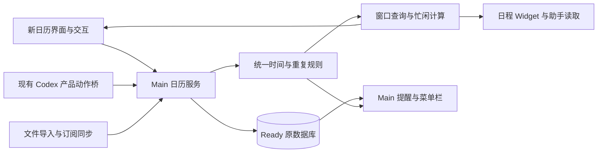

# Ready 日历替换方案

用户已确认本次交付范围为“先完成审计与接入方案”，目标为 `/Users/user/实验田/cod-ready` 当前 0.8.0，包括该目录中已存在的未提交开发内容。本次已完成新旧源码对照、现有数据库只读盘点、基础测试和针对性缺口复现。**按本次范围，不进入模块替换、用户数据库迁移或运行代码修改。** 本文的实施合同是后续开发要求，不是已通过的交付证明。

## 1. 结论与基线

目标版本已确定为主目录当前 Ready 0.8.0。建议把 ready-calendar 的界面与交互移入 Ready，继续使用 `ready.db`。把日程写入、重复规则、导入订阅和提醒收敛到同一个日历服务。不能直接嵌入独立 Tempo 应用，也不能让 `tempo.db` 与 `ready.db` 长期双写。

本聊天工作区的旧版 0.7.1 仅用于保存本次审计文档，不作为接入目标。后续实施必须从主目录 0.8.0 的实际文件状态建立工作副本，不能只取 HEAD 而丢掉尚未提交的开发内容，也不能将本聊天旧版整仓合入主目录。当前目标的相关文件校验值已记录，实施前须检查后续变化。

| 标记 | 实测位置与状态 |
|---|---|
| W：聊天工作区 | `/Users/user/.codex/worktrees/a359/cod-ready`；0.7.1；HEAD `42165805cd7e8d103cf062f6998e5c7d31aba71f`；开始时干净、detached HEAD |
| R：当前 Ready | `/Users/user/实验田/cod-ready`；0.8.0；HEAD `0deeaff2406f5dfe249677eb17b76d77d77a3e04`；存在大量未提交改动，本轮未修改 |
| N：新日历 | `/Users/user/实验田/ready-calendar`；分支 `design/poster-printer-style`；HEAD `3d3f7248a2fc56e21b555d68d540dccc5ddc2f87`；开始时干净，本轮未修改运行源码 |

下文 `R/`、`N/` 均指上述绝对目录。证据文件见 [本轮审计记录](../audits/2026-10-28-calendar-replacement/results.json) 与 [相关源码基线](../audits/2026-10-28-calendar-replacement/source-manifest.json)。这些记录只含合成案例、计数、源码位置和校验值，不含用户日程正文。

重要差异：0.8.0 已把数据库拆为 `database/calendar-store.ts`，助手日历动作由 `codex-product-action-handlers.ts` 在 Main 执行并读回。不能按 0.7.1 的 Renderer handler 接回旧 Agent 链。

## 2. 交付边界与后续替换的完成标准

本轮审计与方案的完成标准：已确认目标版本；列全两套现有功能及归属；把已复现缺口与源码推断区分开；确定数据映射、历史数据风险、接入结构、实施顺序和验证方法；保留可追溯证据。以上已完成。历史全天记录的原录入时区仍需在未来迁移预检中恢复或一次确认，这不阻断方案交付，也不能在实施时被默认猜测。

以下是后续开发完成后必须满足的标准：

1. Ready 原日程、来源、重复例外和提醒可读、可编辑，重启后仍在；迁移前后的有效内容逐字段对照，不能只比总数。
2. 下方功能并集每行都有实际入口和验证结果；仅有字段、按钮或演示数据不算完成。
3. 手动操作、助手操作、订阅同步、提醒、日程卡片使用同一保存结果、同一实例展开规则；关闭日历页面不影响后台提醒。
4. 数据保存失败可见、可恢复；成组操作要么全部完成、要么全部撤回；不能先显示成功再静默丢失。
5. 真实 Electron 隔离数据目录完成新建、拖动、修改、撤销、重复日程、导入导出、订阅、助手、提醒、重启与切换工作面的验收。
6. 全部必要检查通过后才能称“已替换”。本轮只完成审计与方案，不将这些未来验收项标为通过。

## 3. 功能并集与归属

| 功能 | Ready 现状 | 新模块现状 | 接入后的归属与验收 |
|---|---|---|---|
| 日／周／月、多日视图 | 日／周／月 | 1–9 日、月、缩放 | 保留新网格；同一窗口查询，月底与跨年不漏事件 |
| 全天、多天、重叠日程 | 有 | 独立全天栏与布局 | 保留新布局；统一全天日期与结束边界 |
| 拖动创建、移动、缩放 | 有 | 更完整，含 Alt 复制 | 新交互 + Main 确认保存；失败撤回 |
| 多选、复制、剪切、粘贴、复制日程 | 不完整 | 有 | 成组写入；剪切失败不丢源；复制为独立事件 |
| 撤销／重做 | 不完整 | 有，仅内存快照 | 保留会话内撤销；逆操作也经服务确认，不能覆盖助手后来修改 |
| 事件标题、备注、地点 | 有 | 有 | 原字段保留；空值清除与未修改明确区分 |
| 会议链接、网页链接、事件颜色 | 不完整 | 有 | 扩展正式事件字段；打开链接走 Ready 已有安全入口 |
| 参与人、忙闲、可见性、暂定／取消 | 不完整 | 本地记录 | 保留本地语义；不把本地参与人标记宣称成已发邀请 |
| 重复规则与单次／后续／全部 | 有，但有缺口 | 有，但有缺口 | 同一服务处理范围、剩余次数、例外迁移和原子提交 |
| 时区、夏令时 | 显示时区，重复规则不完整 | 墙钟计算、多时区栏 | 保留新显示；Main 统一计算事件时区，UI 与提醒一致 |
| 提醒、声音、错过提醒 | Main 调度与补提醒 | Renderer 轮询、原生卡片 | 保留 Main 调度，吸收新卡片；全天提醒、关闭页面与重启去重补齐 |
| 日历分类、名称、颜色、显隐、默认日历 | 部分仅在界面 | 可持久化 | 全部走 Ready 数据库；显隐与停止同步分开 |
| ICS 文件导入 | 有 | 有且字段较多 | 一套解析与事务导入，完整保留重复例外、时区、提醒和参与人 |
| ICS 文件导出 | 缺少完整入口 | 有 | 保留入口；导出再导入后日期、重复规则与例外不变 |
| URL 订阅、立即／定时同步、取消订阅 | 有 | 无 | 保留 Ready 能力并补同步结果、失败保护与提交后刷新 |
| 搜索、跳转日期、命令菜单、快捷键 | 不完整 | 有 | 搜索全部可访问日程；快捷键只在日历拥有焦点时生效 |
| 空闲时间建议、复制可用时间、创建占位 | 无 | 有 | 保留；忙闲查询不受“是否显示此日历”错误影响，全天忙碌也须扣除 |
| 助手读写、当前窗口与选中日程 | 有，0.8.0 Main 执行 | 无 | 保留当前 Codex 产品动作桥；扩展字段及单次／后续／全部的明确范围 |
| 远程消息中的时间建议、自然语言快建 | 有 | 无 | 接回新编辑器；建议仍需用户采纳，不自动写入 |
| Widget 日程数据与冲突提示 | 有 | 无 | 读取同一窗口服务；忙闲、取消、拒绝参加的规则一致 |
| 语言、时间格式、默认时长、默认提醒 | 部分 | 有 | 日历专属偏好入 Ready settings；主题与启动项遵守应用级设置 |
| 菜单栏下一日程、快捷入会、通知跳转 | 部分／缺少 | 独立桌面壳有 | 合入 Ready 现有应用生命周期；不新建第二个应用壳 |
| ICS 文件打开、深链接 | 不完整 | 有入口，day 链接未消费 | 使用 Ready 自有协议与文件入口；事件／日期都可跳转 |
| Google／Outlook／CalDAV 双向同步、邮件邀请 | 没有本轮可用闭环 | 明确未实现 | 不属于现有功能并集；不增加假账号或空按钮 |

新模块的 `Account.kind='caldav'`、提醒 `method='email'` 等类型成员不代表相应远端能力已实现。保留导入信息并说明不能执行，不自动发邮件、不冒充同步。

## 4. 已确认缺口

“复现”表示运行过合成案例；“源码”表示调用链确认，尚未作为正式修复验收。优先级 P0 为丢数据或错误成功，P1 为替换前必须补齐的正确性。

| 编号 | 级别／证据 | 问题与复现结果 | 根因与处理 |
|---|---|---|---|
| F01 | P0／浏览器复现 | 新模块数据库写入故障后，界面仍显示 1 条事件、无错误提示，刷新变 0 条 | `N/packages/app/src/store.ts:178` 不等待写入；改成提交后读回，错误保留草稿，撤销栈只接收成功操作 |
| F02 | P0／源码 | 新模块拆分系列、批量删除、导入、删分类均逐条写入 | 同处 `apply()` 与 `platform.ts`；以用户操作为一个事务，不按单行 IPC 拼凑成功 |
| F03 | P0／复现 | Ready 收到保留 UID 但缺 DTSTART 的订阅条目，结果 `ok:true` 并删除原有 1 条 | 容错解析把坏条目丢掉，差集删除误认“远端已删除”；解析必须报告完整性，不完整快照不覆盖旧版本；完整校验后才事务替换 |
| F04 | P1／源码 | Ready 增加、改名、颜色、显隐主要只改 Renderer；本地删除不删数据库 | `R/src/renderer/pages/modes/CalendarMode.tsx:490`；增加来源 CRUD 正式入口并读回，分类变动通知所有消费者 |
| F05 | P1／复现 | Ready 纽约 09:00 周会跨 2026-11-01 后仍固定 13:00Z，变成当地 08:00 | `R/.../rrule-engine.ts:195,302,411` 未按事件时区展开；新模块时区算法可作案例参考，不能照搬其不完整频率实现 |
| F06 | P1／复现 | Ready 查询窗口内仍在进行的重复日程、从窗口外移入的例外，均返回 0 | 引擎按开始点筛选，数据库按原实例时间筛例外；改为区间相交，并纳入移入／移出例外 |
| F07 | P1／复现＋源码 | 新模块每日共 3 次，从第 2 次修改“后续”后新系列变 `FREQ=DAILY`；Ready 则直接继承原 COUNT，次数会重新计满 | `N/.../store.ts:241`、`R/.../ipc-handler.ts:600`；按已消费实例数计算剩余次数，同时划分 RDATE、取消与覆盖实例 |
| F08 | P1／浏览器复现 | 新模块一次删除同系列两个实例，只留下一个 EXDATE | `N/.../store.ts:252` 循环读取同一旧母事件，后写覆盖先写；按母事件合并变更后一次提交 |
| F09 | P1／复现 | 新模块 `FREQ=HOURLY;COUNT=3` 的三小时窗口只产出 1 次 | `N/packages/core/src/rrule.ts:164,191` 把小时／分钟／秒频率按日推进；统一引擎必须覆盖 Ready 已支持规则 |
| F10 | P1／复现 | 新模块纽约周会导出再导入，时区变 UTC，冬令时后早 1 小时；RDATE 导入丢失 | `N/packages/core/src/ics.ts:114,153`；保留 TZID／VTIMEZONE、RDATE／EXDATE／RECURRENCE-ID；检验往返实例等值 |
| F11 | P1／源码 | Ready ICS 仅保留基础字段，母事件与例外仅按 UID 会相互覆盖 | `R/.../ics-importer.ts:66,147`、`database/calendar-store.ts:569`；身份区分来源、UID、原实例日期，不能把例外当第二个母事件 |
| F12 | P1／源码 | 新模块跳过全部全天提醒，隐藏日历也被提醒查询排除；Ready 母事件无提醒时也漏掉例外上新增的提醒 | `N/.../notify.ts:10`、`R/.../calendar-store.ts:260`；提醒查询独立于视图显隐，包含例外，Main 调度统一去重 |
| F13 | P1／源码 | Ready 自动订阅完成仅记日志；同步导入后通知使用来源 ID，而调度器匹配事件 ID | `R/src/main/index.ts:756`、`calendar-engine/ipc-handler.ts`、`reminder-scheduler.ts:299`；事务提交返回真实受影响事件，刷新视图并重新排提醒 |
| F14 | P1／源码 | 0.8.0 助手列表只返回少数字段，写入把实例 ID 归一到母事件；不能表达“仅这一次” | `R/.../codex-product-action-handlers.ts:261,360`；工具、授权目标、读取回执与命令都保留结构化实例身份和 scope |
| F15 | P1／源码 | 新模块全局 CSS、`html.dark`、窗口键盘监听会影响 Ready 其他工作面；首次空库还会自动造演示日程 | `N/.../App.tsx:21`、`styles/app.css:4`、`store.ts:128`；局部样式与焦点归属；生产空库仅创建默认分类 |
| F16 | P1／源码 | 新模块空闲建议忽略全天忙碌，默认把拒绝参加者也计为忙碌，按午夜加毫秒计算工作时段 | `N/.../availability.ts:21`；统一忙闲判定与按时区构造墙钟时间，跨夏令时不能直接加 9 小时 |
| F17 | P1／源码 | `tempo://day/...` 被桌面转交，但 App 只处理 event 分支 | `N/packages/app/src/App.tsx:45`；接入时同时验收日期与事件跳转，不照搬无效入口 |

这些缺口不靠增加 UI 按钮解决。共同问题是：多份时间规则、多条独立写入路径，以及没有把“保存完成”当成界面状态的边界。

## 5. 现有数据与迁移策略

只读查询时间为 2026-10-28。真实数据库没有被修改或复制到仓库。

| 数据 | Ready | Tempo |
|---|---:|---:|
| 日历分类 | 4 | 4 |
| 事件记录 | 29 | 13 |
| 全天事件 | 22 | 本轮未统计 |
| 重复母事件 | 0 | 本轮未统计 |
| 例外记录 | 1 | 在事件 JSON 中，本轮未统计 |

Ready 当前没有孤立来源或丢失母事件的例外，但有 1 条例外挂在非重复事件下。保留并在迁移报告标识，不擅自重新启用重复规则或删除历史数据。22 条全天事件的开始时间均为 UTC 16:00，其中 15 条结束于 UTC 15:59、7 条结束于 UTC 16:00；这与 UTC+8 下的 00:00／23:59／次日 00:00 写法相符，但记录没有保存录入时区。本机当前时区是 Asia/Tokyo，不能直接用当前系统时区反推历史结束日。优先恢复原录入时区或既有明确日期证据，无法确定时列出具体差异并一次确认；之后冻结迁移时区并归一为不含结束日的日期范围。不能以 `ceil((end-start)/86400)` 推算天数。

### 5.1 单一正式模型

保留 `calendar_sources`、`calendar_events`、`calendar_event_overrides` 的身份和关联。扩展 Ready 的正式表结构，而非另存整份 Tempo JSON。

| 内容 | 接入决定 |
|---|---|
| 定时事件 | 保留 Unix 秒作为 DB／现有 IPC 的明确单位；新网格使用毫秒只在边界转换一次；起止时区分别保留，不能把 `end_tz` 覆盖成 `start_tz` |
| 全天事件 | 正式模型使用 `startDate/endDateExclusive`；表中使用日期字段，定时字段为空；迁移重建条件约束。旧数值仅在一次迁移中读取，不长期双写两份时间真值 |
| 基础文字与 ID | Ready ID 不变；标题、备注、地点、创建／更新时间原样保留；已有引用不因换 UI 失效 |
| 新标量字段 | 会议链接、网页链接、独立颜色、状态、忙闲、可见性、sequence 增加类型明确的字段 |
| 多值字段 | 参与人、提醒、额外发生日期使用经过验证的 JSON 数组；禁止用一个任意 JSON 包复制整条事件 |
| 重复与例外 | 规则、追加日期、取消、覆盖有明确归属；实例目标是 `{eventId, originalStart}`，显示 ID 不是可直接写入的母事件 ID |
| 导入身份 | 来源 + UID + 原实例标识参与去重；本地事件也有稳定 UID；导出不能重新生成 UID |
| 日历来源 | 显示开关独立于同步开关；名称、颜色、顺序、默认来源、来源时区持久化；订阅内容只读，可复制到本地编辑 |
| 并发版本 | 为实际可修改记录设置递增 revision，避免秒级 updated_at 漏检；UI、助手、同步与撤销写入前核对同一版本 |
| 偏好 | 使用 Ready settings 的日历专属键；应用主题、开机启动归 Ready 应用设置，不增加另一份全局开关 |
| 尚无远端能力的账号 | 本地／订阅来源直接分组，不新增空泛账号系统和 OAuth／CalDAV 表 |

新增字段必须一起经过共享类型、验证、存储、IPC、界面、助手读取与导出；只补数据库列不算完成。全天新约束会让旧时间读者失效，必须在切换之前一次改完所有正式消费者，不留双路径。

### 5.2 迁移步骤

1. 以已确认的主目录 0.8.0 实际状态锁定源码快照，核对本轮文件校验值及之后的变化，记录并保留主目录未提交改动；不能直接用 reset、覆盖或拷贝整个目录混入另一份工作。
2. 对 Ready 数据库做 SQLite 一致性备份，包含已提交 WAL 内容；在独立副本演练恢复、迁移、外键与完整性检查。
3. 保存迁移时区；逐行校验全天边界、例外身份、重复规则。无法确定的历史记录不猜测修复，保留原值和具体诊断并阻止有损切换。
4. 事务中完成表结构与数据转换，保留 ID、关联、提醒及导入身份。失败整体回滚；迁移记录只能在成功后更新。
5. Tempo 的 13 条记录不自动混入 Ready。提供明确的一次性导入入口与计数预览；识别演示数据、重复 UID、ID 冲突后再导入，建立稳定映射，重试不重复。
6. 迁移后的“撤回”通过经过验证的备份恢复进行；已经产生新写入时先导出新增／修改记录，不能直接用旧备份覆盖掉它们。

## 6. 接入结构

- 新网格、编辑面板、菜单、搜索、快捷键布局和纯布局计算可复用。代码收进 Ready 的日历目录并记录来源版本，不依赖运行时访问 `/Users/user/实验田/ready-calendar`。
- 移除独立桌面壳、`window.tempo` 通用 put/del、浏览器 localStorage／JSON 文件回退、演示播种和 Renderer 提醒轮询。需要独立预览时仅用明确测试 fixture。
- `CalendarMode` 保留工作面生命周期、可见范围和选中事件的宿主职责；不再积累事件写入与规则计算。现有文件约 1397 行，应随替换收窄，而非再贴一层桥。
- 日历服务提供窗口查询、事件／来源命令、导入导出与忙闲查询；直接复用 `CalendarStore` 和现有 Main 基础设施。不另起通用工作流框架。
- 日历命令带确切目标、修改范围、预期版本；Main 校验、事务保存、读回后返回结果。窗口切换或过期查询不能覆盖新窗口数据；一次提交产生一次失效通知。
- 新模块现有的 `this/following/all` UI 可以保留，范围计算移到 Main。批量操作、系列拆分、撤销使用同一事务边界；出现冲突刷新后说明原因，不自动覆盖。
- 重复展开优先复用 Ready 已有 `rrule` 依赖，并结合现有时区工具统一墙钟语义；具体实现由 F05–F10 的先行测试裁决。不能同时运行两套行为不同的引擎，不能以简单 DAILY/WEEKLY 快路径绕过时区。
- CSS 限定日历根节点；通用 reset 留在 `@layer base`；主题跟随 Ready；宽窄布局按容器尺寸计算。弹层遵守 BrowserView 隐藏／恢复合同；离开日历后不拦截输入、快捷键或滚轮。
- 当前 0.8.0 的本地日历与飞书只读候选保留各自身份；不把本地新界面描述成飞书日历同步，不复活 DomainAdapter／旧 SDK 执行链。

## 7. 实施顺序与必须跑的合同

以下 C01–C12 是**待新增的行为合同**，不是已经存在的测试。先写失败案例，再改对应实现；不为每个字段写一份重复测试。

| 阶段 | 必须完成 | 验证合同 |
|---|---|---|
| A 基线与模型 | 从已确认的 0.8.0 实际文件建立工作副本，定义新字段、日期与实例身份，完成备份恢复与迁移演练 | C01：旧库内容等值、ID 不变、迁移幂等、故障回滚；覆盖两种全天结束形式 |
| B 唯一写入入口 | 来源 CRUD、批量事件、版本检查、写后读回、成功后通知 | C02：磁盘失败不显示成功；C03：组内任一步失败全部回滚，撤销不覆盖外部新版本 |
| C 时间与重复 | 统一规则、例外窗口、剩余次数、跨天与全天转换 | C04：DST 前后同一当地钟点，UI／提醒等值；C05：移入移出、跨午夜、COUNT／UNTIL、批删与系列拆分 |
| D 导入订阅 | 完整字段导入导出、稳定身份、异常快照保护 | C06：TZID、RDATE、EXDATE、RECURRENCE-ID、参与人／提醒往返等值；C07：部分无效／网络失败不删旧数据，重复导入不重复，成功后刷新及重新排提醒 |
| E 新界面替换 | 新交互、设置、搜索、空闲建议接回；旧 Schedule-X 面及专属依赖撤除 | C08：原 50 项浏览器行为改为 Ready 宿主验证；保存与重启另外穿透真实数据库；C09：切换其他工作面后无样式／快捷键污染 |
| F 产品联动 | 助手、引用、Widget、快建、远程建议、菜单栏、通知点击、深链接 | C10：完整字段和精确 scope 到达存储；写入受现有确认与目标约束；C11：隐藏日历页面仍提醒、全天提醒、睡眠恢复与重启不重复提醒 |
| G 收尾 | 完整功能并集逐行验收，停止双路径，更新唯一权威合同 | C12：同一事件由 UI／助手／订阅修改后，各页面、提醒、搜索与导出结果一致 |

重复频率至少覆盖 DAILY/WEEKLY/MONTHLY/YEARLY 及原库接受的 HOURLY/MINUTELY/SECONDLY；覆盖月底、闰日、夏令时不存在／重复钟点。忙闲计算包含全天忙碌，忽略取消／自己拒绝／明确空闲；显示隐藏不等于不占时间。

提醒的去重凭据应绑定事件、原实例、提醒偏移与实际投递，不靠 Renderer 内存集合。停用通知／静音必须在 Main 生效。邮件提醒只能保留为导入信息，直到具备实际发送能力。

收尾检查：`npm run typecheck`、`npm run verify:calendar`、`npm run verify:native`、CSS reset gate、受影响的当前 Codex 产品动作检查与构建。新增行为测试纳入实际 verify 入口；超过 1000 行的净增文件按现有代码健康规约处理。每项都记录实际结果，skip 不作为覆盖证明。

## 8. 本轮实际验证与边界

| 检查 | 本轮结果 |
|---|---|
| N `npm test` | 18 通过，0 失败 |
| N `npm run typecheck` | 通过 |
| N 原浏览器行为套件（临时复制至审计目录，端口 5312） | 50/50；原输出文件未覆盖 |
| R `npm run verify:calendar` | 176 通过，0 失败，0 skip |
| 补充确定性复现 | F01、F03、F05、F06、F07 新模块分支、F08、F09、F10 已运行，结果见审计记录 |
| 真实用户库 | 只读结构与计数检查；未执行迁移、写入或内容导出 |
| 新旧融合后的 native／Electron／助手闭环 | 尚未实施，不能宣称已通过 |

现有基础测试通过只能说明原测试覆盖的路径正常。上述补测已经证明，直接换界面不能满足功能并集与数据可靠性要求。

审计复跑：`audits/2026-10-28-calendar-replacement/probes/` 内的 `.mts` 用 R 的 `node_modules/.bin/tsx` 运行；两个 `.mjs` 用 Node 运行，先在 N 的 `packages/app` 以 `../../node_modules/.bin/vite --host 127.0.0.1 --port 5312 --strictPort` 启动预览。探针固定引用本轮两份源码路径，只使用合成事件；浏览器探针使用内存存储或注入的失败存储，输出到 `/tmp/ready-calendar-audit-20261028`。它们是缺口诊断脚本，不是已通过的正式回归门。
