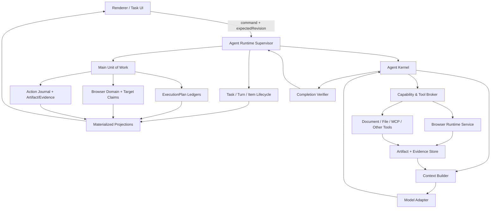
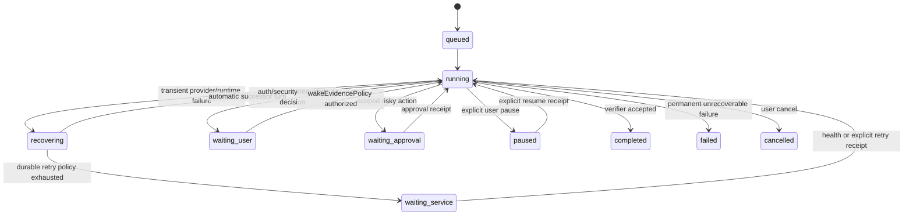

> 原位归档（2026-09-06）：固定历史证据仍引用此路径。保留此路径不代表全文仍是当前合同；其中的状态、源码位置和待办属于原记录。现行约束见 [当前运行时合同](../../architecture/current-runtime-contracts.md)，归档去向见 [文档清单](../../documentation-inventory.md)。

# Ready Durable Agent 与 Browser Runtime 目标架构

## 0. 北极星

用户给出：

```text
参考当前 md，筛选近三个月点赞过千、作者粉丝不超过 5 万的小红书爆款，
并规划接下来一周的 10 条笔记
```

Ready 应在不要求用户补写“打开浏览器”“继续”的情况下：

1. 读懂并补全当前文档；
2. 判断现有资料不足以证明时间、点赞和粉丝条件；
3. 自动启用 Browser；
4. 建立有明确数量与验收条件的工作清单；
5. 在后台完成搜索、核验、淘汰与证据保存；
6. Provider 短暂故障、上下文压缩、窗口切换和 app 重启都不改变任务身份；
7. 只在登录、安全验证、授权或真正缺少用户决策时暂停；
8. 条件全部满足后只交付一次可追溯的最终结果。

这比“像 ChatGPT”更具体，也是后续所有设计的完成标准。

### 0.1 与 2026-07-22 已确认架构的裁决

本文不是第二套 Plan-and-Execute 方案。`2026-07-22-agent-plan-execute-policy-hooks-and-branching-runtime-design.md` 中已经确认的下列合同原样保留：

- 唯一、持久、版本化的 `ExecutionPlan`；
- `NodeAttempt`、`ExecutionCallScope`、Parent budget、provider request；
- resource claim/binding、control/recovery/verifier receipt；
- sealed candidate、acceptance 与唯一 finalizer；
- BrowserResearchState 只保存 Browser 域内动作、候选、证据和检查点；
- ReAct 只作为 direct scope 或单个 plan node 的叶子执行器；
- 普通工具授权与 action journal 保持唯一副作用真值。

本文只补上当时没有统一完成的用户级 `Task/Turn/Item` 生命周期、Browser 运行边界、后台工作面、统一续作和真实验收。实施时禁止同时建立另一套 `Canonical Plan`、通用 `WorkItem`、通用 `ToolCall` 或候选账本。

两份文档在进入实施前必须完成一次 owner 裁决：

1. 以 07-22 的 ledger 和 scheduler 为数据底座；
2. 以本文的 Task/Turn、Browser 边界与联合切换顺序作为增量约束；
3. 把 07-22 frontmatter 标为被本文细化、禁止独立开工；
4. 只有联合切换通过后，才把两份计划同时标为 implemented/superseded-by-runtime。

## 1. 架构原则

### P1. Task 才是用户目标，Turn 只是一次执行尝试

一个用户目标只有一个 durable `taskId`。Provider 重试、上下文换代、app 重启和续作可以产生新 `turnId/attemptId`，不能产生新 task。

### P2. 工具调用是 Turn 内 Item，不是 Task 终态

无论执行 5 次还是 200 次工具，只要 completion contract 未通过，Task 就不能完成。工具次数上限只能触发压缩、换 Turn、降级或暂停，不能静默结束。

### P3. 每类事实只有一个合法写者

Renderer、BrowserView、Provider adapter 和工具实现都不能直接决定 Task 状态。`AgentRuntimeSupervisor` 是 Task/Turn/Item 生命周期的唯一写者；ExecutionPlan、Browser domain、target claim、action journal 与 artifact/evidence 各自由下文具名 repository 写入。它们通过 Main 中的同一 Unit of Work 协调，不能互相复制事实。

### P4. 模型做语义判断，代码做确定性约束

模型负责：

- 理解用户目标；
- 判断缺失事实；
- 选择 capability；
- 生成/调整工作计划；
- 选择下一步；
- 汇总与表达。

代码负责：

- 身份；
- 状态机；
- 权限；
- 预算；
- 重试；
- action receipt；
- Browser owner；
- 结构化验收；
- 终态；
- 恢复。

### P5. 资源充分性决定 capability floor

“用户提到文档”不能关闭 Browser。“用户没说浏览器”也不能关闭 Browser。

判断问题应是：

```text
现有可信资源能否满足每一条验收条件？
```

若不能，缺失事实对应的 capability 必须进入 floor。

### P6. 完整历史、模型工作集和 Artifact 分离

完整事件用于审计；模型只拿当前工作状态和必要近期事件；页面全文、截图、大 JSON 和下载文件进入 Artifact Store。

### P7. Browser control 与 UI visible/active 分离

Agent 能否控制一个 target，不由用户是否正在看该页决定。用户查看 Agent 页不等于接管；只有用户在同一 physical target 上产生真实输入才触发接管。

### P8. transient failure 不升级为用户工作

502、连接断开、runtime 重启、预算换代和压缩不是用户要解决的问题。只要 action effect 可判、checkpoint 可读，supervisor 自动接力。

### P9. 完成是证据判决，不是自然语言声明

模型说“完成了”、progress 达到 total 或 IPC 返回 success 都不能单独完成任务。Completion Verifier 必须读 ExecutionPlan node attempts、Browser domain coverage、receipts、evidence 和 expected outputs。

### P10. 不保留生产双轨

新 kernel 切入生产时，旧权威路径同批删除。开发期可以用离线 fixture 和 shadow validator 比较，但不能在生产中同时维护两个可写 Task 真值。

## 2. 总体结构



Supervisor 只独占 Task/Turn/Item 生命周期，不吞并其他 domain repository。所有可重建 projection 都从下文列出的 canonical stores 重放；UI 永远不能反写任何 canonical store。

## 3. Durable 数据合同

### 3.1 Task

```ts
interface DurableTask {
  taskId: string
  scopeId: string
  originRequestId: string
  objective: string
  status:
    | 'queued'
    | 'running'
    | 'recovering'
    | 'waiting_service'
    | 'waiting_user'
    | 'waiting_approval'
    | 'paused'
    | 'completed'
    | 'failed'
    | 'cancelled'
  activeTurnId: string | null
  revision: number
  acceptanceSpecRef: string
  planRef: string | null
  createdAt: string
  settledAt: string | null
}
```

不保留 `recoverable_paused` 这种既像状态又像恢复能力的混合值。恢复能力由 durable checkpoint 决定，展示状态由 Task 状态决定。

### 3.2 Turn / Attempt

```ts
interface TaskTurn {
  turnId: string
  taskId: string
  attempt: number
  cause:
    | 'initial'
    | 'provider_retry'
    | 'context_rollover'
    | 'process_recovery'
    | 'manual_resume'
  status: 'in_progress' | 'completed' | 'interrupted' | 'failed'
  expectedTaskRevision: number
  startedAt: string
  completedAt: string | null
  terminalReason: string | null
}
```

新 Turn 不改变 taskId、ExecutionPlan、Browser domain state、Browser session 和已接受证据。

### 3.3 Task Item：可观察顺序，不复制域内真值

每个用户级生命周期变化追加不可变 item。涉及 plan、Browser、工具、证据或 checkpoint 时，item 只保存 canonical object 的 identity、revision 和 digest，不复制其完整 payload：

```ts
interface TaskItem {
  itemId: string
  sequence: number
  taskId: string
  turnId: string | null
  kind:
    | 'user_input'
    | 'intent_committed'
    | 'plan_revision_ref'
    | 'node_attempt_ref'
    | 'model_message'
    | 'action_receipt_ref'
    | 'browser_domain_ref'
    | 'artifact_evidence_ref'
    | 'checkpoint_ref'
    | 'waiting_started'
    | 'waiting_resolved'
    | 'context_compacted'
    | 'turn_settled'
    | 'task_settled'
  canonicalRefJson: string | null
  canonicalDigest: string | null
  createdAt: string
}
```

数据库约束：

- `(task_id, sequence)` unique；
- `item_id` unique；
- 单事务追加 item 并更新 Task revision；
- 投影只消费连续 sequence；
- sequence 缺口、重复 settle 或旧 revision 写入直接失败。

### 3.4 唯一调度真值：复用 ExecutionPlan

通用长任务进度只来自 07-22 已定义的：

```text
execution_plan_heads / execution_plan_revisions
execution_node_attempts
execution_call_scopes / execution_provider_requests
execution_parent_budgets / execution_budget_entries
execution_control_receipts / execution_recovery_blocks
execution_candidates / deltas / acceptances / selections
execution_verifier_receipts
```

不得新增 `agent_work_items`。计划节点使用既有 `ExecutionNode`，一次执行使用 `NodeAttempt`。小红书的关键词、候选及字段核验属于 BrowserResearchState 的域内 work items；ExecutionPlan 的 Browser node 只持有 `browserTaskId/checkpoint/evidence watermark`。

Task 进度由 required ExecutionPlan nodes 与 Browser domain coverage 联合派生，禁止由模型直接写 `18/18`。

### 3.5 Tool action：复用授权与 action journal

```ts
interface ToolActionIdentity {
  callId: string
  taskId: string
  turnId: string
  callScopeId: string
  planNodeId: string | null
  toolName: string
  targetRef: string | null
  effect: 'read' | 'reversible_write' | 'external_effect' | 'unknown_effect'
  idempotencyKey: string
}
```

这个 identity 进入现有 authorization/action journal，不新增 `agent_tool_calls`。`execution_control_receipts` 只记调度和政策变化，也不得复制普通工具 allow/result。

约束：

- 相同 `idempotencyKey` 的外部动作最多成功一次；
- timeout 后无法判断效果时进入 `effect_unknown`，必须观察/对账，不能盲重试；
- read 结果也要有 digest，防止续跑时把旧页面当新页面。

### 3.6 Artifact 与 Evidence

```ts
interface ArtifactRef {
  artifactId: string
  taskId: string
  kind: 'document' | 'page_text' | 'screenshot' | 'json' | 'download' | 'summary'
  pathOrObjectKey: string
  sha256: string
  byteLength: number
  mediaType: string
  createdByCallId: string | null
}

interface EvidenceRef {
  evidenceId: string
  taskId: string
  domainItemRef: string
  sourceArtifactId: string
  claimType: string
  extractedValueJson: string
  observedAt: string
  pageIdentity: string | null
}
```

Provider 输入只拿 evidence fact 和 artifact handle，不重复塞完整页面。

Artifact blob 是不可变 canonical object；SQLite 只保存 identity、digest、长度、媒体类型和创建 receipt。Evidence 是 Browser/domain extractor 的 append-only canonical fact。两者都不存进 Task item payload，也不能只靠 Task item 重建。

### 3.7 Canonical store 与 projection 注册表

| store | 类别 | 唯一合法写者 | 可删除重建 | 重建来源 / 冲突裁决 | 事务边界 |
| --- | --- | --- | --- | --- | --- |
| `agent_tasks_v2` | canonical lifecycle head | `AgentRuntimeSupervisor` | 否 | Task items + terminal receipt 用于审计；冲突时 revision CAS 拒绝写入 | Main Task Unit of Work |
| `agent_turns_v2` | canonical execution turn | `AgentRuntimeSupervisor` | 否 | 不重建；旧 turn 只追加结算 | Main Task Unit of Work |
| `agent_task_items` | append-only lifecycle journal | `AgentRuntimeSupervisor` | 否 | `(task, sequence)` 连续序列 | Main Task Unit of Work |
| `execution_*` ledgers | canonical plan/scheduler/call/budget/candidate/recovery | 07-22 `ExecutionSchedulerRepository` / finalizer | 否 | 07-22 immutable revisions、attempt generation 与 receipts；这些表胜过 Task projection | Main Scheduler Unit of Work |
| BrowserResearchState/domain tables | canonical Browser 动作、候选、coverage、域内 checkpoint | `BrowserDomainRepository` | 否 | domain journal/evidence watermark；Task item 只引用 | Main Browser Unit of Work |
| `browser_target_claims` | canonical target owner/generation | `BrowserClaimRepository` | 否 | generation CAS；UI/Browser session projection 无权覆盖 | Main Browser Unit of Work |
| authorization/action journal | canonical 工具准入、副作用与 effect status | 现有 Tool Executor/Action Journal repository | 否 | idempotency key + observation receipt；control receipt 无权覆盖 | Tool Action Unit of Work |
| artifact blob/index | immutable canonical object | `ArtifactStore` | 否 | blob digest readback；索引与 blob 不一致 fail closed | blob write 后的 Main commit |
| evidence index | append-only canonical fact | 具名 domain extractor | 否 | source artifact digest + extractor version | Domain Evidence Unit of Work |
| checkpoint store | immutable canonical snapshot | scope/domain checkpoint writer | 否 | identity + source revision + digest；Task 文案无权声明可续 | checkpoint write 后的 Main commit |
| Task/Browser/UI projections | materialized query view | projection builder | 是 | 从以上 canonical stores 重放；冲突时全部丢弃重建 | canonical commit 后异步投影 |

跨 store 不能靠“都写成功了”保证一致。Main 的 supervisor 发起 Unit of Work：先让 domain/action/artifact writer 结算并返回 immutable refs，再在同一 SQLite transaction 中 CAS ExecutionPlan/claim/Task/Turn、追加 Task item 和 final receipt。外部网页动作不能进入 SQLite transaction，必须用 action journal 的 `started → succeeded | effect_unknown` 与 observation receipt 对账。

## 4. 意图与计划合同

### 4.1 用 `IntentFrame` 替代关键词裁决

第一次模型边界产出：

```ts
interface IntentFrame {
  objective: string
  suppliedResources: Array<{
    resourceId: string
    role: 'input' | 'target' | 'reference'
    completeness: 'complete' | 'excerpt' | 'unknown'
  }>
  acceptanceCriteria: AcceptanceCriterion[]
  missingFacts: Array<{
    fact: string
    freshness: 'static' | 'current' | 'time_bounded'
    sourceClass: 'local_resource' | 'web' | 'browser_session' | 'user'
  }>
  requiredCapabilities: string[]
  planRequired: boolean
}
```

代码验证：

1. 每条 acceptance criterion 是否有可信来源；
2. `time_bounded/current` 外部事实是否绑定 live source；
3. excerpt 是否足以覆盖被引用章节；
4. capability floor 是否包含缺失事实所需能力。

若模型漏掉显然无法从资源得到的动态字段，Resource Sufficiency Verifier 退回一次结构化纠正，而不是让 run 直接回答。

正则可以保留为低权重提示和安全兜底，不能再产生 `excludedDomains` 来关闭合法能力。

`IntentFrame` 不要求额外调用一遍“分类模型”。它是同一 Agent Turn 的首个结构化 item：直接回答可以同时提交 `planRequired=false` 与答案；工具任务可以同时提交 IntentFrame 与首个 capability/plan 动作。只有结构不合法或资源充分性校验失败时才重试该边界。

### 4.2 何时必须计划

满足任一条件必须产生 canonical plan：

- 多个资源；
- 多个目标；
- 多个验收字段；
- 预计 3 个以上独立 ExecutionPlan nodes 或 domain work items；
- 涉及 Browser 研究；
- 涉及可恢复外部动作；
- 需要最终文件/结构化交付。

计划不是给用户看的装饰文本，而是 durable ExecutionPlan nodes 和 dependencies。

### 4.3 Plan 调整

模型可提出：

- add work item；
- split work item；
- reject candidate；
- revise requirement；
- reorder next items。

代码检查：

- 不得删除用户 acceptance；
- 不得把未验证项标 accepted；
- 不得绕过 capability/permission；
- 每次修改有 task revision precondition。

## 5. 工具运行时

### 5.1 两层工具面

永久基础工具面保持小且稳定：

```text
read_resource
activate_capability
list_capability_actions
ask_user
report_progress
commit_plan
request_completion
```

激活 capability 后，只注入当前 work item 需要的 typed actions。Browser 不必每轮永久携带 30+ schemas；也不应把所有 Ready 能力一次性塞给模型。

### 5.2 Tool Descriptor

每个 action 声明：

```ts
interface ToolDescriptor {
  name: string
  capability: string
  description: string
  inputSchema: object
  effect: 'read' | 'reversible_write' | 'external_effect' | 'unknown_effect'
  requiresTarget: boolean
  requiresApproval: boolean
  resultContract: 'inline_facts' | 'artifact_ref' | 'both'
}
```

模型根据 description 选择工具；代码根据 descriptor 执行权限、target、receipt 和结果边界。

### 5.3 Browser 激活

`activate_capability(browser)` 不是任务结束点。返回 Browser discipline 和可用 action 后，Agent Kernel 在同一 Turn 自动再次调用模型。

若 IntentFrame 已声明 browser floor，Kernel 可直接激活，不需要模型再发一次 `use_browser`。

### 5.4 大结果

工具结果合同固定为：

```ts
interface ToolResultEnvelope {
  status: 'ok' | 'error' | 'effect_unknown'
  summary: string
  facts: Record<string, unknown>
  artifactRefs: string[]
  receipts: string[]
  nextStateHints: string[]
}
```

原始 DOM、页面全文、网络记录和截图不能直接常驻聊天 history。它们先入 Artifact Store，模型只拿必要 facts/summary。

## 6. Context Builder

每次 Provider 请求按以下顺序构建：

1. 固定 runtime rules；
2. Task objective + acceptance；
3. canonical plan 摘要；
4. 当前与相邻 ExecutionPlan nodes/domain items；
5. 已接受 evidence facts；
6. unresolved blockers；
7. 最近一小段 turn items；
8. 当前允许的 tool schemas。

不输入：

- 已被结构化 ledger 取代的旧工具全文；
- 重复 screenshot；
- 已结算的长 DOM；
- 所有历史 tool schemas；
- Renderer transient text；
- 与当前 work item 无关的 sibling delta。

Compaction 的输出必须回写：

```text
task facts
plan/node/domain-item changes
accepted evidence
unresolved questions
action receipts
artifact refs
```

不能只生成自然语言摘要。

## 7. 自动续作与故障状态机

### 7.1 状态流



不存在“因为需要新 Turn，所以要求用户说继续”的边。

### 7.2 Provider failure

处理顺序：

1. 同 Turn 最多 6 次 transport retry；只在尚无任何 accepted delta/tool effect 时允许，遵守 Provider `Retry-After`，否则使用 full-jitter exponential backoff。
2. 仍失败时原子写 clean checkpoint、结算旧 call scope、扩展 07-22 的 `execution_recovery_blocks/schedule` 并把 Task 写为 `recovering`。
3. durable recovery schedule 至少保存：

```text
parentTaskId
recoveryEpoch
sourceCallScopeId
consecutiveSuccessorAttempts
firstFailureAt
retryAt
retryAfterSource
lastErrorClass/status
policyVersion
wakeReceiptId?
```

4. 默认硬顶为 30 分钟内最多 3 个自动 successor Turn；到点或耗尽后进入 `waiting_service`，不是 terminal `failed`。UI 显示“服务暂时不可用，任务和进度已保留”。
5. Provider health 恢复、用户显式重试或切换 Provider 可创建新 recovery epoch；健康探测不计入 Task successor attempts，也不能直接完成 Task。
6. startup reconciler 对已到 `retryAt` 的 schedule 幂等唤醒；未到时间不热循环。
7. 唤醒必须 CAS `task revision + status + recoveryEpoch`：
   - cancel 永远胜出；
   - 手动重试先增加 epoch，使旧 timer 失效；
   - steering 进入下一个 successor Turn，但不能与 timer 并发启动第二个 Turn；
   - 旧 wake receipt 重放只能读回原结果。
8. 永久认证/配置错误才进入 `failed`；仍有合法 checkpoint 的服务不可用不得一边 terminal failed、一边宣称可恢复。

### 7.3 进程重启

启动 reconciler 读取：

- running/recovering Task；
- active Turn；
- last contiguous event；
- latest clean checkpoint；
- pending action-journal entries；
- effect_unknown receipts；
- Browser session/target snapshot。

先结算不确定外部效果，再生成 `cause=process_recovery` Turn。不得新建 root task。

### 7.4 用户说“继续”

Continuation 分成两步，定位任务不等于允许恢复。

第一步 `resolveContinuationCandidate`：

1. 当前 scope 有一个 waiting/recovering/paused/waiting_service task：定位该候选；
2. 有多个：展示结构化选择；
3. 没有：按新请求处理。

```ts
interface ContinuationCandidate {
  taskId: string
  checkpointId: string
  browserTaskId: string | null
  expectedRevision: number
  taskStatus: DurableTask['status']
  waitingReason: string | null
  wakeEvidencePolicy: {
    mode: 'allOf' | 'oneOf'
    kinds: Array<
      | 'scheduled_recovery'
      | 'interaction_result'
      | 'site_verification_observation'
      | 'approval'
      | 'explicit_resume'
      | 'provider_health'
      | 'explicit_service_retry'
      | 'provider_change'
    >
  }
  recoveryEpoch: number | null
}
```

第二步 `authorizeWake(candidate, receiptSet)` 按 `wakeEvidencePolicy` 验证每枚 receipt 的 task/checkpoint/revision/reason/target/generation/expiry。完整通过后，它在同一事务铸造一枚幂等 `WakeAuthorizationReceipt`，再创建唯一 successor Turn：

| Task 状态 | wakeEvidencePolicy |
| --- | --- |
| `recovering` | `oneOf(scheduled_recovery, explicit_service_retry)` |
| `waiting_user` 普通必需选择 | `allOf(interaction_result)` |
| `waiting_user/site_security_verification` | `allOf(interaction_result, site_verification_observation)` |
| `waiting_approval` | `allOf(approval)` |
| `paused` | `allOf(explicit_resume)` |
| `waiting_service` | `oneOf(provider_health, explicit_service_retry, provider_change)` |

自然语言、按钮、自动恢复和重启都可调用 candidate resolver，但各自必须提交符合上表的 receipt set。普通“继续”只定位任务和显示未满足条件；它不能自行完成二维码、安全验证、必需选择或审批，也不能把 `waiting_service` 伪装成 provider 已恢复。`allOf` 缺任一枚、`oneOf` 全不匹配、错误/陈旧或不同 task/target/generation 的 receipt 必须零写入。

### 7.5 Steering

用户在运行中补充条件必须携带：

```text
taskId + expectedTurnId + expectedTaskRevision
```

旧消息或旧窗口写入会失败并重新读取当前状态，不能覆盖新 turn。

Steering 是当前活动 Turn 内的 typed event，不因为用户补充一句话就创建新 Task 或新 Turn；只有活动 Turn 已结算时，Continuation Resolver 才决定是否创建 successor Turn。

## 8. Browser Runtime Service

### 8.1 服务边界

第一阶段固定为 Main 内单例 `BrowserRuntimeService` actor，而不是可选 utility process。原因是 Electron `WebContents`、共享 SQLite、Task revision、target claim 和 terminal transaction 必须由同一 Main supervisor 的 Unit of Work 编排：

```text
BrowserSession
  ├─ sessionId
  ├─ ownerTaskId
  ├─ partition
  ├─ status
  └─ targets[]
```

Renderer 只发送 show/hide/focus intent；不能销毁仍被 Task claim 的 session。

Browser actor 可以提出 action/result/claim transition，但不能直接写 Task/Turn terminal。所有 claim、Task waiting item、plan/domain reference 和 projection 由 Main Unit of Work 一次提交。未来若把无状态截图解析等纯计算移入 utility process，它只能返回带 digest 的 candidate，不能拥有 session、claim、Task DB 或 finalizer 写权。

### 8.2 Target identity

target identity 至少包含：

```text
partition
tabId
physicalTargetToken
mainFrameDocumentToken
browserBootId
claimGeneration
```

仅 tabId 不足以跨重载、重建或 app 重启识别同一页面。

### 8.3 Claim

```ts
interface BrowserTargetClaim {
  targetIdentity: string
  owner: 'agent' | 'user' | 'released'
  ownerTaskId: string | null
  generation: number
  leaseState: 'active' | 'suspended' | 'settling'
}
```

规则：

- 同 target 单 owner；
- 不同 target 可独立；
- 用户只对真实输入所在 target 接管；
- Agent 产生的输入回声不触发接管；
- 用户查看、切换或展示 Agent tab 不自动接管；
- target 文档变更后旧 action 立即失效。

### 8.4 Background action

Browser action 作用于 `webContents/target`，不是作用于“当前可见 tab”。读取、等待、截图和已经证明可行的输入动作应在 Agent work tab 后台执行。

点击、滚动、拖拽和隐藏 WebContents 的可信事件是未证明能力，不能作为 B1/B2 实现前提。实施前必须用真实 Electron/macOS spike 分别验证：

- hidden/parked target 的 CDP click/scroll/type；
- 专用 non-user work window/presentation surface；
- 页面收到正确事件且 observation/screenshot 一致；
- 用户继续在 Document 编辑，`BrowserWindow.getFocusedWindow()`、active Ready tab/mode 不变；
- 同 target 的用户真实输入仍可被 takeover detector 识别。

只有其中一个路径通过，才能把它固化为 Presentation Scheduler。两个路径都失败时，Browser 重构停止并修订本架构；不得通过偷切用户 active tab 或伪造后台支持绕过 gate。

### 8.5 Observation barrier

每个 mutation action 后必须有新的 observation receipt：

```text
actionSeq
targetIdentity
documentToken before/after
observationSeq
observedDigest
```

没有新 observation 时不能开始依赖该动作结果的下一步。

### 8.6 Tab finalize

Task/Turn 收口时：

- transient Agent tab：关闭；
- ongoing work tab：保留 claim；
- deliverable tab：明确 handoff 给用户；
- user tab：只释放 Agent claim，不关闭；
- debugger、download grant、file chooser 和 cursor 全部结算。

## 9. Completion Verifier

### 9.1 两层判决

代码 verifier：

- required ExecutionPlan nodes 是否都有合法 NodeAttempt 终态；
- BrowserResearchState 的 mandatory domain items/coverage 是否结算；
- required evidence 是否齐全；
- 数值、时间和来源是否满足硬条件；
- expected artifacts 是否存在且 digest 可读；
- 是否有 unresolved effect_unknown；
- Browser child 与 parent 是否一致；
- 是否仍有 waiting/approval。

Fresh model verifier：

- 最终规划是否真的回答用户目标；
- 10 条内容是否非重复、可执行；
- 结论是否与 evidence 一致；
- 是否错误夸大样本边界。

Fresh verifier 无工具、只读结构化 packet。它不能补做动作或改写 evidence。

### 9.2 原子终态

Artifact/evidence/domain 动作必须先各自在自己的 canonical store 结算并 read back digest。随后唯一 finalizer 在 Main 的同一 SQLite transaction 中一次写入：

```text
all required ExecutionPlan nodes accepted
+ Browser domain coverage/terminal refs and digests
+ expected artifact/evidence refs read back
+ execution_plan_heads.final_outcome_ref
+ Task status=completed
+ Turn status=completed
+ exactly one sealed candidate acceptance to canonical assistant destination
+ task_settled item
+ completion/verifier receipt
```

任一 CAS、digest 或引用检查失败全部回滚。Artifact blob 本身不在 SQLite transaction 中重写；只有已持久且 readback 成功的 immutable ref 才能进入 finalizer。Renderer 只显示 canonical message。

### 9.3 silent success 禁止

以下情况必须 gate 失败：

- IPC success 但无 canonical terminal；
- progress=total 但 result 为空；
- child paused 而 parent completed；
- task completed 但 required evidence 少于 expected；
- app 重启后 canonical message 消失；
- QR/安全验证被写成 completed；
- verifier 没有读到真实 artifact。

## 10. 小红书场景的 canonical acceptance

### 10.1 资源

- 输入文档全文或明确 excerpt + 后续读取 receipt；
- 18 个关键词；
- 本轮固定的 `acceptanceAt`、IANA 时区和由此计算的三个月日历窗口；
- 登录 Browser session。

### 10.2 候选证据

每个最终引用样本至少有：

```text
noteIdentity
sourceUrl or stable page identity
title
author
publishedAt
likes
authorFollowerCount
observedAt
evidence screenshot/page artifact
```

### 10.3 代码侧规则

```text
publishedAt >= now - 3 calendar months
likes >= 1000
authorFollowerCount <= 50000
all three values verified, not inferred
```

每个数值字段同时保存 `rawDisplayedText`、`normalizedValue`、`parserVersion` 和 source artifact digest。解析规则固定为：

- 中文 `万` 按十进制乘以 10,000，`k/K` 按乘以 1,000；
- `1万+`、`999+`、区间、省略值只能得到 bound，只有 bound 本身足以证明条件时才可接受；
- 发布时间相对文本按 `acceptanceAt + timezone` 解析并保留原文本；
- “3 个月前”等边界文本无法定位到确定日期时 fail closed；
- 搜索页的“互动总数”不能冒充点赞；
- 作者名不能冒充作者身份；
- 任何字段无法精确证明阈值时保持 pending/rejected，不靠模型估算。

### 10.4 输出

- 至少 10 个满足规则的 reference records，或明确证明平台可见范围内不足；
- 10 条未来一周笔记规划；
- 每条规划引用一个或多个合格样本；
- 标题方向、开头钩子、内容结构、素材/镜头、CTA；
- 去重检查；
- 数据采集时间和边界说明。

## 11. 失败分类

| class | 示例 | Task 行为 |
| --- | --- | --- |
| transient_provider | 429/502/连接断开 | recovering → 有界自动 successor；耗尽后 waiting_service |
| transient_tool | Browser service 重启 | 恢复 target/checkpoint 后自动重试 |
| effect_unknown | 点击提交后超时 | 先观察/对账，不盲重试 |
| waiting_user | QR、安全验证、必需选择 | durable waiting_user |
| waiting_approval | 下载、上传、外部写入审批 | durable waiting_approval |
| paused | 用户明确暂停 | 保持 checkpoint，等待明确 resume |
| resource_missing | 文档路径消失 | 自动重新解析；无法恢复才 failed |
| target_lost | tab 被用户关闭 | 用 receipt 重建或等待用户，按任务要求判 |
| invalid_plan | capability/evidence 不足 | verifier 退回 Kernel |
| permanent_provider | 认证失效、配置无效 | failed，给出具体修复入口 |
| cancelled | 用户停止 | cancelled，不自动续跑 |

故障类决定恢复策略，不能全部落成 `blocked_tool_error`。

## 12. 可观测性

每个事件至少包含：

```text
taskId
turnId
eventId / callId
workItemId
browserSessionId
targetIdentity
owner/generation
provider attempt
status transition
terminal reason
duration
artifact/evidence refs
```

核心完整性指标：

- `task_without_active_or_terminal_turn`
- `completed_without_canonical_message`
- `completed_with_open_work_items`
- `parent_child_terminal_mismatch`
- `resumable_checkpoint_not_discoverable`
- `tool_result_without_call`
- `duplicate_external_effect`
- `effect_unknown_retried_without_observation`
- `browser_claim_owner_mismatch`
- `projection_revision_gap`
- `renderer_success_without_task_terminal`

全部按 run/task 作用域统计，文件不存在或 DB 无法读取必须 fail closed。

## 13. 非目标

第一阶段不做：

- 多 Browser Agent 并行；
- 同 target 多 owner；
- 让 sub-Agent 直接写共享结果；
- 站点特定小红书脚本代替通用 Browser；
- 用 Computer Use 兜底所有 Browser 缺口；
- 复刻 ChatGPT UI；
- 获取或复制 ChatGPT 服务端私有提示词；
- 为旧 runtime 保留长期兼容分支。

先让一个 Agent、一个 durable Task、多个顺序 Browser work items 稳定完成，再讨论 target-isolated 并行。

## 14. 迁移原则

1. 先用 fixture 写出新事件与状态合同。
2. 新 kernel 在测试进程中完整运行，不接生产 UI。
3. 提供只读 migration，将旧未完成任务转换为新 Task/Turn/Checkpoint；无法证明可恢复的旧任务明确标 failed/recovery_required。
4. 固定实施顺序：

```text
A0–A5
→ B0 + 后台指针可行性 spike
→ B1–B5
→ A6+B6 同一个不可拆 production cutover
→ A7+B7
```

5. 联合切换把 sendScoped、ExecutionPlan scheduler、Browser adapter/continuation 和 Task UI 全部改读新 projection。
6. 同一提交删除旧 Agent/Browser 写路径和旧 fallback；A6 或 B6 不能单独合并。
7. `current-runtime-contracts.md` 只在真实 gate 通过后更新。
8. 不以 feature flag 让两套生产写入长期共存。

实施拆分见：

- `docs/superpowers/plans/2026-07-24-agent-runtime-rearchitecture-implementation.md`
- `docs/superpowers/plans/2026-07-24-browser-unattended-research-implementation.md`
