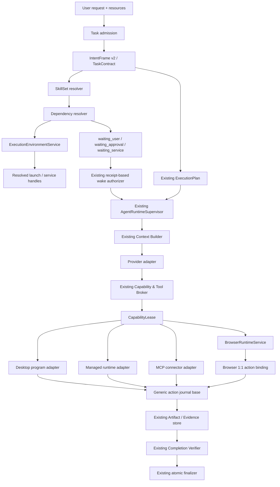
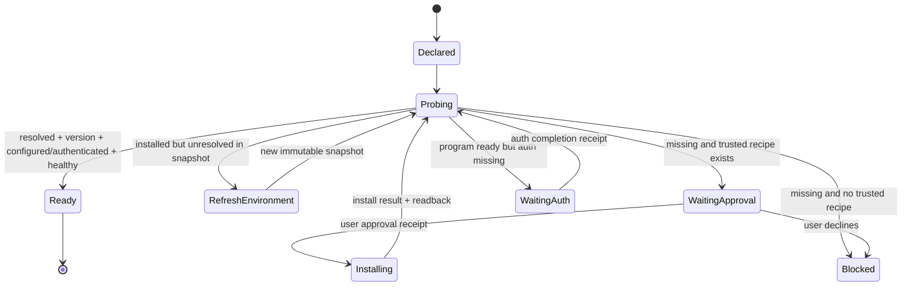

# Ready Agent 统一执行环境目标架构补充提案

## 0. 文档地位

本文是待 owner 确认的 07-24 目标架构补充提案，不是第三套 Agent 架构，也不是当前生产合同。

确认后应把本文的规范性条款合并进：

1. `2026-07-24-ready-agent-browser-target-architecture.md` 的 Intent、Tool Broker、Context、Recovery 与
   Failure Taxonomy；
2. `2026-07-24-agent-runtime-rearchitecture-implementation.md` 的 A2、A4、A5、A6、A7；
3. `docs/architecture/current-runtime-contracts.md` 的 Skill、工具面、确认、连续性与平台章节。

合并并完成实现后，本文改为 `enforce: false / status: merged-and-implemented`，避免长期存在两个详细真值源。

## 1. 北极星

用户说：

```text
用飞书 CLI 查找我上周编辑过的文档，汇总新增的视频条数、支付时长和预算。
```

Ready 应当：

1. 把“查找上周编辑文档”理解为目标，把“飞书 CLI”理解为 required method，而不是领域关键词。
2. 加载 `lark-im`、`lark-drive`、`lark-shared` 等必要 guidance/resource，但只申请当前步骤需要的最小 action。
3. 在同一个桌面执行环境中解析并执行 `lark-cli`；冻结 wrapper/payload、解释器/launcher 的完整
   启动链，不在执行时二次查 PATH/PATHEXT/COMSPEC。
4. 若程序已安装但当前环境没有发现，刷新环境而不是声称“未安装”。
5. 若程序真的缺失，只询问一次是否按可信配方安装；用户拒绝时明确暂停，绝不静默改网页。
6. 安装后重新解析；若未认证，进入 durable `waiting_user`，只保留认证挑战身份与到期时间。
   不允许持久化的 provider 必须在恢复时重新签发设备码/URL。
7. 用户完成认证后，用原 taskId、新 Turn 自动继续原目标，不要求用户重发。
8. 每次命令、外部副作用、结果和 readback 都有持久回执；崩溃后不重复未知副作用。
9. 只有目标、required method、输出和证据全部通过时，发布唯一最终回答。

同一套合同还应自然覆盖 `ffmpeg`、`yt-dlp`、Git、Python、Node、本地设计工具、MCP stdio 和未来的
remote executor；不得为每个 CLI 或产品域新增专用状态机。

## 2. 第一性原则

### P1. 目标、方法、能力、依赖和权限是五件事

- 目标回答“用户要得到什么”。
- 方法回答“必须、优先或禁止怎样完成”。
- 能力回答“哪个执行面能承载该方法”。
- 依赖回答“程序、服务、版本、配置和认证是否就绪”。
- 权限回答“本次 Task 的哪个 action 可以对哪个对象产生什么效果”。

任何一层都不能代替另一层。

### P2. 用户明确方法高于自动 capability floor

资源充分性仍可推导 Browser、Document、Research 等 capability floor，但 required/forbidden method 是更高层的
TaskContract。代码可以因安全、不可用或用户拒绝而停止；不能在 required method 失败后让模型自行换后端。

### P3. Skill 是方法与资源包，不是权限包

Skill 可以声明 dependency 和建议 action；它不能声明程序已安装、已登录、已安全、已授权或可跳过确认。
`metadata.requires.bins` 只产生 dependency requirement。

### P4. resolve 必须等于 execute

依赖探测得到的 launch handle 必须直接进入执行；禁止先用一套 PATH 检查，再在 shebang、
`/usr/bin/env`、PATHEXT、`.cmd` 或 COMSPEC 中以裸名二次解析。若启动链任一身份或环境 digest 漂移，
创建新 attempt 并重新准入，不能静默继续。

### P5. 统一的是政策权威，不是全量环境

Ready 只保留一个 `ExecutionEnvironmentService`。它按用途生成最小环境，而不是把用户 shell、HOME、Cookie、
Provider secret 和所有 PATH 复制给每个子进程。

### P6. 所有外部动作共用持久动作合同

Browser、CLI、MCP、文件、安装和外部 API 共用 action identity、effect、idempotency、result 和 observation
形状；Browser 仍保留 target/claim/document/observation 等更严格的域内校验。

### P7. 安装、配置、认证和业务动作分开结算

安装 exit 0 不能证明程序解析成功；程序解析成功不能证明认证成功；认证成功不能证明业务任务完成。

### P8. 多 Skill guidance 与执行授权分离

一个 Task 可以加载多个 guidance/reference Skill；每个具体 action 只有一个 owner 和一枚最小权限 lease。
不得把所有 Skill 的 actions/primitives 取并集后整体变成 capability floor。

### P9. 恢复沿用同一 Task

环境刷新、安装、认证、Provider retry、context rollover、app restart 都只产生新 Turn/Attempt。依赖状态不得
另建 `EnvironmentRun`、`CliRun` 或 `SkillExecution`。

### P10. 生产只有一个写者

Task/Turn/Item、ExecutionPlan、Action Journal、Artifact/Evidence、Browser Domain 各自只有已批准架构规定的
写者。零新表不是目标；零重复 Task/Plan/Action 生命周期才是目标。每个新事实必须在 canonical-store
registry 中指定 classification、sole writer、owner、immutable/head、CAS、唯一性、FK 与重建规则。

## 3. 总体结构



## 4. TaskContract / IntentFrame v2

07-24 `IntentFrame` 保留 objective、resources、acceptance、missing facts、required capabilities 和
planRequired，并增加以下字段：

```ts
type MethodConstraintMode = 'required' | 'preferred' | 'forbidden'
type MethodFallbackPolicy = 'none' | 'ask_user' | 'allowed'
type DependencyResolutionPolicy = 'use_existing_only' | 'ask_install'

interface MethodConstraint {
  methodId: string
  capability: string
  implementationRef?: string
  mode: MethodConstraintMode
  methodFallbackPolicy: MethodFallbackPolicy
  allowedFallbackMethodIds: string[]
  source: 'user_explicit' | 'resource_contract' | 'policy'
}

interface IntentOutputContract {
  outputId: string
  description: string
  required: boolean
  artifactRef?: string
}

interface IntentEnvironmentRequirement {
  requirementId: string
  kind: 'program' | 'runtime' | 'service' | 'credential' | 'network'
  selector: string
  versionConstraint?: string
  dependencyResolutionPolicy: DependencyResolutionPolicy
}

interface IntentFrameV2 extends IntentFrame {
  version: 2
  methodConstraints: MethodConstraint[]
  outputContract: IntentOutputContract[]
  environmentRequirements: IntentEnvironmentRequirement[]
}
```

### 4.1 语义裁决

- “用飞书 CLI” -> `required local_program / implementationRef=lark-cli / methodFallback=none /
  dependencyResolution=ask_install`。询问是否安装不等于询问是否换成网页。
- “优先用飞书 CLI，不行再网页” -> `preferred`，method fallback 按原话设为 `allowed`，
  `allowedFallbackMethodIds` 只包含 Browser method id。
- “不要打开网页” -> Browser `forbidden`。
- 用户未指定方法 -> 由资源充分性和计划选择最合适 capability，不伪造 required method。
- 安全政策可新增 forbidden method，不能把用户 required method 改写为其他实现。

### 4.2 与 capability floor 的优先关系

按顺序裁决：

1. 系统安全禁止；
2. 用户 required / forbidden method；
3. acceptance 与资源充分性推导的 capability floor；
4. 用户 preferred method；
5. 运行时优化选择。

如果动态事实通常需要 Browser，但 required CLI 也能提供这些事实，则 Browser 不进入 floor；如果 CLI 无法证明
验收且 method fallback 为 `ask_user`，Task 进入等待，而不是自动开 Browser。用户批准替代方法的回执必须
绑定原 method id、替代 method id、原因、作用域和到期时间，不能使用空泛“可以”放开任意后端。

### 4.3 completion 必须核对方法

Completion Verifier 除现有输出和证据外，还检查：

- required method 是否由对应 action receipts 证明；
- forbidden method 是否零 dispatch；
- fallback 是否有允许它的用户或 policy receipt；
- output contract 是否全部 readback。

模型声称“通过 CLI 查到”不能替代 receipt。

### 4.4 direct 与 planned scope

Method 政策变更始终生成 `PolicyDecisionReceipt`，但不强制生成 ExecutionPlan：

- 已有 plan 的 Task 创建新 plan revision 和新 NodeAttempt；
- 原 `execution_admissions` 永远不变；direct Task 在 clean boundary 追加 `PolicyDecisionReceipt`，并创建新
  direct call-scope generation。需要版本化的 effective TaskContract delta 只存于 control receipt/ref，不更新或复制 admission；
- 只有满足 07-22 已有 promotion 条件时才从 direct 升为 planned，不得为记录 fallback 伪造 plan。

`ExecutionNode.methodConstraintRefs` 冻结节点可用方法。`NodeAttempt` 冻结
`skillSetSnapshotRef / dependencySnapshotRef / environmentSnapshotRef / backendBindingRef`；
`ExecutionCallScope.inputDigest` 必须覆盖这些 ref。Direct call scope 使用同样绑定。重试、恢复或第二个
`use_skill` 不得修改活动 attempt；它们必须在 clean boundary 产生新快照、control receipt 和 successor attempt。

### 4.5 时间、身份与集合验收语义

“上周我编辑过的文档”必须在 admission 时生成 typed facts：

- 按用户时区计算的绝对 `[startInclusive, endExclusive)` 时间窗和 calendar 规则；
- 通过认证 readback 得到的 principal receipt；
- “编辑过”的字段语义：`modified_by = principal` 且编辑事件/时间落在窗口，不只是文档最后
  `modified_at` 恰好在窗口；
- 分页 cursor 终止、页数/记录数、去重 key 与 completeness receipt。

若 CLI/API 不能证明“由当前用户编辑”而只能查最后修改时间，Completion Verifier 必须报告验收缺口，
不得悄悄弱化语义。

## 5. SkillSetSnapshot

每个 Task/Turn 绑定内容寻址的不可变 Skill 集：

```ts
interface SkillPackageRevisionRef {
  skillId: string
  version: string | null
  contentDigest: string
  resourceManifestDigest: string
  rootRef: string
}

interface SkillDependencyEdge {
  fromRevisionDigest: string
  alias: string
  toRevisionDigest: string
  allowedResourceIds: string[]
  edgeDigest: string
}

interface SkillSetSnapshot {
  skillSetId: string
  guidanceSkills: SkillPackageRevisionRef[]
  readOnlyDependencyClosure: SkillPackageRevisionRef[]
  dependencyEdges: SkillDependencyEdge[]
  dependencyRequirements: string[]
  collectionDigest: string
  createdAt: string
}

interface SkillResourceRef {
  skillSetId: string
  packageRevisionDigest: string
  resourceId: string
  expectedDigest: string
}

interface ActionOwnerRef {
  packageRevisionDigest: string
  actionId: string
  actionDescriptorDigest: string
}
```

### 5.1 不变量

1. 导入先扫描，再解析只读 dependency closure，最后原子发布 package revision；不能留下半包。
2. symlink、目录逃逸、未扫描可执行载荷、绝对依赖路径、循环、别名冲突和缺失 dependency 关闭失败。
3. 源目录更新产生新 revision 和“可更新”状态；活动 Task 继续旧 digest，下一 Task 才使用新 revision。
4. `use_skill`/guidance loader、提示目录、资源读取和 action owner 都消费同一 snapshot。
5. 多个 guidance Skill 可同时加载；动作权限由计划节点逐个申请，绝不按 Skill 全集取并集。
6. 相邻 `SKILL.md`、references、scripts 和 assets 都是 package resource，不通过 shell `cat` 读取。
7. 资源读取必须提供完整 `SkillResourceRef`，action dispatch 必须提供 `ActionOwnerRef`；不以相对路径或
   action 短名在多个 package root 中猜测。
8. legacy Markdown `../sibling/SKILL.md` 在导入时必须被解析成明确 dependency edge；无法唯一解析时拒绝发布。

### 5.2 资源类型

统一 Resource Broker 至少区分：

```text
skill_package_resource   不可变、只读、绑定 package digest
task_artifact            当前 Task 产生、可写、绑定 action/attempt
user_resource            用户授权文件或文档，读写权限独立
credential_handle        只保存引用，不把秘密值进入 prompt/DB/log
```

产品工具面分别使用 `read_skill_resource` 与 `read_task_artifact`；不再让一个 relative path 在多个 root
之间碰运气。

Skill package revision 是全局不可变安装事实，不存在 task-scoped `artifact_objects` 中假装全局 registry。
SkillSetSnapshot 才是 Task/attempt 绑定事实，其 head/generation 由 canonical snapshot binding 保证。

## 6. DependencyRequirement 与就绪状态

Skill、计划或 Tool adapter 可以声明 requirement，但只有 host resolver 能判定状态。

```ts
type DependencyState =
  | 'declared'
  | 'probing'
  | 'resolved'
  | 'waiting_approval'
  | 'installing'
  | 'configured'
  | 'waiting_auth'
  | 'authenticated'
  | 'healthy'
  | 'ready'
  | 'missing_installable'
  | 'missing_uninstallable'
  | 'failed'
```

Dependency 只回答 resolve/version/config/auth/health，不包含 authorization/permission。`ready` 可以与动作的
`authorization_denied` 同时成立；dependency record 永远不能生成 CapabilityLease。

每个 requirement 有稳定 `requirementId`、owner scope、selector/version digest、generation 和当前裁决 receipt。
不得在 UI 读取时从几个 JSON ref 临时猜当前状态。物理落位必须符合 §16 canonical-store registry；
UI 仍只消费可重建 projection。

### 6.1 真缺失的流程



恶意 Skill 声明的 bin 可被探测为 `ready`，但没有独立 action authorization 时必须返回
`authorization_denied`。这是必测反例，不是错误状态。

### 6.2 安装 recipe

- recipe 由 Ready 信任的 host catalog 提供，绑定平台、架构、来源、固定版本/范围、预期 digest 与 readback。
- 外来 Skill 只能声明依赖，不能提供可自动执行的任意安装命令。
- 用户确认冻结 recipe、参数、目标和风险；用户只回复“可以”时通过 pending interaction 恢复，不重新依赖文本关键词。
- 安装 action 与业务 action 分开记账；安装结束强制使旧 environment snapshot 失效。
- 跨 Task 安装单飞使用现有 `execution_resource_claims`，资源键为
  `dependency-install:<profile>:<selector>:<version>`。获胜 Task 独占安装 action；其他 Task 只等待，然后各自
  重新 probe 并取得自己的 observation/authorization，不跨 Task 复用授权。

### 6.3 认证

- auth challenge 有 task、requirement、provider/program、expiry 和 resume policy。
- device code、URL、QR 或浏览器辅助仅用于完成认证；若 required method 是 CLI，认证网页不等于业务查询 fallback。
- Ready 自己管理的 secret 只存在 Credential Broker；外部 CLI 的 secret 可继续由其原生 credential/config store
  持有，Ready 只保存 program-data grant 与 opaque handle，绝不复制其值。Task/DB/log/prompt 不保存秘密值。
- provider 合同禁止持久设备码/verification URL 时，只存 challenge identity/expiry；app restart 后重新签发，不重放旧 code/URL。
- 需 Browser 认证时，每个 Browser action 必须绑定 `purpose=dependency_auth`、requirement/challenge identity、
  精确 origin/target、允许动作集与 expiry，并继续通过 Browser claim/action/observation。它不能满足业务
  ExecutionNode；无 `dependency_auth` binding 的 Browser dispatch 统计为 required-method 违规。

## 7. ExecutionEnvironmentService

### 7.1 一个权威、多个明确 profile

```ts
type ExecutionEnvironmentProfile =
  | 'internal_sealed'
  | 'desktop_tool'
  | 'managed_runtime'
  | 'connector'
```

- `internal_sealed`：Ready worker、sidecar 等内部程序；最小固定环境，不继承用户工具面。
- `desktop_tool`：用户安装的本地 CLI；使用清洗后的桌面命令搜索路径和 action 级秘密注入。
- `managed_runtime`：Ready 自带 Python/Node/venv 等；由包体 manifest 和安装 readback 决定。
- `connector`：MCP stdio 等长连接；在 desktop base 上叠加 connector 专属配置、生命周期和授权。

Browser 不进入该 Service。Browser 继续由 BrowserRuntimeService 管理 target、claim、physical effect 和 evidence。

### 7.2 环境快照

```ts
interface ExecutionEnvironmentSnapshot {
  snapshotId: string
  profile: ExecutionEnvironmentProfile
  platform: string
  architecture: string
  locale: string | null
  cwdRef: string
  canonicalSearchPaths: string[]
  managedRuntimeRefs: string[]
  envKeyNames: string[]
  credentialHandleRefs: string[]
  programDataGrantRefs: string[]
  sourceDigests: string[]
  digest: string
  createdAt: string
}

interface ProgramDataAccessGrant {
  programIdentityDigest: string
  configRootRef: string
  mode: 'read' | 'read_write'
  homeMapping: 'none' | 'program_scoped'
  xdgMapping: 'none' | 'program_scoped'
  grantReceiptId: string
}
```

持久层只保存 key 名、handle 和 digest，不保存 secret value。全局可缓存的 base discovery 与 Task/attempt 的
snapshot-bound overlay 是两个不同对象：前者不含 task credential/cwd，后者冻结 profile、cwd、program-data grant
和 credential handle。它们的全局/task owner、head、generation 与 CAS 按 §16 落位，不强行塞入 task-scoped
`artifact_objects`。

CLI 可继续使用自己的原生配置与凭据根；Ready 只保存限定根的 grant/credential handle，不复制秘密。
Dependency probe 与真实 execute 必须使用同一 program-data overlay，防止“探测已登录、执行却未登录”。

### 7.3 路径来源与优先级

首批本地实现按确定性顺序合并：

1. Ready-managed runtime 的绝对目录；
2. 用户在 Ready 中明确配置并回读的目录；
3. 平台级可信安装目录和用户工具目录；
4. 用户在 Ready 中显式导入并回读的额外目录。

禁止：

- 为环境发现执行 login shell 或用户 shell rc；rc 超时也可能已产生副作用；
- 保留空 PATH 项或当前目录；
- 未 canonicalize 的相对路径；
- 把工作区目录自动加入 executable search path；
- 让 Skill 自己修改全局 PATH；
- 将 Provider secrets、Browser cookies 或整个 `process.env` 默认传给子进程。

首批实现只使用 deterministic platform discovery + Ready 显式配置，不执行用户 shell rc。若未来确需
导入 shell 环境，必须另立安全设计与用户明确动作，不作为本合同的隐式 fallback。

### 7.4 immutable launch handle

```ts
interface ExecutableIdentity {
  identityDigest: string
  requestedName: string
  platformKind: 'native' | 'script' | 'windows_cmd'
  payloadPath: string
  payloadFileIdentity: string
  payloadDigest: string | null
  version: string | null
}

interface LaunchComponentIdentity {
  role: 'payload' | 'interpreter' | 'launcher'
  absolutePath: string
  realPath: string
  fileIdentity: string
  contentDigest: string | null
}

interface ResolvedLaunchHandle {
  handleId: string
  environmentSnapshotId: string
  executableIdentityDigest: string
  launchComponents: LaunchComponentIdentity[]
  argvPrefix: string[]
  resolverReceiptId: string
}
```

解析器将 shebang、`/usr/bin/env node`、npm shim 和 Windows `.cmd` 展开为完整 identity chain。执行器只接受
handle + argv，直接启动绝对 interpreter/launcher，不接受裸程序名，也不让 shebang/env/PATHEXT/COMSPEC
再解析。`.cmd` 必须绑定绝对 `cmd.exe` handle 与唯一 quoting 合同；该合同未通过前 Windows 只支持 `.exe`。

每个 profile/attempt 生成自己的 snapshot-bound launch handle。不同消费者只能对账到同一
`ExecutableIdentity`，不共享 handleId、credential overlay 或 lease。

spawn 前重新核对所有 launch component 的 identity、owner 与可写父目录；若变化，旧 action 不执行，创建新
attempt 并重新准入。这能缩小但不宣称彻底消除 TOCTOU；高风险或可写链必须复制到 Ready 管理的
只读内容寻址 store，或使用平台级不可变 identity binding。真实 race gate 必须证明替换时关闭失败。

环境 base 可以按安装/配置变更缓存，attempt snapshot 永远不可变。并发任务共享只读 base，不共享 action lease、
cwd、credential overlay 或结果。

## 8. CapabilityLease

Dependency ready 不等于可以执行。CapabilityLease 是既有 authorization receipt 的强类型扩展，
不是第二张授权账本。Tool Broker 在 dispatch 前签发最小租约：

```ts
interface CapabilityLease {
  leaseId: string
  taskId: string
  turnId: string
  callScopeId: string
  planNodeId: string | null
  nodeAttemptId: string | null
  skillSetId: string | null
  actionId: string
  environmentSnapshotId: string | null
  launchHandleId: string | null
  programDataGrantRefs: string[]
  effect: 'read' | 'reversible_write' | 'external_effect' | 'unknown_effect'
  targetPolicyDigest: string
  frozenArgsDigest: string
  confirmationReceiptId: string | null
  expiresAt: string
}
```

### 8.1 谁能声明 effect

- Ready 内置、签名的 action descriptor 可声明机械可验证 effect。
- 外来 Skill 的文字或 manifest 不能把 `unknown_effect`/`external_effect` 降成 `read`。
- raw shell 默认 `unknown_effect`，必须有独立授权和更强隔离；它不是 `requires.bins` 的自动 fallback。
- 只读声明仍需代码侧核对 argv schema、目标与 result contract。

### 8.2 行动确认

当前“未列入首批工具默认 M4”不能继续作为统一 Tool Broker 的默认。目标策略是：

1. 先从注册 action descriptor + frozen args 机械推导 effect；
2. 不能证明只读时按 `unknown_effect` 保守处理；
3. 确认绑定具体 action、handle、argv digest、target 和一次性/会话范围；
4. 预批准只跳过确认卡，不跳过 dependency、environment、allowlist、schema、lease 和 action journal。

## 9. Tool Broker 与 Action Journal

不直接泛化当前 `agent_action_journal`。该表强制 Browser task/plan/node/attempt，tool group 也只允许
Browser 枚举。目标 schema 是：

- 通用 action base：task、turn、call scope、可空 plan/node/attempt、action identity、唯一 effect、args digest、
  state、result/idempotency；
- Browser 1:1 extension：browser task、domain item、target/session/claim/generation、Browser sequence 和
  observation policy；
- Browser descriptor 必须在同一事务中写入 extension 并通过合法 claim；非 Browser action 禁止写 Browser binding。

迁移后继续复用唯一通用 action journal/observations、`ToolResultEnvelope`、Artifact/Evidence store 以及
execution call scope/control/verifier receipts。该 schema 迁移必须与 Browser B6 同批切换，不能先把 Browser
表改成宽松 nullable schema 单独上线。禁止新增第二张通用工具账本。

### 9.1 每个 action 的最小闭环

```text
prepared
-> authorized
-> started
-> succeeded | failed | cancelled | effect_unknown
-> observation/readback（当 result contract 需要）
```

每个 provider-visible tool call 必须恰好配一个持久 terminal ToolResultEnvelope；如果进程在外部效果后崩溃，
先进入 `effect_unknown`，由 adapter-specific observation/reconciliation 解决，禁止原样重试。

### 9.2 desktop program adapter

执行输入：

```text
CapabilityLease
ResolvedLaunchHandle
argv array
stdin artifact/inline ref
cwd ref
timeout
result contract
```

执行输出：

```text
exit code / signal / duration
stdout/stderr artifact refs
structured records
file/network/external observation refs（若有）
environment/launch-chain digest readback
```

不经 shell 是默认路径。确需脚本时，脚本本身是 package resource，有 digest；解释器也是 launch component。

### 9.3 MCP 与 setup

- MCP stdio 消费 connector profile + launch handle；配置只有连接成功、授权 readback 和 artifact digest
  固定后才提交。
- setup/installer 不再拥有独立 PATH builder；它是高风险 Action adapter，消费同一环境服务与可信 recipe。
- 禁止连接时隐式安装，包括 `npx -y package@fixed-version`。Trusted recipe 必须先下载，校验
  registry integrity/签名与 digest，原子发布到 Ready 管理的只读 store，再用 immutable launch handle 离线启动。

## 10. Supervisor、Retry 与恢复

### 10.1 唯一 owner admission

所有 ingress——本地发送、渠道消息、自动播报、定时任务、安装/认证 wake——先经过 canonical Supervisor。
Orchestrator 不得在 admission 前清理旧 owner 或写第二个 running run。

同一 Task 最多一个 active Turn：

- 有活动 Turn 的 follow-up -> typed steering receipt；
- 不支持 steering -> 明确 queue/refuse，不声称已交给当前任务；
- 新 root request -> 新 Task；
- recovery/wake -> 同 Task successor Turn。

### 10.2 Provider retry 只有一个 owner

- transport/request 层负责一次 provider request 内的有限 wire retry；
- Supervisor 负责 exhausted 后的 successor Turn；
- 模型循环不得再次对已经 exhausted 的请求做同层重试；
- accepted text delta、tool call 或外部 effect 出现后，重试必须先走 effect/session reconciliation。

### 10.3 dependency wake

`waiting_approval`、`waiting_auth`、`waiting_service` 使用现有 candidate resolver + receipt-based wake authorizer。
用户“可以”“已登录”“继续”、按钮和 app restart 都定位同一 candidate；只有匹配 receipt 才建立一个 successor。

### 10.4 durable 与 cache 分离

Task、Turn、Item、plan、action、artifact、environment/skill/dependency snapshot binding 和 wake receipt 必须在
canonical store。`os.tmpdir()` 只允许保存可丢失的缓存、流片段和诊断，不承担恢复唯一真值。

### 10.5 Supervisor 统辖的 Unit of Work 家族

不把非终态事实塞入 finalizer。唯一 Supervisor 调用四类具名 UoW：

- admission UoW；
- waiting/recovering transition UoW；
- successor UoW；
- terminal finalizer UoW。

Finalizer 只负责原子终态。Dependency waiting 和 startup recovery 引用 Action Journal/recovery facts，不复制它们。

## 11. Context Builder 与最小工具面

Context Builder 每次只发送：

1. 当前 TaskContract 和 plan node；
2. 当前 SkillSet 中与 node 有关的 guidance/resource 摘要；
3. 已 resolve 的 dependency 状态，不发送 secret；
4. 当前 node 可申请的 action descriptors；
5. 最近必要的 ToolResultEnvelope 与 artifact refs；
6. completion gaps。

不得发送：

- 全部 Skill 的所有权限；
- 与当前 node 无关的 Browser/Document/RSS/Calendar 工具；
- 89 个工具的静态全集；
- 全量环境值、PATH 文本或凭据；
- 已经进入 ledger 的大 stdout、页面全文和大 JSON。

显式 `required local_cli` 且 Browser forbidden 的任务，provider wire 上 Browser 工具数必须为 0；未选择的
Skill action 也必须为 0。

## 12. IPC、UI 与完成语义

`agent:sendScoped` 不再用一个 `success:boolean` 同时表达 transport、admission 和 outcome。目标返回：

```ts
interface AgentAdmissionResponse {
  accepted: boolean
  requestId: string
  taskId: string | null
  turnId: string | null
  admissionReceiptId: string | null
  taskSnapshot: TaskProjection | null
  rejection?: { code: string; message: string }
}
```

Task 完成、失败、取消或等待由后续 projection/canonical item 表达。Renderer 不从 `accepted=true` 猜绿色完成。

依赖卡片应明确区分：

- 程序已安装但 Ready 环境未发现；
- 程序真的缺失且可安装；
- 安装完成、等待认证；
- 认证完成、正在继续原任务；
- 用户拒绝，任务已暂停且没有改用其他方法。

## 13. 失败与 fallback 矩阵

| 场景 | 规范行为 | 禁止行为 |
| --- | --- | --- |
| 终端有程序、旧 app snapshot 无 | 刷新环境，创建新 attempt，resolve/readback | 声称未安装；直接 Browser |
| 程序真实缺失且有可信 recipe | `waiting_approval`，只询问一次 | Skill 自带安装命令自动运行 |
| 用户拒绝安装 | paused/blocked，保留 Task | 静默 Browser/sidecar fallback |
| 安装 exit 0 但 resolve 失败 | 安装 action 成功，dependency 仍未 ready，给出诊断 | 把任务判完成 |
| 程序就绪但 auth 缺失 | `waiting_auth`，持久 challenge | 每轮重复问；丢失原任务 |
| required method 执行失败 | 按该方法重试/恢复/明确失败；methodFallback=ask 时询问指定替代方法 | 模型自由换工具 |
| preferred method 失败且 fallback=allowed | 追加 policy receipt；planned 修订 plan，direct 修订 call-scope contract | 无回执切换；direct 伪造 plan |
| executable identity 漂移 | 旧 lease 失效，新 attempt 重新准入 | 继续用 PATH 找到的新文件 |
| 外部效果发生、结果未落盘 | `effect_unknown` + observation | 原样重试 |
| Provider wire retry exhausted | 同 Task successor 或 waiting_service | 模型循环再乘一层 retry |
| 第二条同 scope 消息 | steering/queue/refuse；旧 owner 保持 | 清掉旧 liveness 或新建第二 owner |
| Browser 只用于 CLI 认证 | 每个 action 有 `purpose=dependency_auth` 与 challenge/target/expiry binding；认证后回 CLI | 把认证 Browser 当任务 fallback；无 binding 业务 dispatch |

## 14. 安全与性能边界

1. PATH 中删除空项、相对项、当前目录和不可访问路径；保留确定性优先级。
2. 完整 launch chain 解析为绝对身份，执行前重新核对；同时检查 owner/父目录可写性，高风险链进入只读 store。
   这个边界防 PATH hijack 并缩小 TOCTOU，不宣称用 pre-spawn stat 完全消除 race。
3. Skill 子进程不默认继承完整 HOME、Provider keys、Browser cookies、SSH agent 或全部 `process.env`；
   已批准 CLI 只取得 program-scoped config root/HOME-XDG mapping。
4. Credential 只按 action descriptor 注入具名 handle；日志只记 key 名/digest。
5. raw shell 是独立高风险 action；禁止 `requires.bins` 自动开启。
6. installer 绑定可信 recipe、来源、版本和 readback；并发安装按 dependency key 单飞。
7. 环境 discovery 可缓存，但安装、设置和文件身份变化会使 cache 失效；不为环境发现启动 login shell/rc。
8. cwd、output dir、Skill resource root 分离；可写 cwd 不代表可读 HOME。
9. stdout/stderr 有大小上限并进入 artifact；敏感字段在落盘前过滤。
10. macOS、Windows、Linux 的 adapter 行为由同一合同测试；绝不复制跨平台 node_modules、包体或环境快照。

## 15. 生产不变量与零值指标

联合切换后必须持续为零：

```text
required_method_violated
forbidden_method_dispatched
fallback_without_policy_receipt
dependency_declared_as_authorized
resolved_handle_environment_mismatch
executable_identity_drift_executed
tool_call_without_terminal_result
tool_result_without_call
effect_unknown_retried_without_observation
multiple_active_turns_per_task
legacy_terminal_writer_invoked
skill_snapshot_digest_drift
environment_secret_persisted
projection_revision_gap
```

这些指标来自代码合同和持久 readback，不由模型判断。联合 gate 必须输出版本化 JSON report，
每项包含 `metricId / collectorVersion / sourceDigest / taskScope / runScope / windowStart / windowEnd /
quiescenceAt / observed / allowed / evidenceRefs`。Collector 的 SQL/日志窗口与非零退出码是 gate 源码的一部分。
`projection_revision_gap` 允许在传播窗口内短暂存在，但在 quiescence + canonical readback 后必须为 0；其余零值项
按 action/task terminal 边界采样，不用“某一瞬间”的无上下文计数。

## 16. Canonical-store registry

编码前必须先将下表落成一份 schema decision 和机器 gate。现有表只有真能保证下列属性时才能复用；
否则允许一个具名 domain-fact store。禁止的是重复 Task/Plan/Action 生命周期，不是所有新 schema。

| Fact | Classification / owner | Sole writer | Head / CAS / uniqueness | Rebuild rule |
| --- | --- | --- | --- | --- |
| Task / Turn / Item | Task-scoped canonical | Supervisor UoW | 复用 07-24 revision/CAS | projection 可删后重建 |
| SkillPackageRevision | global immutable registry | Skill package importer | content digest 唯一；不使用 task artifact 伪装全局表 | 源可丢，已发布 revision 不变 |
| SkillSetSnapshot | immutable value + scoped binding | SkillSet resolver via Supervisor | task/turn/attempt 或 direct scope + generation；expected prior digest CAS | 由 package refs + dependency edges 重放 |
| DependencyRequirement | scoped domain fact | Dependency resolver via Supervisor | stable requirement id + selector digest + generation；唯一当前裁决 | 由 probe/install/auth/health receipts 重放，不重放权限 |
| EnvironmentBaseSnapshot | global immutable cache object | ExecutionEnvironmentService | profile/platform/source digest 唯一；无 task secret | 可重建，清除不改变已绑定 attempt |
| AttemptEnvironmentSnapshot | attempt/direct-scope immutable binding | ExecutionEnvironmentService via Supervisor | owner scope + generation；expected prior digest CAS | 由 base + cwd/config/credential handles 重放，secret 不落盘 |
| ExecutableIdentity / LaunchHandle | immutable object bound to environment snapshot | ExecutionEnvironmentService | identity-chain digest / handle id 唯一；handle 不跨 profile/attempt | 身份漂移后废弃，不就地修改 |
| CapabilityLease | authorization receipt extension | Tool Broker | action/call/attempt 唯一；expiry/revocation/confirmation 机械校验 | 不由 dependency 重建或自动签发 |
| Action Journal | generic canonical base | Tool Broker/action adapter UoW | action id + revision/idempotency 唯一 | result/observation 重放，不从 projection 猜 |
| Browser action binding | Browser 1:1 extension | BrowserRuntimeService UoW | action revision FK + valid target/claim/generation；Browser action 必有 | Browser evidence 从 extension + observations 重放 |

`artifact_objects` 可继续保存 task artifact/evidence，但它当前的 task scope 不足以自动承担全局 Skill registry 或
Environment base。`execution_resource_bindings` 也只有扩展 owner/authority/CAS 后才能承担 snapshot head，不能用
`authority_claim_ref_json` 自由文本隐式扩充。

## 17. DomainAdapter 边界

DomainAdapter 只能提供 domain facts、typed action descriptors 和 evidence verifier。Scheduler/orchestrator 不比较具体
adapter id；DomainAdapter 不得写 Task、决定 method fallback、自建 plan 或绕过 Tool Broker。现有未被生产调用的“端到端调度”
接口应删除或缩成上述 facts 接口，并由 call-graph gate 防止回潮。

## 18. 明确非目标

- 不为飞书、Lark 或特定 CLI 硬编码业务流程。
- 不把 Browser 放入命令执行器，也不削弱 Browser target/evidence 合同。
- 不开放任意 shell 作为统一环境的代名词。
- 不让 Skill 自动安装依赖或自动读取用户 HOME。
- 不复活 `skill_executions`、workflow coordinator 或新增 CLI 状态机。
- 首批不实现 Docker/SSH/remote executor；合同允许未来 adapter，但只交付 local desktop + managed runtime + MCP connector。
- 不为保留旧行为建立生产双写或 legacy fallback。
- 不在 `AgentSdkRuntime`、turn orchestrator 或 domain adapter 中加入产品名特例。

## 19. 与现有架构的最终裁决

本文只增加四类缺失事实：

1. IntentFrame 的方法、fallback、输出与环境要求；
2. SkillSet 的内容和依赖身份；
3. execution environment / immutable launch handle；
4. dependency readiness / CapabilityLease。

它们按 §16 registry 作为 execution admission、snapshot binding、call scope 和 action/control receipt 接入现有
07-22/07-24 边界。Task/Turn/Item、ExecutionPlan、通用 Action Journal、Browser Domain、Artifact/Evidence、
Supervisor 和 Finalizer 仍是唯一权威。任何实施提案若要求复制这些账本，应在编码前被拒绝。
