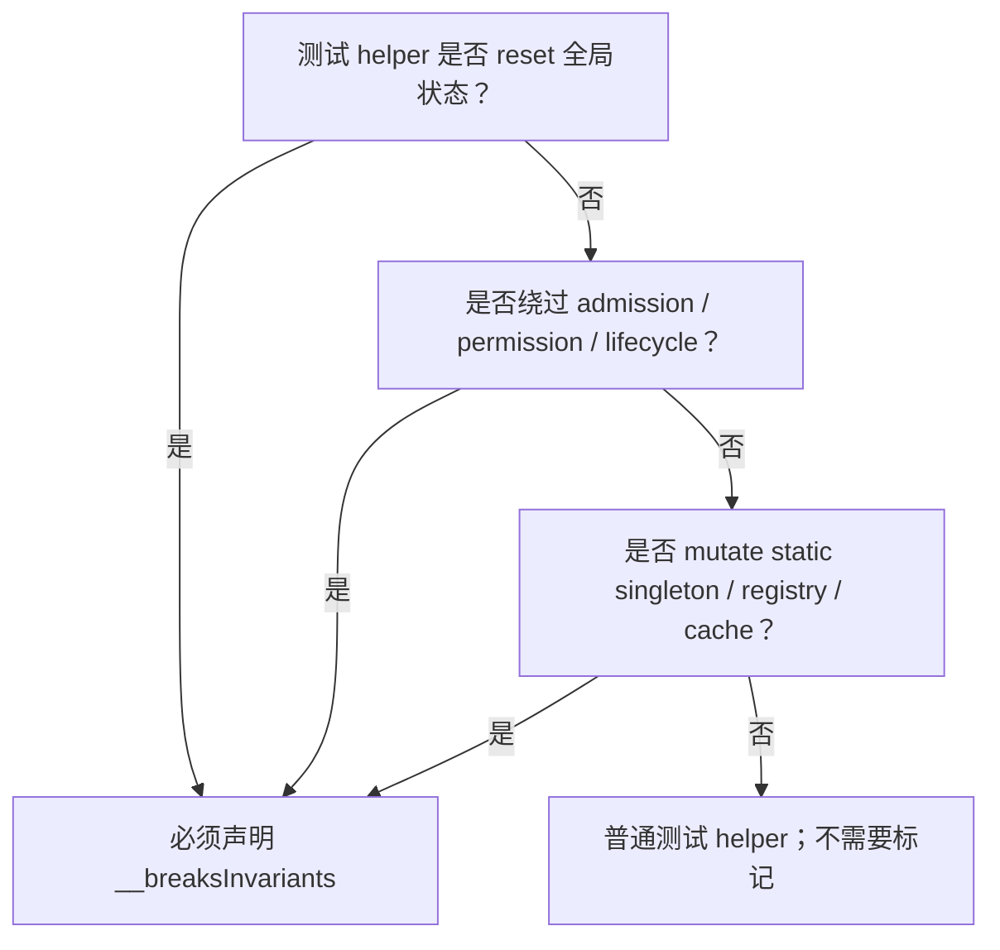

# Ready 测试规约

本规约用于 F 阶段之后的新测试和测试整改。目标是让测试证明真实行为，只有在行为边界无法直接观察时才保留结构检查，并且把破坏生产 invariant 的测试 helper 显式标出来。

## 行为测试 vs 结构测试

行为测试调用真实公开函数、真实策略入口或最小可替换依赖，然后断言用户可观察结果、状态变化、错误结构、日志事件或任务投影。默认优先写行为测试。

结构测试检查源码、导出形状或文件拓扑。它只适合低层硬契约无法通过行为观察证明的场景，例如 E 阶段 `atomic-write.test.ts` 对 fsync 顺序的源码检查，或注册表里某个 LLM-facing 工具必须不存在的删除契约。

反模式：
- 在 `src/__tests__` 中读取 `.ts` / `.tsx` / `.js` 源码再用正则断言。
- 只断言类型、字符串片段或函数名，没有触发真实调用路径。
- mock 太多，最后只证明 mock 按预期返回。

source-grep 豁免只允许两种有理由形态：
- Recommended: `// allow-source-grep: <product reason>`; reason grep/reviewable; W2 checks non-empty reason.
- Acceptable: `// eslint-disable-next-line ready/no-source-grep-test -- <reason>`; ESLint-standard; E atomic fsync source inspection stays.
- Forbidden: reasonless waivers.

反模式 -> 行为测试示例，基于 `src/__tests__/tool-loop-dedup.test.ts`：

```ts
// 反模式：读 turn-engine.ts 源码，检查 helper 里没有 video_expert 字符串。
const source = readFileSync(resolve(process.cwd(), 'src/main/modules/agent-control/turn-engine.ts'), 'utf8')
assert.doesNotMatch(source, /video_expert/)
```

```ts
// 行为测试：安装两个真实 registry definition，再断言长任务判断只看 executionTimeoutMs。
installSkillToolDefinitionForTest('skill_generic_long_action', { executionTimeoutMs: 30 * 60 * 1000 })
installSkillToolDefinitionForTest('skill_video_expert_pipeline', { executionTimeoutMs: 60 * 1000 })

assert.equal(isLongTypedSkillActionName('skill_generic_long_action'), true)
assert.equal(isLongTypedSkillActionName('skill_video_expert_pipeline'), false)
```

## __breaksInvariants 协议

测试 helper 如果破坏生产 invariant，模块必须导出非空 `__breaksInvariants`：

```ts
export const __breaksInvariants: readonly string[] = [
  'singleton.skill-child-runner.never-reset-mid-session',
] as const
```

判定流程：



如果 helper 名称是 `__reset*ForTests`、`__seed*ForTests`、`__stub*ForTests`、`__forceFlush*ForTests` 或 `__breakOpen*ForTests`，先按必须标记处理；确认无破坏时用 `__noProductionInvariantBreach = true` 明确说明。

## e2e 测试边界

e2e 必须穿透真实子进程、真实 runtime 边界或真实外部二进制依赖。只要还在 fake driver、fake runtime、fake repository 里重建 contract，就不是 e2e。

适合 e2e 的情况：
- 风险来自进程边界、文件系统 sidecar、ffmpeg/scenedetect 这类真实依赖。
- 单元测试已经覆盖分支逻辑，但仍无法证明组合链路能启动、产出和关闭。
- 失败只会在生产环境出现，mock 会掩盖问题。

不适合 e2e 的情况：
- 纯函数、单模块策略或 schema 校验可以直接证明。
- 行为可通过最小 stub 观察，且真实依赖不会改变结论。
- 测试只为了提高覆盖率数字，运行成本却明显拖慢默认链路。

e2e 默认 opt-in，使用 `READY_E2E=1` 单独运行；默认 `npm test` 和常规 `verify:*` 不应依赖慢速 e2e。

## fixture 提交规约

- 二进制 fixture 默认小于 2MB；超过需要单独说明理由。
- mp4、大 JSON、压缩包等 fixture 所在目录必须有 README，写明产生命令、来源和可替代生成方式。
- 不提交真实用户数据、真实私密会话、真实 token、真实远程附件。
- fixture 必须稳定可复现；依赖网络实时下载的材料不进入默认测试。

## 测试运行模式表

| 命令 | 覆盖范围 | 默认场景 |
|---|---|---|
| `npm test` | 常规单元与集成测试，不跑 opt-in e2e | 本地快速回归 |
| `npm run native:check` | Electron runtime 下打开 `better-sqlite3`、创建内存库并执行 smoke query | 验证 native ABI 与 Electron 匹配 |
| `npm run verify:native` | `rebuild:native` 后立刻跑 `native:check` | SQLite-backed 改动的最小验收门 |
| `npm run test:a0:focus` | A0 流程门与配套焦点测试 | 改动 A0 gate / plan pairing 时 |
| `npm run verify:*` | 阶段化硬门；后续阶段必须串起前序阶段 | 合并前阶段验收 |
| `node scripts/check-testing-conventions-doc.cjs` | 本文档、CLAUDE.md、AGENTS.md 的测试规约锚点 | W3 及后续文档同步 |
| `READY_E2E=1 npx tsx@^4.19.2 --test --test-concurrency=1 src/__tests__/e2e/*.e2e.ts` | opt-in 真链路 e2e | 专门验证子进程或真实依赖 |

普通 Node 下的 SQLite 相关测试允许因 ABI 不匹配而 skip，但这些 skip 不能作为 SQLite-backed 验收通过的证据。涉及真实 DB、设置持久化、搜索索引或 skill task persistence 的验收必须跑 Electron native gate；`npm run dev` 和 `npm run build` 也必须在进入应用/构建前先通过该 gate。
