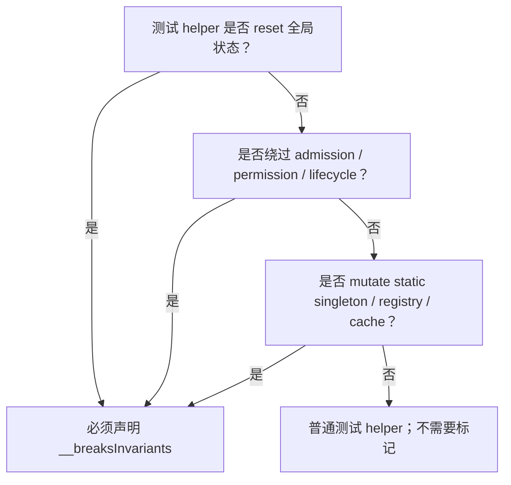

# Ready 测试规约

> 核对日期：2026-09-06。具体测试文件与执行顺序以 `package.json` 和脚本实现为准。

本规约用于 F 阶段之后的新测试和测试整改。目标是让测试证明真实行为，只有在行为边界无法直接观察时才保留结构检查，并且把破坏生产 invariant 的测试 helper 显式标出来。

## 按变更范围选择验证

- 纯文档、技能描述或参考路径调整：检查格式、有效链接、双份指引同步和受影响的技能注册/读取；不因文件改动就默认运行全量测试或打包。
- 提示词或技能流程改变：用有代表性的任务核对能否按授权完成、是否误触发、是否保留必要边界；文字检查只能证明结构，不能代替模型实际使用结果。
- 代码行为改变：选择真实入口的焦点测试与所属专项；类型改变运行 `typecheck`，持久化改变运行 `verify:native`，原生界面改变补真实 Electron 验证。以下硬合同仍适用。
- 检查脚本的实际副作用后，使用隔离夹具的本地测试可在当前授权内反复修正本次问题。真实账号、联网与用户数据检查按原有授权范围执行；命令名字包含 test 不代表没有外部影响。
- 所需检查已通过后，只有新修改、失败或未解决的疑点才增加验证；不为凑覆盖率新增与实现逐字对应的测试，不为减少测试而跳过既有必跑项。

## 行为测试 vs 结构测试

行为测试调用真实公开函数、真实策略入口或最小可替换依赖，然后断言用户可观察结果、状态变化、错误结构、日志事件或任务投影。默认优先写行为测试。

结构测试检查源码、导出形状或文件拓扑。它只适合低层硬契约无法通过行为观察证明的场景，例如进程入口的导入边界，或注册表里某个 LLM-facing 工具必须不存在的删除契约。

反模式：
- 在 `src/__tests__` 中读取 `.ts` / `.tsx` / `.js` 源码再用正则断言。
- 只断言类型、字符串片段或函数名，没有触发真实调用路径。
- mock 太多，最后只证明 mock 按预期返回。

source-grep 豁免只允许两种有理由形态：
- Recommended: `// allow-source-grep: <product reason>`; reason grep/reviewable; W2 checks non-empty reason.
- Acceptable: `// eslint-disable-next-line ready/no-source-grep-test -- <reason>`; ESLint-standard; E atomic fsync source inspection stays.
- Forbidden: reasonless waivers.

现行例子：`src/__tests__/history-continuation-native.test.ts` 通过真实数据库验证当前恢复行为；`src/__tests__/composer-state.test.ts` 验证编辑和发送边界。旧循环的源文件和旧测试示例不能当成当前执行入口。

## __breaksInvariants 协议

测试 helper 如果破坏生产 invariant，模块必须导出非空 `__breaksInvariants`：

```ts
export const __breaksInvariants: readonly string[] = [
  'singleton.skill-child-runner.never-reset-mid-session',
] as const
```

判定流程：



如果 helper 名称是 `__reset*ForTests`、`__seed*ForTests`、`__stub*ForTests`、`__forceFlush*ForTests` 或 `__breakOpen*ForTests`，先按必须标记处理；确认无破坏时用 `__noProductionInvariantBreach = true` 明确说明。

## e2e 测试边界

e2e 必须穿透真实子进程、真实 runtime 边界或真实外部二进制依赖。只要还在 fake driver、fake runtime、fake repository 里重建 contract，就不是 e2e。

适合 e2e 的情况：
- 风险来自进程边界、文件系统 sidecar、ffmpeg/scenedetect 这类真实依赖。
- 单元测试已经覆盖分支逻辑，但仍无法证明组合链路能启动、产出和关闭。
- 失败只会在生产环境出现，mock 会掩盖问题。

不适合 e2e 的情况：
- 纯函数、单模块策略或 schema 校验可以直接证明。
- 行为可通过最小 stub 观察，且真实依赖不会改变结论。
- 测试只为了提高覆盖率数字，运行成本却明显拖慢默认链路。

e2e 默认 opt-in；通用夹具使用 `READY_E2E=1`，Codex 专项使用各自的 `READY_CODEX_E2E`、`READY_CODEX_E3E` 等开关。默认 `npm test` 不自动证明真实外部服务可用；部分显式 `verify:codex-runtime-*` 会启动二进制或联网，运行前查看该脚本。

## fixture 提交规约

- 二进制 fixture 默认小于 2MB；超过需要单独说明理由。
- mp4、大 JSON、压缩包等 fixture 所在目录必须有 README，写明产生命令、来源和可替代生成方式。
- 不提交真实用户数据、真实私密会话、真实 token、真实远程附件。
- fixture 必须稳定可复现；依赖网络实时下载的材料不进入默认测试。

## 测试运行模式表

| 命令 | 覆盖范围 | 默认场景 |
|---|---|---|
| `npm test` | 常规单元与集成测试，不跑 opt-in e2e | 本地快速回归 |
| `npm run test:serial-performance` | 串行运行 `*.serial.test.ts(x)` 性能合同，保留真实墙钟门槛 | 对并发负载敏感的性能验收 |
| `npm run native:check` | Electron runtime 下打开 `better-sqlite3`、创建内存库并执行 smoke query | 验证 native ABI 与 Electron 匹配 |
| `npm run verify:native` | 重编 native、ABI smoke，再在 Electron 中串行运行 Codex、历史恢复、记忆、迁移等真实数据库测试 | SQLite-backed 改动的必跑入口；具体集合以清单为准 |
| `npm run test:a0:focus` | A0 流程门与配套焦点测试 | 改动 A0 gate / plan pairing 时 |
| `npm run verify:*` | 命名专项或阶段切片；依赖关系以脚本为准，不保证覆盖其他专项 | 按变更范围验收 |
| `node scripts/check-testing-conventions-doc.cjs` | 本文档、CLAUDE.md、AGENTS.md 的测试规约锚点 | W3 及后续文档同步 |
| `READY_E2E=1 npx tsx@^4.19.2 --test --test-concurrency=1 src/__tests__/e2e/*.e2e.ts` | opt-in 真链路 e2e | 专门验证子进程或真实依赖 |

普通 Node 下的 SQLite 相关测试允许因 ABI 不匹配而 skip，但这些 skip 不能作为 SQLite-backed 验收通过的证据。涉及真实 DB、设置持久化、搜索索引或 skill task persistence 的验收必须跑 Electron native gate；`npm run dev` 和 `npm run build` 也必须在进入应用/构建前先通过该 gate。

需要断言真实执行耗时的测试使用 `*.serial.test.ts(x)` 后缀；默认并行 runner 会通用排除这类文件，再由串行 runner 统一发现和执行。不得为了让并发全量测试通过而放宽产品性能门槛。

## Stage 5 covenants — test 归属与 sqlite skip 纪律

Stage 5 把"哪些测试在哪条 verify 入口跑"与"sqlite 相关测试如何 skip"做成 CI 强制：

- **C1 orphan-coverage**：`src/__tests__/**/*.test.ts` / `src/__tests__/**/*.e2e.ts` / `eslint-rules/__tests__/**/*.test.{mjs,ts}` / `scripts/__tests__/**/*.test.cjs` 的每个文件，必须被某个 `verify:*` / `test:*` 脚本（含 glob、跨脚本调用递归展开）引用，否则要在 `scripts/test-coverage-exemptions.json` 的 `exempt[]` 中显式登记 `path / reason (≥ 10 字符) / since (ISO) / owner`。
- **C2 no-silent-failures**：`npm run test` 退出码 0 的同时 fail 计数必须为 0；由现有 `test` 链承担。
- **C3 sqlite-direct-skip**：测试文件命中以下 load 形态之一时，必须导入并使用 `src/__tests__/utils/sqlite-skip.ts` 提供的 `skipIfSqliteUnavailable(t, label)`：
  - `require('better-sqlite3')`
  - `await import('better-sqlite3')`
  - `import 'better-sqlite3'` (副作用)
  - `import ... from 'better-sqlite3'` 的 value import (`import type` 与"整组 type-only 命名 import"被排除)
- **C4 sqlite-transitive-skip**：测试文件**直接** value-import 任一 `nativeBackedModule` (gate 启动时由 `grep better-sqlite3 src/main src/shared src/preload` + `database.ts` / `db-worker.ts` seed 合成) 时，同样要用 helper；如果该测试只用 fake 注入、不会触发 native 加载，可在 `scripts/test-coverage-exemptions.json` 的 `c4Exempt[]` 登记。
- **C5 挂载事实**：覆盖与 SQLite skip 检查挂在 `verify:k`，并经阶段链被 `verify:cloud` 引用；本机 `verify` 当前不直接挂这两项。修改测试归属时显式运行这两个检查，不能从旧 Stage 5 文档推断已覆盖。

### canonical skip token schema

`skipIfSqliteUnavailable` 在 host Node 失败路径上向 `t.skip()` 传入：

```
[ABI-SKIP][<reason>] <label>: <error.message>; covered by npm run verify:native
```

`<reason>` 取值固定为：
- `native_abi_host_mismatch` (error.code === `ERR_DLOPEN_FAILED`)
- `binding_missing` (error.code === `MODULE_NOT_FOUND`)
- `sqlite_runtime_error` (其他)

这套 token 让外部审计可以静态判定 "这次 skip 是 ABI 不匹配（合规）" 还是 "测试自己 t.skip 了别的东西（不一定合规）"。

### 当前验证链

```text
verify -> verify:native -> verify:version -> typecheck -> silent-catch / move-only / CSS / IPC -> test
verify:cloud -> rebuild:native -> verify:t -> test -> verify-native-trigger
verify:t -> verify:s -> verify:r -> 既有阶段链
verify:s -> verify:native（除上面的前序链与本阶段检查外）
test -> test:parallel -> test:serial-skill-child -> test:serial-performance
```

因此 `verify:cloud` 当前也会通过 `verify:s` 进入真实 Electron native 验证；不能再声称它完全不需要 Electron。CI 环境能否运行这些工具必须实际验证。

当前产品重点切片包括 `verify:history-continuation`、`verify:single-ready-memory`、`verify:remote-im`、`verify:document-reading`、`verify:widget-ready`。`verify:remote-im-live` 使用本地协议夹具；真实账号收发与包体安装验收需要独立证据。

上述链条是核对日的概要，不复制整份脚本参数。历史 gate 分类、旧失败台账与已结束的测试改造见 [全量文档清单](../documentation-inventory.md)。
